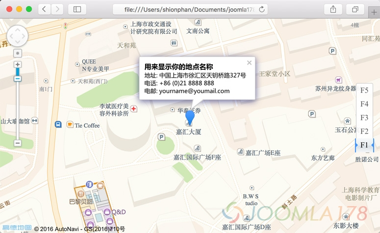
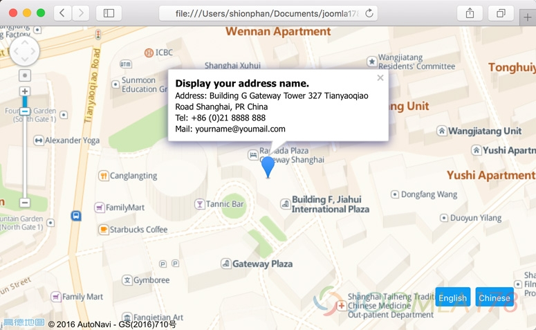

# 使用高德地图API生成带标的专属地图

自从加入新东家之后，就天天泡在js工作中，做梦都在调接口，正好学以致用帮朋友做一个地图显示功能，本来一直用的google地图自然是不能用了，然后比较了一下百度、高德！做前端工作的人自然就选择了界面优美功能完善的高德，下面就介绍一下如何使用高德地图的标注功能生成一张你的专属位置地图。

## 1. 准备工作

### 1.1 申请地图APIKEY

1. 首先，你得注册一个高德账号或者你得有个某宝账号。
2. 访问 <http://lbs.amap.com/dev/> 在我的应用中创建一个新应用。
3. 点击“添加新Key”，选择“JavaScript API”，提交即可创建成功。
4. 在我的应用列表中可以看到新创建的一个JS应用key。

### 1.2 获取地图坐标

1. 访问地图坐标页面 <http://lbs.amap.com/console/show/picker>
2. 输入地点获取坐标，或者双击地图某个点获取坐标，右侧数值保存备用。

## 2. 创建地图应用代码

### 2.1 创建一个基础地图

新建一个新的html，编入以下代码：

```
<!DOCTYPE html>
<html>
<head>
    <meta charset="utf-8">
    <meta http-equiv="X-UA-Compatible" content="IE=edge">
    <meta name="viewport" content="initial-scale=1.0, user-scalable=no, width=device-width">
    <title>基本地图展示</title>
    <link rel="stylesheet" href="http://cache.amap.com/lbs/static/main1119.css"/>
    <script src="http://cache.amap.com/lbs/static/es5.min.js"></script>
    <script src="http://webapi.amap.com/maps?v=1.3&key=您申请的key值"></script>
    <script type="text/javascript" src="http://cache.amap.com/lbs/static/addToolbar.js"></script>
</head>
<body>
<div id="container"></div>
<script>
    var map = new AMap.Map('container', {
        resizeEnable: true,
        zoom:20,
        center: [121.443472, 31.188923]
    });
</script>
</body>
</html>
```

非常简单，一系列基础依赖放在</head>中之前，创建一个用来显示地图的<div></div>，在</body>之前声明一个地图对象即可，resizeEnable表示可缩放，zoom表示初始缩放级别，center则表示当前需要显示地点的坐标。

### 2.2 创建对应坐标的标注点

根据标注的API，新增一个marker对象

```
var marker = new AMap.Marker({
    map: map,
    position: [121.443472, 31.188923]
});
```

map表示使用上述地图对象，position表示当前marker显示的坐标位置，也就是地图中心点位置。

这时候加载地图就可以看到一张对应坐标和有标注点的地图，我们需要对地图进行完善的设计，增加标注地点的详细信息显示、支持中英文切换显示地图和标注显示。



## 3. 增加支持中英文地图及中英文标注弹框

### 3.1 创建弹框模型

创建了setInfoWindow()方法，用来渲染弹框的html结构，并且设置它的位置偏移

```
function setInfoWindow() {
  var info = [];
  info.push("<div style=\"font-family:\'Microsoft YaHei\',Arail,sans-serif\"><strong style=\"font-size:14px;margin-bottom:4px;\">用来显示你的地点名称</strong>");
  info.push("地址: 中国上海市徐汇区天钥桥路327号");
  info.push("电话: +86 (0)21 8888 888");
  info.push("电邮: 该 Email 地址已受到反垃圾邮件插件保护。要显示它需要在浏览器中启用 JavaScript。</div>");
  infoWindow = new AMap.InfoWindow({
    offset: new AMap.Pixel(0, -30),
    content: info.join("<br/>") //使用默认信息窗体框样式，显示信息内容
  });
  //弹框弹在中心点位置
  infoWindow.open(map, marker.getPosition());
}
```

这里主要用到AMap.InfoWindow()方法，offset用来设置这个弹框的偏移量，然后再使用.open方法显示在标注对应的坐标点上。当然这里的marker.getPosition()也可以通过setInfoWindow()设置参数来传递。

### 3.2 增加显示弹框的事件支持

经过上面一步的渲染设计，需要在标注点选择事件触发这个详情弹框，比如地图加载完成、点击标注点、鼠标经过标注点，这里我们选择的是地图加载完成事件，那么使用API中的“[地图加载完成事件](http://lbs.amap.com/api/javascript-api/example/event/map-loading-complete-event/)”来初始化。

```
map.on('complete', function() {
  setInfoWindow();
});
```

### 3.3 增加中英文支持切换

高大上的中英文，很多情况下就会用到了，这里高德地图就提供了这样的解决方案：[英文、中文地图](http://lbs.amap.com/api/javascript-api/example/map/map-english/)

首先创建按钮组DOM元素

```
<div class="button-group">
  <input id="en" type="button" class="button" value="English" />
  <input id="cn" type="button" class="button" value="Chinese" />
</div>
```

脚本中增加点击事件，使用地图的事件方法AMap.event.addDomListener()，绑定好click事件之后调用了map.setLang()方法使用地图能够正常切换中英文。

```
//切换语言点击事件
['en', 'cn'].forEach(function(btn) {
  var button = document.getElementById(btn);
  AMap.event.addDomListener(button, 'click', function(){
    map.setLang(this.id);
    setInfoWindow(this.id);
  })
});
```

改变弹框渲染方法，我们要给渲染方法传入点击按钮的id作为其参数，用来渲染中英文详情，修改setInfoWindow()方法如下：

```
function setInfoWindow(lang) {
  var info = [];
  if(lang == 'cn'){
    info.push("<div style=\"font-family:\'Microsoft YaHei\',Arail,sans-serif\"><strong style=\"font-size:14px;margin-bottom:4px;\">用来显示你的地点名称</strong>");
    info.push("地址: 中国上海市徐汇区天钥桥路327号");
    info.push("电话: +86 (0)21 8888 888");
    info.push("电邮: 该 Email 地址已受到反垃圾邮件插件保护。要显示它需要在浏览器中启用 JavaScript。</div>");
  }
  if(lang == 'en'){
    info.push("<div style=\"font-family:Tahoma,Arail,sans-serif\"><strong style=\"font-size:14px;margin-bottom:4px;\">Display your address name.</strong>");
    info.push("Address: Building G Gateway Tower 327 Tianyaoqiao Road Shanghai, PR China");
    info.push("Tel: +86 (0)21 8888 888");
    info.push("Mail: 该 Email 地址已受到反垃圾邮件插件保护。要显示它需要在浏览器中启用 JavaScript。</div>");
  }
  infoWindow = new AMap.InfoWindow({
    offset: new AMap.Pixel(0, -30),
    content: info.join("<br/>") //使用默认信息窗体框样式，显示信息内容
  });
  //弹框弹在中心点位置
  infoWindow.open(map, marker.getPosition());
}
```

上述方法意思就是把点击切换语言按钮的id传入setInfoWindow()作为条件判断输出中文还是英文。这样我们就完成了中英文标注详情界面显示



## 总结

- 以上仅是一个实例影子，作为对于高德地图的应用抛砖引玉，主要参考来自高德地图实例代码：<http://lbs.amap.com/api/javascript-api/example/map/map-show/>
- 本文完整代码详见：<https://github.com/shionphan/amap-marker>
- 演示地址：<http://demo.joomla178.com/amap-marker/map.html>

---

除特殊标明文章转自第三方网站，文章均由JOOMLASK.COM原创提供  
欢迎友情转载，请务必保留本文出处并引用本文链接： [使用高德地图API生成带标的专属地图](http://www.joomla178.com/joomla-share/front-end/amap-marker.html)
