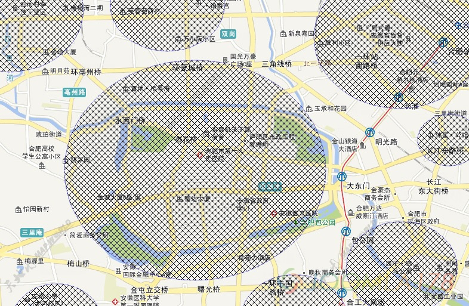
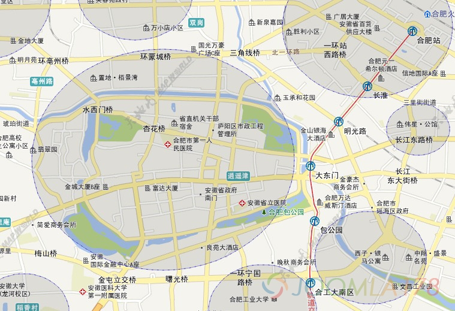

# Arcgis绘制线条边框样式

在Arcgis中根据面数据来绘制网格或者轮廓图时，大多时候我们看到的都是粗粗的实线，用户体验较差，Arcgis提供对动态图层的样式自定义，比如国际边界线、省际边界线可以通过不同样式来表现。

自定义样式主要使用的是 esri/symbols/SimpleFillSymbol 方法，参考API：<https://developers.arcgis.com/javascript/3/jsapi/simplefillsymbol-amd.html#simplefillsymbol2>

```javascript
require([
  "esri/symbols/SimpleFillSymbol", "esri/symbols/SimpleLineSymbol", "esri/Color", ... 
], function(SimpleFillSymbol, SimpleLineSymbol, Color, ... ) {
  var sfs = new SimpleFillSymbol(SimpleFillSymbol.STYLE_SOLID,
    new SimpleLineSymbol(SimpleLineSymbol.STYLE_DASHDOT,
    new Color([255,0,0]), 2),new Color([255,255,0,0.25])
  );
  ...
});
```

其中 SimpleFillSymbol.STYLE\_SOLID 和 SimpleLineSymbol.STYLE\_DASHDOT 分别表示填充样式、 边框线条样式，其形义表达和css中的边框样式基本相同，但在面的处理上会有较多的选择，小编在工作中抽出时间特意整理如下：

**线条可用样式：**

```javascript
STYLE_DASH:"dash" // 常规虚线
STYLE_DASHDOT:"dashdot" // 常规虚、点线
STYLE_DASHDOTDOT:"longdashdotdot" // 常规虚、点、点线
STYLE_DOT:"dot" // 常规点线
STYLE_LONGDASH:"longdash" // 长虚线
STYLE_LONGDASHDOT:"longdashdot" // 长虚、点线
STYLE_NULL:"none"
STYLE_SHORTDASH:"shortdash" // 短虚线
STYLE_SHORTDASHDOT:"shortdashdot" // 短虚、点线
STYLE_SHORTDASHDOTDOT:"shortdashdotdot" // 短虚、点、点线
STYLE_SHORTDOT:"shortdot" // 短点线
STYLE_SOLID:"solid" // 线条
```

面的填充样式比较新颖，有网格状、线条状、菱形状，可以自行调试

**面填充可用样式如下：**

```javascript
STYLE_BACKWARDDIAGONAL:"backwarddiagonal" //左下线条
STYLE_BACKWARD_DIAGONAL:"backwarddiagonal"
STYLE_CROSS:"cross" //方格
STYLE_DIAGONALCROSS:"diagonalcross" // 菱形
STYLE_DIAGONAL_CROSS:"diagonalcross" // 菱形 没看出什么区别
STYLE_FORWARDDIAGONAL:"forwarddiagonal" //右下线条
STYLE_FORWARD_DIAGONAL:"forwarddiagonal" // 右下线条 没看出什么区别
STYLE_HORIZONTAL:"horizontal" //横条
STYLE_NULL:"none"
STYLE_SOLID:"solid" // 纯面
STYLE_VERTICAL:"vertical" // 竖条
```

按照DEMO，我们来做个示例

```javascript
require([
  "esri/symbols/SimpleFillSymbol", "esri/symbols/SimpleLineSymbol", "esri/Color"
], function(SimpleFillSymbol, SimpleLineSymbol, Color) {
  var sfs = new SimpleFillSymbol(
     esri.symbol.SimpleFillSymbol.STYLE_DIAGONALCROSS, // 填充面样式菱形
     new SimpleLineSymbol(
        SimpleLineSymbol.STYLE_SHORTDASHDOTDOT, // 边框线条样式
        new Color([51,51,204,2]), // 边框线条颜色，支持alpha
        1 // 边框线条宽度
     ),
     new Color([0,0,0,0.1]) // 填充颜色（测对线条状的填充面无效）
  );
});
```



再把STYLE\_DIAGONALCROSS 换成 STYLE\_SOLID，此时填充面的颜色、alpha都生效了



本文所做DEMO，会在后期开放

---

除特殊标明文章转自第三方网站，文章均由JOOMLASK.COM原创提供  
欢迎友情转载，请务必保留本文出处并引用本文链接： [Arcgis绘制线条边框样式](http://www.joomla178.com/joomla-share/front-end/arcgis-draw-line-style.html)
