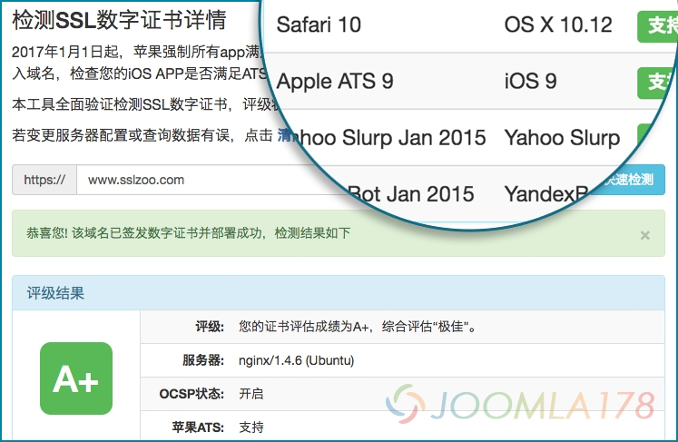

# SSL验证工具开发思路



SSL部署成功后判断是否安装成功，除了浏览器小锁之外就是一些在线验证工具，但是如果部署不合理的话，它也只是个花瓶摆设，比如我们看这篇文章：[增强 nginx 的 SSL 安全性](https://github.com/LCTT/TranslateProject/blob/master/published/201505/20150415%20Strong%20SSL%20Security%20on%20nginx.md)（备用链接：<https://www.sslzoo.com/112>），也就是得在ssllabs上测试验证部署并且评估等级，那如果我要做的话就两条路径，第一是基于ssllabs的api开发一个检测页面，第二则是通过header和php中的openssl功能来实现解析。

综合评估，sslabs提供的API全面，还提供各种模拟设备的握手检测，比如苹果ATS适配检测，此外同样具备ssllabs的评级功能，所以有了 **[SSL在线验证工具](https://sslzoo.com/sslcheck/)，**或者搜索公众账号：sslzoo，提供了CSR生成、SSL检测、ATS检测工具，简单说一下开发思路：

**接口开发**

小篇开发最快的方式是选择了php，原API提供的接口数据较为庞大，基于analyze的方法输出了所有详细参数，后再二次封装输出自己想要的接口内容：

```
cert:{} //证书chainCert:{} //证书链host:"" //域名ips:[] //IPkey:{} //加密port:443 //端口progress:'' //查询进度protocols:[] //传输协议status:"" //状态statusDetails:'' //状态内容statusMessage:'' //状态消息suites:{} //加密套件ocspStapling: //ocspsims:{} //握手测试
```

**前端开发**

其实开始是想用vue.js作为前端框架，后来觉得这么个小工具没必要，于是jquery一路写到头。前端如果不用框架的话，渲染html太费事，而且请求接口为了用户体验表现进度、分步渲染，使用的是递归、缓存的方式分五大类逐步渲染，此外API还提供传递是否查看远程API缓存数据的方式，适用于服务器变更部署等验证，UI使用的是bootstrap的界面。具体使用开发者工具查看吧：<https://sslzoo.com/sslcheck/>

话说第三方API也会有不靠谱的时候，后面计划使用php的openSSL扩展开发ATS检测小工具。

还是软文的意义，买证书：<http://sslzoo.taobao.com>，加入讨论：<http://www.sslzoo.com>，扫描二维码使用工具


---

除特殊标明文章转自第三方网站，文章均由JOOMLASK.COM原创提供  
欢迎友情转载，请务必保留本文出处并引用本文链接： [SSL验证工具开发思路](http://www.joomla178.com/joomla-share/front-end/base-on-openssl-dev-ssl-check.html)
