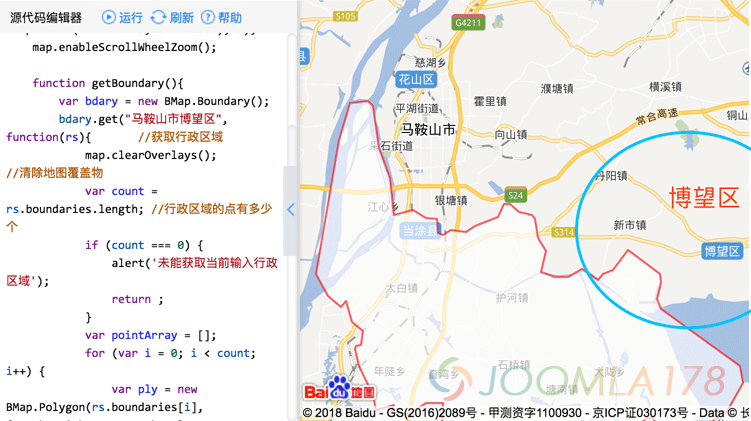
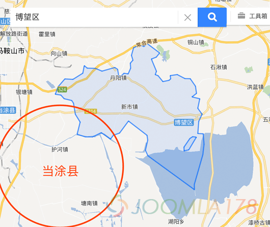
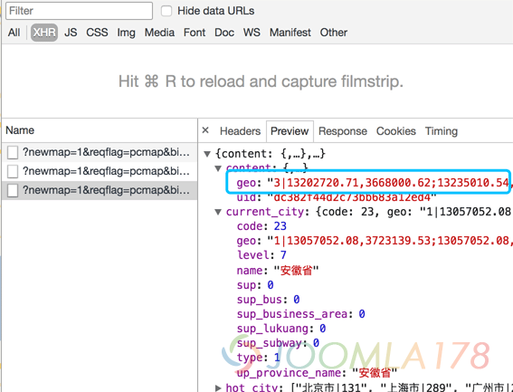

# 百度地图Polygon覆盖物踩坑

工作需要画出国内部分区县轮廓，技术选型采用了百度地图，遇到了百度地图**开放平台的地图**和 map.baidu.com 的区域轮廓是有区别的，通过百度地图API中的覆盖物 - 添加行政区划示例中的添加的数据并不是最新的国家行政区划，下面开始。

### 问题表现

打开官方示例：http://lbsyun.baidu.com/jsdemo.htm#c1\_10，我们以安徽省马鞍山市的区县为例，在“添加行政区划”示例中修改地区为“马鞍山市博望区”

```
map.centerAndZoom(new BMap.Point(116.403765, 39.914850), 5);map.enableScrollWheelZoom();function getBoundary(){   var bdary = new BMap.Boundary();  bdary.get("马鞍山市博望区", function(rs){ //获取行政区域  ...
```

点击运行后如下图



此时不需要我们掌握什么地理常识，但上图中的蓝圈才是真正的马鞍山市博望区，我们来看下百度地图的表现：



笔者尝试在百度地图论坛反馈此问题，得到的答复是：如果有对应行政区划就表示可以使用，如果没有就没有。显然这样的回答姿态是很高的，那我们不能干等百度地图去更新。

### 问题症结

我们理解一下官方示例的代码：http://lbsyun.baidu.com/jsdemo.htm#c1\_10

```javascript
var bdary = new BMap.Boundary();  bdary.get("北京市海淀区", function(rs){  ....  ....for (var i = 0; i < count; i++) {  var ply = new BMap.Polygon(rs.boundaries[i], {strokeWeight: 2, strokeColor: "#ff0000"}); //建立多边形覆盖物  map.addOverlay(ply); //添加覆盖物}
```

其中用到了两个关键方法，**Boundary**是通过查询查询省、直辖市、地级市、或县的名称来返回一个边界轮廓的坐标点数据组，然后再通过**Polygon**来绘制轮廓图形，看下官方API的解释：

```javascript

```

**Boundary：**http://lbsyun.baidu.com/cms/jsapi/reference/jsapi\_reference.html#a7b48

**官方解释：**返回行政区域的边界。 name: 查询省、直辖市、地级市、或县的名称。 callback:执行查询后，数据返回到客户端的回调函数，数据以回调函数的参数形式返回。返回结果是一个数组，数据格式如下： arr[0] = "x1, y1; x2, y2; x3, y3; ..." arr[1] = "x1, y1; x2, y2; x3, y3; ..." arr[2] = "x1, y1; x2, y2; ..." … 否则回调函数的参数为null

**笔者注：**这里设计的就相当于一个坑，利用汉字名称来作为查询条件，笔者没研究过全国的地级市、区、县重名率，但这里应该以某种形式的编码是否最为合适。

**Polygon：**http://lbsyun.baidu.com/cms/jsapi/reference/jsapi\_reference.html#a3b14

**官方解释：**创建多边形覆盖物。

**笔者注：**和大多地图API类似，都是拿到多边形的坐标集合点来绘制svg或者canvas轮廓

也就是说，在百度的地图库中，通过“马鞍山市博望区”的名称作为Boundary的查询参数查询到的轮廓是错误的，导致了Polygon绘制的轮廓错误，所以解决问题的症结就在于轮廓的坐标。

### 解决方案：

打开**map.baidu.com**官网后，搜索“博望区”，不要+不要搜索“马鞍山市博望区”，因为搜出来的仍然是当涂县，得到接口中的坐标数据：



其中content中的geo就是轮廓的坐标数据。

```
"3|13202720.71,3668000.62;13235010.54,3699865.30|13234582.72,3684443.16,13233859.17,3682887.65,13233659.88,3680240.38,13234830.99,3680182.27,13235010.54,3677877.26,13234751.29,3675632.96,13232887.69,3669101.45,13232932.33,3668000.62,13222829.45,3675384.32,13222277.97,3676578.43,13222785.26,3678804.77,13222636.02,3679845.07,13218605.61,3682954.16,13216674.29,3680340.15,13215320.95,3679864.34,13214698.68,3679020.74,13212688.22,3680426.31,13210821.69,3679499.35,13209243.78,3679506.31,13207455.02,3680082.52,13208118.97,3682731.32,13207075.38,3684414.98,13206668.62,3686833.89,13206285.13,3687427.47,13204633.19,3687818.21,13203924.49,3688615.33,13202720.71,3688788.09,13203322.57,3690417.13,13204794.72,3692130.70,13206553.36,3692027.90,13208696.57,3693379.00,13209003.20,3695017.33,13209655.53,3694472.19,13211428.16,3694424.55,13212859.80,3693824.40,13215642.52,3694618.10,13216241.04,3694228.54,13216518.85,3692659.16,13216836.65,3692591.47,13217619.66,3693356.30,13218532.93,3693225.60,13219079.91,3694475.13,13218997.35,3695555.33,13219573.95,3696209.18,13219250.99,3697259.78,13219720.05,3698918.74,13221051.88,3699524.02,13221958.42,3699183.56,13222606.11,3699865.30,13225366.72,3697789.57,13224650.66,3696876.06,13223579.14,3696451.41,13224677.64,3693794.21,13224413.38,3693059.56,13225034.81,3692834.56,13226073.49,3691543.11,13227425.46,3691830.26,13227773.99,3692156.88,13227656.05,3692844.60,13229183.53,3693081.78,13230860.80,3692199.90,13232014.34,3692178.15,13233146.82,3690545.51,13233376.05,3688980.97,13232389.69,3688209.34,13234083.14,3687809.77,13233649.41,3685735.86,13234582.72,3684443.16;13230693.91,3676471.96,13231694.05,3676678.86,13233339.26,3679447.91,13232541.67,3679556.31,13231930.16,3679154.71,13230642.44,3677262.00,13230693.91,3676471.96"
```

这个数据中`3|13202720.71,3668000.62;13235010.54,3699865.30|是不需要的，手动删除，但是数据`存在两个问题，第一是全是以逗号分割符为分割，第二坐标系全是墨卡托坐标系，要进行如下操作

1、转换数据格式

将数据中的第二个逗号更换成分号，由于上述博望区数据中已有一个分号，未使用repalce方法进行替换，可以使用vs code编辑器进行匹配替换比JS方法替换更显著，也可以将字符串转为数组后进行遍历替换。

2、坐标系转换

百度地图API提供了pointToLngLat方法进行转换，返回一个坐标的对象

```
var mctData = new BMap.Pixel(lng,lat);//传入墨卡托坐标
var geoData = map.getMapType().getProjection().pointToLngLat(mctPoint);//返回一个地理坐标系对象
```

中间转换过程不再赘述，以下为得到数据的结果：

```
118.886986,31.570163;118.880486,31.558198;118.878696,31.537832;118.889216,31.537385;118.890829,31.519648;118.8885,31.502375;118.871759,31.452088;118.87216,31.44361;118.781406,31.500461;118.776452,31.509652;118.781009,31.526785;118.779668,31.53479;118.743463,31.55871;118.726113,31.538599;118.713956,31.534938;118.708366,31.528447;118.690306,31.539262;118.673539,31.53213;118.659365,31.532184;118.643296,31.536617;118.64926,31.556995;118.639886,31.569946;118.636232,31.588549;118.632787,31.593114;118.617947,31.596118;118.611581,31.602247;118.600768,31.603575;118.606174,31.6161;118.619399,31.629272;118.635196,31.628482;118.654449,31.638867;118.657204,31.651457;118.663063,31.647268;118.678987,31.646902;118.691848,31.64229;118.716845,31.648389;118.722221,31.645396;118.724717,31.633334;118.727572,31.632814;118.734606,31.638692;118.74281,31.637688;118.747723,31.647291;118.746982,31.655592;118.752161,31.660616;118.74926,31.668688;118.753474,31.681433;118.765437,31.686083;118.773581,31.683468;118.779399,31.688705;118.804198,31.672759;118.797766,31.66574;118.78814,31.662477;118.798008,31.642058;118.795634,31.636411;118.801216,31.634682;118.810547,31.624755;118.822692,31.626963;118.825823,31.629473;118.824763,31.634759;118.838485,31.636582;118.853552,31.629804;118.863914,31.629637;118.874087,31.617087;118.876146,31.605058;118.867286,31.599126;118.882498,31.596053;118.878602,31.580105;118.886986,31.570163;118.852052,31.508833;118.861037,31.510425;118.875816,31.531734;118.868651,31.532568;118.863158,31.529478;118.85159,31.514913;118.852052,31.508833
```

这个数据就是可以满足**Polygon**中的第一个坐标参数，然后再尝试百度地图API示例：

```
var pointArray = [];
var ply = new BMap.Polygon("118.886986,31.570163;118.880486,31.558198;118.878696,31.537832;118.889216,31.537385;118.890829,31.519648;118.8885,31.502375;118.871759,31.452088;118.87216,31.44361;118.781406,31.500461;118.776452,31.509652;118.781009,31.526785;118.779668,31.53479;118.743463,31.55871;118.726113,31.538599;118.713956,31.534938;118.708366,31.528447;118.690306,31.539262;118.673539,31.53213;118.659365,31.532184;118.643296,31.536617;118.64926,31.556995;118.639886,31.569946;118.636232,31.588549;118.632787,31.593114;118.617947,31.596118;118.611581,31.602247;118.600768,31.603575;118.606174,31.6161;118.619399,31.629272;118.635196,31.628482;118.654449,31.638867;118.657204,31.651457;118.663063,31.647268;118.678987,31.646902;118.691848,31.64229;118.716845,31.648389;118.722221,31.645396;118.724717,31.633334;118.727572,31.632814;118.734606,31.638692;118.74281,31.637688;118.747723,31.647291;118.746982,31.655592;118.752161,31.660616;118.74926,31.668688;118.753474,31.681433;118.765437,31.686083;118.773581,31.683468;118.779399,31.688705;118.804198,31.672759;118.797766,31.66574;118.78814,31.662477;118.798008,31.642058;118.795634,31.636411;118.801216,31.634682;118.810547,31.624755;118.822692,31.626963;118.825823,31.629473;118.824763,31.634759;118.838485,31.636582;118.853552,31.629804;118.863914,31.629637;118.874087,31.617087;118.876146,31.605058;118.867286,31.599126;118.882498,31.596053;118.878602,31.580105;118.886986,31.570163;118.852052,31.508833;118.861037,31.510425;118.875816,31.531734;118.868651,31.532568;118.863158,31.529478;118.85159,31.514913;118.852052,31.508833", {strokeWeight: 2, strokeColor: "#ff0000"}); //建立多边形覆盖物
map.addOverlay(ply);//添加覆盖物
pointArray = pointArray.concat(ply.getPath());
map.setViewport(pointArray);//调整视野
```

此时即能正确显示了。

以上方案仅为解决部分特殊区域缺陷，从优化角度来讲，还是建议使用百度地图API的的异步**Boundary**来解决此问题，否则如果大量的静态坐标数据会导致前台等待时间过长。

---

除特殊标明文章转自第三方网站，文章均由JOOMLASK.COM原创提供  
欢迎友情转载，请务必保留本文出处并引用本文链接： [百度地图Polygon覆盖物踩坑](http://www.joomla178.com/joomla-share/front-end/bmap-polygon-bug.html)
