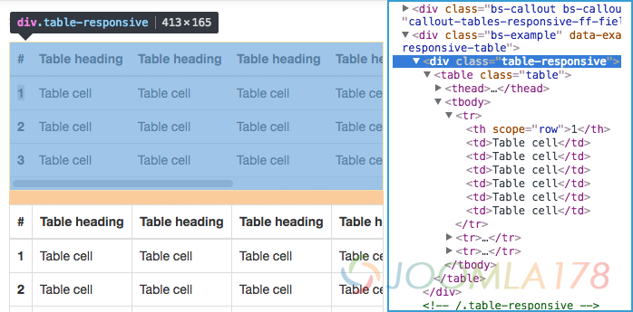
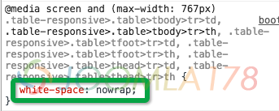

# 前端表格列数过多时增加横向滚动条实现

工作上有个需求，当表格列数达到一定程度时，需要出现横向滚动条，也就类似于Bootstrap框架设计的响应式表格（responsive table），但是如果脱离了Bootstrap样式，按照table外层容器溢出出现滚动条并无效果。

笔者表示不能理解，bootstrap的responsive table可以，到实际代码中却不行，但发现了一个明显的特征，下图中的table内容都并未换行。

问题是否就在内容上，在Chrome高度工具中，找到了td,th对应的样式：white-space: nowrap;

问题解决

---

除特殊标明文章转自第三方网站，文章均由JOOMLASK.COM原创提供  
欢迎友情转载，请务必保留本文出处并引用本文链接： [前端表格列数过多时增加横向滚动条实现](http://www.joomla178.com/joomla-share/front-end/bootstrap-reponsive-table.html)
