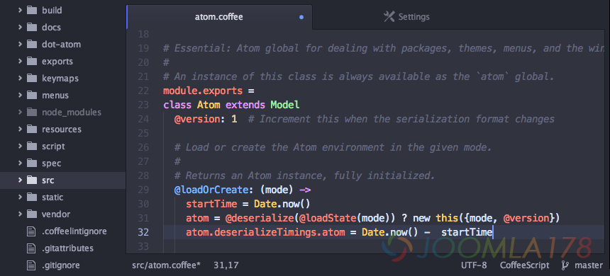
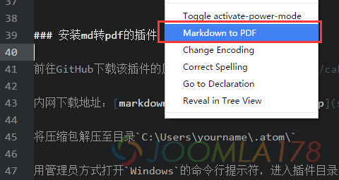
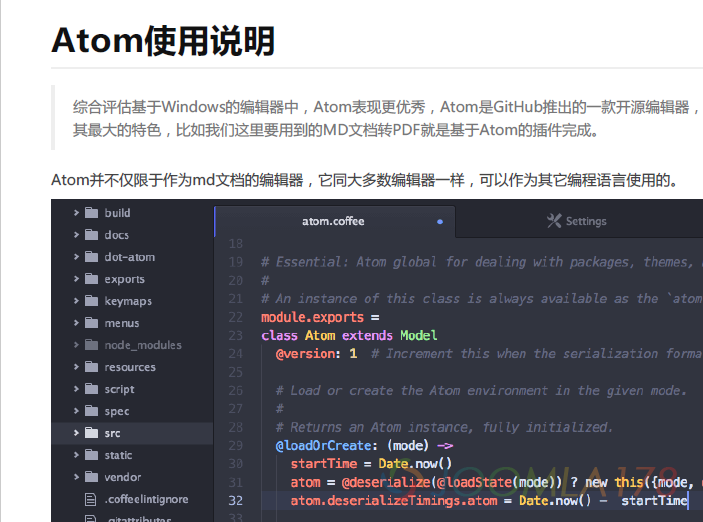

# 使用Atom编写Markdown文档并转为pdf

工作需要经常写技术文档，无奈Word插入代码并不好用，后染上Markdown无法自拔！但又不能要求别人使用Markdown，故目标要将其转换为国际通用的pdf文档，本文将介绍如何使用Atom编辑Markdown文档并将其转换为pdf。

## Atom使用说明

> 综合评估基于Windows的编辑器中，Atom表现更优秀，Atom是GitHub推出的一款开源编辑器，其强大的插件系统是其最大的特色，比如我们这里要用到的MD文档转PDF就是基于Atom的插件完成。

Atom并不仅限于作为md文档的编辑器，它同大多数编辑器一样，可以作为其它编程语言使用的。



## 下载安装

前往Atom官网：<https://atom.io/> 即可下载最新版

Atom的安装非常简单，双击下载的应用程序即可完成安装，其应用程序默认安装在：`C:\Users\yourname\AppData\Local\atom`中，而其插件配置目录在：`C:\Users\yourname\.atom`中，每次使用只需要点击快捷方式即可。

## 使用Atom

我们为了写作`md`文档，所以只需用Atom打开一个md文档，或者新建一个`md`文档，就可以按照`md`格式写作了。使用`ctrl+shift+M`可以预览文档在`html`中的表现。

## 安装插件

> 根据我们实际需要，仅需安装md转pdf的插件（`markdown-themeable-pdf`）即可，这里我们推荐一款有趣的插件：`activate-power-mode`，电脑配置足够强大的话，可以尝试颤抖的力量（[https://9turn.com/xuan-ku-de-atomcha-jian-activate-power-mode/）。](https://9turn.com/xuan-ku-de-atomcha-jian-activate-power-mode/%EF%BC%89%E3%80%82)

Atom的插件是可以使用`apm`命令来进行在线安装，实际因为一些原因，我们只能使用`npm`进行安装，所以我们需要先安装`nodejs`

### 安装NodeJS

前往`NodeJS`官网下载：<https://nodejs.org/en/>

安装完成之后也是因为一些原因，需要将`npm`源改为国内淘宝源，方法如下：

```
npm config set registry http://registry.npm.taobao.org/
```

### 安装md转pdf的插件

前往GitHub下载该插件的压缩包：<https://github.com/cakebake/markdown-themeable-pdf>

将压缩包解压至目录`C:\Users\yourname\.atom\`

用管理员方式打开`Windows`的命令行提示符，进入插件目录

```
cd C:\Users\yourname\.atom\packages\markdown-themeable-pdf-master
```

输入`npm install`，等待安装完成，用`Atom`打开`md`文档，右击文档任意处，选择Markdown to PDF，等待片刻完成转换，如下图：



转换后的pdf完美表现



---

除特殊标明文章转自第三方网站，文章均由JOOMLASK.COM原创提供  
欢迎友情转载，请务必保留本文出处并引用本文链接： [使用Atom编写Markdown文档并转为pdf](http://www.joomla178.com/joomla-share/front-end/edit-md-files-by-atom-transfer-to-pdf.html)
