# 深入了解一个超快的CSS引擎: Quantum CSS(Stylo)

或许你听说过 Quantum 项目。 它是对于 Firefox 内部的一个重大改写，以达到让 Firefox 更快运行的目的。我们将实验性的浏览器 Servo 的一部分功能调换出来，并对引擎的其他部分做除了重大的改进。

这个项目好比一架正在飞行的飞机的引擎。我们对适当的地方进行改进，一个一个组件地改进, 当着这些组件准备好的时候，你就能够看到它对 Firefox 的影响。

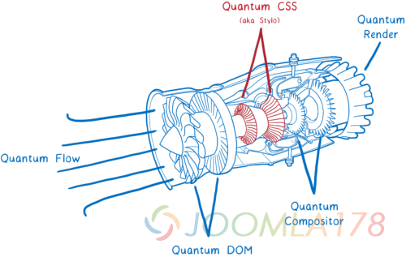

第一个来自 Servo 的主要组件就是一个全新的CSS 引擎，名为 Quantum CSS (之前称作 Stylo) — 现在在浏览器 Nightly 版本中已经可以用于测试了。你可以进入about:config 并设置 layout.css.servo.enabled 以确保这个功能可以被使用。

这个新引擎将四个浏览器中最先进的革新技术结合在一起，创造出了这个超级 CSS 引擎。

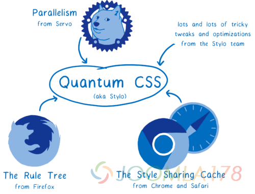

它充分利用了现代的计算机硬件，使你的计算机的所有核心并行工作。这意味着它比原来快2倍，4倍甚至18倍。

另外, 它结合了现有的其他浏览器的最先进的优化方式。 所以即使它不是并行运行，它依旧是一个非常迅捷的 CSS 引擎。

但是 CSS 引擎是做什么的呢？首先，让我们看看 CSS 引擎是如何融入其他浏览器的。然后我们再来看 Quantum CSS 是如何做到更快的。

### CSS 引擎的作用是什么?

CSS 引擎是浏览器渲染引擎的一部分。渲染引擎将网站的 HMTL 和 CSS 文件渲染成屏幕上对应的像素。 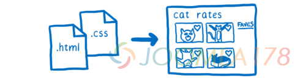

每个浏览器都有一个渲染引擎。在 Chrome 中它叫做 Blink，在 Edge 中它叫做 EdgeHTML， 在 Safari 中 它叫做 WebKit，在 Firefox 中它叫做 Gecko。

为了转化这些文件成为像素点，所有的这些渲染引擎都会做这些相同的事情：

1. 解析这些文件成浏览器能够理解的对象，包括 DOM。在这一点上, DOM 知道这个页面的结构。它知道元素之间的父子关系。但是它不知道这些元素该是什么样子。

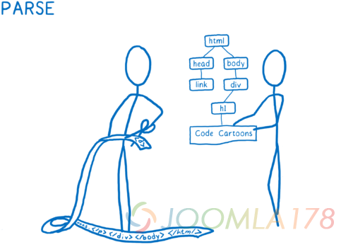

1. 为了弄清楚这些元素究竟该长什么样，对于每个 DOM 节点，CSS 引擎会计算出要应用哪些 CSS 规则，然后计算出那个 DOM 节点应用的每个 CSS 属性的值。

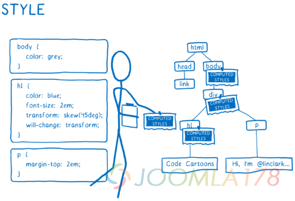

1. 计算出每个节点的大小以及它在屏幕上的位置。 对要出现在屏幕上的东西创建它们所属的盒子。盒子不仅仅代表 DOM 节点，也会有在 DOM 节点内部的盒子，比如文本行。

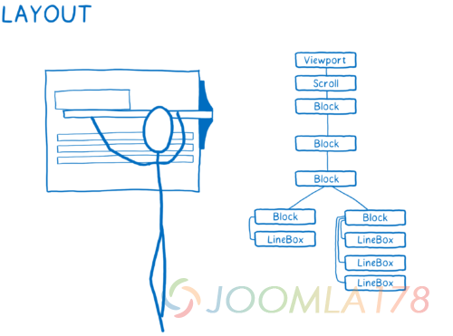

1. 绘制这些不同的盒子，绘制可以发生在不同的层上。我觉得这个有点像过去用洋葱皮纸上的手绘动画。这使得浏览器可以只切换一个层而不用在其他层上重新绘制。

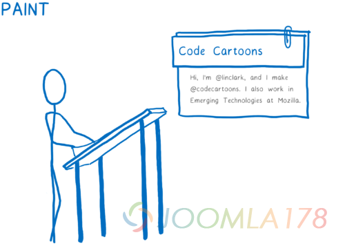

1. 把这些不同的绘制的层，应用任何像transform 这样的合成属性，然后把他们变成一张图像。这基本上就像是给这些叠在一起的层拍一张照，这张图像之后就会被渲染到屏幕上。

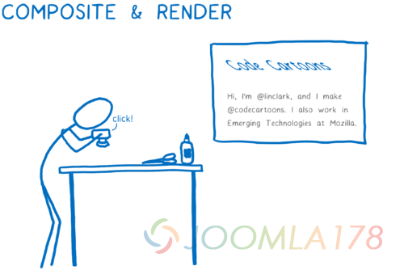

这意味着当渲染引擎开始计算样式，CSS 引擎有两个东西：

- DOM 树
- 一张样式规则的清单

它将遍历每个 DOM 节点，然后计算出对应 DOM 节点的样式。对于这部分，它对当前 DOM 节点的每个 CSS 属性都给予一个值，哪怕样式表没有对这个属性声明一个值。

我觉得这好比某个人去填一张表单。他需要为每个 DOM 节点都填写一张表单，然后表单的每个域都要填上最终的答案。

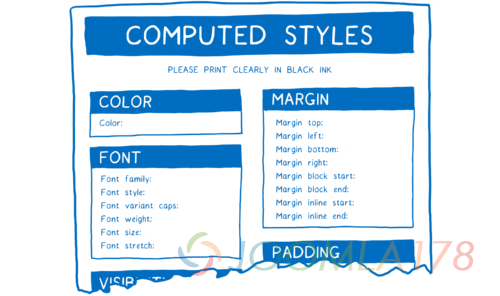

为了做到这一点，CSS 引擎需要做两件事:

- 计算出当前节点需要应用哪些规则 ，又叫做 选择器匹配
- 为任何空缺的值填补上父元素的值或者是默认值，又叫做 层叠

#### 选择器匹配

对于这一步, 我们将任何匹配当前 DOM 节点的规则添加到一个列表，因为可以匹配多个规则，对于同个属性也可能会有多次声明。

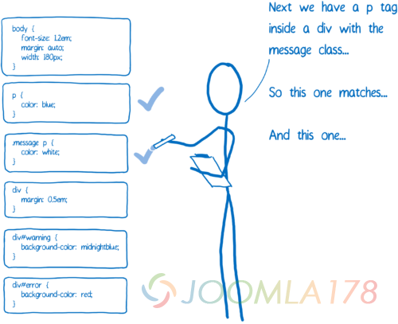

另外，浏览器本身也会添加一些默认 CSS (称作 user agent style sheets)。那么 CSS 引擎怎么知道要选择哪个值呢？

这时候特异性规则就出场了。CSS 引擎基本上会创建一个试算表。然后它会基于不同列分出不同的声明。

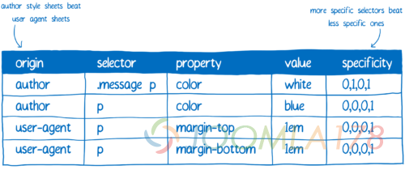

拥有最高特异性的规则将会胜出。所以根据这张表，CSS 引擎会应用上它能应用的值。

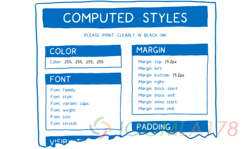

其他的, 我们会用到层叠。

#### 层叠（the cascade）

层叠让 CSS 更易于书写和维护。因为层叠，你可以在 body 上设置 color 属性，然后你就知道 p元素和 span 元素以及 li 元素都使用那个颜色 (除非你有更多具体的样式覆盖)。

为了做到这点，CSS 引擎会查看样式表单中空的盒子。如果这个属性默认是继承的，那么 CSS 引擎就会向树上查找是否有一个祖先节点有值。如果没有任何祖先节点有这个值，或者这个属性没有继承，那么这个属性就会得到一个默认值。

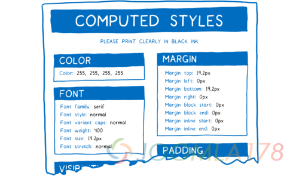

所以现在这个 DOM 节点所有的样式都已经计算好了。

#### 旁注: 样式结构共享

刚刚那个展现给你们的表单其实是有一些曲解的。CSS 有上百个属性。如果 CSS 引擎保持着每个 DOM 节点的每个属性，那内存早就不够用了。

反而, 引擎实际上干的事情，叫做样式结构共享。他们将有关联的数据（比如字体属性）存到不同的对象上，叫做样式结构。然后，计算出的样式只是通过指针指向具体的样式对象，而不是把所有的属性都放在相同的对象上。对于每种属性，都有一个指针指向拥有对应 DOM 节点样式的值的样式结构。

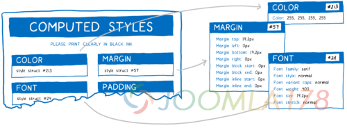

这样既节省了内存又节省了时间。 拥有相似属性的节点（比如兄弟节点）只是指向他们相同的结构并共享那些属性。同时又因为许多属性都是继承的，所以的祖先节点可以和任何不指定具有自己重写属性的后代节点共享同一个结构。

### 现在，我们怎么样让它变得更快?

这就是没有优化过的样式计算看起来的样子。

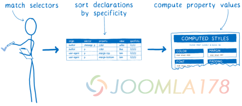

浏览器在样式计算里做了很多事情。 这个过程并不只是发送在页面第一次加载的时候。随着用户和页面的不断交互，这个过程在不断地重复，无论是将鼠标悬停在元素之上还是改变 DOM 结构都会触发样式的改变

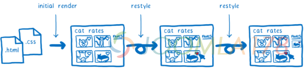

这意味着 CSS 样式计算是实现优化的重要选项。在过去的20年内，浏览器一直在尝试各种的优化策略。Quantum CSS 将来自于不同引擎的各种策略结合在一起，从而创造出一个超级快的新引擎。

那么现在就让我们来看一下他们是如何一起发挥作用的。

#### 所有的运行都是并行的

Servo 项目 (也就是 Quantum CSS 的起源) 的内容是使一个实验性的浏览器将页面上所有不同部分都并行渲染。这意味着什么呢？

计算机就像人类的大脑。有一个专门用于思考的部分——算数逻辑单元（ALU）。靠近这部分，有一些用于储存短期记忆——寄存器（register）。他们共同组成了 CPU 。然后还有一些用于储存长期记忆，也就是 RAM 。

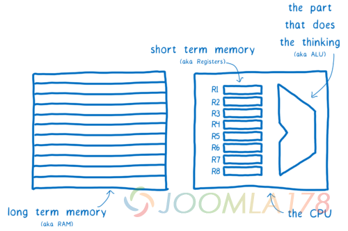

早期使用这样的 CPU 的电脑一次只能处理一件事情。但是经过近十年的发展，CPU 已经进化成可以拥有由多个 ALU 和寄存器组合成的核心。这意味着 CPU 可以一次并行处理多件事情。

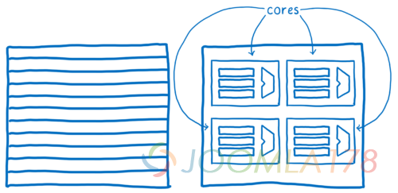

Quantum CSS 利用了当今电脑最新的这些特性将不同 DOM 节点的样式计算分配给不同的核心。

或许这看起来是一件非常简单的事情，仅仅是将树的分支分开在不同的核心上处理。因为某些原因，所以实际上却比想象中的要困难很多。其中之一就是 DOM 树通常是不平衡的。这意味着可能某个核心的工作量要比其他的核心要多很多。

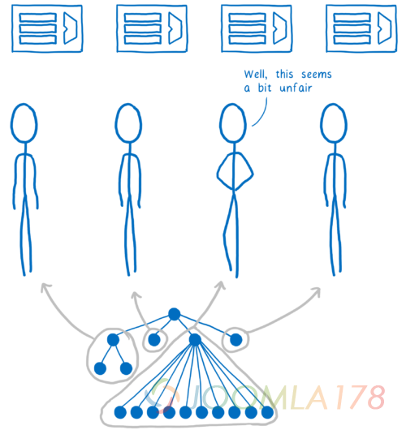

为了更平均的分配这些工作，Quantum CSS 使用了一个称之为工作窃取（work stealing）的技术。处理一个 DOM 节点时，代码会获取他的直接子元素，然后将他们分为一个或多个 “工作单元”。然后这些工作单元会被放进一个队列之中。

一旦其中一个核心完成了它当前队列中的任务，那么他就会从其他的队列中去寻找新的任务。这意味着我们不必提前遍历整棵树去计算他们的平均任务就可以均匀地分配任务。

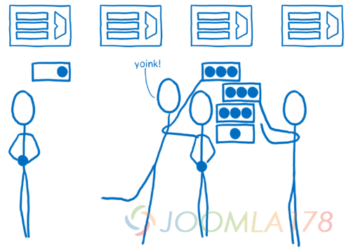

在大多数的浏览器之中，很难保证这个方法的正确性。并行性是众所周知的难题，而 CSS 引擎又十分复杂。 恰好它又处于渲染引擎中的另外两个非常复杂的部分—— DOM 和布局之间。所以它很容易产生 bug，而且因为并行性所产生的叫做数据竞争的 bug 难以追踪。我会在 另一篇文章中阐述更多这类 bug。

如果你的程序接受了来自成百上千的工程师的辛勤奉献，如何让你的程序不怕在并行环境从运行呢？这就是 Rust 的意义所在。

有了 Rust, 你就可以静态地验证以确保没有数据竞争。这意味着通过提前防止难以调试的 bug 写入你的代码之中，你可以避免这些难以调试的 bug。而编译器是不会让你这么做的。将来我会撰写更多关于这个内容的文章。与此同时，你可以观看这个视频 intro video about parallelism in Rust 或者这个视频 more in-depth talk about work stealing。

有了这个，CSS 样式计算变成了一个所谓的尴尬的并行问题——很少有东西会阻止你在并行中更高效地运行。这意味着我们可以得到接近线性的速度提升。假如在你的电脑上有四个核心，那么它会以接近原来四倍的速度运行。

#### 通过规则树来加快样式重置

对于每个 DOM 节点， 都需要CSS 引擎去遍历所有的规则去实现选择器匹配。对于大多数的节点，这个匹配很大程度上不会经常发生变化。比如，当用户把鼠标悬停在一个父元素上，匹配的规则或许会发生变化。但是我们仍然需要为所有的后代元素重新计算样式来处理属性继承，然而匹配规则的后代元素很有可能不会发生任何变化。

如果我们可以为这些匹配到的后代元素这个记录就好了，这样我们就不用对他们再进行选择器匹配了。这就是所谓的规则树——从 Firefox 的上一代 CSS 引擎 — does 中借来。

CSS 引擎会通过这个过程计算出需要匹配的选择器，并通过特异性将他们分类出来。通过这个方式，就创建了链接的规则列表。

这个列表将会被添加到树中。

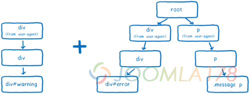

CSS 引擎会尝试保存最少分支的树。为了做到这一点，它会尽量尝试复用分支。

如果在列表中的大多数选择器和已有的分支相同，那么它会沿用同样的路径。但是它有可能会遇到这种情况——列表中的下一条规则并不在当前树的分支中，只有在这种情况下它才会添加一个新的分支。

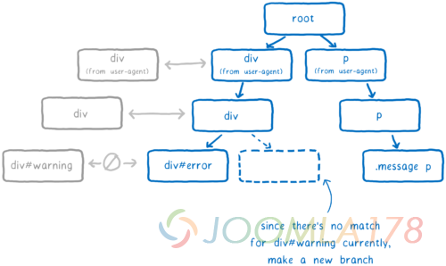

DOM 节点会得到指向最后被插入的规则的指针（在这个例子当中，就是 div#warning 规则)。这是最这是最特殊的地方。

关于样式重置，引擎会做一次快速检查，去检查父元素上的改变是否会潜在地改变子元素上匹配的规则。 如果不是，那么对于任何的后代元素，引擎可以通过后代元素上的指针去获取那条规则。从这里，它能够顺着树回到根节点以获取完整的规则匹配的列表，从最具体的到最不具体的。这意味着它能够完全跳过选择器匹配和排序。

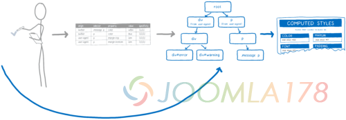

这个可以大大减少在样式重置期间的工作。但是在初始化样式的时候仍然需要很多工作。如果你有10,000 个节点，你仍然需要进行 10,000 选择器匹配。但是也有其他的方式去加速这个过程。

#### 通过样式缓存共享加速初始渲染 (以及层叠)

试想一个拥有上千个节点的页面，许多节点都会匹配同样的规则。比如，一个很长的维基百科的页面。 在主内容区域的段落都最终会匹配相同的规则，拥有同样的计算后的样式。

如果不进行优化， CSS 引擎就不得不为每个单独的段落进行选择器匹配和样式计算。但是如果有一种方法能够证明这个样式在段落与段落之间都是相同的，那么引擎就可以只做一次运算，并将每个段落节点都指向同样的计算样式。

这就是所谓的样式缓存共享 —— 被 Safari 和 Chrome—does 所启发。当引擎处理完一个节点时，计算样式会被放入缓存中。然后，在引擎开始计算下一个节点的样式之前，它会运行一些检查，检测是否有可用的缓存。

这些检查是:

- 两个节点是否拥有相同的 id, 类名, 或者其他？如果是，那么他们会匹配到相同的规则。
- 对于所有那些不是基于选择器的——内联样式，引擎会检查比如，节点是否有相同的值？如果是，那么先前的规则要么不被覆盖要么以同样的方式被覆盖。
- 节点的父元素是否指向相同的计算样式对象？如果是，那么他们的继承值将会相同。

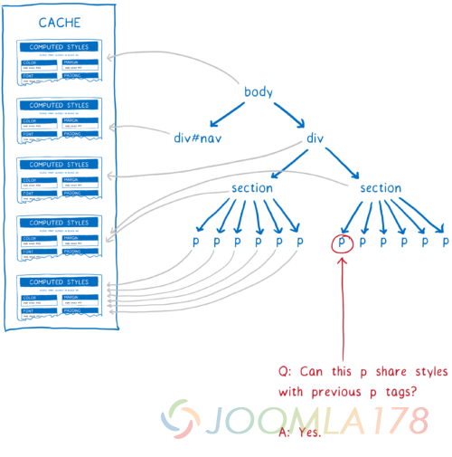

从一开始，这些检查就处于早期的样式共享缓存中。但是可能仍然会有许多样式不一定匹配的个例。比如，如果 CSS 规则使用了 :first-child 选择器，那么两个段落就不一定会匹配。即使这些检查建议它们是匹配的。

在 WebKit 和 Blink 中，这些情况会放弃使用样式共享缓存。随着更多的站点使用这些现代选择器，这种优化策略变得越来越不中用了，所以最近 Blink 团队已经移除了这个功能。结果却发现有另外一种方式来使样式共享缓存能够跟上这些改变。

在 Quantum CSS 中，我们将这些怪异的选择器都集中起来然后检查它们是否在 DOM 节点中使用。然后我们将结果存为 1 和 0。如果两个元素有相同的 1 和 0，那么我们就确定了它们是匹配的。

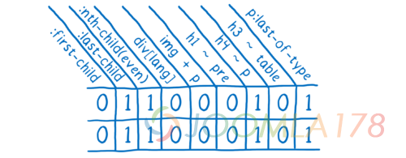

如果一个 DOM 节点能够共享已经计算好的样式，那么你就可以跳过许多的任务。因为页面通常都有很多样式相同的节点，样式共享缓存便能够节省内存并真正地加快运行速度。

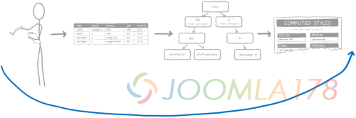

### 结论

这是的一个从 Servo tech 到 Firefox 的重大技术迁移。一路上，我们学到了如何将写在 RUST 中的现代的高性能的代码带到 Firefox 的核心中。

我们非常高兴能够将 Quantum 这个庞大的项目给用户带来第一时间的体验。我们很高兴能让你尝试使用，如果你 发现了任何问题请告知我们。

## 关于

Lin Clark

Lin 是 Mozilla Developer Relations 团队的一名工程师。 She 专注于 JavaScript, WebAssembly, Rust, 以及 Servo，同时也绘制一些关于编码的漫画。

- code-cartoons.com
- @linclark

**[原文链接](http://www.zcfy.cc/article/inside-a-super-fast-css-engine-quantum-css-aka-stylo-x2605-mozilla-hacks-8211-the-web-developer-blog-4041.html)**

---

除特殊标明文章转自第三方网站，文章均由JOOMLASK.COM原创提供  
欢迎友情转载，请务必保留本文出处并引用本文链接： [深入了解一个超快的CSS引擎: Quantum CSS(Stylo)](http://www.joomla178.com/joomla-share/front-end/inside-a-super-fast-css-engine-quantum-css.html)
