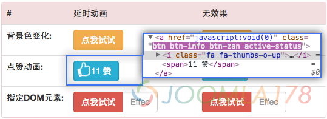

# 简易的点击状态jQuery插件 Active-status

不管是在PC端还是移动端的前端开发中，经常需要用到点击事件夹杂着一个细微的动画，在这个过程中虽然可以使用css3动画，但是在起始到终点间的额外交互却做不了。



笔者想要在一个css3的动画过程中，额外增加一个过场效果，比如点击的时候背景、图标发生一些变化，而不是鼠标经过！于是有了active-status，同样还可以适用于移动端的一些touch事件，虽然该插件简单，但使用范围广，源码放在Github上，有兴趣可以下载：<https://github.com/shionphan/active-status>

演示：[传送门](http://demo.joomla178.com/active-status/demo/demo_cn.html)

Gigthub源码：[传送门](https://github.com/shionphan/active-status)

### **源码：**

```
/* ========================================================================
 * Adding class name in a few seconds by event action, Maybe milli seconds
 * Then you can add css3 animation in the same time.
 * ========================================================================
 * Author: Shion.Phan
 * Blog: http://www.joomla178.com
 * Github: https://github.com/shionphan
 * ======================================================================== */
+function($){
  'use strict';
  $.fn.astatus = function (options,obj) {
    var defualts = {delay:300, etype:'click', cname:'active-status', adddom:''};
    var opts = $.extend({}, defualts, options);
    var element = (opts.adddom.length > 0) ? $(opts.adddom) : this;

    this.on(opts.etype,function(){
      if(element.hasClass(opts.cname)){
        return;
      }
      element.addClass(opts.cname);
      setTimeout(function(){
        element.removeClass(opts.cname);
      }, opts.delay);
    });
    element.on(opts.etype,obj);
  }
}(jQuery);
```

### 原理：

目标就是针对click之类的事件，当某个DOM元素点击时触发该事件，然后给当前DOM元素增加一个叫active-status的类名，并持续300ms，此时还可以执行回调。

### 使用方法：

默认参数

```
$('.testdom').astatus()
```

增加回调

```
$('.testdom').astatus(function(){
  //...可以干些什么事
})
```

指定DOM (含所有配置)

```
$('.testdom').astatus({
  delay:300, //持续时间
  etype:'click', //事件类型，还可以是touchstart
  cname:'active-status', //增加的class类名
  adddom:'.test-anotherdom' //指定的DOM增加变化类名
},function(){
  //...可以干些什么事
})
```

CSS 动画

```
.testdom{
  -webkit-transition: all 300ms;
  -o-transition: all 300ms;
  transition: all 300ms;
}
.testdom.active-status{
  -webkit-transition: all 300ms;
  -o-transition: all 300ms;
  transition: all 300ms;
}
```

---

除特殊标明文章转自第三方网站，文章均由JOOMLASK.COM原创提供  
欢迎友情转载，请务必保留本文出处并引用本文链接： [简易的点击状态jQuery插件 Active-status](http://www.joomla178.com/joomla-share/front-end/jquery-plugin-active-status.html)
