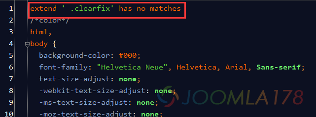

# Less 2.5.1编译出错：extend ' .clearfix' has no matches

最近在Windows下安装了新版的Node.js和Less 2.5.1编译环境，结果BootStrap的类库中.clearfix()编译后在css中发现了第一行冒出来个错误，自然影响到其它CSS的正常工作，为解决此问题，通过特殊途径搜到英文资料解决办法。

解决办法很独特，还要再安装一个node扩展：less-plugin-clean-css

在管理员的cmd中键入npm install -g less-plugin-clean-css 安装成功会显示less-plugin-clean-css@1.5.0之类的提示消息 ，表示安装成功。

不过笔者在使用webstorm类工具，自动编译还是出问题，然后使用了手动编译，插件正常使用，如果对此有深入见解的朋友，请在下方留言交流。

参考资料：

[Windows7 x64系统下安装Nodejs并在WebStorm 9.0.1下搭建编译less环境](http://www.bubuko.com/infodetail-501117.html)

[fixed compress depreciation error by implementing less-plugin-clean-css](https://github.com/timdouglas/sublime-less2css/pull/106)

[less-plugin-clean-css](https://github.com/less/less-plugin-clean-css)

---

除特殊标明文章转自第三方网站，文章均由JOOMLASK.COM原创提供  
欢迎友情转载，请务必保留本文出处并引用本文链接： [Less 2.5.1编译出错：extend ' .clearfix' has no matches](http://www.joomla178.com/joomla-share/front-end/less-bug-extend-clearfix-has-no-matches.html)
