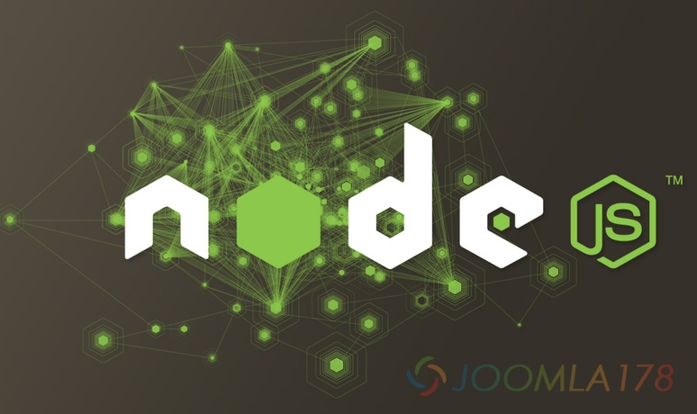

# 一切就绪 node app.js 一闪而过

最近做项目中遇到老问题，公用模块的静态页嵌套问题，常用方法配个apache环境去支持shtml，感觉挺麻烦，于是准备用时下流行的node+express方式，只是启动过程遇到了点小问题，看教程执行启动服务node app.js一闪而过，也没有任何提示。

究其根本是因为Express版本的问题，大多教程基于3.0编写，而在4代中已经更改启动方式。

In Express 3.0, you normally would use app.configure() (or app.use() ) to set up the required middleware you need. Those middleware you specified are bundled together with Express 3.0.

In Express 4.0 however, all middleware have been removed so that they can be maintained and update independently from the core Express (except the static middleware), thus they need to be called separately (what you see in app.js).

The `bin\` directory serve as a location where you can define your various startup scripts, the `www` is an example on how it should looks like, ultimately you could have startup script like `test`, `stop` or `restart` etc. Having this structure allows you to have different configurations without touching the app.js.

取而代之的是npm start，而不是node app.js

---

除特殊标明文章转自第三方网站，文章均由JOOMLASK.COM原创提供  
欢迎友情转载，请务必保留本文出处并引用本文链接： [一切就绪 node app.js 一闪而过](http://www.joomla178.com/joomla-share/front-end/node-app-cant-start.html)
