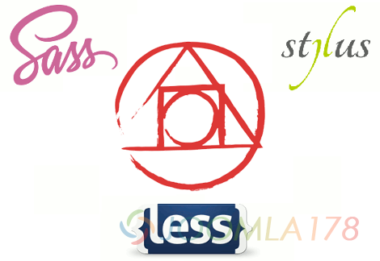
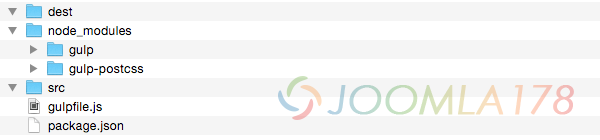

# PostCSS 快速入门: Gulp安装



得益于大漠文章[PostCSS深入学习：你需要知道什么](http://www.w3cplus.com/PostCSS/postcss-deep-dive-what-you-need-to-know.html)，后对PostCSS有极强的兴趣，但是作者后文还未译完，等待不及前往自英文教程[PostCSS Quickstart Guide: Gulp Setup](http://webdesign.tutsplus.com/tutorials/postcss-quickstart-guide-gulp-setup--cms-24543 "PostCSS Quickstart Guide: Gulp Setup")对照学习半天，对PostCSS有了进一步了解，就顺便将此文译出如下，并辅以我的理解让读者更加易懂。

前节中介绍了在CodePen和Prepros中内置了PostCSS，当然这很强大，只是我们并不知道哪些插件适合我们，本节教程我们如何在Gulp中使用PostCSS，这样我们可以根据需求选用配套插件。

要注意的是：如果之前没有Nodejs或者使用过命令行工作过的朋友，应当先了解一下其它教程...

### 前置条件：

因为我们需要使用Gulp工具，所以下述三件工具是必备的

- Node.js
- NPM
- Git

如果这三件事不太理解的话，需要参考此教程：[The Command Line for Web Design: Taming 3rd Party Packages](http://webdesign.tutsplus.com/tutorials/the-command-line-for-web-design-taming-3rd-party-packages--cms-23451)，当然类似中文教程也是一把。

然后我们还必须对Gulp做一定的了解，也有教程：[The Command Line for Web Design: Automation with Gulp](http://webdesign.tutsplus.com/tutorials/the-command-line-for-web-design-automation-with-gulp--cms-23642)，中文可参考类似教程[gulp 实现 js、css,img 合并和压缩](http://www.gowhich.com/blog/621)。根据上述教程项目根目录下创建以下文件

- “gulpfile.js” (Gulpfile) 文件
- “package.json” 文件
- 在项目根目录下执行安装gulp-postcss和gulp的命令（都在项目目录下安装）

### Gulp PostCSS工具包

根目录下创建一个/src和/dest文件夹，/src是未编译文件存放处，/dest是编译后的文件目录

执行下述两条命令安装Gulp PostCSS工具包（命令行先不要关闭哦）：

```
npm install --save-dev gulpnpm install --save-dev gulp-postcss
```

安装完了之后在项目根目录下可以找到/node\_modules/gulp 目录和 /node\_modules/gulp-postcss 目录，第一个是gulp主工具，第二个是基于gulp的postcss工具。



那么现在需要编辑gulpfile.js文件进行初始化设置，编辑gulpfile.js文件，输入以下代码创建变量库，引入gulp和gulp-postcss模块：

```
var gulp = require('gulp');var postcss = require('gulp-postcss');
```

再后面继续添加代码用以设定CSS编译输出路径（由src输出到dest目录）

```
gulp.task('css', function () {
  var processors = [
  ];
  return gulp.src('./src/*.css')
    .pipe(postcss(processors))
    .pipe(gulp.dest('./dest'));
});
```

再让我们看一下这段代码的含义：

第一行我们设置了一条gulp任务名为CSS，这个任务执行了一个空数组processors，默认数组为空，后文我们将会插入数组。

在函数处理完成后，我们要选定src中的任意css文件，再执行processors数组函数，最后再输出到/dest目录中。

### 运行一段示例看看

创建一个style.css在/src目录中，其中CSS代码如下：

```
.test {
    background: black;
}
```

然后在命令行代码中输入gulp css，记得在项目根目录下输入此命令，然后会在/dest目录下看到同名文件style.css。

当然你现在打开这两个文件没有任何区别，因为此时我们还没有加入其它PostCSS插件，如果这条命令没生效的话，那要注意前面是否正确安装gulp和gulp postcss，缺一不可哦。

### 加入重量级的PostCSS插件

此刻我们将安装具有代表性的PostCSS插件：Autoprefixer（自动前辍）,cssnext（CSS 的转译器）和precss（类似预编译工具Sass,Less），继续使用在项目根目录下安装插件（不要安装全局-g）

```
npm install autoprefixer --save-dev
npm install cssnext --save-dev
npm install precss --save-dev
```

安装cssnext和precss的时候可能会花费更多时间，推荐使用taobao镜像（`http://registry.npm.taobao.org）具体再问度娘，不做多阐述。`

按照引入gulp和gulp-postcss包的方法，继续在gulpfile.js中引入上述三个插件包，在前面代码中添加变量后如下：

```
var gulp = require('gulp');var postcss = require('gulp-postcss');
var autoprefixer = require('autoprefixer');
var cssnext = require('cssnext');
var precss = require('precss');
```

 再将上述空的processors加入完成代码如下：

```
gulp.task('css', function () {
  var processors = [
    autoprefixer,
    cssnext,
    precss
  ];
  return gulp.src('./src/*.css')
    .pipe(postcss(processors))
    .pipe(gulp.dest('./dest'));
});
```

让我们来见证奇迹的时刻，编辑/src/style.css，插入以下代码：

```
/* 测试 autoprefixer 插件生效 */
 
.autoprefixer {
  display: flex;
}
 
/* 测试 cssnext 插件生效 */
 
.cssnext {
  background: color(red alpha(-10%));
}
 
/* 测试 precss 插件生效 */
 
.precss {
  @if 3 < 5 {
    background: green;
  }
  @else {
    background: blue;
  }
}
```

 再回到命令行中键入命令gulp css，然后我们打开 /dest/style.css文件会发现如下代码（如果没有变化，请注意processors处）

```
/* 测试 autoprefixer 插件生效 */
 
.autoprefixer {
  display: -webkit-box;
  display: -webkit-flex;
  display: -ms-flexbox;
  display: flex;
}
 
/* 测试 cssnext 插件生效 */
 
.cssnext {
  background: rgba(255, 0, 0, 0.9);
}
 
/*  测试 precss 插件生效 */
 
.precss {
  background: green
}
```

应该注意到了 -webkit-是和autoprefixer相关，rgba则由cssnext工作，@if和@else是precss在工作。

### 设置插件选项

如果你想让这些插件按照最新版浏览器标准来工作，当然可以设置浏览器版本来限定，例如autoprefixer，有些firefox和Chromen已经统一的样式属性不需要前辍的情况下，设置processors如下：

```
var processors = [
  autoprefixer({browsers: ['last 1 version']}),
  cssnext,
  precss
];
```

我想PostCSS也是一个优秀的平台，我们可以在此基础上施展，的确如她所说，她不是一个预编译工具。

文章译自：

[PostCSS Quickstart Guide: Gulp Setup](http://webdesign.tutsplus.com/tutorials/postcss-quickstart-guide-gulp-setup--cms-24543 "PostCSS Quickstart Guide: Gulp Setup")

参考资料：

[PostCSS深入学习：你需要知道什么](http://www.w3cplus.com/PostCSS/postcss-deep-dive-what-you-need-to-know.html)

[gulp 实现 js、css,img 合并和压缩](http://www.gowhich.com/blog/621)

---

除特殊标明文章转自第三方网站，文章均由JOOMLASK.COM原创提供  
欢迎友情转载，请务必保留本文出处并引用本文链接： [PostCSS 快速入门: Gulp安装](http://www.joomla178.com/joomla-share/front-end/postcss-quickstart-guide-gulp-setup.html)
