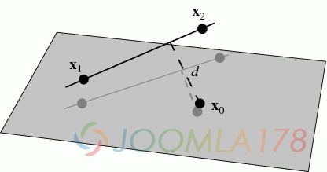
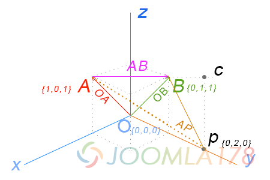
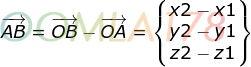
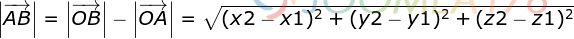
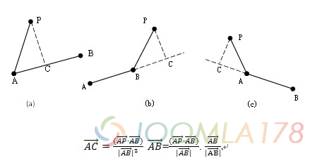
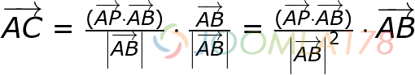
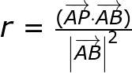

# 空间向量的基本计算及Mathjs的实现

最近业务场景中有使用到基于三维空间的一些点到点距离、点到线段距离的业务场景，所以需要复习一下立体几何和线性代数，然而关于向量的逻辑运算的理解和运算着实让人头疼，那本着已经大致理解了向量计算的逻辑和懒到不想重复造轮子的原则，找到了mathjs这个类库，下面介绍一下如何使用其中的向量计算。

### 一、概念理解

从本质上来讲，三维空间的点到点距离是可以理解成这两个点组成的一个二维上点到点的距离，因此，点到线的距离也是如此，如下图。



图片出处：<http://mathworld.wolfram.com/Point-LineDistance3-Dimensional.html>

点到点距离、点到线的距离，我们都可以使用向量的方式进行计算，假定以下直角坐标系场景，向量OA和向量OB的终点组成了向量AB，P是AB之外的点，并且在三维空间下的坐标点如下



### 二、计算逻辑和实现

**A. 点到点距离**

求OA和OB的两个终点的距离，也就是求向量AB的长度，称作向量AB的模，数学公式如下

向量AB的计算公式



向量AB模计算公式



所以AB模的结果，A、B两点距离就是2的平方根约等于1.41421，其实上述图例很好理解，就是一个等腰直角三角形的斜边长度，两个腰长是1，斜边长度则是根2的平方根。

**所以JS的实现就是：**

```
var A = {x:1,y:0,z:1}, B = {x:0, y:1, z:1}var ABDistance = Math.sqrt(Math.pow((B.x - A.x),2) + Math.pow((B.y - A.y),2) + Math.pow((B.z - A.z),2))console.log(ABDistance)1.4142135623730951
```

**B. 点到线距离**

在这里我们参考文章：[点到线段的最短距离算法](http://blog.sina.com.cn/s/blog_5d5c80840101bnhw.html)，换到我们的示例中就是该教程中的b图

根据上面图例，假设的p点（坐标是0,2,0），直观地看到了点在向量AB的延长线上，所以点到线的距离是p到c的长度，而点到该线段的最短距离则是p到B的长度，所以我们要求得点到线距离是c，视觉上可得知p点到AB线段的距离最近的点是B（不在线上），所以投影不在线上的情况判断起来就比较容易了。



无论C点在向量AB上的虚线还是实线上，我们都需要得到向量AC，计算公式是：



该公式计算逻辑是

- 1、向量AC = 向量AC的模 \* 向量AC的单位向量
- 2、因为C点在向量AB上，所以向量AC的单位向量 = 向量AB的单位向量
- 3、向量AC的模 = 向量AP和向量AB的点积 / 向量AB模  （避免使用AP和AB的夹角计算AC的模）

由此公式我们也可以理解为：**向量AC = 向量方向性r \* 向量AB，所以****r的值公式如下：**



所以此上述教程我们设定r的值作为判断p到线段AB最近距离点的方式就简单的多了，以上三种情况

- 1、r ≤ 0，则是c图情况，C点则在A的负方向，那么最短距离就是向量AP的模（长度）
- 2、r > 1，则是b图情况，C点则在B的正方向，最短距离就是向量BP的模（长度）
- 3、0 < r < 1，则是a图情况，C点则介于A和B中间，最短距离就是向量CP的模（长度）

**情形1：投影点C不在向量AB线上，js代码如下：**

```javascript
var A = {x:1,y:0,z:1}
var B = {x:0,y:1,z:1}
var p = {x:0,y:2,z:0}// 定义向量AP和向量ABvar APV = {x: p.x - A.x, y: p.y - A.y, z: p.z - A.z}var ABV = {x: B.x - A.x, y: B.y - A.y, z: B.z - A.z}// 求向量AP和向量AB的内积var cross = APV.x * ABV.x + APV.y * ABV.y + APV.z * ABV.z // 示例结果是3// 求向量AB模的平方，注意求模是平方根var ABPow = Math.pow((B.x - A.x),2) + Math.pow((B.y - A.y),2) + Math.pow((B.z - A.z),2) // 示例结果是2// 根据r的公式计算如下var r = cross / ABPow // 示例结果是 3/2 = 1.5
```

以上得出r的结果是1.5，结果是b图的情况，那么就可以得到p到线段AB的最短距离点是B点，由此可得到p到线段AB最短距离是向量PB的模，js代码如下：

```javascript
var PBDistance = Math.sqrt(Math.pow((p.x - B.x),2) + Math.pow((p.y - B.y),2) + Math.pow((p.z - B.z),2)) // 示例结果是1.4142135623730951
```

其实从本示例图可以视觉观察，P和B以及B在y轴上的投影组成的又是一个等腰直角三角形，腰长是1，所以斜边长可以算得1.4142135623730951

对于r小于0时，则计算向量PA的距离，不作细述

**情形2：投影C在向量AB线上**

我们把p点设置为 `{x: 0, y: 0.5, z: 0}`，所以根据上述计算得到r的结果是0.75，所以符合图a的情况，此时我们需要求向量CP的模。

那么我们知道C点是在向量AB上，所以根据上述公式 **向量AC = 向量方向性r \* 向量AB，js代码如下：**

```javascript
var A = {x:1,y:0,z:1}
var B = {x:0,y:1,z:1}
var p = {x:0,y:0.5,z:0}
// 定义向量AP和向量AB
var APV = {x: p.x - A.x, y: p.y - A.y, z: p.z - A.z}
var ABV = {x: B.x - A.x, y: B.y - A.y, z: B.z - A.z}
// 求向量AP和向量AB的内积
var cross = APV.x * ABV.x + APV.y * ABV.y + APV.z * ABV.z // 示例结果是1.5
// 求向量AB模的平方，注意求模是平方根
var ABPow = Math.pow((B.x - A.x),2) + Math.pow((B.y - A.y),2) + Math.pow((B.z - A.z),2) // 示例结果是2
// 根据r的公式计算如下
var r = cross / ABPow // 示例结果是 1.5/2 = 0.75// 得到向量AC
var ACV = {x: (B.x - A.x) * r, y: (B.y - A.y) * r, z: (B.z - A.z) * r} // 结果是{x: -0.75, y: 0.75, z: 0}var C = {x: ACV.x + A.x, y: ACV.y + A.y, z: ACV.z + A.z} // 结果是{x: 0.25, y: 0.75, z: 1}var ACDistance = Math.sqrt(Math.pow((C.x - A.x),2) + Math.pow((C.y - A.y),2) + Math.pow((C.z - A.z),2)) // 结果是1.0606601717798212// 得到p到C的距离var pCDistance = Math.sqrt(Math.pow((p.x - C.x),2) + Math.pow((p.y - C.y),2) + Math.pow((p.z - C.z),2)) // 结果是1.0606601717798212
```

最终得到了C点和向量AC模（A到C点距离） ，还有p到C点的距离

### 三、Mathjs distance方法实现

对于Mathjs来计算空间向量就变得非常简单，Mathjs空间量算文档：<http://mathjs.org/docs/reference/functions/distance.html>，先看官方示例

```javascript
math.distance([x, y, z], [x0, y0, z0, a, b, c])math.distance({pointX: 2, pointY: 5, pointZ: 9}, {x0: 4, y0: 6, z0: 3, a: 4, b: 2, c: 0})
```

两种方法都能实现，注意官方文档有一句强调：NOTE: When substituting coefficients of a line(a, b and c), use ax + by + c = 0 instead of ax + by = c For parametric equation of a 3D line, x0, y0, z0, a, b, c are from: (x−x0, y−y0, z−z0) = t(a, b, c)。

翻译意思为：(x0,y0,z0) 是线段向量的起点，(a,b,c) 本例子中的向量AB，也就是OB向量减去OB向量，使用方法如下：

**情形1：p的投影点C在向量AB的延长线上**

p点为  `{x:0, y:2, z:1}` 验证，代码如下

```javascript
var A = {x:1,y:0,z:1}var B = {x:0,y:1,z:1}var p = {x:0,y:2,z:0}math.distance([p.x, p.y, p.z], [A.x, A.y, A.z, B.x - A.x, B.y - A.y, B.z - A.z])1.224744871391589
```

**和第二部分的情形1结果不一致，因为Mathjs计算的是法向量pC的距离，所以这里可以将Bp、Ap、Cp的距离进行比较，取最小结果即可**

**情形2：p的投影在向量AB上**

```javascript
var A = {x:1,y:0,z:1}var B = {x:0,y:1,z:1}var p = {x:0,y:0.5,z:0}math.distance([p.x, p.y, p.z], [A.x, A.y, A.z, B.x - A.x, B.y - A.y, B.z - A.z])1.0606601717798212
```

结果是和第二部分计算逻辑一致

### 四、Mathjs的精简方法

Mathjs同时支持npm包方式导入至工程化项目中。

npm install --save mathjs

但Mathjs的全量导入（import \* as mathjs from 'mathjs'）会使得工程化代码过于庞大，在这里我们参考官方文档精简引入：<http://mathjs.org/docs/custom_bundling.html>

```javascript
// 加载mathjs核心库
const core = require('mathjs/core')
// 创建math对象
// 它只包含`import`和`config`方法
const math = core.create()// 导入distance模块math.import(require('mathjs/lib/function/geometry/distance'))// 导入所需模块math.import(require('mathjs/lib/function/arithmetic/add'))math.import(require('mathjs/lib/function/arithmetic/subtract'))math.import(require('mathjs/lib/function/arithmetic/multiply'))math.import(require('mathjs/lib/function/arithmetic/divide'))math.import(require('mathjs/lib/function/string/format'))
```

然后在业务代码中即可使用math.distance方法了

### 五、总结

在实际项目中，Mathjs的运用范围比较广，如果业务中使用到一些数学、几何类运算较多，可导入Mathjs模块，如果空间运算中只涉及到以上的距离，可将第二部分逻辑运算方法进行封装。

以上可见，三维空间中点到线、点到面、点到立方体中心距离等三维空间中的空间运算都可以基于点到点、点到线的基本方法加以实现，而在使用向量运算能让我们在实际业务中脱离三维夹角、三维坐标系的复杂运算进行逻辑实现变得异常简单。

向量的运用范围不仅限于三维，依托线性代数的知识，还可以使用向量针对多维矩阵进行空间运算。

---

除特殊标明文章转自第三方网站，文章均由JOOMLASK.COM原创提供  
欢迎友情转载，请务必保留本文出处并引用本文链接： [空间向量的基本计算及Mathjs的实现](http://www.joomla178.com/joomla-share/front-end/use-mathjs-vector-calculate.html)
