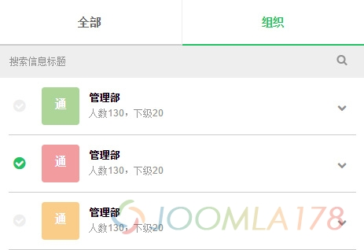

# zepto中操作ajax创建的dom元素进行事件绑定



最近做的项目中要用到ajax+json无刷新异步加载数据，由ajax创建的dom元素无法在$(document).ready()中进行事件操作，和开发的朋友聊了一下，朋友说了两种方法，都很管用！效率也相当，在此分享一下。

第一种方法：直接在ajax返回Dom操作结果后，执行该dom元素的事件

下述代码中result是ajax创建的一个<i class="fa fa-check-circle"></i>的DOM元素，返回result在<p></p>中，返回后执行tap事件

```
function ajaxCateData(jsonurl){    $.ajax({        type: 'GET',        url: jsonurl,        dataType: 'json',        success: function(data){            var result = '';            for(var i = 0; i < data.lists.length; i++){                result +='<i class="fa fa-check-circle"></i>'            }            $('p').html(result);            //下行执行点击事件            $('i.fa-check-circle').tap(function(){                console.log('点击成功');            });        }    });}
```

第二种方法：使用zepto/jquery中的.on()进行预绑定

很简单，删掉ajax中处理点击事件代码：

```
function ajaxCateData(jsonurl){    $.ajax({        type: 'GET',        url: jsonurl,        dataType: 'json',        success: function(data){            var result = '';            for(var i = 0; i < data.lists.length; i++){                result +='<i class="fa fa-check-circle"></i>'            }            $('p').html(result);        }    });}
```

并添执行代码下述执行代码，利用<p>和<i class="fa fa-check-circle"></i>的父子关系进行绑定事件，参考zepto官方API中的.on()

```
$(function() {    ajaxCateData("json/contact0.json");//先常规执行ajax数据加载    $('p').on('tap','i.fa-check-circle',function(e){        console.log('点击成功');   })});
```

---

除特殊标明文章转自第三方网站，文章均由JOOMLASK.COM原创提供  
欢迎友情转载，请务必保留本文出处并引用本文链接： [zepto中操作ajax创建的dom元素进行事件绑定](http://www.joomla178.com/joomla-share/front-end/zepto-ajax-dom-event.html)
