# Joomla! 2.5基础教程系列 - 更强大的用户和权限管理

12: 用户和权限

人们只想能用好您为他们创建的[Joomla](http://www.Joomla178.com)网站- 不论是主动还是被动。经验越丰富，对网站理解 越佳。[Joomla](http://www.Joomla178.com) 正同每个CMS一样，它会对访客和注册用户的权限加以区分。访客通常通过搜索 引擎或社交媒体网站推荐抵达，他们通过注册即可成为用户。已经注册的用户大多 都知道他们 要找寻什么，而且他们来网站都有特定的目的。  
网站的用户越多， 关于用户和权限的话题juice越复杂。在早先的[Joomla](http://www.Joomla178.com) 1.6版本，由用户组、权  
限和访问级别组成的系统是静态的，它无法予以更改。在 [Joomla](http://www.Joomla178.com) 2.5中，该系统只是作为强大的  
访问控制列表（ACL） 54 的默认配置得以保留。  
每个网站访问都会经由权限组 评估，即使是访客也不例外。在注册您的[Joomla](http://www.Joomla178.com) 网站后，用户 就会自动转换为权限组 的一员。该组具有预定义的权限并有其归属的访问级别。 一个访问级别 可以包含许多的权限组。 一个组可以包含许多的用户或访客。权限可以在好几个地方向下传递 和覆盖。  
让我们从回顾注册过程开始。

注册与登录

网站生命周期的第一个注册过程就是完成[Joomla](http://www.Joomla178.com)的安装。在最后步骤会要求你提供用户名、 邮件地址和口令。安装[Joomla](http://www.Joomla178.com)的用户就成为了超级管理员， 他具备网站的无敌权限。这就是为 什么每个[Joomla](http://www.Joomla178.com)网站都至少具有一个用户账户的原因。只有该用户可以通过用户–用户管理-选项 来修改网站的行为 （图 1）。

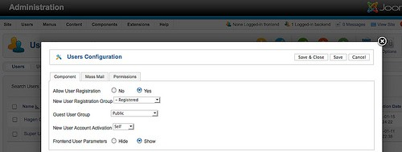

图 *1*： 用户选项

在您的 [Joomla](http://www.Joomla178.com)网站， 您可以任意创建用户。你也可以允许访客注册。根据他们的权限，用户  
能创建他们自己的内容或查看特意为他们准备的内容。

用户选项

该表单有三个标签  
• 组件  
在这个地方你可以配置是否允许注册。[Joomla](http://www.Joomla178.com) 1.6之后的一个新功能就是可以配置访客默认所  
在的用户组和注册用户默认所在的用户组。  
• 群发邮件  
可以给用户群发邮件。该标签内你可以配置静态的邮件设置。  
• 权限 该标签内你可以管理每个用户组的权限设置。 登录  
访客可以在网站注册。因此， [Joomla](http://www.Joomla178.com) 提供了一个可以放置在网站的登录模块（图 2）。

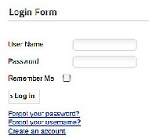

图 *2*： 登陆模块

该模块可以配上许多附加功能，比如自定义文本、SSL 加密和登录/注销重定向。具体请见扩  
展–模块管理器（图3 ）。  
 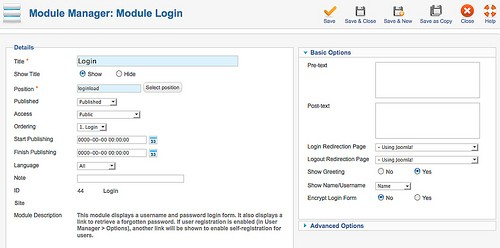

图 *3*： 登录模块选项

登录模块提供的表单有个优点，用户不必在登录表单显示之前点击链接。如果登录不是必要 的行为或者你不想把登录表单用作模块，你还可以通过组件来创建表单。因此你必须根据需要创 建正确的菜单项类型和菜单项（图 4）。

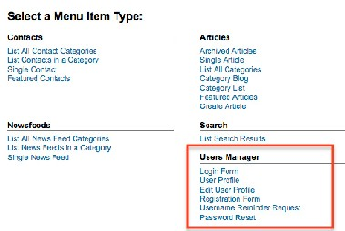

附加配置文件字段

图 *4*： 用户的菜单项类型

过去只有借助附加扩展才能在注册表单内加入额外的字段。为了解决这个问题并把用户数据  
和联系人组件结合起来，[Joomla](http://www.Joomla178.com) 2.5 核心提供了一个插件叫用户配置文件。 在扩展–插件管理器 内你可以激活并配置该插件（请参阅 联系人组件 ）。该模块提供了几个附加字段，甚至还有服 务条款 选项，便于用户在注册前先确认服务条款（图 5）。

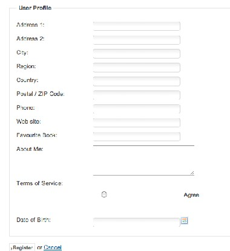

用户组

图 *5*： 附加配置文件字段

引入用户组的想法是创建权限集。  
"你如果想成为我们网站的作者，你就需要下列权限。"  
会员的权限不是通过单独指派、而是通过指派用户组获得。用户可以归属一个或多个用户 组。想象下您有分属四个用户组的10.000个用户。管理员管理这些用户组的权限就很方便。没有 用户组你就只能手工更改每个用户的权限。如果你使用了用户组的话，就只需要改一次权限!  
[Joomla](http://www.Joomla178.com) 2.5 配置多少用户组完全取决于你。在 [Joomla](http://www.Joomla178.com)核心的用户管理–用户组，你可以浏览到 所有的用户组（图 6）。

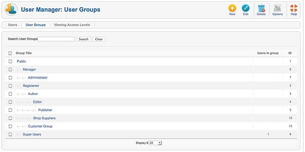

图 *6*： 用户组

默认设置和[Joomla](http://www.Joomla178.com) 1.5一样。如果您满意的话就不必做任何改变。

网站前台用户组默认权限

• 注册用户组  
注册用户可以登录、编辑他自己的东西，并且能看到部分未注册用户不能看到的东西。  
• 作者组 作者拥有注册用户所有的全部权限。作者也可以撰写文章并修改内容。通常在用户菜单上会有 个相应链接。  
• 主编组  
主编拥有作者所有的全部权限。主编能在网站前台撰写和编辑所有文章。  
• 总编组 总编拥有主编所有的全部权限。总编能在网站前台撰写和编辑所有文章。另外，总编还能决定  
文章的发布与否。

网站后台用户组默认权限

• 初级管理员组  
初级管理员可以创建内容并查看系统的各种信息。但他不可以：

• 管理用户  
•  
• 安装模块和组件  
• 提升用户为超级管理员或修改超级管理员  
• 操作菜单项 ：网站 | 全局配置  
• 给所有用户群发邮件  
• 更改和/或安装模板和语言文件  
• 高级管理员  
高级管理员不可以：  
• 提升用户为超级管理员或修改超级管理员  
• 操作菜单项 ：网站 | 全局配置  
• 给所有用户群发邮件  
• 更改和/或安装模板和语言文件  
• 超级管理员或超级用户 用户可以执行[Joomla](http://www.Joomla178.com)管理的一切功能。仅超级管理员方可添加其他超级管理员。 访问级别  
用户组可以分配访问级别。所以用户组内的用户也就对应有了访问级别（图 7， 图 8）

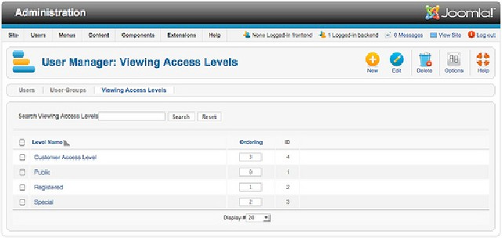

图 *7*： 访问级别

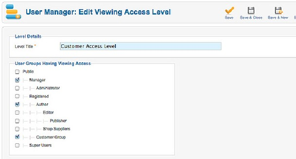

图 *8*： 为用户组分配访问级别

为什么是访问级别*?*

正如我们看到的，访问级别就是捆绑的用户组。通过用户组权限的组合，访问级别就能解决 用户需求。比如在文章内你就可以限制访问权限（图 9）。  
 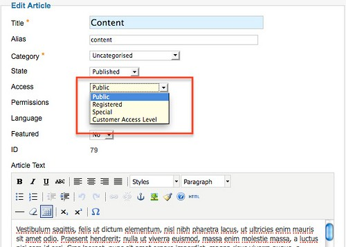

图 *9*： 文章的访问级别 新系统把[Joomla](http://www.Joomla178.com)推进了一大步。很多用户过去困扰于缺乏用户组配置、访问级别和权限。 对于大型组织来说，对内容和功能访问进行限制是必须的；它对于[Joomla](http://www.Joomla178.com) 网站开展电子商务

支持和基于订阅的服务也必不可少。 [Joomla](http://www.Joomla178.com)的ACL 系统不仅对[Joomla](http://www.Joomla178.com)内容和核心功能生效

用户备注

你可以给每个用户创建带有审查日期的备注（图 10）。可以对用户备注按类进行分组。这个 功能使得你可以设置一个工作流程，比如用于审查用户账户。可以按审查日期对用户备注进行排 序（图 11）。

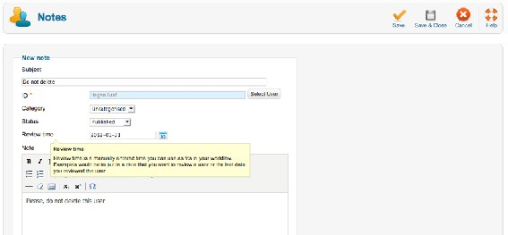

图 *10*： 用户备注

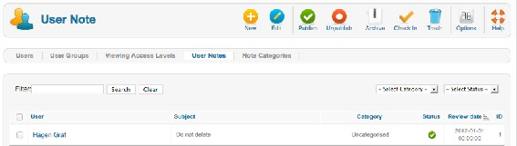

邮件群发

图 *11*： 用户备注列表

有时你会需要通过邮件向所有用户发送信息。有时你会需要仅向可以访问网站后台的用户发  
送信息。发送邮件总有点微妙。没人想成为垃圾邮件发送者，没人想收到垃圾邮件，这个要谨  
慎!  
要使用邮件群发组件，你需要在全局配置 → 服务器 → Mail 设置对Joomla的邮件发送进行配 置。你也可以在用户 →群发邮件：选项–群发邮件 配置标题前缀和邮件内容后缀。

邮件群发组件的用户界面很易理解。你可以选择邮件接收用户组。自 Joomla 1.7 就能对查封  
用户是否可以接收邮件进行选择。 你也可以确定子用户组能否接收邮件，邮件是html格式还是纯文本格式，还有是否在邮件内  
列出所有收件人或者标记为BCC（密件副本）。信息包括标题和主体。你可以使用html，但这里  
没提供 wysiwyg 编辑器（图 12）。  
 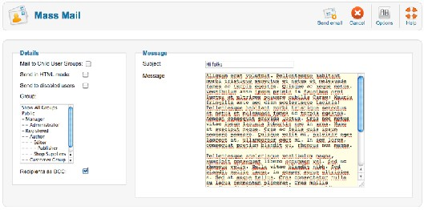

图 *12*： 邮件群发表单

Joomla无法保存群发邮件。表单填写完毕点击发送邮件图标，邮件就发送出去了。

---

除特殊标明文章转自第三方网站，文章均由JOOMLASK.COM原创提供  
欢迎友情转载，请务必保留本文出处并引用本文链接： [Joomla! 2.5基础教程系列 - 更强大的用户和权限管理](http://www.joomla178.com/joomla-share/joomla-basic/joomla-base-guide-acl.html)
