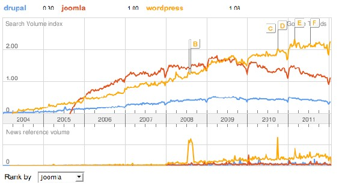
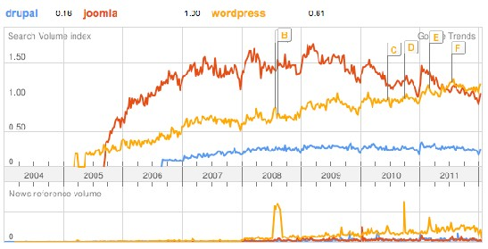

# Joomla! 2.5基础教程系列 - 序言

本教程及后续版本均转自[Joomla! 2.5 - 基础指南](http://cocoate.com/zh-hans/j25cn)，版权为原作者及翻译作者所有，感谢Hagen Graf和Yooyooh。**[下载PDF版本](http://pan.baidu.com/s/1eQd1VUE)**

1: 序言

欢迎来到[Joomla](http://www.Joomla178.com/)。它是个用于创建网站的免费系统。正如大多数开源项目一样，[Joomla](http://www.Joomla178.com/)也处 于不断地发展中。我们无法预知、有时无法描述，甚或[Joomla](http://www.Joomla178.com/)还存有争议，但它确实是个很棒的 系统。六年来[Joomla](http://www.Joomla178.com/)极其成功，广受全球几百万用户的欢迎。  
关于在书写[Joomla](http://www.Joomla178.com/) 的时候后面是否要加“！”现已达成共识：  
仅在首次书写时加“！” [Joomla](http://www.Joomla178.com/)衍生自单词Jumla，后者属于非洲语言的斯瓦希里文，意思是“在一起”。 [Joomla](http://www.Joomla178.com/)项目是Mambo基金会激烈讨论的结果， 后者成立于2005年8月，也就是后来的开发团  
队。[Joomla](http://www.Joomla178.com/) 继承了Mambo系统的优点。[Joomla](http://www.Joomla178.com/) 在全球范围内得到广泛使用，无论是简单的主页  
还是复杂的公司网站。它易于安装、管理，非常可靠。  
[Joomla](http://www.Joomla178.com/)团队自身在过去六年间处于不断变化中  
? 从 2005 到 2009， [Joomla](http://www.Joomla178.com/) 1.0开发到1.0.15版，在2009年9月其开发正式终止。  
? 从 2005 至今，[Joomla](http://www.Joomla178.com/) 1.5 一直在持续开发中，1.5的首个稳定版发布于2008年1月， 而官方宣布 其产品生命周期终止于2012年4月。  
? 从 2008 到 2011， [Joomla](http://www.Joomla178.com/) 1.6在开发。2011年1月迎来首个稳定版。  
? 2011年7月 [Joomla](http://www.Joomla178.com/) 1.7发布  
? [Joomla](http://www.Joomla178.com/) 2.5是[Joomla](http://www.Joomla178.com/) 1.5后的第一个长期发行版，2012年1月发布  
[Joomla](http://www.Joomla178.com/)用户展示了他们的忠诚。许多人把网站从Mambo转为[Joomla](http://www.Joomla178.com/)，经年累月他们掌握了很 多。  
很多用户在过去几年内都已上手了[Joomla](http://www.Joomla178.com/)，但总有人还对该系统一无所知。[Joomla](http://www.Joomla178.com/)、Drupal和  
WordPress，同属全球开源网站内容管理系统的巨擎。

图 *1* 中， *Google*搜索量趋势表明*[Joomla](http://www.Joomla178.com/)* 和 *WordPress*

处于同一级别。[Joomla](http://www.Joomla178.com/) 和 Wordpress的搜索量三倍于Drupal。但是，自2010年以来 [Joomla](http://www.Joomla178.com/) 的 搜索量在下降。[Joomla](http://www.Joomla178.com/)是该反思下2011年1月的[Joomla](http://www.Joomla178.com/) 1.6 和2011年7月的 [Joomla](http://www.Joomla178.com/) 1.7了。  
 

图 *2: Google Trend 2012-01-17 Germany - Drupal, [Joomla](http://www.Joomla178.com/), WordPress*

和世界平均水平相比， 比如德国的情况就不一样 （图 2 ）。 [Joomla](http://www.Joomla178.com/)几乎是的WordPress两  
倍， WordPress又几乎是Drupal的四倍。  
下面是来自Google Trends的一些统计 （表 1 ）：

|  |  |  |  |
| --- | --- | --- | --- |
| 国家 | Drupal | [Joomla](http://www.Joomla178.com/) | WordPress |
| 全球 | 0.3 | 1 | 1.08 |
| 智利 | 0 | 1 | 0.82 |
| 法国 | 0.2 | 1 | 0.68 |
| 德国 | 0.16 | 1 | 0.61 |
| 意大利 | 0.17 | 1 | 0.6 |
| 波兰 | 0.15 | 1 | 0.43 |
| 俄罗斯 | 0.3 | 1 | 0.5 |
| 西班牙 | 0.26 | 1 | 1 |
| 瑞士 | 0.15 | 1 | 0.45 |
| 英国 | 0.4 | 1 | 1.65 |
| 美国 | 0.66 | 1 | 2.3 |
| 中国 | 0.8 | 1 | 3.2 |

表 *1: Google Trend - Drupal, [Joomla](http://www.Joomla178.com/), WordPress*

内容管理系统的使用存在着显著的国别差异。例如，在德国，CMS TYPO3也占有一席之 地。其搜索量和[Joomla](http://www.Joomla178.com/)相当。  
截止**2012**年**1**月， **2.8 %**的网站是用**[Joomla](http://www.Joomla178.com/)**搭建1  
基于 [Joomla](http://www.Joomla178.com/)框架， [Joomla](http://www.Joomla178.com/)网站范 围 从 简单 的主 页 一直延伸到复 杂 的商 业应 用。是什么 让  
[Joomla](http://www.Joomla178.com/)如此成功，您又可怎样的方式来使用它，本书将一一道来。

我是谁?

1 w3techs.com/technologies/overview/content\_management/all

我叫 Hagen Graf，47岁，住在法国菲图 *Fitou, France*2。我娶到了梦中情人并拥有了4个女儿。  
我的工作很杂，比如讲课、顾问、倾听、测试、编程、开发新的应用等等，而且经常会尝试  
新的东西。  
实际上，我的工作完全可以在线完成，但是客户有时对在线项目的看法有所保留，因此我不 得不频频踏上旅途。旅途也意味着会见来自不同国家、拥有不同语 言和文化的客户，我是长途 车 、公共汽 车 或火 车 的常客， 还 有 针对 客 户查询 的快速响 应 ，主要是通 过 Fa c e b o o k 信息和 tweets。  
这种工作方式我曾经称作“办公室”。 我需要在全球的任意地点都能访问我的邮件、图片、视频、推特和文档。我人在哪里，办公室就 在哪里。

你是谁?

我当然不知道你做些什么，但是我共事过的很多人和我的工作方式类似。规模较大的公司的 员工由于各种原因通常无法灵活安排自己的工作。你自己在计算机 方面的经验或许和我相同。 我们许多人开始的时候都是在学校或家里摆弄装有Windows系统的老式PC，也都经历过办公应用 的严酷现实：数据丢失、内存不 足、硬盘和打印机配置异常等。这种情况随着以用户为中心的 Web 2.0和智能手机的出现而得以改善，但这并不意味着更为简单。  
如果你不爱在晚间捣鼓操作系统或电话或整理你的照片和音乐，并热衷于在设备间倒腾的 话，那么你大概和我一样——为自己的设备和应用能正常工作而感到 满足，当你能通过Internet 访问数据而且一切都进展顺利的时候。 如果你在家办公，一个舒适的工作环境就尤显重要。有 故障的软硬件会很快让你经历一场噩梦。  
我把用户区分为以下几类：  
? 访客： 他们访问网站但不关心网站用什么系统来创建。  
? 用户： 他们使用网站，并使用预定义的过程来创建内容。  
   
 [2](http://goo.gl/maps/3dU6) http://goo.gl/maps/3dU6

? 网站设计者或集成者： 他们在服务器上安装 [Joomla](http://www.Joomla178.com/)站点，创建类别，内容，链接和菜单模  
块， 配置模板和语言，他们是通才，通常也对网站全权负责。  
? **CSS** 设计者： 他们往往喜欢和. css 扩展的文件打交道。  
? **HTML** 设计者： 他们奠定CSS设计师工作的基础。对于 [Joomla](http://www.Joomla178.com/)，他们创建所谓的模板覆盖。  
? 开发者： 他们知道编程语言PHP和JavaScript，而且喜欢使用它们。他们用附加的功能来提升  
[Joomla](http://www.Joomla178.com/) 核心。  
? 架构师： 他们思考安全、速度和代码质量。 网站设计者在上述名单中扮演了特殊的角色。他通常涵盖所有其他角色，这构成了现实的挑  
战。当我写这本书时，我经常发现自己在思考网站设计者。  
一个公司、一个机构、一个俱乐部，是的，或许每个人，都希望网站的展示既灵活又对用户 友好。网站的展示，也随着时间的推移而发展，通过网络浏览器可以很容易地加以改变。这个展 示可以取代你的文件柜和皮制地址薄；这个展示可以和各种设备通信并可易于扩展。  
我假设你的网站已经足以说明你或你的公司。它可是每周7天、每天24小时维护你的客户关系 的地方。 你的网站或许包含了许多应用程序和数据来概括你的活动。你的网站还应当包含允许其他应用程 序使用的接口。  
直到几年前，创建网站还是一件很困难的事情。虽然你不必成为一个知名的专家，但只有同时具 备毅力和兴趣才能使成果打动人心。你得在HTML编辑器里创建静 态的HTML页面，然后通过 文件传输协议把它们上传到服务器。即使创建最简单的交互比如联系表单或论坛，你都得学习一 門编程语言。 很容易理解有些人不会自己来承担这些困苦，他们会把网站外包，或者根本就不予重视。 多亏Facebook和诸如Google网站这样的配套工具，创建简单的网页不再困难，但是如果你希望与 众不同，那么你还是应当熟悉内容管理系统。

## [Joomla](http://www.Joomla178.com/) 提供了创建个人网站的一切东东。

这是本什么样的书?

首先， 它是本关于[Joomla](http://www.Joomla178.com/)及其使用的书。 [Joomla](http://www.Joomla178.com/)几乎是个万能工具，依据你的想法和愿望，它可以对应有很多种类繁多的配置。 为了便于阅读，我把书按照以下组织：  
1. 序言  
2. 陈列柜  
3. 安装  
4. 结构和术语  
5. 最新动态？  
6. 管理内容  
7. 如何创建 '关于我们' 页面  
8. 典型文章  
9. 媒体管理器  
10. 联系表单  
11. 状态、垃圾箱和签入  
12. 用类别来组织您的内容  
13. 网站和内容配置  
14. 模板  
15.  
16. 导航  
17. 用户和权限

18. 扩展管理器  
19. 核心扩展  
20. 模块  
21. 插件  
22. 使用模板  
23. 模板 Beez  
24. 为什么 SEO 很重要  
25. 多语言网站  
26. 从头开始 [Joomla](http://www.Joomla178.com/) 网站  
27. 从老版本升级  
28. 用[Joomla](http://www.Joomla178.com/)赢取尊重和金钱  
29. 资源?

阅读本书后你能做些什么?

虽然你是一个初学者，你也可以用 浏览 器来管理自己的 [Joomla](http://www.Joomla178.com/) 网站。如果你有点熟悉   
HTML， CSS和图像编辑，你就能为自己的网站定制模板了。

还有其他问题?

不要犹豫! 当然，我无法提供技术支持。[Joomla](http://www.Joomla178.com/)论坛已经提供了丰富的知识，你在那儿一定 可以找到问题的答案。如果你对本书有意见或问题，请尽管在评论区留言。

---

除特殊标明文章转自第三方网站，文章均由JOOMLASK.COM原创提供  
欢迎友情转载，请务必保留本文出处并引用本文链接： [Joomla! 2.5基础教程系列 - 序言](http://www.joomla178.com/joomla-share/joomla-basic/joomla-base-guide-begin.html)
