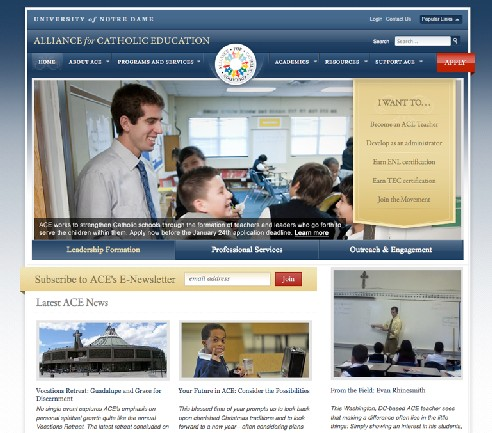
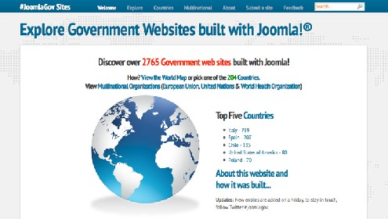
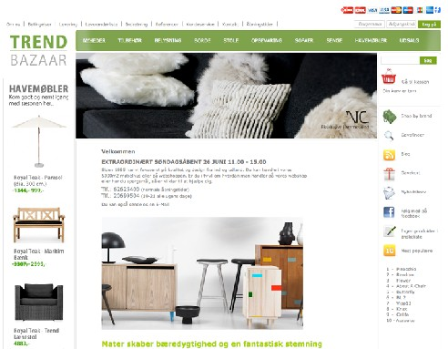
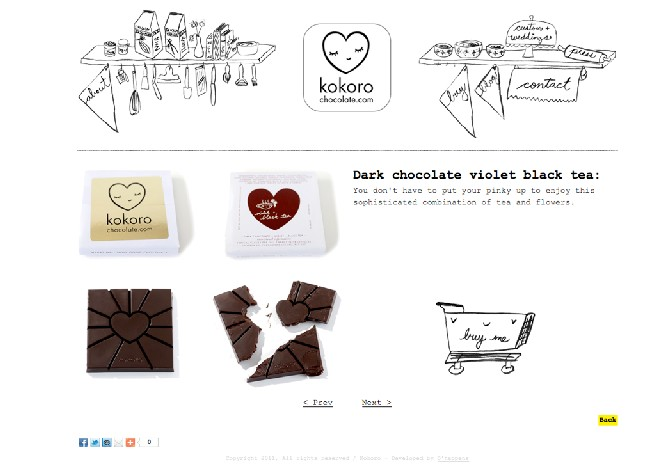
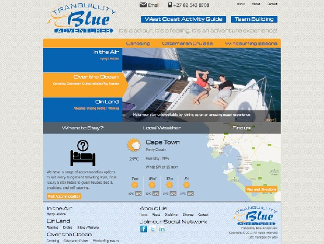
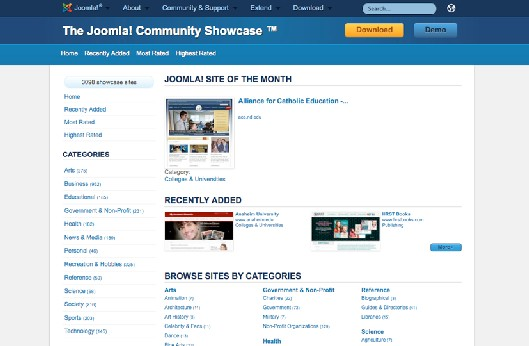
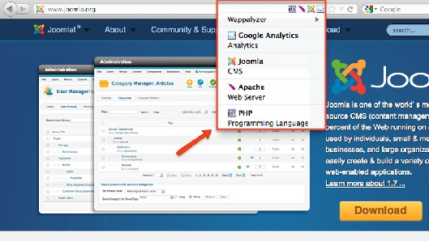
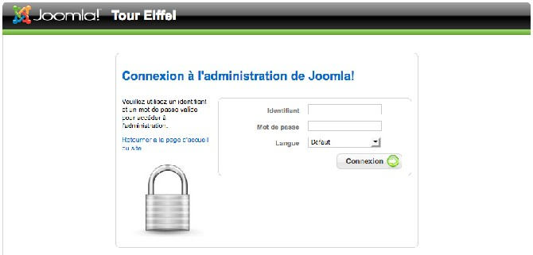

# Joomla! 2.5基础教程系列 - Joomla案例陈列柜

2: JOOMLA案例陈列柜（JOOMLA酷站）

## [Joomla](http://www.Joomla178.com)所建的网站是个什么样子?

这个问题不好回答，因为多数网站虽然使用[Joomla](http://www.Joomla178.com)来搭建，但其设计却来自专业机构，是“转
换”成[Joomla](http://www.Joomla178.com)模板的。因此，网站外观具有欺骗性。不过，这里有些截图可以帮你厘清思路。 天主教教育联盟
- 巴黎圣母院大学  
天主教教育联盟，简称ACE，使用[Joomla](http://www.Joomla178.com) 1.7来管理他们多方面的网站展示。ACE协同了12个
不同的规划，它们都致力于加强和维持美国的天主教学校。利用[Joomla](http://www.Joomla178.com)和Gantry模板框架的多模  
板选项，ACE得以维护12个网站为一体（如：http://ace.nd.edu/teach是该站点内某个规划的首
页）。所有的ACE单位都用同样的[Joomla](http://www.Joomla178.com)实例和数据库构建，这就在视觉上和主站首页保持了一
致，并能和组织成员共享相同的功能：整合的新闻源、在线会员资格、JomSocial网络、多个博 客、招工板和出版物在线目录。  
AC
E 所采用的某些 扩 展是： Yo o t h e m e 的 Zoo ， Sh 4 0 4 s ef ， JCE ， JS P T 和
So c i alab le 的  
Autogroup。  
未来的计划包括在[Joomla](http://www.Joomla178.com)框架内整合CRM（CiviCRM）。（图
1）!



图 *1*：巴黎圣母院大学

• 网站: ace.nd.edu  
• 制作: CloudAccess.net, Ricky Austin3

3000+ 政府网站使用JOOMLA构建

JoomlaGov是个[Joomla](http://www.Joomla178.com)搭建的展示政府网站的陈列柜。里面的网站来自200多个国家，该网站 在2011年 'J and
Beyond' (http://www.jandbeyond.org) 发布后一个多月，罗列的网站就超过了3000  
家。  
  
[3](http://ace.nd.edu/directory/ricky-austin) http://ace.nd.edu/directory/ricky-austin

该网站极好地演示了[Joomla](http://www.Joomla178.com)社区 (http://joomlagov.info/about) 合作，凸显了[Joomla](http://www.Joomla178.com) CMS的品  
质。例如，联邦区政府墨西哥城的公民門户网站，Mexiko
(http://www.df.gob.mx/) 就值得一看。  
（图 3）.  
  
图 *3: JoomlaGov*  
使用 [Joomla](http://www.Joomla178.com)， K2 & Google
Maps （API 版本 3）构建的网站。这段视频录制于南非2011的  
[Joomla](http://www.Joomla178.com) Day。案例研究 ——
我们如何建立joomlagov.info网站——Dwight Barnard （ZA) 4  
•
网站: www.joomlagov.info  
• 制作: raramuridesign & piezoworks.be

艾菲尔铁塔

是的，或许你也知道这个建筑（图 4）!  
  
[4](http://vimeo.com/32790888) http://vimeo.com/32790888

  
• 网站: tour-eiffel.fr

图*4: The Eiffel Tower*

• 制作: Mairie de Paris (paris.fr)

ECOMMERCE

基于[Joomla](http://www.Joomla178.com)和RedShop组件的丹麦在线商店（图 5 ）。

  
图 *4: eCommerce with [Joomla](http://www.Joomla178.com)!*  
• 网站:
www.trendbazaar.dk  
• 制作: redweb.dk

KOKORO

Kokoro代表：全心全意制作的巧克力。（图 6）

  
图 *6*： *Kokoro* 网  
• 网站:
kokorochocolate.com  
• 制作: ohappens.nl

TRANQUILLITY BLUE

Tranquillity Blue是个展示非洲西南海岸某个沿海小镇、以运动和冒险为主题的网站。它旨在

赋予客户管理网站的能力，并且网站要足够灵活以便涵盖必要的高级功能。（图 7）

  
网站: www.tranquillityblue.co.za  
图 *7:
Tranquillity Blue*  
制作: raramuridesign.com

还有?

这些网站看起来和普通网站也没啥区别。：-） 如果我没有告诉你它们是用[Joomla](http://www.Joomla178.com)创建的，你可能都不会加以留意。  
更多示例可以在techrepublic
2012 年1月的文章内找到：15 [Joomla](http://www.Joomla178.com) implementations5

如何查找 JOOMLA网站?

joomla.org

  
[5](http://www.techrepublic.com/blog/webmaster/inspiration-15-joomla-implementations/1085) http://www.techrepublic.com/blog/webmaster/inspiration-15-joomla-implementations/1085

参观下项目主站吧！ 在 [Joomla](http://www.Joomla178.com) 陈列柜 6 我可以找到许多特色网站。该类别下有逾2，000网  
站。那里有月度网站、
获评最佳网站的概要，等等（图 8）。  


Google

图 *8: [Joomla](http://www.Joomla178.com) Showcase*

你可以搜索术语 com\_content7。组件 "content"
在页面网址内使用该术语。目前，该方法已不  
是最有效，因为许多搜索引擎对网址进行了优化，但结果仍差强人意。

WAPPALYZER 火狐扩展

Wappalyzer8 是个用于识别网站软件的浏览器（火狐）扩展（图 9）。.  
  
[6](http://community.joomla.org/showcase/) http://community.joomla.org/showcase/  
[7](http://www.google.de/search?q=com_content)http://www.google.de/search?q=com\_content

8 https://addons.mozilla.org/en-US/firefox/addon/wappalyzer/



更详细地检查网站

图 *9: Wappalyzer*

如果你想知道所在的网站是否用[Joomla](http://www.Joomla178.com)创建的，你可以查看下源代码。在header区域，你应  
当发现本行代码：

```
<meta name="generator" content="Joomla - Open Source Content Management" />
```

你也可以直接键入后台管理的网址链接：

http://example.com/administrator

这是艾菲尔铁塔网站的示例: 9:  
  
[9](http://www.tour-eiffel.fr/administrator/) http://www.tour-eiffel.fr/administrator/



图 *10: Administration of the Eiffel tower* 网站

直接去问你的朋友

我发布如下推特  
我需要你的网站：） 寻找5+超棒的[Joomla](http://www.Joomla178.com)网站示例，用作

cocoate.com/j25/的陈列柜章节的材料，请回应+转发

这样极有可能收到上述网站链接的回应!

其他想法?

你还知道其他识别[Joomla](http://www.Joomla178.com)网站的方法吗? 请随时留言 。10 .  


10<http://cocoate.com/zh-hans/images/stories/img/base/j25/showcase>

本教程及后续版本均转自[Joomla! 2.5 - 基础指南](http://cocoate.com/zh-hans/j25cn)，版权为原作者及翻译作者所有，感谢Hagen Graf和Yooyooh。**[下载PDF版本](http://pan.baidu.com/s/1eQd1VUE)**

---

除特殊标明文章转自第三方网站，文章均由JOOMLASK.COM原创提供  
欢迎友情转载，请务必保留本文出处并引用本文链接： [Joomla! 2.5基础教程系列 - Joomla案例陈列柜](http://www.joomla178.com/joomla-share/joomla-basic/joomla-base-guide-case.html)
