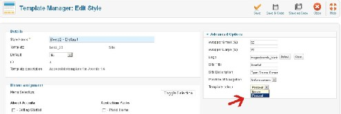
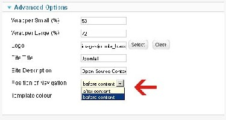
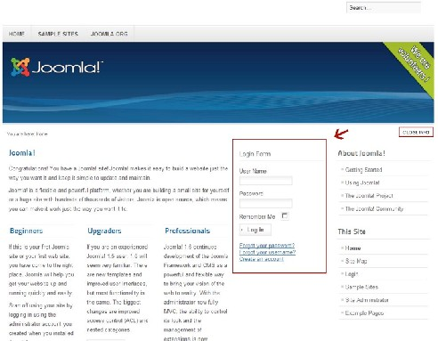
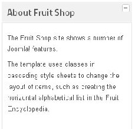
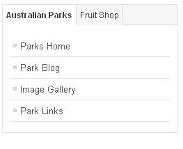

# Joomla! 2.5基础教程系列 - 经典的Beez模板

18: Beez 模板

模板包含的东西通常超过你一眼所见。 模板这个术语通常和网站的外观所联系。但是除了设计，网站的特点还和技术实施方式有  
关。它决定了文档流内内容之所在、特定模块在何时与何地切换显示、是否可以使用自定义错误  
页以及使用何种版本的HTML标记。  
有些用户对于[Joomla!](http://www.Joomla178.com/) 1.5的Beez模板很熟悉。beez\_20与beez5 a和先前版本的外观设计有差异。在  
设计上我使用了中性灰作为模板的组件基调，比如提供的菜单方案能和很多颜色协调。 即便那时，我就想开发出符合标准兼容、易于访问和适应性的模板。我有意选择了紫色，希  
望设计者能接受这些代码，并在此基础上修改后免费发布。我希望会涌现许多新的免费模板。不  
幸地是，现实并非如此。 我犯下的另一个错误就是没有及早沟通清楚真正的目标是什么。输出结构注重能以简单和直  
接的方式来实现设计，你仅需进行少量的CSS修改即可。我把这 个作为新版本Beez的原则。此  
外，还多了些JavaScript，beez5还带有少量的HTML574。Beez\_20不需要模板覆盖。[Joomla!](http://www.Joomla178.com/) 最终  
也舍弃了布局表。新的基于HTML的输出仍遵循旧有Beez模板的结构。  
为便于理解，CSS类名称进行了重命名和统一。对于模板设计者来说这是个巨大的优势。 [Joomla!](http://www.Joomla178.com/)的标准HTML输出因而简洁、规范。你不再需要使 用模板覆盖来生成简洁、符合标准兼 容的代码。Beez模板的技术能力几乎相同。它们只有图形设计的差异。Beez5 版本也被设计用来 使用HTML5。

THE MAIN FEATURES

• 无障碍访问  
• 导航位置可配置

• WAI-ARIA路标角色  
• 访问标签内的模块自动展示  
• 可折叠模块的淡入淡出  
• 可折叠栏目的淡入淡出  
• beez\_20 你可以在两种样式做选择： natural 或 human  
• beez 5 可以使用HTML5

常规无障碍

对于多数人来说互联网变得普遍。全球的信息都时刻处于待检，或许更重要的是，你可以在 家里的屏幕上找到本地五金商店的特惠，登记处的开放时间或电话号码本。烦人的电话咨询或前 往图书馆已不再必要，你仅需查看互联网。 但并非所有人都从中受惠。那些身体或精神上有残疾的人难以充分参与到社会，即使他们已经能 从通信技术获益良多。他们经常受困于信息访问方面的障碍，甚至完全无望。某些障碍可以克 服，如果能提供相应设计的话。 提供网上银行服务的网上商店或银行的运营商，应当意识到这个不小的目标群体。  
无障碍的设计目标就是要尽可能让互联网上的内容和交互可以被所有的用户群体和设备所访 问。  
约有8%的德国人由于物理限制而难以通过互联网访问信息。通常网站设计中的术语 “可访问 性”是针对失明人士可以访问互联网而言。我想强调这不是全部 - 实际上，这只是一小部分。我 常常想知道为什么会是这样。或许理由就是显示器已成为计算机的经典象征，那些没法视物的人 也就没法使用它了。在我的日常工作 中，我注意到那些失明人士要比其他类型的残疾人应付更 好。  
失明人士就是残余视力仅达平均值百分之几的人。德国的失明者数量约在150，000至200，  
000。他们某些人可以通过调节计算机字体大小和自定义颜色设置来 辨认文本，某些人则只能依

赖有声信息或通过触摸盲文显示器来阅读。  
有严重的视力障碍的人的比例要显著来得高。 大概四分之一的工作年龄人口抱怨不同程度的屈光不正。以后的百分比更高。有些人可以通  
过佩戴眼镜很好地加以解决，有些人就没那么简单了。某些眼部疾 病如白内障或青光眼可以通  
过外科手术治愈或至少缓解。某些眼部疾病，如视网膜色素变性或糖尿病性视网膜病变，会导致 视力持续恶化，并往往最终导致视力的完 全丧失。患有所谓的管状视的人们的视野极端受限 – 有时仅能看到距离眼镜一臂之外2欧元硬币大小的范围。  
大概10%的男性受扰于轻微色盲 – 也就是说某些红绿无法辨识。女性中的其它颜色色盲，完全色 盲或红绿色盲则非常罕见。  
使用常见输入技术有问题的其它潜在用户群体是 - 不是每个人都会使用鼠标或标准键盘。 原因可能有很多： 手臂和手指的僵化或自发移动从而难以控制。甚至有人没有手臂和手掌，  
或者身体一侧中风后脖子以下就瘫痪了。只要人可以发送可控的二进制信号- 著名的0 或 1 – 他  
就能学会用适合的软件操纵计算机。 德国大概有60，000到100，000人的听力及其有限。其中有数千人丧失了学习德语的能力，因  
而他们的掌握有限（在4级和6级水平）。 这就需要文字表述更为清晰。  
在相互交流、接待外宾或表达复杂内容的场合，他们更喜欢使用德国手语 – 这本身是个风格，口  
语都有它自己的系统标志和手势。 注意  
不仅仅是听觉低下的人们在浏览互联网时才使用扬声器! 比如，仅有声音警告信号是不够的 – 必  
须还有清晰可辨的视觉告知。 互联网融入的生活越多，不便的场景现象也越多：旅馆内缓慢的链接速度，行驶列车上无法控制 的照明条件， 工作场所必须忍耐的噪声。 所有人都能从无障碍网站受益。这不是要最大限度地满足政府机构才要去遵循的所有规则。即便 向无障碍迈出的一小步也能显著改善网站的适用性。  
由于[Joomla!](http://www.Joomla178.com/)的普及率高， 它能影响到很多人。使用标准的beez模板可以创建相对简单且易于使用 的无障碍网站。

如beez1.5一样，所有用于无障碍模板设计的东西都已在beez\_20和beez5内实施。最重要的  
是：  
• 内容和布局分离  
• 语义逻辑结构  
• 锚链接  
• 键盘导航  
• 足够的颜色对比

内容和布局分离

开发者首要和最重要的原则就是内容和布局的完全分离：  
• 内容HTML得干净利落  
• 没有不必要的布局表  
• 专門用CSS来格式  
• 合乎逻辑的语义结构  
• 锚链接 内容的线性化问题和仅通过CSS来格式是确保便利访问的最重要条件之一。 仅当辅助技术可以随意回收内容，视觉表现才能完全忽视。利用样式表来实现网站外观可以  
赋予用户，比如那些视障用户，可以通过在他们自己浏览器内定义样式表以便页面贴合自己的需  
要。线性的内容介绍和充分的语义结构对于使用屏幕阅读软件的用户来说特别重要。 屏幕阅读软件从上到下抓取网站的内容，这意味着线性。布局表过多使用会妨碍线性化。 对于术语“语义Web” 多数人都缺乏想象。你可能会联想到语文课，但它在编写Web内容方面  
也扮演了重要的角色。 例如，屏幕阅读软件可以让用户在标题或列表之间跳转，以获取整个文  
件的简要概述。如果Web文件没有标题，这个功能就无法实现。

web文件的正式结构应主要对应内容结构。 根据Web项目，选择相应的标题层次可是相当大  
的挑战。 今天，我们不仅可以在模板内找到这个概念，它也存在于整个[Joomla!](http://www.Joomla178.com/)标准输出。在[Joomla!](http://www.Joomla178.com/) 1.6  
的开发中，它属于开发工作的核心部分。原因就是，不仅为了更好地使用辅助技术，还有助于搜  
索引擎优化和更好地使用移动设备。结构良好的代码不仅可以 帮助残疾人士更好地浏览网站， 甚至谷歌也会对这样结构良好的网站抱有好感。

锚链接

内容的线性介绍有个很大的缺陷：你也许需要折腾很久，才能访问到"in the back lying" 区域 的内容。  
在屏幕上，三栏布局允许多个区域从“above"开始， 视线很容易跳跃到，它也为视觉辅助设备  
所支持。  
补救措施就是引入锚的概念。实际上，这是个图形布局的非视觉对应物，它允许使用线性播 放设备的用户在网页开始就识别重要内容区域，从而快速跳到他们所感兴趣的信息的所在。  
实际上，锚的使用就是在每个页面的顶端设置用于页面内部导航的附加菜单。多数情况下， 在图形布局中隐藏该菜单是有用的。它会惹恼正常用户，去点击一个什么都不会发生的链接，因 为链接目标已经呈现于眼前。  
任何情况下，"锚链接菜单" 不应过长，并在建立时深思熟虑，因为它自身的线性化，它会使 感知路径延伸和复杂。通常，建议把主要内容作为首个目标跳转，这样熟悉网站和导航处理的常 规用户，能以最短路径抵达他们的目的地。  
至少这里很清楚，特别对于含有复杂内容页面的网站来说，它们不仅需要图形布局，还需要 仔细设计内容形式，以避免给使用线性设备的用户带来不必要的障碍。  
示例**:**

```
<ul class="skiplinks"><li><a href="#main" class="u2">Skip to content</a></li><li><a href="#nav" class="u2">Jump to main navigation and login</a></li></ul>
```

锚链接

颜色选择对于无障碍特别重要，搞好了即使色觉障碍的用户也能完全地使用你的网站。如果 你把布局转换为灰阶，你就能大致了解到色盲用户看到的东西了。然而，这种感知极其个别，而 且取决于不同程度屈光不正的严重性。很多色盲人士在生活中学习他们看到的都代表什么颜色。 例如，他们知道草是绿的，他们也可以通过对比和其他绿阶来识别。比完全色盲更为广泛的是所 谓的红绿色盲。受基因异常影响，患者无法分辨红色和绿色。包含红绿色的混合色组件会使他们 犯迷糊。

对比

在各种类型的视障里面，颜色也扮演了重要角色。这不仅因为颜色本身，也是因为显著的色 彩对比有助于网页的使用。文本元素内的前景色和背景色应当有鲜明对比，这样就能满足所有需 求。白底黑字的对比效果最佳。为了避免讨厌的眩光影响，采用轻微的背景色彩很有用。 某些 视障人士需要非常强烈的对比来分离页面间不同的内容元素。对于他们来说，白色文本配上高亮 橙色背景这样的颜色组合是不够丰富的。相比之下， 其它强对比如辐射效果 – 内容就难以阅读 了。

BEEZ\_20：设计选择

在模板Beez\_20， 模板颜色你可以选择personal或nature。和模板参数文件挂钩的nature.css和  
personal.css，和CSS文件的结构，组成了该方法的基础。  
 

图 *1*： 选择样式

配色方案不止有两个文件。文件 position.css 和 layout.css 负责整体定位和间距。  
如果以后你仅想更改模板的颜色，你只需修改文件personal.css或nature.css。内容定位不会发  
生变化，因为它们的定义在其它文件。  
所有的样式模板仍旧可以随意修改， 模板开发者还可以包含附加模块以修改。 在源代码设计中，我考虑过修改CSS文件以提供尽可能多的有创意的变量。我想告诉你的  
是，Beez 模板就好比框架，虽不起眼，但以它们自己的方式，能帮你节约很多的工序。

导航位置

为了美观或改善搜索引擎友好和无障碍，有必要把导航放在内容之前或之后。Beez 模板在后 台都提供两个选项让你从中选择。  
 

图 *2*： 选择导航位置 导航是在内容前或后的视觉和语义定位，它通过使用CSS来格式化。 如果你打开beez\_20或你修改过的模板的index.php，大概在第27行你会找到下面代码：

```
$navposition = $this->params->get('navposition');
```

变量$navposition 分配的就是后台当前选定值。该变量没有采用值left 或center。 Left 表示位 置在内容前，center 则表示位置在内容后。

术语 center 在这看起来有点让人迷惑，逻辑上把它叫做right更好。但是根据你设计CSS的方  
式，你可以把导航放在三栏视图的中间。

JAVASCRIPT 和 WAI ARIA

WAI-ARIA （无障碍网页倡议 - 可访问的富互联网应用）是无障碍网页倡议50的技术规范， 它为残疾人参与当今日益复杂和交互的web服务提供了便利。该技术在动态内容展示和用户界面 的设计方面特别有用。这种技术是基于 JavaScript、Ajax、HTML 和 CSS的使用。  
如果访问网站时遭遇内容突然显示或隐藏，尤其是盲人通常会迷失方向。正常人可以用眼睛 来感受到这种变化，盲人则只能通过聚焦到正确的内容项来了解。  
聚焦就意味着把光标停留在合适的地方来访问定位内容。 在HTML和XHTML中不是所有元素都能聚焦。只有链接、按钮或输入字段这样的交互元素  
才能聚焦。随着WAI ARIA 和 HTML5的使用，情况发生了变化。  
Beez 模板中使用的脚本依靠这种技术使得模板可为残疾人访问。

WAI ARIA - 路标角色：定位要援

路标角色旨在通过描述页面区域和它们在页面内的确切功能来为网站定位提供便利。导航的 作用是导航，搜索的作用是搜索，主要内容的作用是主要。实施极其简单。元素只要扩展下合适 的role属性。这样，现代屏幕阅读软件的用户就能知晓其作用。

```
<div id="main" role="main">
```

在Beez模板内，这是通过使用javascript （javascript/hide.js）自动完成的。Wai-Aria 技术仍有  
待审批， 在源代码内直接实施会导致网站无法通过验证测试。 路标角色的完整概览可见 http://www.w3.org/TR/wai-aria/roles#landmark\_roles. 如果你稍后使用Beez模板作为自己的模板基础，并修改了页面区域的结构，你就应当适应相  
应的脚本。  
   
 [50](http://en.wikipedia.org/wiki/Web_Accessibility_Initiative) http://en.wikipedia.org/wiki/Web\_Accessibility\_Initiative

可折叠模块和侧边栏

特定区域的激活和取消激活对于用户很有帮助，特别当页面内容很多时。两个Beez模板都提 供了两种不同的方法。首先，带有附加信息的列可以完全地开关，另一方面，点击模块标题可以 实现模块折叠。

隐藏列

要测试该功能，你必须把模块放置在附加信息列。模块位置可以是 position-6、position-8和 position-3。不管导航是在内容前还是后，也不管列何时显示， 带有“关闭信息 ”的链接会显示在 右上。  
 

图 *3*： 隐藏列

激活该链接，列就隐藏了，链接文本将变为"打开信息"，点击后列会重新显示。

该能耐通过JavaScript控制。这里提到的所有脚本都是基于Mootools JavaScript框架，它能在许  
多地方减少我们的工作量。  
模板 JavaScript 文件夹内的hide.js文件负责显示和隐藏列。 在模板的index.php内约194行，你可以找到需要的HTML代码。

```
<div id="close"><a href="#" onclick="auf('right')"><span id="bild"><?php echo JText::_('TPL_BEEZ2_TEXTRIGHTCLOSE'); ?></span></a></div>
```

JavaScript 变量的文本内容由 [Joomla!](http://www.Joomla178.com/) 语言字符串控制。

显示和隐藏模块

设计网站的最大挑战之一就是内容结构要明晰。特别是首页，经常需要放置各种信息、同时  
得避免页面杂乱。  
 

图 *4: beez-Slider*

两种 Beez 模板都提供了滑动形式的模块。

这里首先输出的是模块标题。点击标题旁的加号，模块就会打开并展示其内容。然后，加号  
就变为了减号，点击后模块重新折叠。即使这个方法我也用到了 WAI ARIA 技术。  
为了像描述那样使用模块，它们应当通过使用命令来整合到模板内。

```
<jdoc:include type="modules" name="position-8" style="beezHide" headerLevel="3" state="0" />
```

通过使用style = "beezHide" 在该位置加载的所有模块都会以滑动形式显示。  
你可能注意到命令包含了属性 “state”， 它用来控制模块的展开还是折叠。 如果你选择的值是0，模块加载时是关闭的；选择1，那么默认就是打开，用户可以选择关  
闭。

访问标签

内容展示放置在所谓的标签中是越来越流行。[Joomla!](http://www.Joomla178.com/)内已经有扩展了这一功能的模块。但是  
提供的模块无一能实现无障碍的需求。  
 

图 *5*： *BeezTabs*

基于 WAI-ARIA 技术的整合方案确保了无障碍。要在标签内展示模块，可按如下整合。

```
<jdoc:include type="modules" name="position-5" style="beezTabs" headerLevel="2" id="1" />
```

所有放置在position-5 的模块会自动按标签形式排列。通过样式beezTabs你可以控制HTML输  
出。属性id = "3" 的使用是强制的。原因就在于JavaScripts的结构。想象下，你想把不同位置的模 块整合到模板中。JavaScript 函数需要标签打开和关闭的确切信息。如果缺失信息，脚本就无法 按预期运行。该id只能适用数字。

调整字体大小

在布局顶部用户可以调整字体大小。该功能的技术基础是JavaScript文件templates/your\_name/ JavaScript/md\_stylechanger.js。在index.php内你得包含个带有id="fontsize"的div容器。  
该 区域初始 为 空，以后会被使用了 Ja v a S c r i p t 的内容自 动 填充。如果你的 访 客关 闭 了  
JavaScript，该功能就会失效。 有人或许会问，为何还需要该功能，因为每种浏览器都有字体增大功能。该技术对于老年人  
通常还是特别重要，因为他们多数人多少会有些视障。不管怎样，老年人通常不了解浏览器的功  
能，他们希望有明显的标记。

BEEZ5: 使用 HTML5

Beez5 模板和beez\_20几乎没有不同，除了某些设计方面。提供的功能大部相同。  
仅有的区别在： beez5 允许使用HTML5。如果你看下beez5的模板参数，你会发现可以在 HTML5和XHTML代码之间选择输出。这是基于HTML5 模板覆盖，它在模板的HTML文件 夹。  
HTML5 提供了诸多新功能，未来将带来许多的变化和方便，但它还未经批为标准（March  
2011）。HTML5 提供的有些选项目前应用还不稳定，但是其它已经可以放心使用了。 已经可以使用的很重要的部分就是新的结构元素。HTML4 和 XHTML 的语义权值很低。  
HTML5显著地改善了这点。  
我们现在又很实用的元素对网页进行构造。 利用元素  
• header

• footer  
• aside  
• nav  
你可以构建一个很棒的网页。元素诸如  
• section  
• article  
• hgroup  
给实际内容助力。  
Beez5 内的 HTML5 代码只使用了可靠的元素。一般来说，仅Internet Explorer8 会出现些问 题。  
网页顶部插入了一段脚本，在现有的文档结构内整合了未知元素。

```
<!--[if lt IE 9]><script type="text/JavaScript" src="/<?php echo $this->baseurl ?>/ templates/beez5/JavaScript/html5.js"></script><![endif]-->
```

[Joomla!](http://www.Joomla178.com/)内的HTML5整合基础是模板覆盖和通过index.php内的模板参数来对选定标记语言做出  
反应。因为模板允许两种不同的标记语言，你必须通过index.php实现。  
确切地说：index.php 的构造是相当复杂，因为根据选择的标记语言会生成另一个HTML代  
码。 它始于文档类型的定义。  
当你打开Beez5 模板的index.php，你会马上了解我的意思。

```
<?php if(!$templateparams->get('html5', 0)): ?><!DOCTYPE html PUBLIC "-//W3C//DTD XHTML 1.0 Transitional//EN" "http://www.w3.org/TR/xhtml1/DTD/xhtml1-transitional.dtd"><?php else: ?><?php echo '
'; ?><?php endif; ?>Joomla!2.5HTML5HTML5HTML5XHTMLHTML5Oct182012 Pi1; e 188Milena Mitova
```

本教程及后续版本均转自[Joomla! 2.5 - 基础指南](http://cocoate.com/zh-hans/j25cn)，版权为原作者及翻译作者所有，感谢Hagen Graf和Yooyooh。[下载PDF版本](http://pan.baidu.com/s/1eQd1VUE)

---

除特殊标明文章转自第三方网站，文章均由JOOMLASK.COM原创提供  
欢迎友情转载，请务必保留本文出处并引用本文链接： [Joomla! 2.5基础教程系列 - 经典的Beez模板](http://www.joomla178.com/joomla-share/joomla-basic/joomla-base-guide-classic-beez-template.html)
