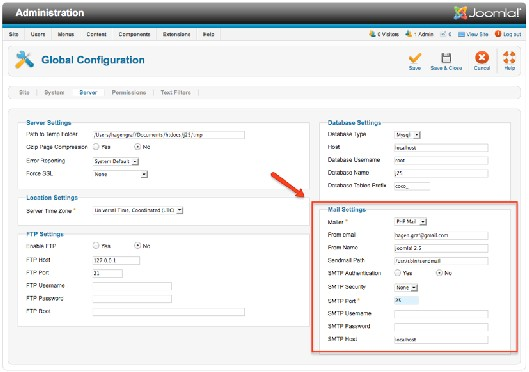
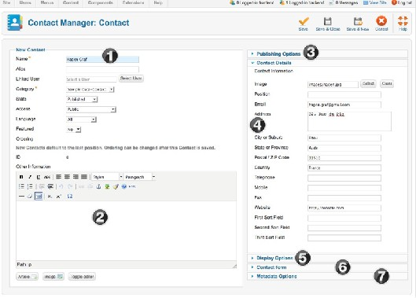
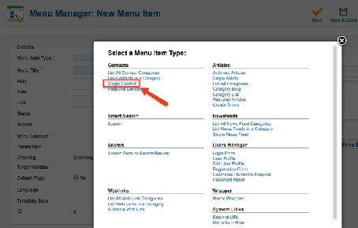
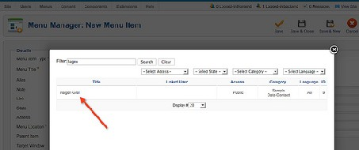
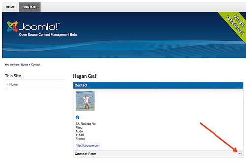
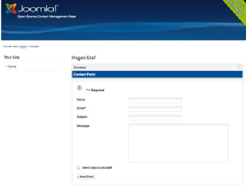

# Joomla! 2.5基础教程系列 - 联系我们表单功能

7: 联系人表单

说起联系人表单就出现了这个问题： "它也算内容吗?"。我的答案是肯定的，并且我专門在管 理内容章节用一个子章节来予以说明。类似CMS 的使用使得联系人表单开始变得清晰。手工创 建的HTML页面是无法发送邮件的，因为这需要诸如PHP 之类的脚本语言，还需要配置好的服 务器。 PHP 脚本可以作为联系人表单嵌入HTML页面，但是这样网站整体就显得不协调了。 Joomla已经集成了联系人表单，你仅需配置下即可。通常，如果你的Joomla运行在供应商的服务 器上，你就不会遇上邮件发送的问题。但如果是本地的话，这就有点麻烦了，因为你必须首先设 立好邮件服务器。一般来说这也不是个问题，它也不是很有必要。 ;-）  
Joomla 可以用各种方式发送邮件。你可以通过全局设置 → 服务器（图 1）了解个大概。当然，  
你可以使用标准激活的PHP Mail 功能（参阅： 网站和内容配置）。  
 

图 *1*：邮件服务器设置

创建联系人

想在网站创建联系人，你至少需要：  
• 一个联系人类别  
• 一个联系人  
• 一个菜单链接  
也许你还有个来自示例数据的类别（Sample-data contact）。I如果没有就自己创建个吧。接 下来创建个新的联系人。在后台打开组件 → 联系人并点击图标新建。T然后填写出现的表单  
（图 2）。为方便定位我已经在截图上标示出了某些区域。  
 

图 *2*： 创建联系人

1. 联系人的姓名。如果不是个人的话就输入部門名称或公司名称。联系人可以关联到现有的用  
户账户。还必须分配个类别，可以是公共的（状态 = 已发布）并且假设不显示在首页（精选  
= 否）。  
2. 文本区域可以添加额外信息，比如开放时间或权限。  
3. 发布选项 是有关谁能在以后更改该内容，谁创建了内容，和发布的时间。后者较少用于'正 常' 网站。  
4. 联系人详情 里面有很多字段，你可以选择填写。  
5. 显示选项 你可以决定要显示的字段。本区域很重要，你可以指定是否显示联系人表单（显示 联系人表单）。你也可以指定发送人是否接受邮件副本， 你还能配置垃圾邮件保护（邮件黑 名单， 标题黑名单等等）。当然要对抗"真的" 垃圾邮件发送者，这些防护还相对"不足"。  
6. 在联系人重定向字段，你可以输入另一个邮件地址，来发送表单内容。  
7. Metadata 选项和发布选项一样，在每个页面都可见（阅读全文：为何SEO对你来说很重 要）。

创建菜单项

联系人准备完毕，但网站还是没有表单。这就是我们接下来要创建的东西。由于可以把嵌套 类别链接到联系人，你可以一个或多个联系人表单。即使为大众这 样的大公司（大概 370,000个 雇员）每个员工都创建一个联系人表单也绝非难事。动态CMS是如何把它们显示在网站上的呢? 要管理这些表单，Joomla 是通过它自带的多种布局的菜单管理器。菜单管理器内，你可以决定 是按列表还是详情来显示联系人表单。乍一看，这似乎有些混乱，但它是个很好的想法，而且很 有用。让我们把刚才创建的联系人详情链接到菜单内。打开 菜单 - Top 并点击图标新建。 你需 要为菜单链接提供三样东西：  
1. 显示在网站的菜单项类型 （链接类型），你可以选择联系人或类别  
2. 当做链接显示的文本  
3. 显示链接的菜单

对于第一项， 点击字段菜单项类型旁边的选择按钮。将弹出个窗口，你可以做选择。点击单  
个联系人（图 3）。  
 

图 *3*： 菜单类型选择

窗口将再度关闭。因为你仅需一个联系人，你必须在必须设置内选择一个联系人（图 4 ）。  
 

图 *4*： 选择联系人

最后，为链接插入文本（菜单标题）并作保存。菜单现已正确匹配该表单。网站的顶部菜单 将多出个指向相应联系人的链接（图 5 ）。点击右边的加号即可访问到实际的联系人表单。 现 在你就可以通过网站来发送消息了。

图 *5*： 网站联系人

图 *6*： 联系人表单

本教程及后续版本均转自[Joomla! 2.5 - 基础指南](http://cocoate.com/zh-hans/j25cn)，版权为原作者及翻译作者所有，感谢Hagen Graf和Yooyooh。**[下载PDF版本](http://pan.baidu.com/s/1eQd1VUE)**

---

除特殊标明文章转自第三方网站，文章均由JOOMLASK.COM原创提供  
欢迎友情转载，请务必保留本文出处并引用本文链接： [Joomla! 2.5基础教程系列 - 联系我们表单功能](http://www.joomla178.com/joomla-share/joomla-basic/joomla-base-guide-contact-us.html)
