# Joomla! 2.5基础教程系列 - Joomla! 2.5是如何进行内容管理

6: 内容管理

内容管理系统是用来管理内容的 - 谁曾想到?! 下个问题就是：什么是内容?

在媒体制作及出版方面，内容就是特定情况下为最终用户/听众提供价值的 信息和经验((Wikipedia
18).

Ok，我知道了，那么什么是提供价值呢?  
这个问题很难回答，也很个性化，但是我想你现在对内容和[Joomla](http://www.Joomla178.com)那样的内容管理系统已经  
有了想法。  
内容管理系统有助管理针对你的受众的有价值的信息
(*Hagen Graf :-)* ).

内容类型

[Joomla](http://www.Joomla178.com)核心有文章、类别、 网站链接、横幅广告、联系人 和 新闻源。我不确定横幅广告能
否创造价值，但横幅广告也是种内容。模块也能用来进行创建内容。通常你使用照片和其他媒体 类型的文件类丰富你的内容。
[Joomla](http://www.Joomla178.com)相应提供了媒体管理器。这是[Joomla](http://www.Joomla178.com)核心所提供的工具盒，
用来管理那些零零碎碎的、用来为你的受众创造价值的东西。下一章我会介绍这些工 具。  
如果这些还不够，你可以使用诸如 K219, FlexiContent20 或 CCK
jSeblod 21 和其他扩展 content construction kits 22 来加强[Joomla](http://www.Joomla178.com)，但这方面的话题足以另外出书讨论了。：-）  
  
[18](http://en.wikipedia.org/wiki/Content_%28media%29)http://en.wikipedia.org/wiki/Content\_%28media%29  
[19](http://getk2.org/) http://getk2.org  
[20](http://www.flexicontent.org/) http://www.flexicontent.org/

[21](http://www.seblod.com/) http://www.seblod.com/

[22](http://extensions.joomla.org/extensions/news-production/content-construction) http://extensions.joomla.org/extensions/news-production/content-construction

6.1: 如何创建 '关于我们' 页面

给你一个挑战，就是在新网站创建我们的第一个网页。它就是 关于我们 页面，你可以介绍下
公司、项目或者个人。多数情况下，这样的网页包含一个标题、一段文本或许还有一些图片。 静态内容 *vs.* 动态内容

• "关于我们" 页面通常只需创建一次，并通过菜单链接访问，以后所要做的就是适时修改。  
它是静态的。而新闻稿或博客条目则通常是动态的。  
•
相较动态网页，静态页的创建日期或作者并不重要。  
• 静态网页通常通过菜单链接访问，而动态网页通常通过列表访问。

计划

关于我们' 页面由以下组件构成：  
• 一个标题，  
• 一段文本，  
• 一个图片。  
•
页面不该显示在首页。  
• 在顶部水平菜单（top）我们需要个页面链接。 初听起来很简单 ：-）。接下来让我们登录到管理界面吧!

Step 1 – 创建内容

打开文章管理器 （内容 → 文章管理器）。你或许还能看到有未发布的示例数据（图 1）

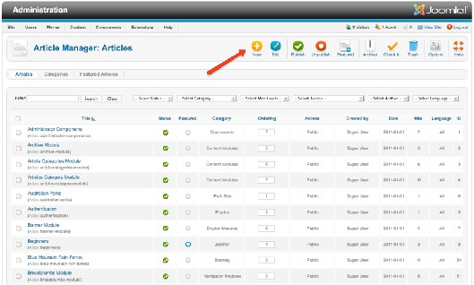

图 *1*： 文章管理器

点击新建图标并输入标题和文本。在面板上方标题下面，选择类别为"未分类" 。安装示例数 据
后就有该类别了。字段 精选 代表是否把内容显示在精选博客布局，后者经常用作首页布局。 [Joomla](http://www.Joomla178.com) 2.5
仍在使用该术语但很容易令人误解。选择否。在编辑器内，你可以输入文本。[Joomla](http://www.Joomla178.com) 的默认编辑器是TinyMCE （图 2）。

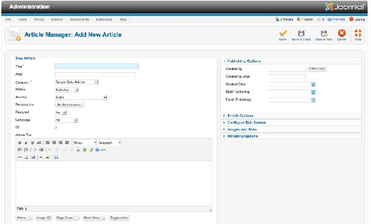

从网址插入图片

图 *2*： 文章编辑表单

作为首个范例，我们将使用来自网络的现有图片。  
比如这个图：
http://farm2.static.flickr.com/1198/898250237\_78a0e75cba\_m.jpg *(Figure
3)*  
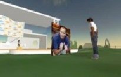

图 *3*： 示例图片

把光标移到你想插入图片的文本位置。点击编辑器工具栏的图片图标并把图片网址黏贴到弹  
出的窗口内。把图片配置为左对齐，垂直和水平间距分别设为10个像素（图
4 ）。

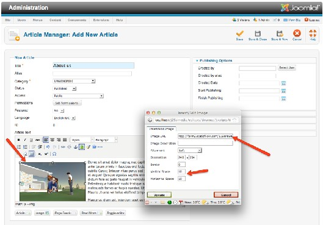

图 *4*： 插入图片

图片将显示在编辑器窗口内。点击保存 这样就能存储了。保存有几种方式：  
• 保存 *–* 项目保存。表单不关闭。当你还需要继续工作时使用。  
•
保存 *&* 关闭 *-*项目保存，表单关闭。  
• 保存 *&* 新建 *-*项目保存，表单关闭，再调用一个新的空白文章表单。  
•
退出表单。

Step 2 – 创建菜单链接

东西已准备好了，但网站上还没显示。我们还要加个链接! 点击菜单管理器的新建 图标。点  
击 菜单项类型
旁边的'选择'按钮。弹出个带有各种链接的窗口。点击链接 单个文章（图 5 ）。

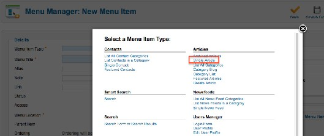

图 *5*： 分配文章到菜单项

选择所需的文章。点击右侧面板（选择文章）的选择/更改 按钮实现。你会看到附有搜索框
的所有文章。万一你无法找到文章，你可以在搜索框内键入文章部分标题来对列表进行筛选，然 后再点击结果列表内正确的文章标题（图 6 ）。  
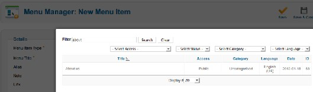

图 *6*： 菜单类型 *–* 单个文章 *–* 选择文章

为链接"关于我们"输入标题，并且确保菜单位置 选中顶部 。其他保持默认选项即可。

Step 3 -网站上的'关于我们'

如果你现在加载网站前台，你会在顶部菜单上发现个新的链接。点击该链接即可找到关于我  
们 – 恭喜你已经创建了自己的首个网页（图 7
）。

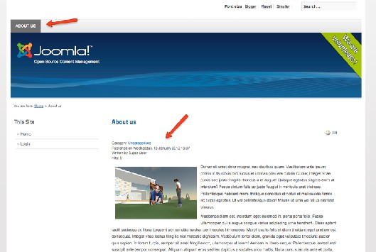

Step 4 – 图片上传

Figure 7: About us page

如果网络上没有你要的图片，你就需要从电脑上上传了。我们再看下示例。打开文章管理器  
（内容 →
文章管理器）。如果你找不到自己的文章，可以用搜索框定位。选择文章标题并打开  
编辑表单。 从文本中删除链接的图像。  
编辑器窗口下方有个
图片 按钮。该按钮可启动个对话框用于上传图片。你可以选择现有图片 或上传个新的图片（图 8）。

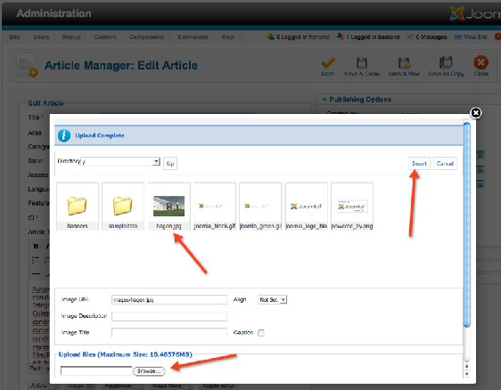

图 *8*： 图片上传

一旦图片插入到文本内，其格式可以通过工具栏的图标 图片 来调整。[Joomla](http://www.Joomla178.com)特意选择了这种
功能上的分离，因为用户可能会使用不同的编辑器。[Joomla](http://www.Joomla178.com)的 图片 按钮将始终如一，但编辑器 内的图片格式会有所不同。  
注意：
[Joomla](http://www.Joomla178.com) 会照原样使用图片。图片不会予以调整!  
要解决这个问题，请看下Brian Teemans 的博客 Making
[Joomla](http://www.Joomla178.com) Idiot Proof23 - 或许当你看到这  
里的时候针对
[Joomla](http://www.Joomla178.com) 2.5 的 FBoxBot24 也有了。  
  
[23](http://brian.teeman.net/tips-and-tricks/making-joomla-idiot-proof-part-1.html) http://brian.teeman.net/tips-and-tricks/making-joomla-idiot-proof-part-1.html  
[24](http://extensions.joomla.org/extensions/photos-a-images/articles-images/1162) http://extensions.joomla.org/extensions/photos-a-images/articles-images/1162

6.2: 典型文章

在网站创建文章时你必须考虑到下列因素：  
• 一段含有一个或多个图片的文本  
• 用于列表视图的传情文字和指向全文的阅读全文
链接  
• 文章会显示在首页，它不需要菜单链接  
• 最好能有： 预定发布日期  
• 最好能有：
为访客提供文章的打印机版本  
• 最好能有： 邮件转发文章的选项

Start

文章应当显示在你网站的首页。如果你删除了、没有安装或更改了示例数据，你的首页看起  
来就如图 1。  
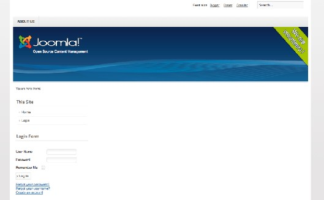

图 *1*： 空白网站

当你登录网站管理后台，你会看到个添加新文章的图标。  
你可以点击该图标或者通过主导航的 内容 → 文章管理器 →添加新文章（图
2）来访问文章 表单。  
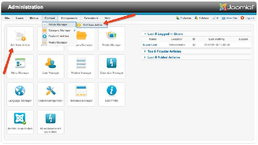

文章表单

图 *2*： 管理区

你现在就在文章表单内，这里是 [Joomla](http://www.Joomla178.com)用来输入文章的地方。当然非常重要! 表单结构如图 3  
所示。

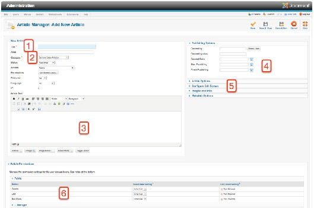

图 *3*： 文章表单项

文章至少要配置标题（1）、类别（2）和正文（3）。如果你够仔细，就会发现当鼠标移过字 段描述时会出现帮助文本。我已经在图 3
中用 6 个数字标注了这些区域。

1. 标题

标题是文章最重要的组成部分。标题会显示在网站内（通常还使用<h2>样式）， 还有浏览  
器的顶栏（你可以启用或禁用该特性）。
标题也是下方别名字段的基础。当你保存文章时， [Joomla](http://www.Joomla178.com)会自动生成别名，当然别名也是可以配置的。从根本上说，别名本意是让浏览器地址栏内
的网址更简 单、清晰，别名也能在邮件或聊天时使用。比如http://example.com/first-article - first-
article 就是别名。

2. 类别

这就是文章的分类。每篇文章必须有个类别。如果你明确不想把文章归类，你可以选择未分 类。 这对于类似法律声明 和关于我们
的静态页面非常有用。在该区域还能配置其他重要的属 性， 比如状态 （已发布或未发布），访问权限，语言和精选。精选re替代了以前的上首页属

性，它会把文章显示在预定义博客布局的网站首页。文章ID 则在保存后生成，它是由数字组  
成。

3. 正文

这里就可以撰写文字了，这也是针对网站受众体现价值的地方。听起来很容易，不是吗t?!  
：-）  
技术上，你用WYSIWYG
编辑器来处理。编辑器会把你输入的文本转换为HTML文本格式。 [Joomla](http://www.Joomla178.com)默认使用 **TinyMCE**25 编辑器。TinyMCE是个独立的开源项目，功能很多，足以另行出书
来介绍（或许也是个好主意。）。  
它基本上和其他字处理程序一样：撰写文本，亮显文本，然后点击工具栏图标就会应用相应  
功能或打开对话框。  
输入区域下面的按钮不同寻常，有时会令人迷惑。这些按钮都是[Joomla](http://www.Joomla178.com)特定按钮，它们只和  
编辑器间接相关。[Joomla](http://www.Joomla178.com)核心提供了五个非常实用的附加按钮。
你可以通过添加[Joomla](http://www.Joomla178.com)扩展来增加更多的按钮：  
1. 文章：允许你链接到其他现有的 [Joomla](http://www.Joomla178.com)文章  
2.
图片：你可以从媒体管理器插入现有图片或照片，或者上传新的图片。  
3. 分页： 为文章插入分页  
4.
阅读全文：允许您规定的地方放置阅读全文链接  
5. 切换编辑器： 切换编辑器开关状态。如果编辑器处于关闭，你看到的就是文章的HTML  
代码。

4. 选项

[Joomla](http://www.Joomla178.com) 1.5的参数在[Joomla](http://www.Joomla178.com) 1.6 称作选项 。比如发布选项。 你可以在此指定谁撰写了文章（作  
者）。文章作者也对文章以后的修改负责。而真正显示在网页文章标题下面的是作者别名。接下
来的三个字段可以让你实现定时发 布。 仅需输入合适的日期，其他[Joomla](http://www.Joomla178.com)负责搞定。  
  
[25](http://tinymce.moxiecode.com/) http://tinymce.moxiecode.com/

5. 更多选项

这里可以通过开关来配置更多选项。你可以更改文章布局来适应读者和搜索引擎的需求。实  
践是学习的最佳途径。第  
6
个、也是最后一个区域涉及的是文章权限。这个地方也很有用，我将在用户和权限章节予 以讨论。

示例文章

让我们一起创建以上列出的文章： 含一个或多个图片的文本 先写下文章。添加图片可以有多种方法：

## 1. 图片已经在线可用，比如在 Flickr.

在这种情况下， 点击编辑器工具栏的图片 图标并把网址复制到对话框内。

## 2. 图片已经在[Joomla](http://www.Joomla178.com) 媒体管理器

在这种情况下，点击下面的图片 按钮并选择图片并插入文本（图 4 ）。

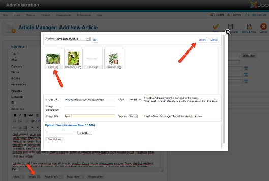

图 *4*：从媒体管理器插入图片

## 3. 图片在您的硬盘里 这种情况最复杂。基本上你还要用到文本下面的图片按钮。你会看到个上传对话框，可以很方便 地上传图片。记住 [Joomla](http://www.Joomla178.com)不会自动调整图片。如果你要从数码相机上传照片，它会照原始的尺 寸显示（width > 3000 pixels）。你要上传前调整图像。

如果一切顺利 – 那就恭喜了!  
如果还没搞定，肯定是有地方出错了，比如缺失媒体管理器的目录权限。至多也就得到一个错误  
消息。
一旦完成插入图片，你可以点击编辑器工具栏的图片图标来调整图片格式。 用于列表视图的传情文字和指向全文的阅读全文链接
这很简单。把光标移到阅读全文链接应当出现的地方并点击文本区下方的阅读全文 按钮。  
文章应当显示在首页并且不需要菜单链接

选择第 2 区域的字段精选 为是。  
定期发布效果将更好  
刚开始的时候不要这么干，这样你就不必苦候网站文章的显示：-）。
如果你想稍后用其他 文章尝试下，仅需点击日历图标，填写字段开始发布 和终止发布 日期和时间。  
文章的打印机版本  
如果你现在还不知道这个全局设置在哪里，请翻阅网站和内容配置章节。在第
5 区，你可以 切换显示打印机图标为 '显示'。  
通过邮件转发文章  
仅需设置第五区域的选项，切换
显示邮件图标 为 显示。

结果

保存后刷新网站你即可看到类似图5 的首页文章。  
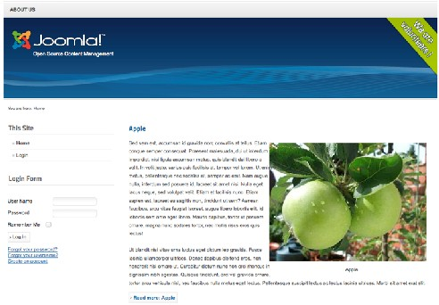

Figure 5: Article on the frontpage

6.3: 媒体管理器

媒体管理器是 [Joomla](http://www.Joomla178.com)的迷你数字资产管理系统 (Digital Asset Management System, DAM26)。 如 果你要管理内容，你就需要有地方来保存文件。文件可以是图片、PDF和所有你想在内容中提及
的东西。通常这些数字资产由文件和附加的meta数据构成。这种情况下，我们就要一个称手的工 具来管理文件。让我们来看下[Joomla](http://www.Joomla178.com)
核心的媒体管理器可以做些什么。

工作机理

对我来说它更像一个文件管理器。每个人都知道Windows的explorer或OSX的finder。[Joomla](http://www.Joomla178.com)内
它就叫做"媒体管理器"。它有个根目录用来保存所有的文件。你可以用两种方式来查看文件：缩 略图视图（图 1）和详情视图（图
2）。点击标签可以实现切换  
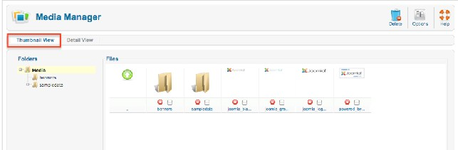

图 *1*： 媒体管理器 *–* 缩略图视图

  
[26](http://en.wikipedia.org/wiki/Digital_asset_management) http://en.wikipedia.org/wiki/Digital\_asset\_management

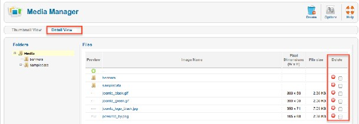

图 *2*： 媒体管理器 *–* 详情视图

你可以随心创建足够的目录。在详情视图，你可以删除文件夹和文件。你在[Joomla](http://www.Joomla178.com) 管理后台 也能看到和FTP客户端内同样的结构（图
3），但是你要小心： [Joomla](http://www.Joomla178.com)核心还有个media目录。 该目录不是媒体管理器的根目录。  
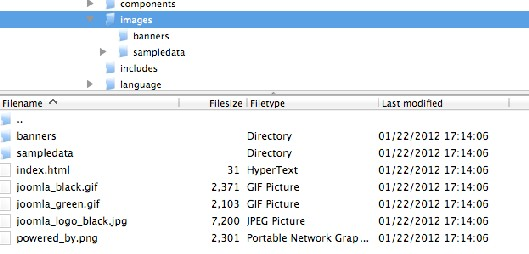

图 *3*： *ftp*客户端内的媒体管理器目录

当你查看工具栏你会发现选项图标 – 点击会打开对话框（图 4）.

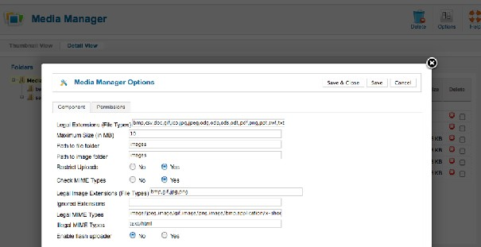

图 *4*： 媒体管理器选项

如果你仔细查看这些选项，你会发现你可以限制文件的扩展类型、文件的最大尺寸，并且还 能把图片和文件
隔离开来。当然，图片也是文件，但是我很欣赏这个创意。比如，缩略图视图 对于图片就更有意义。  
隔离的最大好处还能设置权限低于管理员的用户限制上传。你可以允许注册用户上传图片，
但禁止他们上传其他文件。在某些情况下，这是非常有用的。下一个选项是 MIME 类型， 现在 通常叫做互联网媒体类型。
如果你是Windows用户，你通常通过文件的扩展来说识别文件类型。 互联网媒体类型
就是种不通过文件扩展来识别文件类型的方法。你可以按需允许或禁止必要的 文件类型。  
Flash上传器是最先进的功能之一，虽然常遭用户遗忘。[Joomla](http://www.Joomla178.com)
1.5 内它有时工作不正常，但 [Joomla](http://www.Joomla178.com) 2.5的版本已经足够优秀，它可以同时上传多个文件。Flash上传器 工作简单、使用简便!
试试吧! （图 5 ）。

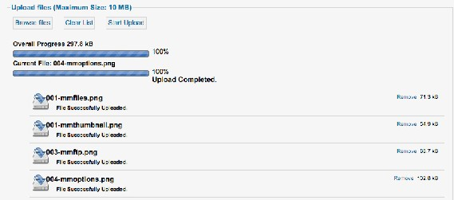

图 *5*： 媒体管理器 *Flash*上传器

如你所见，[Joomla](http://www.Joomla178.com) 媒体管理器不很复杂 (rocket science27)
但很可靠，用来管理图片和其他文件 很是方便。  
如果你需要更复杂的产品， [Joomla](http://www.Joomla178.com)在扩展目录的文件管理 (category
File Management 28 ) .类别 提供了其他解决方案。

媒体管理器和编辑器

现在你已经知道了文件的核心枢纽所在，但你知道如何把它们和内容联系起来吗?  
在内只要你看到编辑器，就意味着你可以通过点击下面的图片按钮来从媒体管理器添加媒
体。我们已经在典型文章 （图6）这个章节谈过这个话题。  
  
[27](http://www.urbandictionary.com/define.php?term=rocket%2Bscience) http://www.urbandictionary.com/define.php?term=rocket+science  
[28](http://extensions.joomla.org/extensions/core-enhancements/file-management) http://extensions.joomla.org/extensions/core-enhancements/file-management

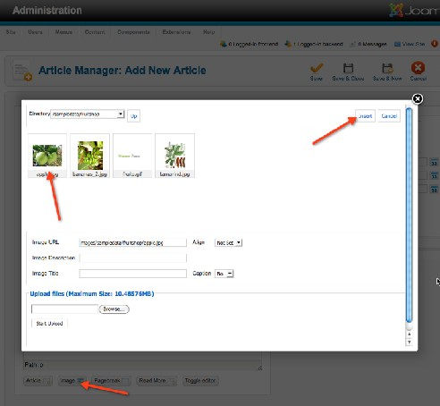

图 *6*：内容区域的媒体管理器

其他地方的媒体管理器

媒体管理器在其他地方也扮演着角色，比如在类别里。可以把图片链接至某个类别（图 7）

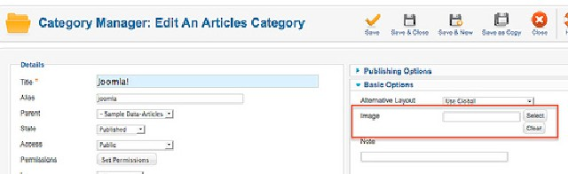

图 *7*： 类别内的媒体管理器

如果你在菜单项选项里面作了配置，图片就会显示在类别列表内。

本教程及后续版本均转自[Joomla! 2.5 - 基础指南](http://cocoate.com/zh-hans/j25cn)，版权为原作者及翻译作者所有，感谢Hagen Graf和Yooyooh。**[下载PDF版本](http://pan.baidu.com/s/1eQd1VUE)**

---

除特殊标明文章转自第三方网站，文章均由JOOMLASK.COM原创提供  
欢迎友情转载，请务必保留本文出处并引用本文链接： [Joomla! 2.5基础教程系列 - Joomla! 2.5是如何进行内容管理](http://www.joomla178.com/joomla-share/joomla-basic/joomla-base-guide-content-manager.html)
