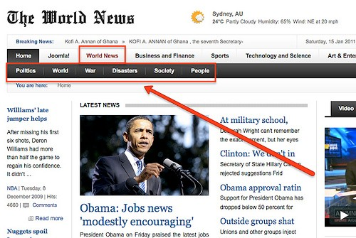
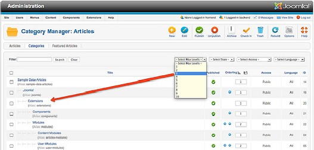
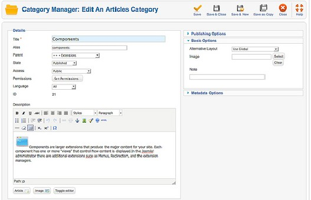
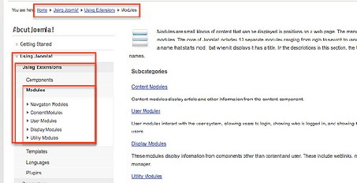
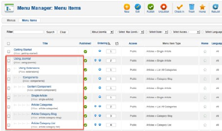
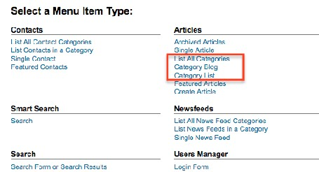
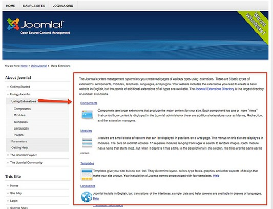
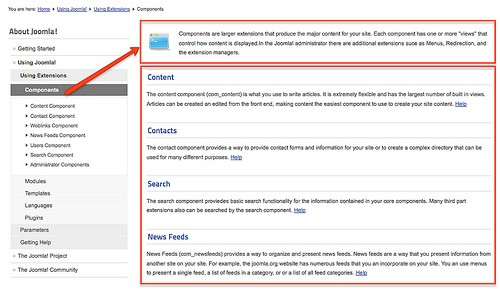
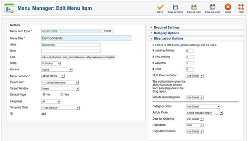
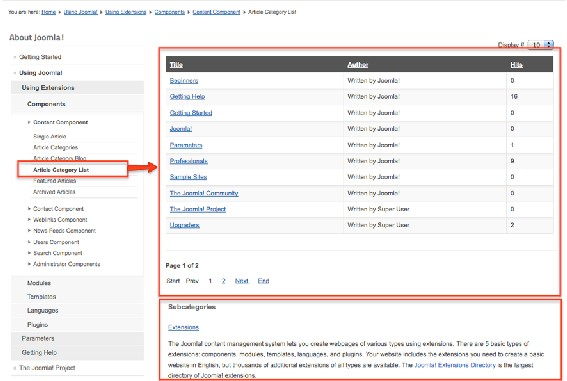

# Joomla! 2.5基础教程系列 - 用分类构建内容

9: 用分类构建内容

[Joomla](http://www.Joomla178.com)的文章可以归类。一般而言，归类就是通过抽象来识别、区分、理解事物的过程。 这  
听起来相当复杂，但用于管理文章时非常管用。  
[Joomla](http://www.Joomla178.com)允许你创建无限的分类。分类可以嵌套，文章可以归属其中任一类别。 例如报纸就使用分类来更好地辨识文章。这儿有个来自[Joomla](http://www.Joomla178.com) 模板50 的样例（图 1 29）  
 

图 *1: Gavick Template*

他们使用了分类国际新闻，在该分类下又包括了诸如政治、环球、战争、灾难等等。 有时候 两级分类就已足够，比如本例; 有时候你还需要更多。[Joomla](http://www.Joomla178.com) 1.5 内最多只能有3级分类。 [Joomla](http://www.Joomla178.com)  
2.5 就突破了这个限制。[Joomla](http://www.Joomla178.com)不再有单元 - 仅存分类。 通过类别管理器 （管理→ 内容→ 类别  
管理器）， 你可以对分类树进行管理，并至多可以筛选10个级别（图 2）。  
   
 [29](http://demo.gavick.com/joomla15/dec2009/) http://demo.gavick.com/joomla15/dec2009/

图 *2*： 类别管理器

就像文章一样，类别包含标题、说明和一些其他属性和选项。它也可以有用于不同布局的附 加图片。图片可以在基本设置中选择。分类说明也可以使用图片（图 3）。  
 

图 *3*： 类别编辑表单

当你访问你的[Joomla](http://www.Joomla178.com) 网站时，你可以看到示例数据的分类。导航使用分类链接以显示其中所  
有的文章和子类（图 4）。 即使是面包屑导航也体现了这一结构。  
 

图 *4*： 网站上用作菜单链接的类别

通过菜单管理器 （管理→ 菜单→ 关于[Joomla](http://www.Joomla178.com)）， 你可以看到这些菜单项，它们链接到某个 分类的文章（图 5）。  
   
图 5： 网站上用作菜单链接的类别

你也可以选择不同的文章布局。在图 5 你可以看到链接的布局。你可以在菜单项的编辑表单  
内选择不同的布局（图 6）。  
备选布局：  
• 所有分类列表  
• 博客布局  
• 单个分类列表  
针对不同的布局，你需要为子类和文章配置不同的外观和行为。  
 

所有分类列表

图 *6*： 类别布局

该布局列出指定分类的所有子类（图 7）。

图 *7*： 所有分类布局

这种情况下会显示顶级分类Extensions的分类说明。其下一级分类的说明也会显示在页面上， 即使是空类。顶级分类的文章会被隐藏。 示例： 管理→ 菜单→ 关于[Joomla](http://www.Joomla178.com) → 使用扩展→ 编 辑。

博客布局（*like on the frontpage*）

博客布局显示指定分类的所有文章（图 8）

图 *8*： 博客布局

这里会显示分类组件 的说明。所有和组件 有关的文章会按列和它们的传情文字一起显示。 当然也可以显示更多的列。 顶级分类中的开头七篇文章会被隐藏。示例： 管理→ 菜单→ 组件→ 编辑（图 9）。  
 

图 *9*： 博客布局设置

单个分类列表

单一分类列表布局会用表结构来列出指定分类的所有文章（图 10）。  
 

图 *10*： 单个分类列表布局

这里会显示[Joomla](http://www.Joomla178.com) 分类的说明。所有的相关文章显示在一个可以配置的表内。你可以对表进  
行部分隐藏，并配置各种排序选项。 示例： 管理→ 菜单→ 组件→ 文章分类列表 → 编辑。

结论

[Joomla](http://www.Joomla178.com) 2.5的分类系统很强大，也很容易使用。你可以用用户友好的嵌套分类来对整个网站进  
行构建。一篇文章可以对应到一个分类。

本教程及后续版本均转自[Joomla! 2.5 - 基础指南](http://cocoate.com/zh-hans/j25cn)，版权为原作者及翻译作者所有，感谢Hagen Graf和Yooyooh。**[下载PDF版本](http://pan.baidu.com/s/1eQd1VUE)**

---

除特殊标明文章转自第三方网站，文章均由JOOMLASK.COM原创提供  
欢迎友情转载，请务必保留本文出处并引用本文链接： [Joomla! 2.5基础教程系列 - 用分类构建内容](http://www.joomla178.com/joomla-share/joomla-basic/joomla-base-guide-creat-content-by-category.html)
