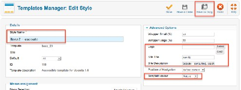
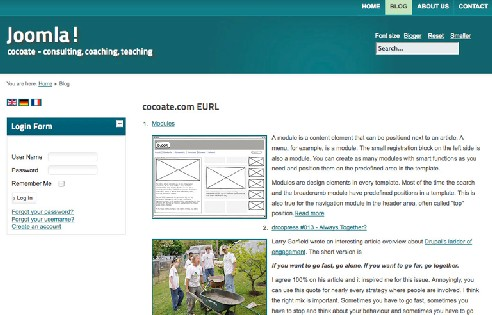
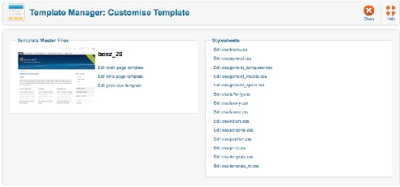
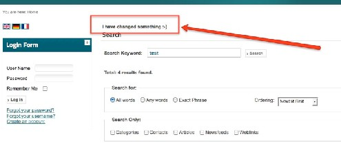
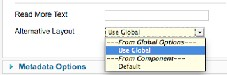
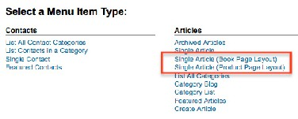
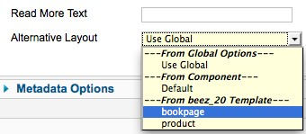

# Joomla! 2.5基础教程系列 - 模板概述

17: 使用模板

编者注：本章节是对模板的一个概述，详细请参考本站模板系列教程：[传送门](../joomla-templates-tutorials/README.md)

想要能使用模板，你不仅需要良好的设计技能，还需要了解HTML和CSS。不幸地是，某些  
 浏览器无法显示最新版本，这就是为何其它版本仍旧相当普遍的原因。 下一个挑战就是开发者和设计者之间无休止地讨论'如何正确地做事情'。设计者依赖于开发  
者，因为他们需要HTML标记来添加CSS类。开发者也依赖于设计者，因为没有设计精良的模板  
即使最好的组件也难于使用。  
Joomla内建的方案解决了这两个问题!  
Beez 模板有XHTML和HTML5版本， 通过所谓的Overrides 创建了合适的HTML标记以及 CSS类。Overrides 意味着设计者不用改变源代码就可以覆盖开发者所编写的扩展产生的HTML 输出。  
模板行业另一个重要的代理人是'Joe Webmaster' 。通常，他仅需更改标题图像、色调、宽度 和其他一些选项。  
Joomla 当然也有个完美的解决方案，叫做模板样式。模板样式 意味着你可以通过创建现有的模 板样式副本来配置自己的选项，并把它们分配到各种菜单项。请参阅章节模板 然后回来再做深  
入了解。

17.1 : 创建你自己的样式

在章节 多语言网站， 我们基于Beez2 模板建立了一个网站。现在我要创建自己的样式，并在  
扩展 –模板管理-Beez2默认内更改一些选项。我所做的更改如下：  
• Style name： Beez2 - cocoate  
• Logo： 我不需要logo， 就点击了清除 按钮  
• Site Title： Joomla  
• Site Description： cocoate - consulting， coaching， teaching

• Template color： Nature  
我点击保存副本 保存了样式副本（图 1）。  
 

图 *1*： 个人模板样式

我的网站现在面目一新（图 2）。使用菜单分配功能可以为网站的不同部分创建不同的样  
式。  
 

图 *2*： 使用*Beez2* 样式的网站

利用现有选项创建不同的样式是最简单的解决方案，也是最佳和最快的方法。当有Joomla更  
新的时候，你的样式在新版本还能照用。 无需任何其他扩展，你就可以使用Joomla 2.5核心包!

17.2 : 定制现有模板

如果你在阅读本章节，我假定你已经创建好了模板样式， 还了解如何使用现有的模板选项， 但还想更深入一点。那就欢迎来到HTML 和 CSS的世界! 我还假定你知道这连个缩写。如果不知 道的话，请看下超文本标记语言（HTML48）和层叠样式表（CSS49）的维基百科。  
在 Joomla 内可以使用模板管理器来编辑模板所使用到的全部CSS。打开扩展-模板管理器-模 板 并点击链接beez\_20 详情。在那，你可以更改beez2模板并访问到所有可以修改的文件（图  
3）。  
 

图 *3*： *Beez2*： 模板定制

可以编辑的CSS文件都保存在文件夹folder htdocs/templates/[template\_name]/css。 点击CSS文 件的链接名称就会打开一个表单，在那你可以使用CodeMirror编辑器来编辑文件内容。除了CSS 文件，你还可以编辑三种主要的模板文 件：  
 

48 <http://zh.wikipedia.org/wiki/HTML>

49 <http://zh.wikipedia.org/wiki/CSS>

• 主页  
htdocs/templates/[template\_name]/index.php  
• 错误页  
如果打开Joomla网站时发生错误，页面就会使用到该模板。  
htdocs/templates/[template\_name]/error.php  
• 打印视图  
当你访问打印视图时该模板负责输出。  
htdocs/templates/[template\_name]/component.php  
更多的模板件比如用于核心覆盖 的文件位于htdocs/templates/[template\_name]/html。核心覆 盖 无法通过管理后台编辑。  
你在这里所做的更改会改变Beez2的核心文件。这在更新时必须记得。

17.3 : 覆盖

你已经创建了样式，更改了CSS文件和模板的主页，然而对结果还不满意? ：-） 那就是讨论  
覆盖的好时机了。在Joomla内有两种覆盖：模板覆盖 和替代布局。

模板覆盖

假设你想改变搜索结果页的布局。类似搜索组件的组件都有默认的模板布局，保存在文件 / httpdocs/component/com\_search/views/search/tmpl/default.php。该文件决定了搜索页面的 显示 方式。给这个文件添加一些单词，保存后即可看到结果! 例如，在13行添加

<strong>I have changed something :-) </strong>

并看看发生了什么 （图 4）。



图 *1*： *HTML* 输出的变化

结果有助激发你的兴趣，因为这是如此简单，每个模板都会显示它了。然而，它有损你的名 声，因为你改动了核心代码。下次 Joomla一升级，你的更改就没了!  
更好的替代方法是针对模板使用模板覆盖。把更改后的文件复制到模板文件夹/httpdocs/ templates/[template\_name] /html/com\_search/search/default.php 并放弃对于原始文件的修改。网 页效果一样，但私底下你已经用所需要的内容布局覆盖了原始的.../default.php文件- 而没有改变 核心代码 – 干得漂亮!  
该系统是在2007年随着Joomla 1.5的发布而引入，目前仍然工作得很好。

替代布局

Joomla 2.5的覆盖有所提升，称为替代布局。 我相信你在文章、模块和类别的编辑表单内已  
经看到过替代布局字段（图 5）。  
 

图 *2*： 文章的替代布局

我们为何需要替代布局? 请想象，你是个管理员或网管，某一模板自带三种不同的文章布  
局。有时它是'常规文章'， 有时它看起来像个产品，有时看起来有像个书页。你只需要选择你想 使用的布局。这听起来是个很棒的功能，当然，它确实是。 这项技术和模板覆盖一样。你必须 创建和组件或模板同名的文件夹和用来保存视图的子文件夹。这里有两点区别：  
1. 很显然文件名必须和default.php有所不同，因为后者已预留给模板覆盖。  
2. 替代布局当然不是自动选择的。 除了替代布局，布局还能添加菜单项类型，文章也能通过在和替代布局文件同名的xml文件  
内定义选项条目来予以控制（图 6）。  
 

图 *6*： 附加菜单项类型

创建这些文件不属于初学者的话题，但我相信不久后第三方模板就会使用到这些新特性（图  
4）。  
 

图 *4*： 文章的附加布局

17.4 : 用ATOMIC创建新模板

Atomic 模板是我们自己模板的骨架。它包含：  
• */htdocs/templates/atomic component.php –* 打印视图模板

error.php – 错误页面模板

favicon.ico – 网站图标 (Favicon [5])

index.html – 是个在直接进入目录时显示空白页面的安全文件（也能由服务器配置）

index.php – 模板主页

templateDetails.xml – 配置文件，包含用来在模板管理器内显示模板的文件、选项和位置的所有信 息，以后还能用来创建可安装的zip包。

template\_preview.png – 模板预览图，显示在模板管理器内

template\_thumbnail.png – 模板缩略图，显示在模板管理器内

• /htdocs/templates/atomic/css  
CSS 文件的文件夹  
• */htdocs/templates/atomic/html*  
覆盖 文件的文件夹 – Atomic提供了模块的一些覆盖。  
• /htdocs/templates/atomic/images  
图片文件夹  
• */htdocs/templates/atomic/js*  
JavaScript文件的文件夹  
• */htdocs/templates/atomic/languages*  
语言文件的文件夹 - Atomic 自带英语基础语言文件。

主模板文件*index.php*

布局文件名称必须是index.php， Joomla 会搜索其中嵌入的<jdoc> 和PHP命令。所有必要的  
HTML标记已经内建并注释。你可以根据需要改变文件内容。 要获取概念，让我们做个快速回顾：

在 24行 你可以选择是否需要使用blueprint CSS 框架。  
在 50， 56， 62行 和更多地方你可以看到模板提供的带有具体名称的位置（atomic- search， atomic-topmenu， ...）。如果你想使用这些名称的话，你必须把模块分配到这些位置。如果你想 改变名称，你可以通过修改templatedetails.xml文件来达 成。  
在 42 行 你会看到：

```
<?php echo $this->baseurl ?>/templates/<?php echo $this->template ?>/js/template.js
```

Joomla 知道 baseurl 的值和模板的名称，需要的时候你就可以访问它们。在 46行 你会看到：

```
echo $app->getCfg('sitename');
```

它会告诉你网站名称。在48行 你会看到：

```
if($this->countModules('atomic-search'))...
```

它计算atomic-search位置的模块数量。它用来调整布局以适应不同的情况。在50行 你会看 到：

```
<jdoc:include type="modules" name="atomic-search" style="none" />
```

这个是<jdoc>命令，仅作为Joomla的命名空间存在。它用于为属性插入给定类型的HTML输 出。本例中它表示所有分配到模板 at o m i c s e a rc h 位置的模 块输 出。 样 式属性称作 modul e chrome， 可以赋以下值  
• **table** – 输出显示在表内。  
• **horz** - 输出水平显示在表的单元格内。  
• **xhtml** – 输出在XHTML-兼容的<div>元素内。  
• **rounded** – 以圆角格式输出。元素的类从moduletable重命名为module。  
• **none** - 无格式  
• **outline** – 用于位置预览的显示类型（?tp=1）  
• **Template specific style –** 某些模板，比如Beez， 有它们自己的样式

你可以在Joomla文献- - *What is module chrome* - 内找到完整的样式列表 。.  
其它 <jdoc> 类型有：

```
<jdoc:include type="head" /><jdoc:include type="message" /><jdoc:include type="component" style="none" />
```

每个页面都需要有head， 有时是消息 （保存后） ，当然还有组件。 每个页面可以显示一个 组件。组件 同样可以使用自定义模块结构。错误 和打印视图 模板文件工作机理和 main 模板文 件一样。

CSS 文件夹

该文件夹内你可以找到三个文件  
1. 文件css/template.css 内是预定义的带注释的CSS 命令。如果你不想使用blueprint框架，你 必须取消某些注释。那些代码行都有特殊标记。  
2. 文件 css/template\_ie.css是空的。你可以在这里为IE浏览器添加些样式覆盖。  
3. 文件css/template\_rtl.css 也是空的。你可以为从右向左书写的语言添加些样式覆盖。

Blueprint 框架

Blue print是个 CSS框架， 专为 减少开 发时间 和保 证 跨 浏览 器兼容而 设计 。下面是些摘自   
readme文件的句子：  
欢迎使用Blueprint! 这是个设计用来削减CSS开发时间的CSS框架。它为您建 立自己的命令提供了坚实的基础。BP提供的即用功能有：  
\* 轻松定制网格  
\* 合理的默认版式  
\* 排版基线  
\* 完美的浏览器 CSS 重置  
\* 打印样式表

本教程及后续版本均转自[Joomla! 2.5 - 基础指南](http://cocoate.com/zh-hans/j25cn)，版权为原作者及翻译作者所有，感谢Hagen Graf和Yooyooh。[下载PDF版本](http://pan.baidu.com/s/1eQd1VUE)

---

除特殊标明文章转自第三方网站，文章均由JOOMLASK.COM原创提供  
欢迎友情转载，请务必保留本文出处并引用本文链接： [Joomla! 2.5基础教程系列 - 模板概述](http://www.joomla178.com/joomla-share/joomla-basic/joomla-base-guide-creat-template.html)
