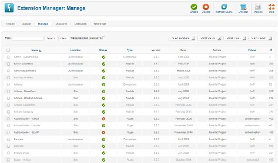
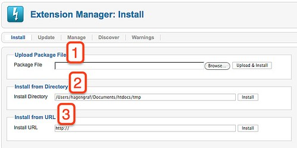

# Joomla! 2.5基础教程系列 - 扩展管理

13: 扩展管理

[Joomla](http://www.Joomla178.com)核心包内有很多东西。你先前已听闻过类似组件、模块、插件、模板和语言 这样的词 汇。除了这些有名的部分，[Joomla](http://www.Joomla178.com)还有些不那么出名的东西如链接库 和压缩包。附加的组件、 模块、插件和语言 都列在[Joomla](http://www.Joomla178.com)扩展目录[Joomla](http://www.Joomla178.com) extension directory33。[Joomla](http://www.Joomla178.com) 项目没有为模板和 链接库安排集中的地方。理由很简单。链接库在[Joomla](http://www.Joomla178.com)项目之外开发，它们多数也用于其他开源 项目。模板则是很独立的东东，它们归属于其设计者的网站。将来设立中央目录，特别是模板， 应该很有用。通过重写的扩展管理器，你可以在 [Joomla](http://www.Joomla178.com) 管理区直接安装、更新、探查和管理扩 展。

管理扩展

通过扩展→扩展管理器→管理器可以看到已安装的122个扩展。你可以用各种参数对列表进行  
筛选。某些扩展是受保护的。如果卸载了它们的话 [Joomla](http://www.Joomla178.com)就无法正常工作（图 1）。  
 

图 *1*： 已安装的扩展表

  
 [33](http://extensions.joomla.org/) http://extensions.joomla.org/

在这里你可以启用、禁用或卸载扩展。启用和禁用类似灯的开关。您只需切换扩展的开关，  
所有相关数据仍会保留。如果你卸载了扩展，它就被删除了。扩 展，通常是组件，在安装时会 创建附加的数据库表。这些表在卸载时删除还是保留取决于组件的卸载流程。请提前阅读手册或 readme，以免发生意外。 工具栏的最后一个图标是缓存图标。每个扩展都可以缓存数据。你可以为每个扩展单独清除缓 存。如果您的[Joomla](http://www.Joomla178.com)网站吸引了众多的访客，而你基于性能考虑又不想清除所有的缓存，那么你 就需要这个功能。  
如果你筛选出列表的链接库，会返回四个结果：  
• [Joomla](http://www.Joomla178.com) Application Famework， 这是[Joomla](http://www.Joomla178.com) 2.5的核心。其他扩展都基于这个框架搭建。  
• *PHPMailer*34 i是个PHP书写的类，用于发送邮件。它用在mail to组件。  
• *SimplePie*35 是个PHP书写的类，用于管理RSS和Atom新闻源。它用在newsfeeds组件。  
• phputf836 是把PHP自身的字符串功能按 UTF-837-映射。你可以通过阅读 UTF-8 and PHP38 来获  
取该链接库的信息。  
如果你筛选列表内的压缩包，你会发现返回结果为空。如果你安装了除英语以外的语言，你 将会发现返回该语言的压缩包。

更新扩展

本区列出第三方扩展和[Joomla](http://www.Joomla178.com)核心版本。点击查找更新图标可以检测可用的扩展更新。如果  
发现了扩展更新并且你想自动更新，你就需要在全局配置 →服务器 → FTP 设置填写FTP设置表  
   
 [34](http://phpmailer.worxware.com/) http://phpmailer.worxware.com  
 [35](http://simplepie.org/) http://simplepie.org/  
 [36](http://sourceforge.net/projects/phputf8/) http://sourceforge.net/projects/phputf8/  
 [37](http://en.wikipedia.org/wiki/UTF-8) http://en.wikipedia.org/wiki/UTF-8  
 [38](http://www.phpwact.org/php/i18n/utf-8) http://www.phpwact.org/php/i18n/utf-8

单。然后选择你想更新的扩展并点击更新图标。这个过程是完全自动的，更新时依据扩展的设定  
你或会收到信息和提示。

安装扩展

你可以用三种不同的方法安装扩展（图 2）：  
 

图 *2*： 安装扩展

• 上传压缩包文件  
如果你在本地下载了包含Joomla扩展的zip文件，你可以使用本选项来上传和安装扩展。  
• 从目录安装 如果你在web服务器根目录上传了包含Joomla扩展的zip文件，你可以使用本选项来解压并安装 扩展。  
• 从网址安装 如果你知道包含Joomla扩展的zip文件的网址，你可以使用本选项来下载、解压并安装扩展。 查找扩展  
有时候在安装过程中会遭遇错误，比如文件太大、权限未正确设置或由于其他奇怪的原因。 在这个地方，Joomla会试图查找那些未安装但仍存在于文件 目录内的扩展。如果发现了目标，

你可以使用FTP功能来予以安装。不要忘记在全局配置 →服务器 →FTP设置 内配置正确的  
FTP。 使用检测操作，你可以同时安装多个扩展!

警告

安装和更新时的有关错误信息将显示在本区域。如果你自己无法解决问题，可以把信息文本  
google下，通常你会找到解决办法，或者起码能找到些建议。

---

除特殊标明文章转自第三方网站，文章均由JOOMLASK.COM原创提供  
欢迎友情转载，请务必保留本文出处并引用本文链接： [Joomla! 2.5基础教程系列 - 扩展管理](http://www.joomla178.com/joomla-share/joomla-basic/joomla-base-guide-extension-manager.html)
