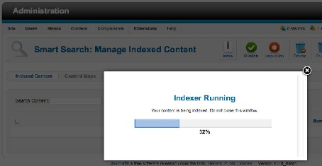
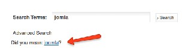
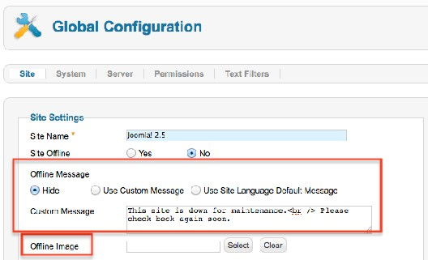
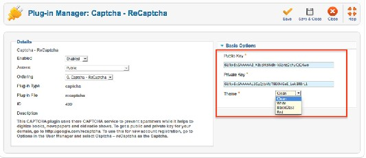
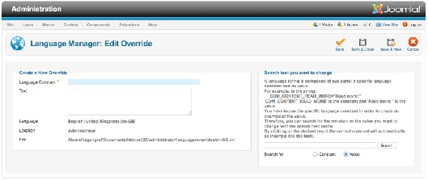
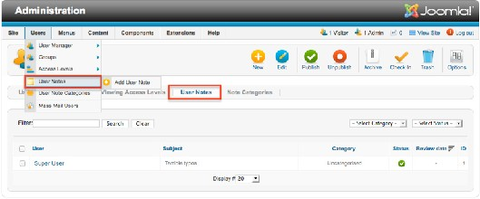
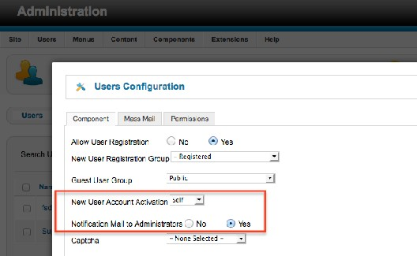

# Joomla! 2.5基础教程系列 - Joomla! 2.5有哪些新功能

5: 新增功能

[Joomla](http://www.Joomla178.com) 2.5在2012 年1月发布，它是[Joomla](http://www.Joomla178.com) 1.5的后续版本。它也是所谓的长期支持版本，在  
2013年7月前，它都将代表[Joomla](http://www.Joomla178.com)
的最高艺界。版本1.6和1.7都是短期版本，为[Joomla](http://www.Joomla178.com) 2.5做铺 垫。如果你在2011年把网站从[Joomla](http://www.Joomla178.com) 1.5
升级到了[Joomla](http://www.Joomla178.com) 1.7 ，你或许已经用到了[Joomla](http://www.Joomla178.com) 1.6 和  
1.7所介绍到的新功能。如果你看下新旧功能对比，你会发现2011年对于[Joomla](http://www.Joomla178.com)来说是个很有趣
的年份。但我们现在先仔细看下[Joomla](http://www.Joomla178.com) 2.5的新功能。

JOOMLA 2.5新功能

崭新、闪亮的*[Joomla](http://www.Joomla178.com)*平台

目前 [Joomla](http://www.Joomla178.com)平台是基于11.4版本。  
这意味着第三方开发有了更多的可能性，比如使用JImage类来进行图像处理，使用JGrid类来
生成HTML表。这里还使用了JavaScript的新版本链接库MooTools（1.4）。如果你不知道[Joomla](http://www.Joomla178.com) 平台是什么，请参阅
Write your own App using Joomla Platform13 和
official announcement of the Joomla Platform release14
的官方公告。

利用智能搜索找到更多内容

[Joomla](http://www.Joomla178.com) 2.5的搜索利用Finder组件进行了改造。新的组件使用了搜索索引（图 1）。  
  
[13](http://cocoate.com/node/9582) http://cocoate.com/node/9582  
[14](http://developer.joomla.org/news/378-version-11-3-of-the-joomla-platform-released.html) http://developer.joomla.org/news/378-version-11-3-of-the-joomla-platform-released.html

图 *1*： 创建搜索索引

Finder会对内容进行预搜索。搜索结果会基于上下文和搜索词的频率进行动态打分。最相关 的内容将优先列在结果顶部。它还会联想替代词（图
2）并且可插拔适配系统允许你安装新的搜 索适配，用来对标准的[Joomla](http://www.Joomla178.com)内容和其他类型的文档提供支持。自定义搜索筛选器允许你为网站
访客提供网站特定部分的上下文搜索。  

图 *2*： 联想

支持更多类型的数据库加强*[Joomla](http://www.Joomla178.com)*的平台适应性

[Joomla](http://www.Joomla178.com) 2.5可以使用MySQL、Microsoft SQL Server和 Microsoft
Azure。针对PostgreSQL和  
Oracle的驱动也不远了。(Getting Ready for
Multi-Database Support15).

离线模式选项更多

  
[15](http://community.joomla.org/blogs/community/1526-getting-ready-for-muti.html) http://community.joomla.org/blogs/community/1526-getting-ready-for-muti.html

你可以使用默认的离线消息，或者创建自定义消息。此外你还可以选择一个用于离线模式页  
的图片（图
3）。甚至你可以在安装时可以把网站设置为离线模式，这样可以防止未经授权的人  
浏览网站。  

带有验证码的用户注册

图 *3: Offline mode options*

可以启用使用了 reCAPTCHA16 服务34的验证码插件（图 4）。
一旦你注册了免费的  
reCAPTCHA 并输入密钥，你就能为用户注册启用验证码。它也能用于其他需要使用验证码的扩  
展。  
  
[16](http://www.google.com/recaptcha) http://www.google.com/recaptcha

简单布局更易处理

图 *4: Captcha*

现在你可以为博客布局和精选布局的引文附上图片，也可以指定全文图片，并且可以为全文  
布局配置多达三个链接。这意味着内容制作时不必再担心文本图片，而文章格式将更简洁、一
致。

多语言

你可以使用后台的管理器覆盖默认的语言字符串（图 5）。  

图 *5*：语言覆盖管理器

用户备注

新功能 “用户备注”可以为特定用户账户附上备注。你也可以创建一个他日使用的用户备注，
比如用于用户相关的任务组织。你也可以为每个用户创建多个备注，备注也可以隶属不同的类别  
（图 6）。  

清理

文章管理器内可以筛选类别

图 *6*： 用户备注

这很有用。自 [Joomla](http://www.Joomla178.com) 1.6以来，文章管理器就可以对类别进行筛选，但你还不能看到子类文  
章。现在这个问题已经不存在了。  
链接模块到新菜单  
[Joomla](http://www.Joomla178.com)
2.5内不会再为新的菜单类型自动生成模块。这不是bug ，它是新功能：） 不是每个人都会用到核心的菜 单 模 块 ，反倒是自定 义
模板或第三方模 块 用得多些。因此，   
1.6/1.7开始菜单就不会再自动创建对应的模块了。这个更改令人迷 惑，并且导致了额外的工
作。[Joomla](http://www.Joomla178.com) 2.5内，如果菜单未关联到模块，菜单管理器内就会显示一个链接，点击它就会进入  
创建新模块的界面。然后你就可以保存该标准菜单模块或转而使用其它菜单模
块。

自定义文本过滤器已经移到了全局设置。根据您的配置和角色权限，你可以给内容过滤使用  
白名单或黑名单。
你现在可以选择管理员接收新用户注册通知邮件。这在新用户注册通知设置为Self 时很有  
用。这种情况下用户注册后会收到一封带激活链接的邮件（图
7）。点击该链接即可激活账户。  

图 *7*： 管理员通知

The extensive options in “Select a Menu Item Type” are not loaded
unless you need them. You will find a good summary in form of a
presentation created by Mike Carson17

对照 JOOMLA 1.5的新功能

对比 [Joomla](http://www.Joomla178.com) 1.5 ，差别可谓巨大，下面就是功能和改进的列表。  
这有 [Joomla](http://www.Joomla178.com) 1.6 和 1.7以来的重要更改  
•
不再有单元。分类可以无限嵌套。  
  
[17](http://www.slideshare.net/carson3511/joomla-25-new-features-and-hidden-gems) http://www.slideshare.net/carson3511/joomla-25-new-features-and-hidden-gems

• 访问的概念 已完全重建。  
[Joomla](http://www.Joomla178.com) 1.5使用的用户组和[Joomla](http://www.Joomla178.com)
2.5相同，但它们得到了加强和重命名。已经可以定义无限的  
访问级别了。用户可以分配到用户组、而用户组也可以分配到访问级别。  
•
多处理技术  
复制和移动操作，访问级别的分配都能用批处理完成。  
• 轻点鼠标即可升级  
一个简单的功能。系统会查探到可用升级，并在点击相应按钮后启动升级。  
•
模板  
模板也有许多变化。现在有两种管理模板和三种网站模板。  
• 模板样式
有时你想显示不同选项的模板。你或许想用红的背景色创建一个页面，蓝的背景色创建另一
个。这样你就需要模板样式。你可以随心创建足够的模板样式并把它们分配到菜单链接。  
• 模板布局  
有时候你不想修改模板、但又想仅在不同的布局内显示组件或模块，利用模板布局可以做到。  
•
一致的用户界面 常规的保存对话框就是个成功的范例。 保存： 保存内容，用户停留在编辑模式  
保存 **&** 关闭：保存内容，用户退出编辑模式  
保存
**&** 新建： 保存内容；出现新的空白编辑界面  
保存副本： 保存内容为副本，用户停留在编辑模式  
•
最低要求  
最低要求根据服务器环境和客户浏览器而有所不同。  
浏览器： Internet Explorer 7
或以上，Firefox 3或以上， Safari 4 或以上 服务器： PHP： 最低版本 PHP 5.2.4， MySQL：最低版本
5.04

• **Legacy** 模式  
[Joomla](http://www.Joomla178.com) 1.5的legacy模式已无必要了。Legacy模式是为了在[Joomla](http://www.Joomla178.com)
1.5上运行[Joomla](http://www.Joomla178.com) 1.0组件。使 用了[Joomla](http://www.Joomla178.com)框架的1.5的和2.5 组件的发展，向下兼容淡出。

## • 搜索引擎优化

• 你现在可以在网址内使用unicode， 这意味着网址内可以使用特殊字符如'ö' 和 'ä'
或阿拉 伯或希伯来字符。  
• 你可以给类别分配meta文本和关键字。  
•
你可以把网站标题和页面标题组合起来，并指定显示顺序。  
• 模块可以定时发布。菜单项的分配选项已得以扩展。  
• 多语言  
[Joomla](http://www.Joomla178.com)
核心现已提供以几种不同语言来创建文章、类别和模块。利用新的语言切换插件和模  
块，你可以按指定语言对网站进行筛选。
新的编辑器叫CodeMirror，它和TinyMCE同时提供。它不是个WYSIWYG 编辑器，但它为编 辑'类似代码'
的内容提供了简便途径，它会把内容按结构显示并语法高亮。

## • 组件

• 新的重定向组件可以启用网址重定向以避免发生'404 not found' 错误。  
•
引入了新的可扩展的搜索组件。它会预先搜索内容，并按相关度排序结果，联想替代搜 索词，处理广泛的文档类型，等等。  
•
调查组件已被淘汰。  
• 新的发行周期  
每 18个月发布一个[Joomla](http://www.Joomla178.com)长期版本。  
• **[Joomla](http://www.Joomla178.com)**平台简介  
[Joomla](http://www.Joomla178.com)由两部分组成  
• [Joomla](http://www.Joomla178.com)平台

Joomla!2.5

• [Joomla](http://www.Joomla178.com)

|slider

Oct182012 page

本教程及后续版本均转自[Joomla! 2.5 - 基础指南](http://cocoate.com/zh-hans/j25cn)，版权为原作者及翻译作者所有，感谢Hagen Graf和Yooyooh。**[下载PDF版本](http://pan.baidu.com/s/1eQd1VUE)**

---

除特殊标明文章转自第三方网站，文章均由JOOMLASK.COM原创提供  
欢迎友情转载，请务必保留本文出处并引用本文链接： [Joomla! 2.5基础教程系列 - Joomla! 2.5有哪些新功能](http://www.joomla178.com/joomla-share/joomla-basic/joomla-base-guide-how-many-new-on-joomla25.html)
