# Joomla! 2.5基础教程系列 - 如何安装Joomla! 2.5

3: 安装

多亏有了web安装程序，几分钟内就可以安装好 [Joomla](http://www.Joomla178.com)。  
要在本地安装 [Joomla](http://www.Joomla178.com)
，就有必要建立你“自己的内网”，这样你就需要个浏览器、网站服务 器、一个PHP环境和[Joomla](http://www.Joomla178.com)支持的数据库系统。我们称之为 LAMP11 （或 XAMP） 和客户端服 务器系统。[Joomla](http://www.Joomla178.com)文件会复制到该系统内并通过[Joomla](http://www.Joomla178.com)
web安装程序来予以配置。 最低系统要求：  
•
安装和运作的web服务器，比如Apache（带有 mod\_mysql， mod\_xml， 和 mod\_zlib）， 版本  
2.x
或 Microsoft IIS 7。  
• PHP 脚本语言，版本 5.2.4.  
• MySQL 数据库系统， 版本
5.0.4.

安装形式

安装[Joomla](http://www.Joomla178.com)系统时需要上述提到的所有组件。PC、浏览器和网络连接都经常要用到。Web服  
务器， PHP
解释器和数据库还有许多选项。你可以：  
• 在本地配置系统  
• 在公司内网服务器配置系统  
•
从供应商租用虚拟服务器  
• 从供应商租用或购买服务器（具有根目录访问权限） 你也可以把网站服务器和数据库配置在物理隔绝的计算机上。
你当然也可以使用不同的：  

11  <http://zh.wikipedia.org/wiki/LAMP>

• Web服务器品牌  
• 版本的 PHP  
• 解释器版本的 MySQL 数据库
而最重要的是，你可以在各种操作系统上安装和操作所有这些组件。 这种资源选择的自由权有时会让新手感到迷惑。因此，我们将讨论一些典型的场景。

本地测试环境

如果你在家或在办公室，比如，你想建立一个[Joomla](http://www.Joomla178.com)网站，你也许使用到下列操作系统。

Windows 操作系统

把XAMPP压缩包解压，其他都可以参考（http://apachefriends.org）。

Linux操作系统

这要看你手头的版本了。所有的版本都支持Apache、PHP 和 MySQL简单安装（鼠标一次点 击）。
有时根据版本的不同，它们可能都已预装。这样你就可以直接使用它们了。当然你也可 以使用XAMPP;
解压，然后你可以在（http://apachefriends.org）找到所有答案。

Mac OS X操作系统

如果是Mac OS X 操作系统，系统内已有默认web服务器（Apache），仅需激活即可，但不幸 地是不含PHP和MySQL。  
这样你必须补上所缺的软件，或直接使用Mac
OS X专用XAMPP包。此外，还有个MAMP在  
Mac OS X环境也很有名气（http://www.mamp.info）。

作业环境

你也有好几种选择。

租用虚拟服务器

你从供应商那里租用了个带有数据库、PHP 支持、并且通常还有域名的空间。这种情况下，  
你的环境已经就位直接安装[Joomla](http://www.Joomla178.com)即可。你仅需咨询下版本问题（PHP，
MySQL）。有时供应  
商会提供带有多个模板的预装的[Joomla](http://www.Joomla178.com)。如果这样的话，你就有福了。

您自己的服务器

你从供应商那里租用了一个服务器，并且自己安装所需的操作系统。你是系统管理员，大可 以随心操作。  
在你涉猎感受互联网之前，你应当首先在本地电脑上实践。这样的好处显而易见，不会发生
流量费用、速度又快，并且可以轻松悠闲。  
你也可以在家配置一个小型的本地网络，在一台机器上安装好[Joomla](http://www.Joomla178.com)，并在另外一台访问。

绊脚石

这个话题很复杂，因为供应商很多，安装好的web服务器、PHP、MySQL 版本和web空间管 理工具更多。安装过程的误区通常包括：  
•
PHP启用了安全模式，这样就无法上传文件，  
•
Apache的路径重写'已禁止'，因为没有激活所谓的Apache Rewrite
Engine（mod\_rewrite），  
• Linux和OSX的目录权限和Windows不同。
本质上，最简单最有效的方法就是这样：  
• 从 joomla.org 下载文件包到本机并解压至临时目录。  
•
通过FTP把解压文件上传到租用的服务器或你的本地安装目录。文件必须安装在公共目录。这 些目录通常称作htdocs， public\_html
或 html。如果该目录下已经有其他安装，你可以指定个子 目录用以安装[Joomla](http://www.Joomla178.com)。许多Web主机允许你把域名链接至目录。  
•
你必须确定数据库名称。多数情况下，web主机包会包括一个或多个数据库。有时，用户名、
数据库和口令都已给定；有时则必须先予设置。通常你都可以通过浏览器来搞定。你需要为 [Joomla](http://www.Joomla178.com) web安装程序提供数据库访问信息。

JOOMLA WEB 安装程序

你可以在 joomla.org12 并把文件解压到服务器的根目录（如：*/htdocs*）。接下来就简单了，  
[Joomla](http://localhost/)安装程序会帮你搞定其余事情。转至网<http://localhost/>.

Step 1 –选择语言

Web安装程序首先让你选择语言。语言选择位居七个安装步骤之首。选择所需的语言，点  
击“下一步”按钮（图 1 ）。  
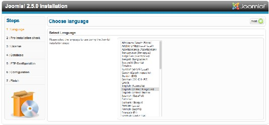

Step 2 –安装检测

图 *1*： 安装程序 *–* 选择语言

The Installation check (Figure 2) should help you verify whether your
server environment is suitable for the installation of [Joomla](http://www.Joomla178.com)! or not.  
  
[12](http://www.joomla.org/download.html) http://www.joomla.org/download.html

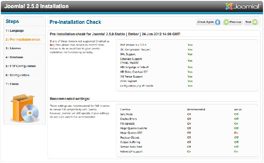

图 *2*： 安装程序 *–*安装检测

如果你看到的检测结果多数是绿色的，就表明不错。根据你配置的不同这里也会有所差异。 [Joomla](http://www.Joomla178.com)
安装程序会考虑web服务器（我们用的是Apache）、PHP 和操作系统的配置。当使用Unix 系统（Linux、Mac OS
X）时，你必须留意文件权限。 这个对于configuration.php文件来说非常
重要。这个文件将在[Joomla](http://www.Joomla178.com)安装完成后生成，里面保存有你的个人偏好值。如果安装程序无法写 入文件夹，
[Joomla](http://www.Joomla178.com)就无法创建文件，那么安装也就失败了。在这种情况下，请重新配置权限并 点击按钮“重新检测”。然后点击下一步即可进入“许可”。

Step 3 – 许可

每个软件产品都会以某种方式授权。[Joomla](http://www.Joomla178.com) 是按照 GNU General Public License 版本 2.0来授
权的 （图 3）

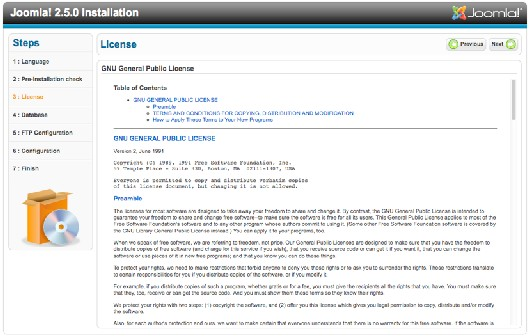

Step 4 – 数据库

图 *3*： 安装程序 *–* 许可

第四个步骤是 数据库配置，会要求你提供数据库基础参数（图 4）。在本地服务器环境里，  
你可以随意创建数据库。有个名叫root的MySQL用户，是MySQL的管理员，具备任意操作
MySQL的权限。服务器环境 不同口令也有所不同（XAMPP 没有口令，MAMP的口令则是 root）。

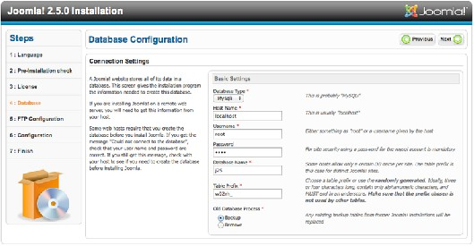

图 *4*： 安装程序 *–* 数据库配置

本地安装时需要输入以下数值：  
• 计算机名称： localhost  
• 用户名： root  
• 口令：
[记得保密哦~]  
现在要选择数据库名称。真实环境下，供应商的数据库服务器或许有配额限制，数据库凭据 也都是 预设 的。如果你在
MySQL服 务 器 拥 有根权限，你就可以 输 入一个新的数据 库 名称。 [Joomla](http://www.Joomla178.com)会创建该数据库。  
对于安装时目标数据库内已存在的表，你可以选择清空或者保存为标记有bak\_前缀的表。  
MySQL
的表前缀很有用。 In front of each 表 name generated by the web 安装程序会在它所创
建的每个表名称的前面，缀以你在相应字段内指定的字符。默认情况下，web 安装程序会予随机
创建，比如w02rh\_。这有一个简单的理由。有时你的供应商只会提供给你一个MySQL数据库。 如果你想运行多个[Joomla](http://www.Joomla178.com)
网站，你就麻烦了，因为表会混淆。利用表前缀则可轻易加以区分  
（w01client\_ or
w02client\_）。这里，你应当使用默认的 w02rh\_ 。表前缀也能用以提示保存的数  
据（bak\_）; 前面已提到过。

Step 5 - FTP配置

要避免访问权限问题和可能开启了PHP 安全模式，你需要使用PHP的FTP功能来进行上传和 文件处理。
本地安装则没这必要。如果你在虚拟服务器上安装[Joomla](http://www.Joomla178.com) ，你可以使用ISP 提供的 FTP
。如果供应商允许你这么做，那么出于安全考虑，你应当为用户和[Joomla](http://www.Joomla178.com)安装程序创建不同  
的FTP账号。激活仅用于[Joomla](http://www.Joomla178.com)目录的FTP账号（图
5）  
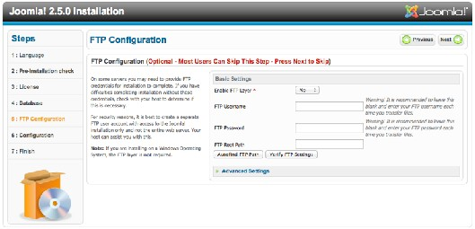

Step 6 - 配置

主要配置分为三个步骤。

图 *5*： 安装程序 *– FTP*配置

首先是提供网站名称。它会在用户浏览网站时显示在浏览器的标题栏。网站名称还会用在其  
他地方，比如向注册用户发送确认邮件时。在示例页面，我使用的
名称就是[Joomla](http://www.Joomla178.com)（图 6）。其 次，需要提供用户名、邮件地址和口令。把口令抄下来绝对是个好主意（可千万别贴在屏幕或压
在键盘下哦：-））.  
最后，就是指定[Joomla](http://www.Joomla178.com)安装时所需要包含的数据了。

安装示例数据

数据是安装时最重要的东西了。[Joomla](http://www.Joomla178.com)允许安装示例数据（强烈推荐初学者安装）。你会得  
到一个[Joomla](http://www.Joomla178.com)小手册，和一些可以安全体验的范例。点击按
钮安装示例数据。 安装程序将在数 据库内加载数据并更改屏显（图 6）。这个过程有点不起眼，但很有必要。按钮将消失，取代的 是一个小的文本框。  
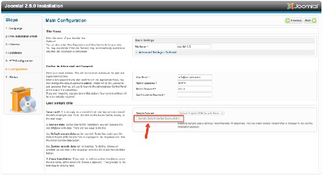

图 *6*： 安装程序 *–* 配置 *–* 用户名、*E-Mail*、口令和示例数据

点击下一步，数据自动转换。.

Step 7 – 完成

第七步也是最后一步，恭喜你已经成功安装[Joomla](http://www.Joomla178.com)（图 7 ）。我也同样恭喜你! 你也会看到屏
幕上一行粗体字忠告，提示你要删除名叫'Installation'的安装目录。你应当遵循照做，否则[Joomla](http://www.Joomla178.com)  
网站无法正常运行

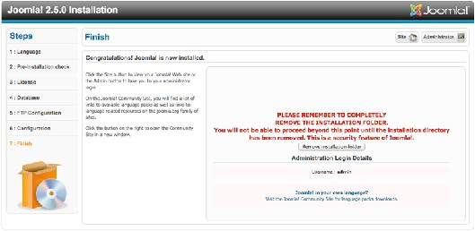

图 *7*： 安装程序 *–* 完成

## Note： 在文件目录内创建了configuration.php。如果你想重复安装，请在删

除安装目录前先删除文件configuration.php。[Joomla](http://www.Joomla178.com)安装程序方可重启。  
现在[Joomla](http://www.Joomla178.com)已经完全安装好了，你可以开始配置网站和内容。眼下有两个选择，一个按钮是
网站 （查看网站） 另一个是 管理 （管理界面）。要看下新创建的网站就请点击网站。如果你还
没有删除安装目录，你还会看到要求删除目录的友情提醒，完成后再刷新页面。  
令人激动的时刻（图 8）。

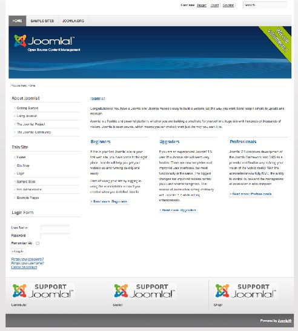

图 *8*： 刚安装完毕的网站

随便瞧瞧网站和一些选项吧，你可以试着开始熟悉新网站。[Joomla](http://www.Joomla178.com) 的很多功能由网站填充的
示例数据来展现。接下来，我们要仔细探查!

取消发布示例数据

如果你是第一次安装 [Joomla](http://www.Joomla178.com) 2.5， 我推荐你安装下示例数据。花些时间探索下网站，了解下  
到底是什么情况。
示例数据向你展示了具备内容的网站究竟是个什么样，你也能简要了解下示 例内容和模块。想获取简要概述，请阅读菜单"Using
[Joomla](http://www.Joomla178.com)"下的内容。  
现在你已有了概念，接下来你该想根据需求和愿望来配置网站了吧。

如何获取干净的 *Joomla ?*

要获取干净的版本，你可以：  
• 安装 [Joomla](http://www.Joomla178.com) 2.5 时不要安装示例数据：
在web目录（/htdocs）下新建个文件夹用来安装[Joomla](http://www.Joomla178.com)。这样就有了两套[Joomla](http://www.Joomla178.com)。这在培训时 非常有用。  
•
在管理后台删除示例数据。  
• 取消发布示例数据。请观看视频连接，我会告诉你怎么做。
如果你想采用后两种方法，你需要登录到管理后台。在那里你可以删除或取消发布这些示例  
数据和菜单项。

菜单管理器

选择菜单管理器的顶部菜单 （Menus -> Top），点击菜单项左侧上方的复选框全选菜单项， 然后点击图标 取消发布。
完成这些后，你会看到每个菜单项都出现个红色的图标。如果你  
返回网站（刷新下），你会注意到菜单消失了。针对Main Menu
和About [Joomla](http://www.Joomla178.com)菜单项重复 这个过程。确保选择了所有的菜单项，除了Home/Frontpage菜单项。这个菜单项可不能删除，
否则主页都没了。在界面下方，你可以更改显示的菜单项的数目（图 10）。

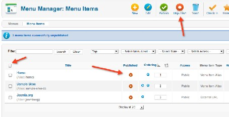

图 *9*： 菜单管理器 *I*

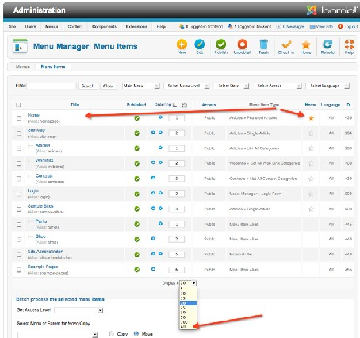

图 *10*： 菜单管理器 *II*

文章管理器

过程和前述的一样。打开文章管理器并把所有的内容取消发布或者干脆删除。

缓存

要确保数据消失，需要清空整个缓存（网站维护 -> 清空缓存）。当然，选择删除所有内容。

干净的网站

现在 [Joomla](http://www.Joomla178.com)就是“干净”的了（图 11 ）。  
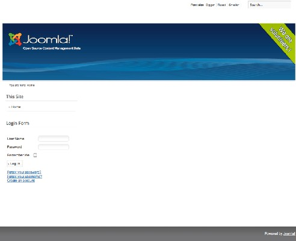

图 *11*： 没有示例数据的*Joomla*

本教程及后续版本均转自[Joomla! 2.5 - 基础指南](http://cocoate.com/zh-hans/j25cn)，版权为原作者及翻译作者所有，感谢Hagen Graf和Yooyooh。**[下载PDF版本](http://pan.baidu.com/s/1eQd1VUE)**

---

除特殊标明文章转自第三方网站，文章均由JOOMLASK.COM原创提供  
欢迎友情转载，请务必保留本文出处并引用本文链接： [Joomla! 2.5基础教程系列 - 如何安装Joomla! 2.5](http://www.joomla178.com/joomla-share/joomla-basic/joomla-base-guide-how-to-install-joomla25.html)
