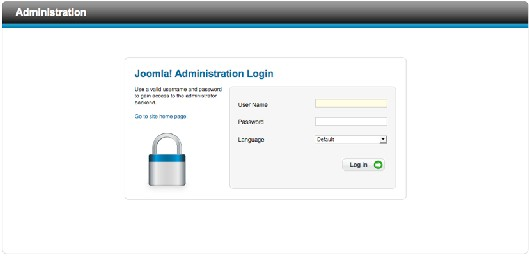
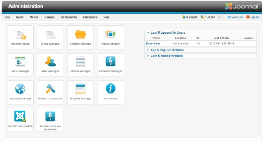
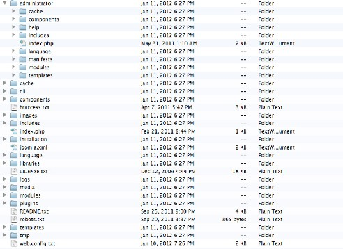
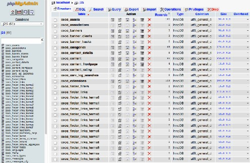
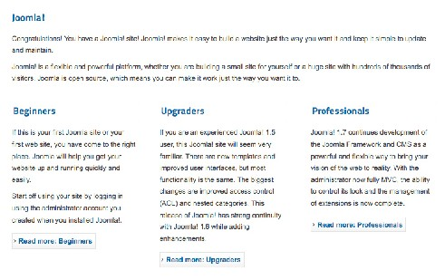
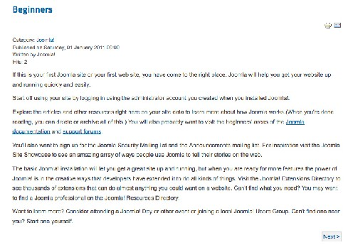
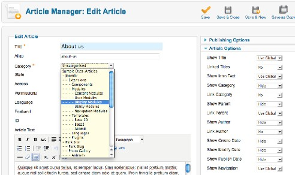
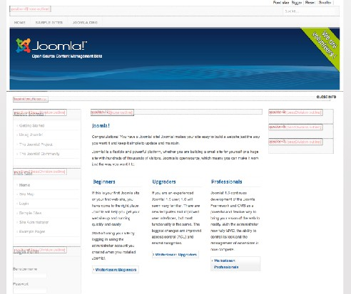
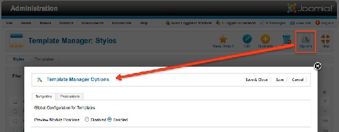

# Joomla! 2.5基础教程系列 - Joomla结构及专业术语

4: 结构和术语

I在开始配置前我先要解释和澄清一些结构和术语。

前台

前台就是游客或用户所看到的网站。注册用户通常只能接触到前台。就好比在商店，商品陈  
列在橱窗和货架上。你可以随意浏览。

后台

这是管理区域，因此，我们称之为网站管理。你也可以赋予注册用户后台访问权限。这种特 权通常仅限于少数几个负责某些管理任务的员工。你可以通过http://localhost/administrator来访 问后台。  
你可以注册你的登录信息并选择首选语言。（图 1）  
 

图 *1: Joomla Administration registration*

一旦成功登录，你就可以访问网站管理，根据用户权限不同管理界面也有所差异。（图 2）

图 *2*： 网站管理

你可以通过使用组合的菜单标签系统或点击启动画面里的快捷图标来访问各个功能

文件

[Joomla](http://www.Joomla178.com) 包含数以百计的文件。有图像、PHP脚本、CSS 文件、JavaScript 和其他等等。 当你解压文件并拷贝到htdocs文件夹时你或许已留意到这点。本质上，你已经安装了两个  
Joomla包：一个是前台、一个是后台。后台的[Joomla](http://www.Joomla178.com)安装在文件夹administrator内（图 3）。  
当你在浏览器内调用/administrator 时就会访问该文件夹。该文件夹包含有类似cache、 components、 language、modules 和 templates 等子文件夹。特定的后台文件就保存在这些目录里 面。  
在administrator文件夹外面你也能找到这些同名文件夹。那些文件夹包含的就是前台文件了。 这不是说真的有两个[Joomla](http://www.Joomla178.com)包，但是前台和后台文件确实泾渭分明。 例如，所有利用媒体管理器上传的文件会保存在文件夹/media 内。所有文件应当留有备份。

数据库

[Joomla](http://www.Joomla178.com) 2.5 文件和文件夹

除了文件（图像、文档、系统文件等等） [Joomla](http://www.Joomla178.com) 还需要一个数据库。安装时，[Joomla](http://www.Joomla178.com) web 安  
装程序会在指定的数据库内创建61个数据表（图 4）。这些表管理着所有的内容。

图 *4*： *Joomla*数据表

当我提到内容的时候，我的意思是文本和配置设定。数据表的截图是通过phpMyAdmin来显 示的。phpMyAdmin是XAMPP和MAMP的组成部分，可以通过http://localhost/phpMyAdmin访 问。 通常，不需要对这些表做任何改动。如果你忘记了管理员口令的时候，phpMyAdmin就很有 用了。这个软件还能用于备份数据库，方法是创建所谓的SQL转储，因为你必须对数据表进行定 期保护。

JOOMLA元素

[Joomla](http://www.Joomla178.com)的结构简单、精巧而有效。[Joomla](http://www.Joomla178.com) 假定你要撰写一篇文章。文章通常包含标题、文本 和一些配置设定。

文章

文章可以在单一或列表视图内显示。[Joomla](http://www.Joomla178.com) 网站的首页通常能看到四个文章（图 5 ）。

图 *5*： 首页文章

文章是以某种方式进行排序。第一篇文章占据了网站的整个宽度。下面的其他文章则分成了 三列。如果文章太长，你可以插入链接read more 。 这就是列表视图。点击链接read more 你会 被重定向到文章全文（图 6）。显示类型可以通过改变后台的设定来予以更改，但是，仅限于拥 有相应权限的用户。

图 *6*：文章全文

文章可以处于发布状态或未发布状态。你可以在首页推荐文章，你也可以存档文章，或把文 章放入回收站并取回。你也可以复制或移动文章。

类别

为了把文章显示清楚，你可以创建类别，然后把文章归类。每个文章可以归属一个类别（图  
7）。类别可以无限嵌套。一个或多个类别 的文章可以分配到一个菜单项并以各种方式显示。通 过点击菜单项，可以显示不同类别的文章。这个法则可以用于在线报纸。例如，你点击Sports 然 后就获取了该话题下所有类别的文章。如果报纸想对不同的运动进行区分，他们将使用嵌套类别 树：  
• Sports  
• Football  
• Handball  
• Politics

• Domestic  
• Europe  
• World  
 

图 *7*： 类别分配

用户

内容需要用户来生成。每个[Joomla](http://www.Joomla178.com)网站至少都有一个注册用户，也就是你在安装网站时创建  
的用户，它拥有顶级网站配置权限。依据用户权利的不同， 用户可以在前台和/或后台来撰写文 章。每个用户都需要一个用户名、邮箱和口令。每个用户都可以隶属不同的用户组并拥有不同的 访问级别。这也使得用户能创建 仅限特定用户组才能看到的文章。

导航

要在网站里面不致迷失，你需要配备相应链接的导航。[Joomla](http://www.Joomla178.com)内称为菜单。你可以按需创建 菜单，并把它们以各种方式嵌套。每个菜单都是个可以放在模板预设区域的模块。

模块

模块就是你放在文章边上的一些玩意。比方说，菜单就属于模块。左侧的小注册框也是模  
块。你可以按需创建足够用的智能模块并把它们放在模板的预设区域。

模板

模板就是网站的图形模式。它主要由HTML和CSS文件构成。[Joomla](http://www.Joomla178.com)提供了多个模板供你选 择。模板是可配置的，这就使得你可以上传不同的logo，改变背景色等等。每个模板都提供了模 块的位 置（图 8）。  
 

图 *8*： 模板位置

你可以把模块围绕在一个或多个文章周围。

插件

插件提供实用的服务，但它往往不为网站访问者所察觉。例如，一个 wysiwyg 编辑器就是一  
个插件。插件就是可以安装无限次的扩展。[Joomla](http://www.Joomla178.com)核心包已经包含了许多有用的插件。

组件

组件几乎可以帮助你在网站创建任意东东。你需要为研讨会弄个预定系统？物业平台?论坛?  
图库? 你只要安装合适的组件即可!  
[Joomla](http://www.Joomla178.com) 核心包已经提供了一些组件，如联系人组件，用于整合网站联系人。还有成千上万的组  
件可以用来提升你的[Joomla](http://www.Joomla178.com)系统。

选项

你的网站需要个性配置；我们称为选项。这些针对用户、类别、模块和组件的选项应用于整  
个网站。你也总能发现一个名叫选项的图标，类似下图（图 9）， 通过插入http://localhost/  
index.php?tp=1就能查看模块位置（图 8）。 首字母 tp 代表模块位置。  
 

其他结构

图 *9*： 选项

还有其他结构比如用户界面、末和技术合作关系等。眼下，你只要熟记前述提到的结构即  
可。

本教程及后续版本均转自[Joomla! 2.5 - 基础指南](http://cocoate.com/zh-hans/j25cn)，版权为原作者及翻译作者所有，感谢Hagen Graf和Yooyooh。**[下载PDF版本](http://pan.baidu.com/s/1eQd1VUE)**

---

除特殊标明文章转自第三方网站，文章均由JOOMLASK.COM原创提供  
欢迎友情转载，请务必保留本文出处并引用本文链接： [Joomla! 2.5基础教程系列 - Joomla结构及专业术语](http://www.joomla178.com/joomla-share/joomla-basic/joomla-base-guide-joomla-frame-words.html)
