# Joomla! 2.5基础教程系列 - Joomla! 2.5自带的扩展

14: 核心扩展

正如我们在扩展管理器内所见， [Joomla](http://www.Joomla178.com) 2.5 压缩包已经包含了许多内置扩展。我们已经接触 了一些。作为一个网站用户，你可能只关注网站管用，而不在于扩展本身。但是作为管理员，你 必须了解发生的一 切。我们已经看过了几个[Joomla](http://www.Joomla178.com)扩展，比如内容 扩展，我们可以用它来撰写 和管理文章, 还能用它以多种方式在网站发布文章。用户 扩展则和用户有关，类别 扩展则和分 类有关，等等。  
在下列章节，我要述及的附件扩展的功能也是[Joomla](http://www.Joomla178.com)核心部分。在组件菜单，你将看到横幅 广告、联系人、短信、新闻源、重定向、搜索、智能搜索和友情链接。我们来看下这些组件，包 括它们的模块和插件。

14.1: 横幅广告

横幅广告组件用于展示网站的广告。横幅广告可以包含图像或自定义的HTML代码。每当用 户访问您的网站，就会依据设置展示不同的广告。点击这些广告即可链接至客户网站。横幅广告 组件提供了客户和类别，同时还提供了详细的分析管理。本章我会给出一个现实生活的示例。  
如果你想在网站售卖广告，你就需要三样东西：客户、横幅广告和网站上用于显示广告的页  
面。噢，我还遗漏了一样东西。你还需要流量。网站流量越大越好。 根据你和客户的合同条款，你还需要个追踪单，罗列所有的展示次数和点击次数。 让我们从客户开始。我居住在某个旅游区，当地企业想给他们的业务做个广告。[Joomla](http://www.Joomla178.com)提供  
了按年、按月、按周、按天和无限这五种类型。你可以在组件-横幅广告–选项配置默认的订阅类  
型。  
我的客户想按月支付费用，在所有页面显示三种不同的滚动横幅广告。我在组件-横幅广告–  
客户–新建 内增加了一个客户并填写表单（图 1）。  
 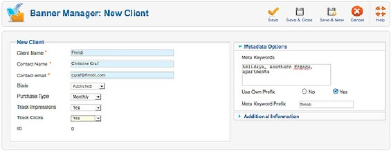

图 *1*： 添加客户

在创建横幅广告之前，我必须先创建广告分类。分类很有用，因为后面的横幅广告模块要用 到客户和分类选项（组件-横幅广告–类别）。  
我可以自由选择每个横幅广告的尺寸，但通常你需要使用标准的web广告尺寸。 （图 2）

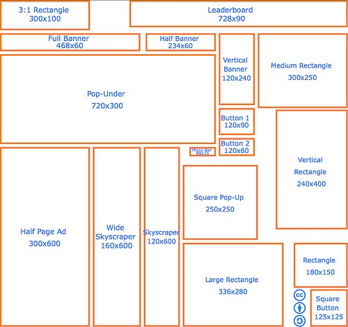

图 *2*： 标准的*web* 横幅广告尺寸39

客户想按leaderboard尺寸（728 x 90 pixels）制作三个横幅广告。我在组件 - 横幅广告 - 横幅广 告中予以创建。我选择好类别和客户，并把横幅广告上传、填写好尺寸。在发布选项 I我可以对 多个选项进行配置，比如，横幅广告的发布开始日期和结束日期。如果客户的订阅计划是有时间 限制的话这就非常有用了。还有个选项用于重置点击次数 和展示次数（图 3， 图 4）.  
   
 [39](http://adzaar.com/docs/standard_ad_sizes) http://adzaar.com/docs/standard\_ad\_sizes

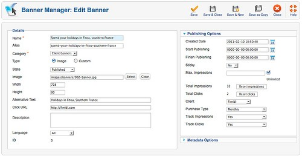

图 *3*： 添加横幅广告表单

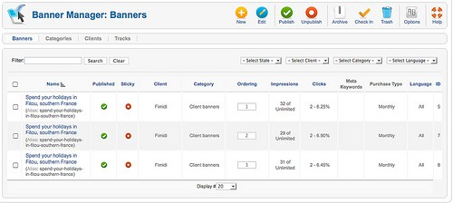

图 *4*：管理横幅广告

接下来就是创建和/或激活横幅广告模块。每种广告尺寸都需要对应一个模块。本例中，所 有的广告都是相同尺寸，所以一个模块就够了。打开 扩展-模块 并筛选横幅广告。现在这里是空 的，我点击新建 图标来创建一个模块。我必须根据模板选择一个位置。在这里我选择的是Beez2 模板的position 12 。横幅广告就会显示在内容上方了。在基本设置 中你可以配置更多。你还可以 在内容中显示模块（参阅章节：模块）。

按标签搜索 字段是个有趣的功能。启用后，当横幅广告关键字（在横幅广告内设置）和页面  
关键字（在文章和其他地方设置）匹配时就会显示广告。另外一个控制模块和广告显示的选项是 菜单分配。还有一个非常重要的功能就是撰写页眉和/或页脚文本。在某些国家广告必须要设标 签（图 5）。  
 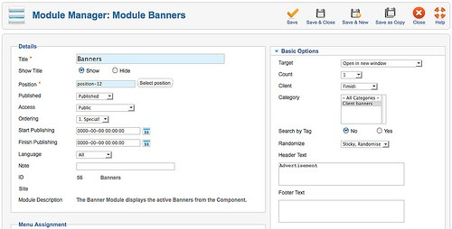

图 *5*： 横幅广告模块

网站现在就能显示横幅广告了。根据配置和广告数量，每次刷新页面就会出现不同的广告。 横幅广告本身链接到客户网站，如果你把鼠标移过图片，就会显示带有广告标题的工具提示窗  
（图 6）。

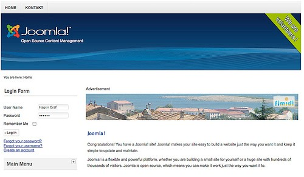

图 *6*：网站上的横幅广告

如果设置正确，广告组件就能追踪到横幅广告所有的展示次数和点击次数。这些数据可以在  
组件–追踪 内查看，并可以按日期、客户、广告分类和类型（点击或是展示）进行筛选（图  
7）。  
 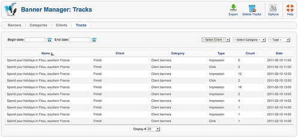

Figure 7: Banner tracking

14.2: 联系我们

每个网站都需要联系人表单。它们的数量依据网站的供应商而有所不同。如果公司网站有多 个部門，那么每个部門都需要有个联系人表单。也许你想为每个雇员或用户账户显示一个联系人 表单。  
所有这些都可以通过[Joomla](http://www.Joomla178.com)联系人组件完成。 正如我们已经看到的（参阅章节：联系人表单），设置联系人表单非常简便。只要创建联系  
人，分配好类别并创建菜单项即可。

示例

如果需要好几个联系人表单，你应当考虑底层结构。类似于文章类别，是可以把联系人类别 分配到菜单项的。结果你就能看到分配给该类别的联系人列表。如果点击名称或联系人标题，你 能看到更多的细节和表单。  
利用联系人组件我已经尝试了好几种不同的场景，结果令人称奇! 在[Joomla](http://www.Joomla178.com)内你可以轻松创 建嵌套类别和不同的菜单项类型。比如，在选项 （组件-联系人-选项），你可以配置联系人表单 的外观（滑动、标签、无格式）并且设置许多其他参数。  
我用我们的公司来创建示例，联系人区域针对三种不同的查询设置了三种联系人表单，还为  
每个组员弄了个联系人表单。点击链接就会显示联系人表单和附加详情（图 1）。

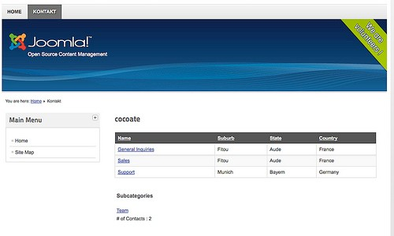

图 *1*： 联系人区域

我在本例创建了两种类别： cocoate 和 team。类别 team 是cocoate的子类。虽然可以添加图片 和说明，但我决定只填写标题字段（图 2）。  
 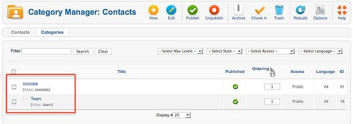

图 *2*： 联系人类别

每个联系人都需要配上一个邮件地址。联系人可以关联用户或独立存在。本例中，我创建了 三个独立的、和类别cocoate有关的联系人。我还创建了两个和类别team 有关的联系人，并关联 到某个现有的用户账户。（图 3）

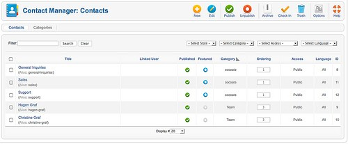

图 *3*： 联系人

只要数据有更改，比如电话号码，如果相关用户可以直接在网站、而不是通过管理后台来更 改他们的配置文件会非常好。对于这种任务提供了个User-Profile插件。你只要在扩展-插件里面 予以激活，就会显示配置文件字段区域，它连接到联系人组件。.

14.3: 短信

短信是[Joomla](http://www.Joomla178.com)的核心组件，也是为后台用户准备的内置私信系统。 它允许你在后台接发来自其它其它用户的短信。 短信组件使用很简便；但是，人们往往容易忽略在组件-短信-我的设置予以配置。你可以设  
置在有新短信时通过系统邮件提醒，每隔多少天予以删除，你还能锁定收件箱。

14.4: 新闻源

新闻源是非常方便的。它可以用来订阅不同的新闻和信息。不幸地是即使今天，人们还由于 某些不明原因而不善加以使用。三十年前你不得不通过购买报纸来 获取新闻。十五年前你打开 浏览器访问众多网站来获取新闻。今天，你还能通过这两种办法来获取新闻，但更好的办法是试 用新闻源聚合器。 Google's reader 和浏览器的动态书签工具栏（e.g. Firefox） 很受欢迎。[Joomla](http://www.Joomla178.com) 的Newsfeeds 组件也是个新闻源聚合器。虽然它不如Google's reader那么复杂，但也很有用。  
新闻源组件允许您收集来自其它网站的新闻源并把它们发布到自己的网站。

在 现 今社交媒体的 时 代，每个人都会有 许 多的用 户账户 。通常 视频 和 图 片会保存在   
youtube.com和flickr.com。在公司里情况就更复杂。想象下诸如[Joomla](http://www.Joomla178.com)或有关您公司的项目新闻源 会有多少信息吧。

网站上的新闻源阅读器

在下个示例中，我们将在网站上构建一个新闻源阅读器。我将收集有关公司的点点滴滴并把 它们在表内列出。我们的影片有个vimeo账户，照片有个flickr账户，还有几个twitter账户，但这 还不是全部：-）  
首先，我在组件→新闻源→类别里面创建了一个叫cocoate的新闻源类别，然后在组件→新闻 源→ 聚合源 每个源配上一个条目（图 1）。唯一的问题是要经常查找正确的种源链接。例如， 我们的vimeo视频新闻源链接看起来类似： [http://vimeo.com/cocoate/videos/rss](http://vimeo.com/cocoate/videos/rss%E3%80%82Flickr%E7%85%A7%E7%89%87)。Flickr照片的新 闻 源 链 接看起来更复 杂 （ htt p://api.flickr.com/ser vices/fee ds/photos\_publ ic.gne? id=17963290@N00&lang=en-us&format=rss\_200)。  
在发布选项里面你必须输入想显示多少新闻源条目，还有缓存的刷新秒数。Joomla 仅保存你 在缓存中配置的条目数量。这个细节很重要，因为在某些国家不允许在数据库内保存来自公共新 闻源的内容。  
 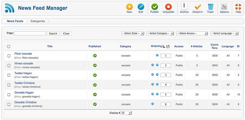

图 *1*： 新闻源集合

最后，你必须在中意的菜单创建个菜单项。新闻源 组件有三种不同的布局：  
1. 所有的新闻源类别列表  
2. 指定类别的新闻源列表  
3. 单一新闻源  
我选择了第二种，因为我的所有新闻源都归到一个类别了。在网站上， [Joomla](http://www.Joomla178.com)会聚合我的新  
闻源，比如 Vimeo 视频源 （图 2）  
 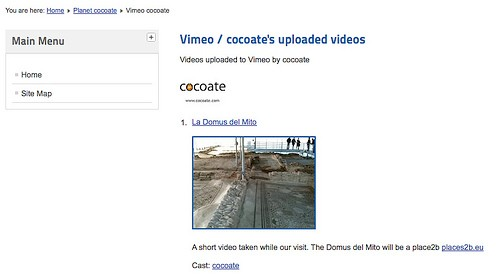

图 *2*： 新闻源数据

当你创建新闻源的时候，你可以在显示选项配置是否显示新闻源图片等东西。还有，你可以 限制显示内容的字符数。如果新闻源包含的文章很长、或者你想使用新闻源显示模块时这个功能 就非常有用了。你可以在 扩 展 - 模 块 – 新建 创 建新的模 块 。 这 里有个 纽约时报 的新 闻 源示例 ([http://feeds.nytimes.com/nyt/rss/HomePage](http://feeds.nytimes.com/nyt/rss/HomePage%EF%BC%89%E3%80%82%E6%8A%8A%E6%A8%A1%E5%9D%97)）。把模块配置在position-4并配置基本选项 （图  
3）。

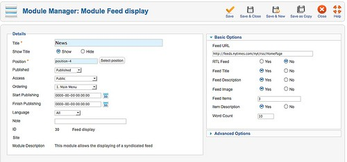

图 *3*： 新闻源模块

网页结果如图 4。  
 

14.5: 重定向

网页结果如图 *4*。

重定向管理是一个绝妙的主意。 如果用户输入的网站路径有误就会把他们重定向到某个有效 的网页。失效网页或许过去有存在并被搜索引擎添加索引，又或某人把它保存到了另外一个网

站。这个问题经常发生在网站改版后。重定向组件非常方便。如果某人试图访问的页面不存在，  
[Joomla](http://www.Joomla178.com)就会显示一个404–未发现 页面，同时会在重定向管理器内创建一个新的条目。当访问组  
件–重定向，你会看到这些链接（图1）。必须在扩展 →插件内激活插件系统–重定向。  
 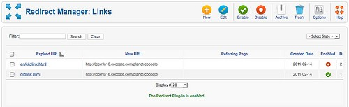

图 *1*： 重定向管理器

你现在可以编辑这些链接并添加新的重定向网址。下次再访问这些旧的路径时，重定向组件 会确保访客重定向到新的网址。如果你意识到哪些旧的路径已经不复存在的话也可以自己创建重 定向。该组件使用了web服务器的重写系统。你必须弄明白你所使用的web服务器。你可以在网 站→系统信息里面查看你在使用何种web服务器。（图 2）  
 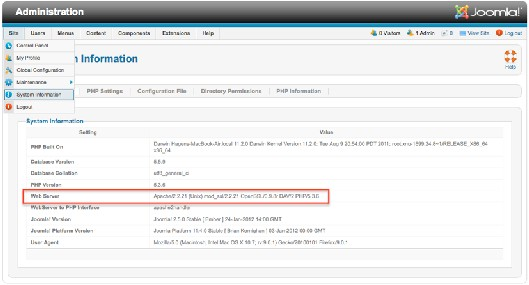

图 *2*： 系统信息

如果您web服务器的是Apache，请重命名文件htaccess.txt为.htaccess。某些情况下无法改名是  
由于文件名的开始是个点。我使用了ftp客户端或shell来重命名。  
如果使用的是Internet Information Server，请把文件web.config.txt重命名为web.config并在激活 前安装IIS URL Rewrite Module （图 3）.  
 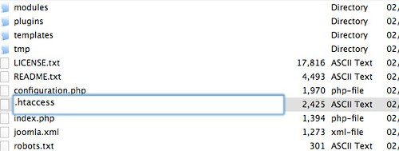

图 *3: .htaccess*

然后，打开全局配置→网站→SEO设置→使用网址重写 并切换到是（图 4）.  
 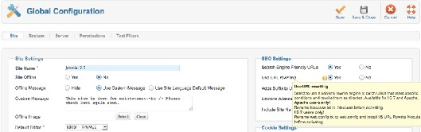

图 *4*： 全局配置 *–* 网站

14.6: 搜索

人们都希望能在您的网站进行内容搜索。  
[Joomla](http://www.Joomla178.com) 默认使用的是全文搜索。全文意味着[Joomla](http://www.Joomla178.com)会在数据库内搜索你在搜索框内输入的所有关  
键词。  
这可能对大多数人来说，听起来是显而易见的，但事实并非如此。很多搜索引擎会创建一个 搜索索引，它包含了你网站使用的关键词。正式搜索时，会浏览搜索索引匹配项。这些匹配项会 链接到实际内容。搜索结果页面就是基于这些匹配项和链接。 基于索引的搜索要比全文搜索快，但索引必须和你网站同步更新；否则就无法找到新的内容。为 了弥补基于索引的搜索功能的性能  
势，[Joomla](http://www.Joomla178.com)是高度可配置的。  
打 [Joomla](http://www.Joomla178.com) 2.5起，全新的自能搜索核心组件提供了基于索引的搜索。

搜索词分析

想知道访客在你网站都搜索些什么，你必须打开统计功能（组件→搜索→选项：搜集搜索统 计–是）。这样就会记录所有的搜索词并在组件–搜索内列出。别忘了打开显示搜索结果（图  
1）。  
 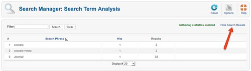

用户界面

图 *1*： 搜索统计

你可以选择在网页直接显示搜索框或搜索链接。搜索扩展针对搜索框提供了个搜索模块，菜  
单项则有搜索布局。搜索模块默认已被激活，而且多数模板为它提供了特 定的搜索位置。搜索 模块提供了众多选项，包括按钮文本配置和设定搜索框宽度。自打[Joomla](http://www.Joomla178.com) 2.5以来的一个附加功 能就是可以把[Joomla](http://www.Joomla178.com)搜索加做浏览器默认。 [Joomla](http://www.Joomla178.com) 搜索模块提供了 OpenSearch Format40 (图 *2*).  
 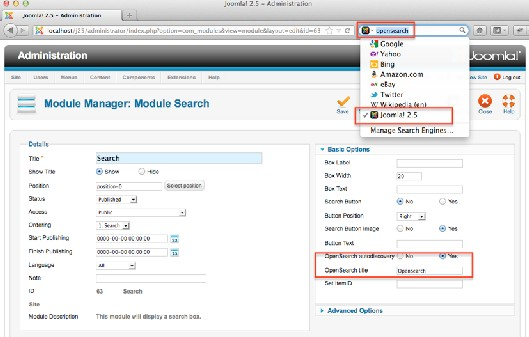

图 *2*： 搜索模块

搜索结果页顶部包含更详细的搜索表单，下面则是搜索结果（图 3）。  
   
 [40](http://en.wikipedia.org/wiki/OpenSearch) http://en.wikipedia.org/wiki/OpenSearch

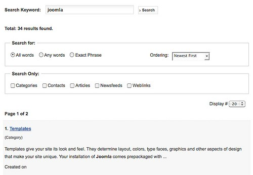

图 *3*： 搜索结果页

用户可以配置搜索设置（全部关键字、任意关键字、词组匹配）并更改显示结果次序。搜索 也可以限定针对不同的内容项比如文章和类别。

幕后

你还可以在现有的搜索插件内配置搜索。请查看扩展–插件管理器并筛选类型search （图 4）.  
 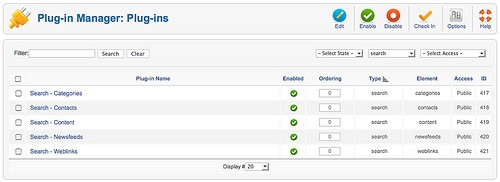

图 *4*： 搜索插件

这里罗列了搜索有关的插件。你可以更改插件次序，并切换激活状态。你也可以配置每个插  
件的选项，比如，是否需要搜索存档文章。 每个附加安装的扩展都可能包含一个搜索插件，并把它自身整合到搜索进程中。  
利用基于插件的搜索结构，[Joomla](http://www.Joomla178.com)的搜索组件就便于使用和扩展!

14.7: 智能搜索

智能搜索是[Joomla](http://www.Joomla178.com) 2.5的新功能。它的自动完成和“猜测”功能（词干处理）为[Joomla](http://www.Joomla178.com)核心添加 了更灵活和快速的“智能化”搜索引擎。  
词干处理?

比如对英语进行词干化，应当识别字符串"cats" （或许"catlike"、"catty" 等 等。）是源于"cat"，而"stemmer"、"stemming"、"stemmed"则源于"stem"。词干算 法就是把单 词"fishing"， "fished"， "fish"和"fisher"简化到词根"fish" (Wikipedia)41.

[Joomla](http://www.Joomla178.com)核心包带有个称作Snowball的英语词干处理器（扩展-> 智能搜索 -> 选项）。它工作起 来与众不同，需要PHP Stem扩展的支持，目前支持14种语言：丹麦语、德语、英语、西班牙 语、芬兰语、法语、匈牙利语、意大利语、挪威语、荷兰语、葡萄牙语、罗马尼亚语、俄 语和 土耳其语。为了获取灵活和速度，数据必须加以索引。

激活

默认情况下智能搜索是禁用的。要启用它你需要启用内容插件智能搜索和五种查找器插件。  
查找器的名称源自该组件。它是个整合到[Joomla](http://www.Joomla178.com)核心的第三方组件（图 1）。  
 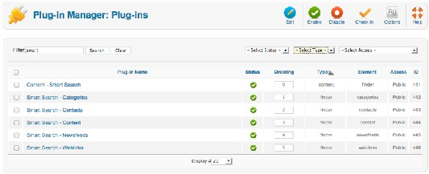

图 *1*：查找器插件

  
 [41](http://en.wikipedia.org/wiki/Stemming) http://en.wikipedia.org/wiki/Stemming

索引

要使智能搜索工作就必须对内容进行索引。这个工作在内容保存时自动完成。初始索引可以 通过组件->智能搜索->索引来完成 （图 2）。  
 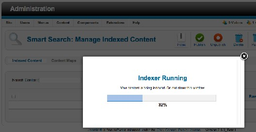

图 *2*： 索引

定制

完成激活和索引后你需要决定是试用智能搜索模块呢还是在导航中显示搜索链接。无论哪种  
情况，你都可以拥有自动完成和词干处理（你是想找?）功能（图 3， 图 4）

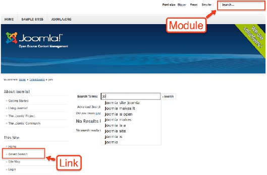

图 *3*： 自动完成

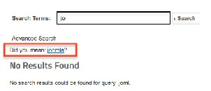

图 *4*： 词干处理

智能搜索还可以预定义搜索参数。  
摘要请见[Joomla](http://www.Joomla178.com)文献42

删除经典的[Joomla](http://www.Joomla178.com)搜索

要删除经典的Joomla搜索：  
   
 [42](http://docs.joomla.org/Smart_Search_configuration_options) http://docs.joomla.org/Smart\_Search\_configuration\_options

Joomla!2.5

search (search)

search ( -> ->search)

Oct182012 Pi1e; 148

14.8: 友情链接

利用友情链接组件，你可以创建和网站整合的链接列表或下载区。为达到目的，Joomla提供 了嵌套分类系统并计算这些链接的个人点击数。该组件对于链接分类很有用。你可以尽情创建所 需要的链接分类和链接，然后把它们关联起来。加上菜单链接，选择布局并配置选项。  
友情链接组件提供了三种菜单项类型布局：列出所有的友情链接分类、列出某个友情链接分 类和提交友情链接。前两种布局我们在文章和类别中已见识过。而 第三种类型可以让用户参与 到联合分类建设。在用户菜单创建个'提交友情链接 '的菜单项并在组件→友情链接 →选项设置权 限允许注册用户创建链接。选项 区设有六个选项卡配置众多细节。  
示例数据包括了某个链接分类（图 1）。  
 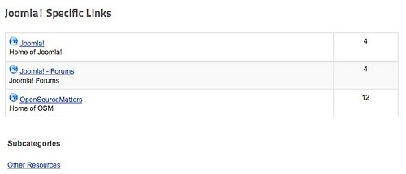

图 *1*： 链接分类

在模块管理器，你可以找到个友情链接模块，用来在你的网站显示某个类别的链接。

---

除特殊标明文章转自第三方网站，文章均由JOOMLASK.COM原创提供  
欢迎友情转载，请务必保留本文出处并引用本文链接： [Joomla! 2.5基础教程系列 - Joomla! 2.5自带的扩展](http://www.joomla178.com/joomla-share/joomla-basic/joomla-base-guide-joomla25-default-extensions.html)
