# Joomla! 2.5基础教程系列 - 菜单导航设置

11: 导航

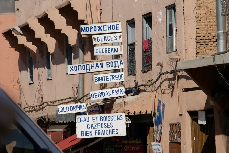

Photo: [http://www.flickr.com/photos/62904109@N00/5214296452](http://www.flickr.com/photos/62904109%40N00/5214296452) CC BY 2.0

每 个网站点需要一个易于理解的导航， 否则用户就不便找到他所需要的内容。这听起来简 单，做起来不易。最完美的情况下仅需两到三次点击即可访问到网站的目标页面。另一个事实 是，你的访客可能来 自搜索引擎或社交媒体网站，他们并不总是首先访问你网站的首页。这就 是必须考虑在每个页面添加“首页”按钮的理由！  
网站通常包含主导航和二级导航。主导航通常在网站顶部或左侧或右侧。二级导航则在底部 或顶部，但大多比主导航来得小。它们一般包含诸如联系人、关于我们和法律声明等链接。设置 初衷是把这些网站链接放在某个不很重要的位置。  
作为通则，导航不宜超过4到8个链接。

面包屑

'面包屑'属于辅助导航。它来源于格林兄弟童话里面 Hansel and Gretel32 留下的面包屑。通常  
面包屑水平放置在网页顶部。它用到了两种结构：  
• 显示用户一路点击抵达当前页面的每个来路链接  
• 显示当前页的父页面 面包屑用于防止访客在网站迷途。最理想的情况是访客时时知道自己身在何处。[Joomla](http://www.Joomla178.com) 提供  
了面包屑模块来达成该目的，并且多数模板都为面包屑保留好了位置（图 1）。  
 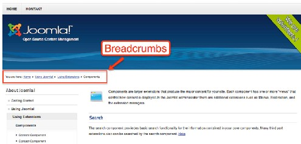

[Joomla](http://www.Joomla178.com) 菜单

图 *1*： 面包屑

[Joomla](http://www.Joomla178.com) 的导航由菜单创建。你可以按需为网站创建任意数量的菜单。每个菜单可以包括任意  
数量的嵌套菜单项，你也可以对菜单层级进行筛选。菜单项可分配给组件或外部网址。菜单项也 可以分配模块和模板样式。在示例数据中，已经创建了一些菜单用于显示。  
让我们看两个静态页面和动态分类的主导航示例。

第一个例子：静态目录或书目结构

  
 [32](http://en.wikipedia.org/wiki/Hansel_and_Gretel) http://en.wikipedia.org/wiki/Hansel\_and\_Gretel

有时你需要为书设置导航，目录或指南。你可以参照示例数据的菜单About [Joomla](http://www.Joomla178.com) 的设置。  
让我们假设现在要撰写一本仅有三个章节的书。  
导航应当链接到所有的页面，它看起来类似 图 2。  
 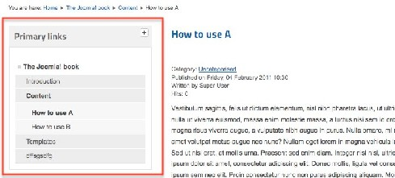

图 *2*： 静态书本结构

准备

创建一个具有少许章节的书目结构  
• The [Joomla](http://www.Joomla178.com) book  
• Introduction  
• Content  
• How to use A  
• How to use B  
• Templates  
在创建菜单项前，你首先得创建单独的文章（页面）。打开 内容 → 文章管理器 → 添加新文 章 （图 3）。你可以把这些文章归到未分类 ，或者你可以提前创建个 book 类别，并把它们归入  
其中。

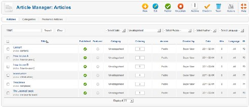

Step 1： 创建菜单

图 *3*： 六个 *'*书章节*'*

You can use an already existing menu as your primary links or you can create a new one by accessing  
Menus → Menu Manager → and filling out the form (Figure 4).  
 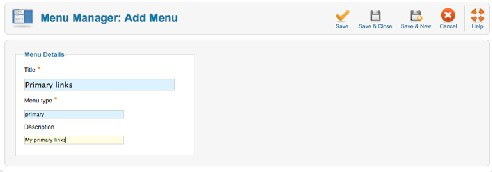

Figure 4: Add new menu

Step 2: Creating the menu items

打开菜单→ Primary links 并且把六篇文章加做链接。选择单个文章作为菜单项类型。 选择文  
章并输入菜单标题（图 5）。 如果你忘记了怎么做，请参考如何创建'关于我们' 页面。

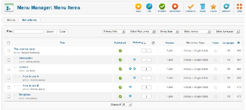

Step 3： 创建并分配模块

图 *5*： 主菜单项

这一步有点棘手。你现在已经有了文章、菜单和菜单项，但你还需要在网站上设置个模块位 置。让我们动手创建一个。打开扩展→ 模块 → 新建模块 并填写表单。在基本设置的选择菜单字 段，选择Primary links。在字段显示子菜单项选择是（图 6）。  
 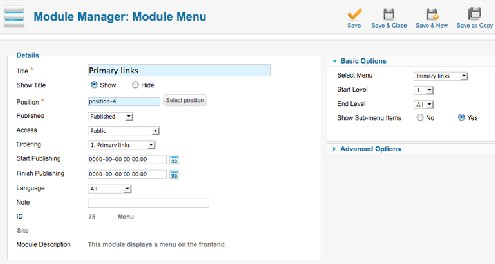

图 *6*：主链接模块

最后一步是模板位置。点击 选择位置按钮， 筛选出模板Beez\_20 并选择 position-4。保存好即 告完工。

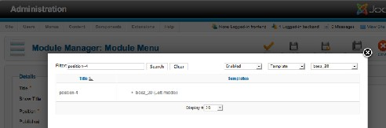

图 *7*： 选择模板位置

第二个例子：链接至类别（新闻杂志）

在第一个例子中，页面链接数量有限是可行的，但如果你的文章成千上万了怎么办? [Joomla](http://www.Joomla178.com)  
给出的解决很简单： 用类别来建立结构，把文章归类并创建分类布局链接。

准备

我们需要一些文章分类： 类别：  
• News  
• World  
• Africa  
• Europe  
• Technology  
• Internet  
• Cars  
您可以创建分类或使用现有的分类 （阅读全文：用分类构建内容）。

Step 1： 菜单

如何继续取决于你。最简单的办法就是使用现有的Primary Links 菜单。如果你需要，就可以新建  
个菜单。

Step 2： 菜单项

当你处理类别时，你必须考虑好点击链接后要显示些什么。本例的预期效果是  
• Category News → all =显示所有的新闻  
• Category News → World = 仅显示国际新闻  
等等（图 8）。  
 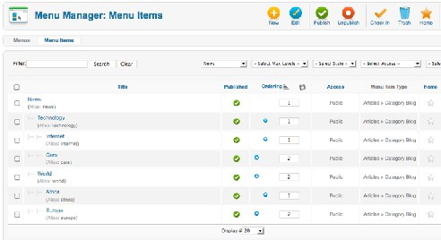

图 *8*： *News* 菜单内的菜单项

要达到预期效果，可以用类别博客 类型来创建菜单项。在 必填设置， 选择您新建的类别 News。 在博客布局选项，选择包括子类别-全部、#头条文章=0。继续为每个类别创建嵌套菜单 项，直到完毕 （图 9）。

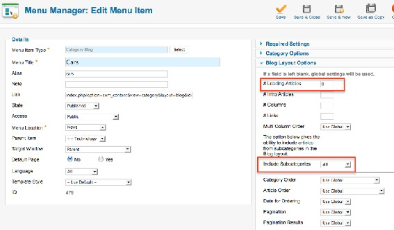

图 *9*： 类别选项

现在你就可以对付成千上万的文章了。导航已经就绪，访客能立马领会系统含义（图 10）。  
 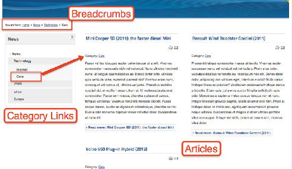

图 *10*： 类别结构中的文章

一些调整

如你所见，这里的设置选项组合非常之多。许多事情都可以做到的，通常也有一种方法来达  
到您的目的。关于导航设计，可以在模块内筛选出菜单项的层级。比如说，我们可以做到  
• 把 News 菜单的第一级放在顶部，而把它的第二和第三级放在左侧栏或右侧栏  
• 把整个菜单放在顶部并使用下拉式菜单（取决于模板的能力） 如果你能细致把玩，你会发现几乎每种情况都能找到相应的解决。Joomla 的导航系统一方面  
有点复杂，另一方面却很强大。

---

除特殊标明文章转自第三方网站，文章均由JOOMLASK.COM原创提供  
欢迎友情转载，请务必保留本文出处并引用本文链接： [Joomla! 2.5基础教程系列 - 菜单导航设置](http://www.joomla178.com/joomla-share/joomla-basic/joomla-base-guide-menu.html)
