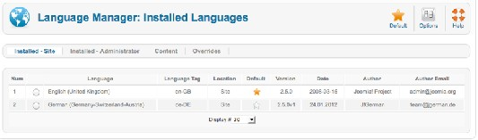
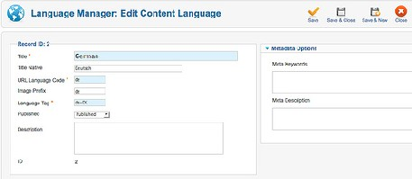
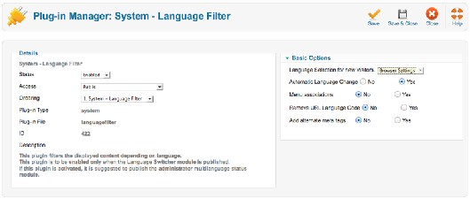
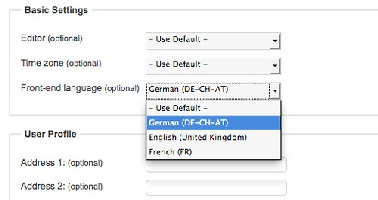
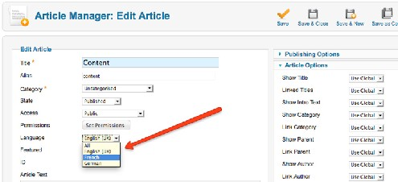
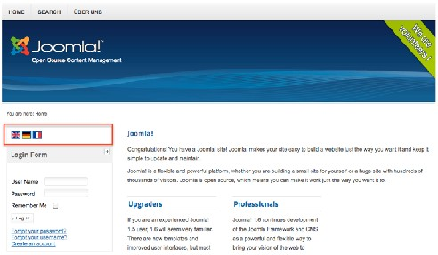
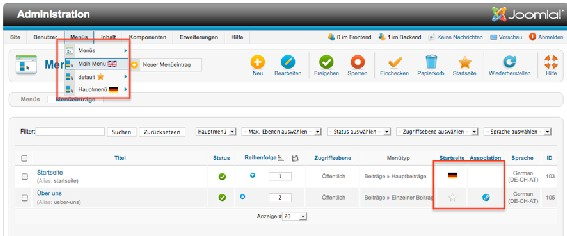
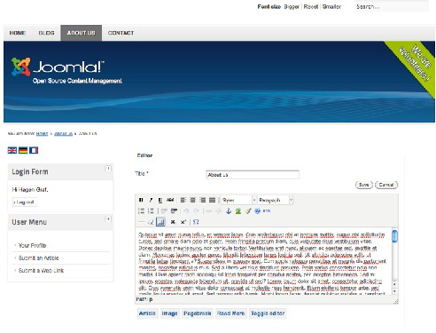
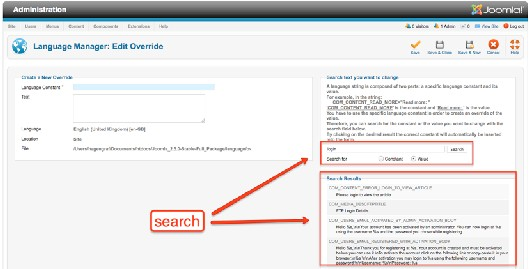

# Joomla! 2.5基础教程系列 - 多语言网站

20 : 多语言网站

我住在欧洲。欧盟有23种官方语言。如果你在这样的地方创建网站，你就必须考虑多语言。 这里涉及两个挑战：静态的[Joomla](http://www.Joomla178.com/)文本字符串翻译和内容项的翻译。第一个挑战通常容易克服， 第二个才是真正的挑战。  
[Joomla](http://www.Joomla178.com/) 2.5核心包括了超过40种语言，而且有望添加更多的语言。 本章我们利用[Joomla](http://www.Joomla178.com/) 2.5核心创建多语言网站。

JOOMLA! 语言包

你可以从 [Joomla](http://www.Joomla178.com/) Code64 或 [Joomla](http://www.Joomla178.com/) extension directory65下载翻译包并使用扩展管理器安装（阅 读全文： Chapter 13: 扩展管理）。我安装了德语包和法语包。安装后打开后台的扩展 → 语言管 理 就可以找到有三种已安装语言（图 1） 。  
 

图 *1*： 已安装的语言（英语，德语）

语言配置

  
 [64](http://joomlacode.org/gf/project/jtranslation1_6/frs/) http://joomlacode.org/gf/project/jtranslation1\_6/frs/  
 [65](http://extensions.joomla.org/extensions/languages/translations-for-joomla) http://extensions.joomla.org/extensions/languages/translations-for-joomla

现在，还有必要看下语言配置，确认语言是否已发布（扩展 → 语言管理 → 已安装）和语言  
内容属性是否正确（图 2）。打开（扩展→语言管理→内容）。如果安装好的语言没有内容项， 点击新 建图标创建。这就是我安装好法语包后所做的。  
 

语言筛选器插件

图 *2*： 编辑内容语言

要让 [Joomla](http://www.Joomla178.com/) 能分辨不同的语言，必须激活系统–语言筛选 插件（扩展→插件）。你只要通过  
选项设置就可以配置显示给访客的语言，不管是网站语言还是客户浏览器设置。另外一个要配置 的是 自动选择语言。 启用后，内容语言会根据前台语言设置自动发生变化。  
 

图 *3*： 插件 *-* 语言筛选

用户在登录前台后都可以配置他的前台语言。 多数时候，根据你的权限会有个用户菜单提供  
了不同的菜单项。在该用户菜单，你还可以找到链接您的资料。点击该链接，你可以查看和编辑  
自己的个人资料。在基 本设置的资料编辑表单，用户可以选择配置并设定他们的前台语言（图  
4）。你可以使用默认的网站语言或可用的内容语言。根据这些设置， 语言插件可以让你查看相  
应语言的网站内容。  
 

语言切换模块

图 *4*： 用户资料 *–* 基本设置

通过激活语言切换 模块，你可以在前台切换语言，不管你是访客还是登陆用户。在基本设置  
你可以添加文本并选择语言是以名称还是国旗图标的形式显示。我相信有些第三方模板在不 久 就会为该模块提供对应的模板位置。在默认的模板Beez2 中， position-7 和国旗一起结合工作。

图 *5*： 语言切换

仔细阅读说明文本是很要紧的  
当切换语言但显示该页的菜单项未关联到其它菜单项，模块会重定向到选定 语言的首页。然而，如果设定了语言筛选插件的菜单关联参数，它会重定向 到选定语言的关联菜单项。之后，就使用该语言所定义的导航了。如果插 件*'*系统*-* 语言筛选*'* 未启用，会达不到预期结果。方法：

1. 打开语言管理的内容标签，确保你想在内容内使用的语言已发布，还需 要用于网址的语言代码和模块显示使用的图片前缀。

2. 在菜单项创建指定语言的首页，并定义每种已发布语言的默认首页。

3. 之后，你可以给Joomla内的任意文章、分类、模块、新闻源、友情链接指 定语言。

4. 确保模块已发布、插件已启用。

5. 当使用关联菜单项，确保模块显示在有关页面上。

6. 国旗或语言名称的显示方式取决于语言管理–内容 的语言排序。

如果发布了该模块，建议也发布管理员多语言状态模块。

多语言内容项

正如我先前提到，每个内容项，比如文章，可以指定语言。困难就在于需要创建所有源和目  
标语言的内容项（图 6）。你可以创建任意语言的内容项，但不幸地是， [Joomla](http://www.Joomla178.com/) 2.5 不支持翻译  
工作流，这意味着你要自己注意避免错误。  
 

多语言网站

我的示例网站包括  
• 带有文章的首页，  
• 博客，  
• '关于我们' 页面，  
• 一个联系人表单。

图 *6*： 语言字段

图 *7*： 示例网站

首页

我已经为每种语言都创建了一些带精选属性的文章（参阅章节：典型文章）  
为了让你易于上手，我专門录制了视频（2.5的不久后发布）。这是针对1.7 版本 （一样有 效）

To make it easier for you to start I created a screencast (will be published soon for 2.5). This is the 1.7 version (which still works)66

我创建的菜单包含个默认叫做default的菜单项， 链接到 精选文章。 我通过点击首页图标把  
该菜单项设置为首页。菜单default 不需要对应的模块，它只要存在即可 （[Joomla](http://www.Joomla178.com/) 2.5版本实际存 在该行为，它有望在下个更新中得到更改）。  
然后我针对每种语言创建菜单和相应的菜单模块。我为每种语言创建了菜单项： （Home， Startseite， Accueil）。通过点击首页 图标可以配置菜单链接为首页（图 8）。如果你看到菜单项 旁边的国旗了，一切就正常，否则 ... 看视频去吧 ：）  
   
 [66](http://vimeo.com/28593435) http://vimeo.com/28593435

图 *8*： 每种语言的首页

博客

我在cocoate.com已经有了一个博客，所以我就是用了新闻源组件来显示外部的博客条目。我  
针对每种语言创建了新闻源项和对应的菜单项（参阅章节： 新闻源）。

'关于我们' 页面

我针对每种语言都创建了 '关于我们' 页面，如同章节如何创建 '关于我们' 页面描述的那样。

联系人表单

我使用单一联系人表单应对普通查询。我仅需要一个联系人项，所以没必要分配语言。仅当 不同语言的联系人数据有区别时，比如地址或邮件不同，才有必要针对每种语言都创建一个联系 人项。

登录表单

每个页面都得配上登录表单。我复制了两次英文的登录模块，配置了菜单分配，修改了标题  
并分配了正确的语言。现在就能在我的网站登录和注册了。

用户菜单

我使用了现成的用户菜单，上面有个人资料的链接，还能创建文章或友情链接（图 9）。

图 *9*： 前台编辑

如你所见，用[Joomla](http://www.Joomla178.com/)创建多语言网站是非常的简单!

语言覆盖

如果你发现网站的语言字符串不合适，可以通过扩展 -> 语言管理 -> 覆盖更改。  
语言字符串由两部分组成：特定的语言常量和它的值。比如，字符串内：

COM\_CONTENT\_READ\_MORE="Read more: "

'COM\_CONTENT\_READ\_MORE' 是常量、 ' Read More：' 就是数值。 要创建数值覆盖必须使用特定的语言常量。因此，你可以通过下方的搜索字 段搜索要更改的常量或数值。 点击所需的结果就会在表单内自动插入正确的常量。

你可以搜索语言字符串并把自定义文本填入表单以便覆盖（图 10）。

本教程及后续版本均转自[Joomla! 2.5 - 基础指南](http://cocoate.com/zh-hans/j25cn)，版权为原作者及翻译作者所有，感谢Hagen Graf和Yooyooh。[下载PDF版本](http://pan.baidu.com/s/1eQd1VUE)

---

除特殊标明文章转自第三方网站，文章均由JOOMLASK.COM原创提供  
欢迎友情转载，请务必保留本文出处并引用本文链接： [Joomla! 2.5基础教程系列 - 多语言网站](http://www.joomla178.com/joomla-share/joomla-basic/joomla-base-guide-mutilanguage.html)
