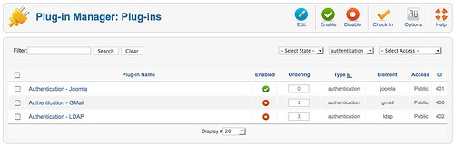
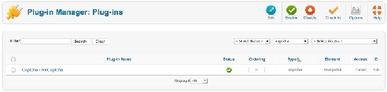
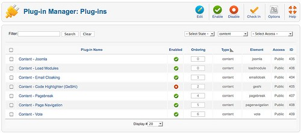
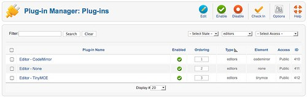
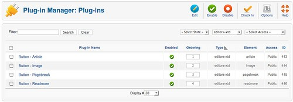
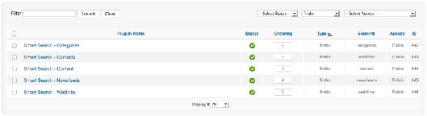
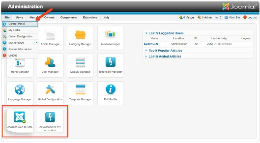
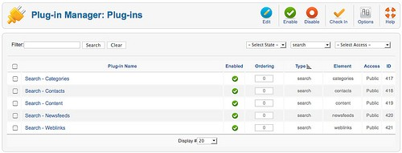
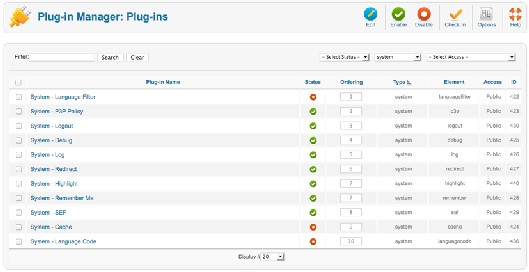
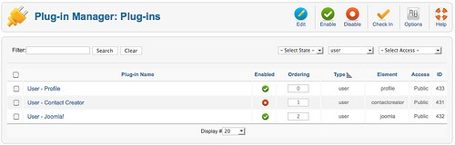

# Joomla! 2.5基础教程系列 - 插件的管理和应用

16: 插件

插件为组件添加特定功能。插件这个术语还用在其他地方。例如，浏览器通常使用插件来播 放视频。很有名的一个插件就是Adobe公司的Flash Player。Joomla的插件使用示例当推搜索组 件 。五个搜索插件协同工作查找来自不同Joomla 组件的内容。  
Joomla 有八种插件类型：authentication， captcha， content， editors-xtd， editors， extension， finder， quickicon， search， system 和 user。还有专門存储插件文件的网站子目录名 称。例如，authentication类型的插件就保存在目录。我们没必须要像在模块章节那样在后台插件 插件。插件安装必须通过扩展管理器。

认证

Joomla的认证就是验证用户是否有权限在网站上做些什么事情。授权是认证后验证用户可以  
做什么。你验证你的用户名和密码，并获取权限组的授权（阅读全文：用户和权限）。Joomla提 供三种认证方式（图 1）。当停用插件时需要仔细。你必须至少启用一种认证插件，否则就无法  
访问网站了。  
 

Joomla!

图 *1*： 认证插件

该插件提供的是Joomla标准认证。就是填写登录用户名和口令并予验证。

GMail

如果你激活了GMail 插件，用户就可以使用他们的Gmail邮箱和口令登录你的网站。这样就  
无需事前注册。当首次登录的时候， Joomla系统插件会在它的数据库内创建用户账户。数据库 内保存的GMail口令是加密的，不用担心被黑。该插件对于用户来说登录很方便。但不幸的是， 在登录表单内不会提示用户说可以使用GMail来登录。你必须手工添加提示文本或者寻求其它的 创意方案。

LDAP

轻量级目录访问协议 *Lightweight Directory Access Protocol (LDAP)*43 是个利用目录服务来读取和编辑  
数据的应用协议。 它通常被公司用来管理部門归属和雇员电话号码。

dn: cn=John Doe,dc=example,dc=com cn: John Doe

givenName: John sn: Doe

telephoneNumber: +1 888 555 6789 telephoneNumber: +1 888 555 1232 mail: 该 Email 地址已受到反垃圾邮件插件保护。要显示它需要在浏览器中启用 JavaScript。

manager: cn=Barbara Doe,dc=example,dc=com objectClass: inetOrgPerson

objectClass: organizationalPerson objectClass: person

objectClass: top

要想使用该认证插件，你必须有LDAP服务器（OpenLDAP）并且需要用服务器具体数据来配 置LDAP插件。教程请参阅 joomla.org： *LDAP from Scratch* 44.

验证码

验证码是自打Joomla 2.5以来的新功能。验证码用来区分用户究竟是人还是机器的程序。你或  
许见识过它们— 在网站注册表单下面彩色的带有扭曲文本的图片。许多网站使用验证码来防 止“机器人程序”的滥用，否则自动程序会产生大量垃圾邮件。计算机程序是无法读取扭 曲的文 本的，但人可以。这样机器人程序就无法浏览到受验证码保护的网站了。该插件使用Google reCAPTCHA服务来阻止垃圾邮件发送者。要获取你的域名的公钥和私玥，请访问 htt p://  
   
 [43](http://en.wikipedia.org/wiki/Ldap) http://en.wikipedia.org/wiki/Ldap  
 [44](http://community.joomla.org/component/zine/article/507-developer-ldap-from-scratch-sam-moffatt.html) http://community.joomla.org/component/zine/article/507-developer-ldap-from-scratch-sam-moffatt.html

google.com/recaptcha。 要在新账户注册时添加验证，请打开用户管理器的选项并选择Captcha –

reCaptcha。  
 

图 *2*： 验证码插件

内容

除了Joomla类型的内容插件，所有其他内容插件都和你在文章中插入的文本有关。自定义  
HTML 也能使用内容插件（图 3）。（阅读全文： 模块）  
 

智能搜索

图 *3*： 内容插件

该插件启用了内容索引。这是Joomla 2.5的新功能，也是Joomla智能搜索的基础。

Joomla

Joomla 插件有两个任务：

1. 当你试图删除类别时，它验证类别是否为'空'。空的类别就代表它没有文章或子类别了。你可  
以在基本设置 把这个功能关闭。  
2. 如果前台提交了新的文章，插件会给所有开启了发送邮件的用户（用户管理器 - 编辑用户）  
发送一封邮件。可以在基本设置 把这个功能关闭。

加载模块

该插件把所有指定了模板模块位置的模块HTML输出加载到文章内去。你所要做的只是在需 要显示模块的地方写上。这个功能特别方便用来把横幅广告插入内容。 电子邮件伪装  
该 插件把文章内容里面 输 入的 该 Email 地址已受到反垃圾邮件插件保护。要显示它需要在浏览器中启用 JavaScript。 形式的 邮 件地址 转换为链 接，并通 过  
JavaScript进行邮件地址的伪装。这样做的好处是邮件地址搜集程序无法轻易读取到您的邮件地 址。

代码高亮

GeSHi插件使得语法高亮成为可能，如果你把代码用<pre> </pre> HTML标签加以格式的话  
就会在网站上创建出令人印象深刻的列表：

<pre>

if ($number > 0)

{

echo $number;

}

else{

$number++;

}

</pre>

分页符

分页符插件负责文章的分页。就像Image插件一样，它很方便和文章内容整合。除了简单的 分页，还能定义各种页眉和页面标题。你也可以使用分页对话框来设置分页。分页会以简单水平 线的方式显示在文本窗口。在HTML代码内，分页看起来类似：

该插件整合了文章下方的前后翻页功能。

页面导航

该插件整合了文章下方的前后翻页功能。

投票

该插件为文章提供投票功能。

编辑器

Joomla 核心有两个编辑器（图 4）。在全局配置–网站，你可以设置网站的默认编辑器。此 外，你也可以为每个用户指定不同的编辑器。（用户 - 管理）.  
 

CodeMirror

图 *4*： 编辑器插件

CodeMirror45 是个JavaScript链接库，用来给代码内容创建相对舒适的编辑器界面―计算机程  
序、HTML标记等等。如果你想使用CodeMirror编辑器提供文本域字段则必须激活该插件。你可 以在基本设置 对编辑器行为进行配置。

None

如果你不想使用编辑器而仅想提供个文本域字段，就必须激活该插件。

TinyMCE

  
 [45](http://codemirror.net/) http://codemirror.net/

TinyMCE46 是个跨平台的基于网络的Javascript HTML WYSIWYG编辑器控件。它也是Joomla  
的默认编辑器。

EDITORS-XTD

四个编辑器扩展插件用于在编辑器窗口下方生成按钮（图 5）.  
 

图 *5*： 编辑器扩展插件

文章

显示的按钮用于链接当前文章到其它已有文章。点击该按钮后，会显示个弹窗让你选择要链  
接的文章。

图片

该插件显示一个按钮用于在文章内插入图片。点击该按钮后，会显示个弹窗让你从媒体目录 选择图片或上传新文件并配置它的属性。

分页

提供一个按钮用于在文章内插入分页。会显示个弹窗让你配置设置。该插件必须和Content - Pagebreak插件一同激活。

阅读全文

提供按钮使得你可以方便地在文章里面插入阅读全文链接。  
   
 [46](http://tinymce.moxiecode.com/) http://tinymce.moxiecode.com/

扩展

扩展类型的插件和管理Joomla扩展的任务有关。

Joomla

该插件管理站点扩展更新

FINDER

智能搜索组件的前身是Finder。这就是该插件类型名称由来。可以按需对智能搜索插件的内  
容、友情链接、联系人、类别和新闻源类型予以激活。它们实现了智能搜索组件的搜索功能。如 果你想获取相应对象的搜索结果就必须激活它们。如果你想搜索附加组件，那么就必须有这些对 应插件的支持 (图6)。  
 

快速图标

图 *6*： 智能搜索插件

这种类型的插件用于检查Joomla和已安装的第三方扩展的更新，并在您访问网站 -> 控制面板  
时通知你。

图*7*：快速图标

搜索

针对内容、友情链接、联系人、类别和新闻源的搜索插件可按需激活。它们实现了智能搜索  
组件的搜索功能（参阅章节 搜索）。如果你想获取相应对象的搜索结果就必须激活它们。如果 你想搜索附加组件，那么就必须有这些对应插件的支持（图8）。  
 

图 *8*： 搜索插件

系统

系统插件深深融入Joomla框架，它们左右整个网站的行为（图 9）。  
 

语言筛选

图 *9*： 系统插件

该插件根据所需的语言对显示内容进行筛选。仅当发布了语言切换器 模块才需要启用。（参  
阅章节：模块）

P3P 策略

隐私偏好工程平台 *Platform for Privacy Preferences Project (P3P)*47，是网站用于声明搜集用户信息的 使用目的的协议。系统的P3P策略插件允许 Joomla在HTTP头内发送P3P策略的自定义字符串。 这对于某些浏览器的会话正确工作很有必要，比如 Internet Explorer 6 and 7。

缓存

该模块提供了页面缓存。你可以配置是否需要使用客户浏览器来缓存页面。

Debug

提供了debug 功能，对于编程人员很重要。你可以配置参数来确定显示的信息。  
 

[47](http://en.wikipedia.org/wiki/P3p) http://en.wikipedia.org/wiki/P3p

日志

该插件提供了系统日志文件。你可以在全局配置 – 系统 – 系统设置内确定日志文件的位置。 下面是日志文件示例（/logs/error.php）：

#Version: 1.0

#Date: 2011-07-06 12:39:38

#Fields: date time level c-ip status comment

#Software: Joomla 1.7.0 RC1 [ Ember ] 28-Jun-2011 23:00 GMT

2011-07-06 12:39:38 - 92.143.161.32 Joomla FAILURE: Empty password not allowed

重定向

和Redirects组件一起提供重定向功能。

Highlight

该插件对特定术语进行高亮，比方可以用在智能搜索组件。

记住我

这是个在客户浏览器内使用cookie来本地保存访问数据的方法。一旦用户再次访问你的网 站，数据就会自动填写表单。仅当用户勾选了登录表单下面的标记后方有效。

SEF

SEF 是搜索引擎友好 的简称。该插件为内容元素创建搜索引擎友好网址，它可以在全局配  
置-SEO设置 内配置。

注销

系统注销插件使得Joomla可以在用户访问受限页面时选择注销的时候把他们重定向至首页。

语言代码

语言代码插件可以在生成的HTML文档内改变语言代码以利改善SEO。

用户

用户插件和用户的具体功能有关（图 10）。

用户资料

图 *10*： 用户插件

用户资料插件使得你可以用附加的配置文件字段对用户进行询问，它可以在基本设置 内配  
置。它还可以结合联系人创建器插件来为每个用户自动创建联系项目（参阅用户和权限）。

联系人创建器

该插件为新用户自动创建联系人信息。它和用户资料插件协同工作（参阅用户和权限）。

Joomla!

This plug-in creates a user in the database after the first successful authentication.

本教程及后续版本均转自[Joomla! 2.5 - 基础指南](http://cocoate.com/zh-hans/j25cn)，版权为原作者及翻译作者所有，感谢Hagen Graf和Yooyooh。[下载PDF版本](http://pan.baidu.com/s/1eQd1VUE)

---

除特殊标明文章转自第三方网站，文章均由JOOMLASK.COM原创提供  
欢迎友情转载，请务必保留本文出处并引用本文链接： [Joomla! 2.5基础教程系列 - 插件的管理和应用](http://www.joomla178.com/joomla-share/joomla-basic/joomla-base-guide-plugin-manager.html)
