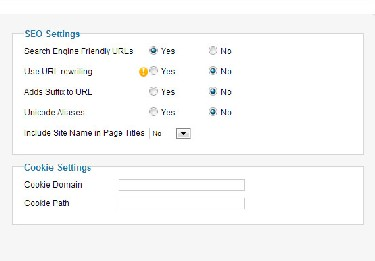
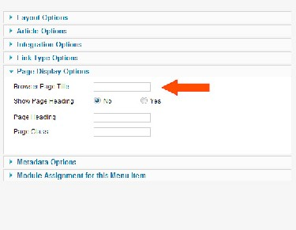
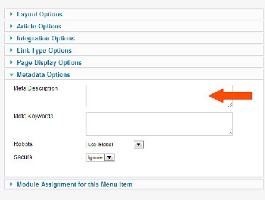
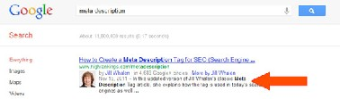
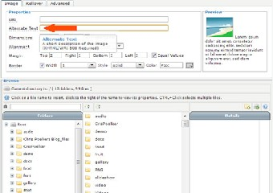
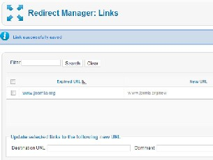
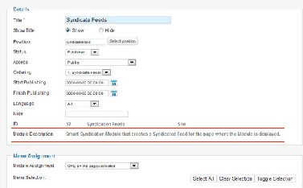

# Joomla! 2.5基础教程系列 - SEO的重要性

19: 为何 SEO很重要

作为网站拥有者、开发者或创建者，你知道获取访客是网站成功存在的关键。在这个互联网 统治的世界，学习新事物、定位正确的产品和服务，或查找用户反馈的最 快方法就是使用搜 索，如果你想让人能够在你的网站找到他们所喜欢的东西，你就必须遵循既定的在线搜索法则。 为了让你了解下近年来在线搜索有多可观，下面提 供一组来自 ComScore51, 的数据，它是一个专 門从事数字营销情报的研究公司：  
• Google搜索： 每月880亿  
• Twitter搜索：每月190亿  
• Yahoo搜索：每月94亿  
• Bing 搜索：每月41亿

JOOMLA 2.5 和 SEO

作为世界上最先进的开源内容管理系统之一，[Joomla!](http://www.Joomla178.com/)设计提供了诸多功能和特性，使得你的 网站能做到搜索引擎友好并被合适的受众所找到。或许你也知道，这个过程

“通过"自然的" 或无需付费（"有机的" 或 "算法的"）的搜索结果来提高网站 或网页在搜索引擎内的可见度”52

叫做**SEO**或 搜索引擎优化。  
 

51 <http://www.comscore.com/Press_Events/Press_Releases/2010/1/> [Global\_Search\_Market\_Grows\_46\_Percent\_in\_2009](http://www.comscore.com/Press_Events/Press_Releases/2010/1/)

[52](http://en.wikipedia.org/wiki/Search_engine_optimization) http://en.wikipedia.org/wiki/Search\_engine\_optimization

SEO有两个主要功能，一是把那些高度感兴趣的访客转变为潜在客户或客户， 二是帮助你建  
立网上品牌。  
SE O 分站内和站外元素，你可以在 se a rc he ng i ne l a nd . co m 查阅 到有用的 详细图 文信息 infographic53 。 好消息是[Joomla!](http://www.Joomla178.com/)可以帮助你处理这两种元素，这样你就可以建立起坚实的SEO基 础，它可以方便地延伸为一个成功的由流量驱动的网站。

JOOMLA! 2.5 包括的SEO功能

SEO-友好网址

图 *1*： *SEO-*友好网址

按照谷歌的 Matt Cutts 54， 最佳网址包含的单词不超过3-5个。在此基础上，网址越长，排名 权越弱。[Joomla!](http://www.Joomla178.com/)网站安装后网址看起来类似：

http://www.yourdomain/index.php?

option=com\_content&view=article&id=8:beginners&catid=19&Itemid=260

  
 [53](http://searchengineland.com/seotable/) http://searchengineland.com/seotable/  
 [54](http://www.mattcutts.com/) http://www.mattcutts.com/

如果你开启了SEO功能 – 在[Joomla!](http://www.Joomla178.com/)控制面板的全局配置，并修改了 access.txt55 文件 - 那么网  
址看起来如下：

http://www.yourdomain/products/your-product-name

虽然搜索引擎能够读懂第一种网址，叫做动态网址，但第二种网址更为普遍，它属于搜索引 擎友好类型。理由是 – 用户倾向于点击带有意思和相关搜索词的链接，而动态网址经常会导致搜 索引擎在诠释时误判重复并因此而惩罚你的网页排名。[Joomla!](http://www.Joomla178.com/) 允许你用简单的两步即可建立起 搜索引擎友好网址- 在管理后台编辑全局配置，并对服务器根目录内的access.txt文件做少许更 改。你还可以通过文本编辑器编辑文章内容或菜单项配置面板来修改网址实际包含的的单词。 SEO 浏览器页面标题  
 

图 *2*： *SEO* 浏览器页面标题

标题标签，在[Joomla!](http://www.Joomla178.com/)内称为浏览器页面标题，它们显示在浏览器窗口的顶部。它们是最重要 的SEO元素，直接影响每个网页的排名。要确保有效，每个标题必须：  
   
 [55](http://www.teachmejoomla.net/joomla-mambo-tutorials-and-howtos/general-questions/how-to-) http://www.teachmejoomla.net/joomla-mambo-tutorials-and-howtos/general-questions/how-to- enable-seo-on-joomla.html

• 每个页面都唯一，  
• 要和该页面内容极其有关，  
• 最多70字符长，  
• 应当包含你为页面优化所设的关键搜索字 。 是这样解释它的工作方式的 seo.com56 :

"例如，我们假定你有个为教师认证要求提供信息和指南的教育网站。你觉 得网站最重要的关键字是 “teaching certification” 和 “teaching requirements.” 在这种情 况下，带有“Teaching Requirements for Teacher Certification”的页面标题就和网站主 题高度相关。蜘蛛程序会抓取你网站，由于它首先看到的就是标题，蜘蛛程 序会“阅读”到它，然后继续检查 页面其余部分出现的关键字，来判断标题 和内容的相关性。如果内容、H标签和标题标签都相关—你就是行家了! 这 就是为何在标题标签内要放置最重要的关键字之所在"

使用 [Joomla!](http://www.Joomla178.com/)，添加标题标签是个简单无忧的过程。你可以在菜单项设置面板修改所有页面的  
标签。

所有页面的*SEO Meta*描述

  
 [56](http://www.seo.com/blog/seo-tips/title-tag-seo-tips/) http://www.seo.com/blog/seo-tips/title-tag-seo-tips/

图 *3*：所有页面的*SEO Meta*描述

Meta描述是用户执行在线搜索查询之后、在返回的查询结果页面内、每个查询结果网址下方 用户看到的简单概要。虽然它不再牵涉到搜索引擎排名的重要性，但它却决定了点击率（如用户 实际上是否感受足够的驱策去点击你的网页链接）。 Meta 描述不应超过160个字符。  
 

图 *4*：搜索引擎里的*SEO Meta*描述

[Joomla!](http://www.Joomla178.com/) 可以让你为所有的网页添加meta描述 – 即使你创建的页面是展示文章分类的。你可以 从两个层面管理该过程 – 菜单项层面（针对分类页面）和文章层面（在编辑文章的文本编辑器 内） （图 3）。

用于*SEO*的简单图片标题

图 *5*： 用于*SEO*的图片标题

搜索机器人是无法正确看到图片的。这时候就需要用到“alt”标签或图片描述/标题了。它们帮 助你的图片便于搜索，最终改善SEO。 [Joomla!](http://www.Joomla178.com/) 提供了便于填写的图片对话框57 会方便地提示你为 图片加上描述。这是个更为简便易用的SEO增强功能，结果快速有效。

用于*SEO*最佳实践的重定向

图 *6*： 重定向管理

57 [http://www.joomlacontenteditor.net](http://www.joomlacontenteditor.net/)[/](http://www.joomlacontenteditor.net/)

Stephan Spencer，一个SEO专家和博客写手在他的文章58 内提到：

"使用适合的重定向属于SEO “ 最佳实践”。每个网站都需要重定向（例如， 从网站的非www版本到www版本，反之亦然）。如果你不这样做，你就无法 获取最大利益。此外，随着时间推移网 站会逐步发展，网址也会变化。只 要你的网址发生变化 — 不管是域名、子域名、子目录、文件名或查询字符 串 — 你都需要保证指向旧网址的链接受到谷歌和 其他搜索引擎的重视， 而且它们的投票权转移到了新网址。"

利用[Joomla!](http://www.Joomla178.com/)自带的重定向组件把用户从不存在的页面、文档或其它网站资源重定向到新的位 置仅需3个简便步骤。它对用户很友好，上手容易，最棒的就是每次用户访问到不存在的页面 时，组件会把有问题的网址列出，同时还有它的点击次数。这样你就可以快速修正问题网址。 使用*RSS*获取更好的*SEO*

图 *7*： 新闻源模块

RSS通过反向链接来帮助你增强SEO。正如你知道的，你的网站的反向链接越多，谷歌和其 他搜索引擎对它的信任就越高，而且搜索结果排名也就越高。针对 SEO使用RSS的最简单的办 法就是使用[Joomla!](http://www.Joomla178.com/)的聚合新闻源模块来给你的内容建立起RSS源，并把它们发布到网站和社交媒  
   
 [58](http://www.stephanspencer.com/redirects-and-seo-best-practic) http://www.stephanspencer.com/redirects-and-seo-best-practic

体频道 （LinkedIn，Facebook，等等。），还有某些内容聚合网站如feedage.com，等等。你也可  
以和伙伴和其他非竞争网站分享你的RSS 链接 – 只要你能持续提供相关新鲜内容，有些机构也  
许就会订阅它们并在他们的网站上显示你的新闻源，从而有助你建立起更多的反向链接。

结论

利用上述提及的方法有助你快速简便地建立并保持正确的网站SEO。但是，以结果wi导向的  
SEO并不仅是标题和图片。它在你建立网站之前就已开始，它也是个需要定期进行管理并以成功 作为衡量的不间断的工作。这里我想推荐些极好的资源。它们会帮 助你掌握所需的一切，你将 成为自己足以依赖的免费的SEO顾问：  
• 来自wordtracker.com的免费的59 ，非常有用。它向你介绍了关键字的概念，和为何SEO始于定 义分类和页面关键字，帮助你了解如何找到最佳关键字和如何在文本内把它们包含进去以便建 立起网站稳定增长、免费且有序的流量。  
• 这里还有一篇文章时关于五步法指南，可以让你快速完成自助60 .  
• 要想学习更多的SEO知识和了解实现的方式，请参阅searchengineland.com的免费的61 .  
• 的SEO Cheatsheet会带给你很多SEO技巧，能让你很快上手。62  
• SEOMoz的Web Developer SEO Cheatsheet 也是很棒的资料，它向你展示如何把页面内容结构  
化。63  
   
 [59](http://www.wordtracker.com/academy/keyword-basics-part-1-how-search-engines-work) http://www.wordtracker.com/academy/keyword-basics-part-1-how-search-engines-work  
 [60](http://searchengineland.com/guide/seo) http://searchengineland.com/guide/seo  
 [61](http://magazine.joomla.org/topics/item/403-5-Quick-SEO-steps-that-will-help-you-get-better-) http://magazine.joomla.org/topics/item/403-5-Quick-SEO-steps-that-will-help-you-get-better- rankings-and-more-traffic-to-your-Joomla-site  
 [62](http://static.seomoz.org/user_files/2006/seomoz-cheatsheet.swf) http://static.seomoz.org/user\_files/2006/seomoz-cheatsheet.swf  
 [63](http://static.seomoz.org/user_files/SEO_Web_Developer_Cheat_Sheet.pdf) http://static.seomoz.org/user\_files/SEO\_Web\_Developer\_Cheat\_Sheet.pdf

本教程及后续版本均转自[Joomla! 2.5 - 基础指南](http://cocoate.com/zh-hans/j25cn)，版权为原作者及翻译作者所有，感谢Hagen Graf和Yooyooh。[下载PDF版本](http://pan.baidu.com/s/1eQd1VUE)

---

除特殊标明文章转自第三方网站，文章均由JOOMLASK.COM原创提供  
欢迎友情转载，请务必保留本文出处并引用本文链接： [Joomla! 2.5基础教程系列 - SEO的重要性](http://www.joomla178.com/joomla-share/joomla-basic/joomla-base-guide-seo.html)
