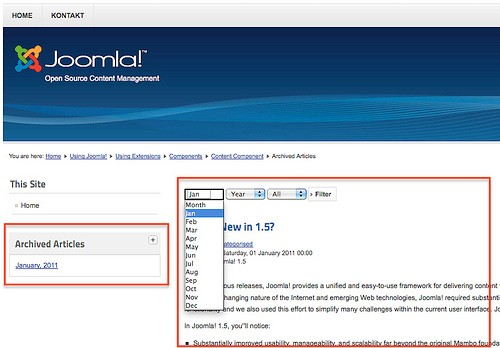
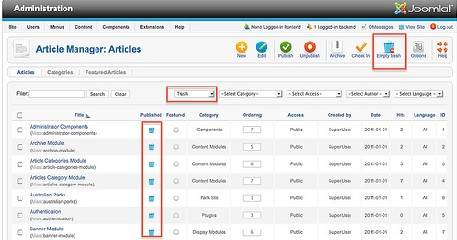
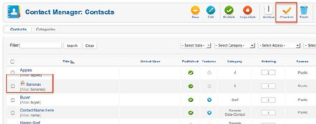

# Joomla! 2.5基础教程系列 - 状态、回收站、签入等功能

8: 状态、回收站和签入

[Joomla](http://www.Joomla178.com)的内容可以有几种状态。根据不同的内容类型，至少有三种状态： 已发布、未发布和 回收站。这是什么意思呢? 内容首次保存后，它就存在于[Joomla](http://www.Joomla178.com)数据库内，并且根据它自身状 态，显示在（或不显示）网站的不同区域。  
[Joomla](http://www.Joomla178.com)内容通常的生命周期是：  
1. 在编辑和审查前都是未发布  
2. 已发布或定时发布（还有可能是首页精选）  
3. 还是 已发布 但首页上已没有  
4. 存档  
有些时候很有必要把内容取消发布 ，有时你也会把它们放入回收站。内容本身当然不会丢 失。它未被删除。你也可以通过内容状态对后台界面的大多数表进行筛选，并且随心切换内容状 态。

未发布

网站访客无法看到内容。仅限你自己编辑和审核。

发布

用户和访客能否看到内容依据他们权限的不同，但通常来说你的网站内容既然发布了，就应 该都可见!

精选

精选功能无非是个开关，用作首页显示最重要和最新的内容。这也是个附加状态，因为它仅  
和文章相关。所以文章状态可以处于未发布 同时精选。

存档

总有时候你需要考虑对文章进行存档。只要把状态设为存档 a你就几乎创建了一个存档。 [Joomla](http://www.Joomla178.com)知道你的文章的创建日期，并且提供了一个存档模块用于网站的显示。示例数据就包含了 存档模块。  
如果没有的话，可以通过模块 → 新建 →存档文章来创建。你的文章显示类似图 1。请参阅  
模块。  
 

回收站

图 *1*： *Joomla* 存档

倒数第二个状态是回收站。如果文章内容发配到这里，它还可以重见天日。你可以在回收站  
内放置模块、菜单项、类别、文章、联系人和其他内容。你可以筛选出回收站的内容（图 2）。

图 *2*： 回收站

签入

[Joomla](http://www.Joomla178.com)中的签入图标恐怕不是你从 Foursquare 或其他基于定位服务所知道的那种。它是内 容编辑的一种安全机制。用户开始编辑内容的时候，[Joomla](http://www.Joomla178.com)会锁定内容以防其他用户编辑。这 样做的好处是其他用 户不会形成干扰。这是个非常方便的功能。但当用户编辑内容时不小心关 闭 了 浏览 器 时 ， 问题 就来了，要么等会 话过 期，要么等 电 厂断 电 ，要么 ... 你知道我的意 思：-）。然后内容惨遭锁定，没人能够编辑它了! 没人能够（除了拥有适当权限的用户比如管理 员）可以再度签入内容、以便他人编辑。你会在未经检查的内容标题旁边发现有一把小锁（图  
2），或许你可以哭喊着要求他人相助 ：-）.  
 

图 *3*：签入

本教程及后续版本均转自[Joomla! 2.5 - 基础指南](http://cocoate.com/zh-hans/j25cn)，版权为原作者及翻译作者所有，感谢Hagen Graf和Yooyooh。**[下载PDF版本](http://pan.baidu.com/s/1eQd1VUE)**

---

除特殊标明文章转自第三方网站，文章均由JOOMLASK.COM原创提供  
欢迎友情转载，请务必保留本文出处并引用本文链接： [Joomla! 2.5基础教程系列 - 状态、回收站、签入等功能](http://www.joomla178.com/joomla-share/joomla-basic/joomla-base-guide-some-config.html)
