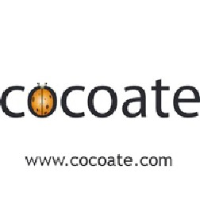

# Joomla! 2.5基础教程系列 - 从头开始制作Joomla! 2.5网站

21 : 从头开始 [Joomla](http://www.Joomla178.com/) 2.5 网站

首先，要有计划

有两种类型的网站建设者。 第一种 非常典型。客户询问，  
我想弄个网站，要蓝色调的；需要多少钱?  
他回答，  
如果想要带日历的，需要花费$X， 当然花$Y可以带个博客。  
这种类型的网站建设者好比机械。客户需要什么，他就仅止于提供这样一个网站，而不去用 自己的分析或多年经验帮助客户去解决问题。  
第二种 网站建设者则有望迎来更大的客户。当问到同样的问题，他会说， 当然，我们可以把你的网站搞成蓝色调。你能和我谈谈你的机构，以及你的  
网站希望为此做些什么吗?  
通过转而询问客户的机构和他们所需要解决的问题，你会和客户发展互信关系。这意味着完 成网站是你和客户关系的开始，会导致进一步的合作，而不是和客户关系的终结。开展和老客户 的业务要容易很多，远胜不停地寻找新客户。  
如果你想成为第二种类型的人，更为成功的网站建设者，这里有些指南供你从头梳理你的  
[Joomla](http://www.Joomla178.com/) 2.5网站。

机构、用户和网站的目标

就从和客户讨论他们的机构开始，是要做商业网站、非盈利网站还是个人网站。你或许需要  
询问到以下问题， 它们还有附加问题：

• 机构目标是什么? （例如： 结束世界饥饿，销售针织产品赚钱，为最新活动提供更新）  
• 机构创建日期和服务对象?  
• 机构为何需要网站? 网站已经存在还是新建?  
• 如果网站已经存在，那么保留老网站的价值何在? 你会给老网站添加些什么内容? 网站的信 息是否仍旧定位准确，或者机构在网站最终改版后有无变化?  
• 谁来维护网站? （例如： IT员工、内部网管、兼有其它职责的秘书，或完全由你来负责更 新）  
除了以上问题，你可能会想提些附加问题以便全面了解客户，并寻求下面三个关键问题的答 案：  
• 机构的目标是什么?  
• 网站的目标是什么，它是如何支持机构目标的?  
• 网站访客想从网站得到什么，这又是如何契合网站和机构的目标的?  
从讨论中你应当识别某些需要用到的网站扩展类型 （比如：带有"即将举行的活动"的日历模  
块；带有评论和标签的博客；带有PayPal界面的购物车）。 你还应当给网站开发个网站地图。这是对于网站所有页面和它们如何相互链接的详细说明。  
术语网站地图也指包含网站每个页面链接的页面。第一个网站地图可以在纸上画出所有的页面和  
导航结构，第二个网站地图就可以用诸如XMap的扩展来生成。

其次，考虑技术

如果你在阅读本书，特别是读到本章节，我假设你已经选择了[Joomla](http://www.Joomla178.com/)来建设网站。 客 户 也行想知道你 为 何 选择 [Joomla](http://www.Joomla178.com/)来建网，或者何以 这 是适合他 们 的 优 秀技 术 。我推荐   
[Joomla](http://www.Joomla178.com/)的若干理由有：

• [Joomla](http://www.Joomla178.com/) 是全球顶尖的三大开源内容管理系统67 之一，它拥有繁荣的社区和积极的开发进度  
的支持。每六个月就会发布新版本。  
• 全球使用[Joomla](http://www.Joomla178.com/)建的站超过2350万68 ，其中政府网站超过3000家。  
• 因为 [Joomla](http://www.Joomla178.com/) 是开源技术，客户无需依赖某家web开发公司，有很多公司可以帮助你建设网 站。  
• [Joomla](http://www.Joomla178.com/) 的界面简明易用， 客户无需开发能力即可对网站做出更改。 光是用[Joomla](http://www.Joomla178.com/)核心来建站是不可能的。多数情况下，你需要添加第三方扩展。寻找这些扩展  
的一个宝地是 [Joomla](http://www.Joomla178.com/) Extension Directory69 (JED)。辩论哪些扩展是网站 "最佳"或 "关键"扩展，是  
设计者和开发者永远孜孜不倦的交流话题。 不要在[Joomla](http://www.Joomla178.com/)网站堆积太多的扩展。最好的办法就是选出最少数量的、你最需要的扩展，而  
且不要在网站加载不必要的多余技术。每个扩展都应当去解 决上述开发过程中确定的目标。仅  
仅由于扩展效果很酷或者你认为使用起来有趣，是不能构成足以使用它们的理由的，除非它们确  
实有助于实现网站目标。

现在你已准备就绪

随着规划的确立、扩展的选择和网站地图的就位，你可以开始组装你的 [Joomla](http://www.Joomla178.com/) 网站了。  
1. 安装 [Joomla](http://www.Joomla178.com/)  
2. 为规划好的内容创建类别。类别由网站地图驱动。例如，如果你的网站有个部分叫做关于 我们，你也许想创建个对应的类别。 该类别下应当包含诸如董事局、历史、使命和愿景、经  
营这样的网页。  
   
 [67](http://trends.builtwith.com/cms) http://trends.builtwith.com/cms  
 [68](http://techcrunch.com/2011/06/11/joomla-quietly-crosses-23-million-downloads-now-powering-) http://techcrunch.com/2011/06/11/joomla-quietly-crosses-23-million-downloads-now-powering- over-2600-government-sites/  
 [69](http://extensions.joomla.org/) http://extensions.joomla.org/

3. Enter your content into the website using the Article Manager. Each planned page might become an article. Helpful resources for understanding this process include:  
3.1. 典型文章

3.2.  如何创建 '关于我们' 页面

3.3. 媒体管理器， 可以用来在文章内管理图片或文档  
4. 通过菜单项管理器把文章链接到网站导航栏。  
5. 安装模板 以使网站外观如你所愿。你可以早点这么做，但我发现如果网站有了内容后再 确定模板外观会更简单。  
6. 配置网站必须的扩展 例如，你极有可能需要在网站 包括联系人表单 。  
7. 仔细测试网站。确保网站导航链接的目标页面和功能正常。仔细甄别内容的错别字。在 Mac和PC平台用不同的浏览器（如Firefox、Safari、Chrome和Internet Explorer）查看网站。 网站未必要全部一致，但得确保在所有浏览器内看起来合理。  
8. 启动你的网站。 你也许想先做个 "软启动" ， 就是网站还未加载稿件或大肆宣扬。这样你 就有时间在真实环境下测试网站，同时修正发生的问题。一旦网站经过1-2周的测试，就可以 进行 "硬启动"，也就是进入网站推广了。

Resources

• [http://community.joomla.org](http://community.joomla.org/) [•](http://community.joomla.org/) [http://magazine.joomla.org](http://magazine.joomla.org/) [•](http://magazine.joomla.org/) <http://community.joomla.org/user-groups.html> [•](http://community.joomla.org/user-groups.html) <http://twitter.com/joomla> [•](http://twitter.com/joomla) <http://www.facebook.com/joomla>

DOCUMENTATION

• [http://docs.joomla.org](http://docs.joomla.org/)[/](http://docs.joomla.org/)

SECURITY CHECKLIST

• <http://docs.joomla.org/Security_Checklist_1_-_Getting_Started>

JOOMLA EXTENSIONS

• [http://extensions.joomla.org](http://extensions.joomla.org/)[/](http://extensions.joomla.org/)

EVENTS

• <http://community.joomla.org/events.htm> [•](http://community.joomla.org/events.htm) [http://jandbeyond.org](http://jandbeyond.org/)

TRAINING

• <http://resources.joomla.org/directory/support-services/training.html>

COMMERCIAL SUPPORT

• [http://resources.joomla.org](http://resources.joomla.org/)[/  
•](http://resources.joomla.org/) [http://cocoate.com](http://cocoate.com/)

cocoate.com

is the publisher of this book and an independent management consultancy, based in France and working internationally.  
Specialised in three areas – Consulting, Coaching and Teaching – cocoate.com develops web based  
strategies for process and project management and public relations; provides customized trainings for open source content management systems Drupal, [Joomla](http://www.Joomla178.com/) and WordPress, in the area of management and leadership skills and develops educational projects with the focus on non-formal learning.  
The European educational projects focus on the promotion of lifelong learning with the goal of social integration. Particular emphasis is placed on learning methods in order to learn how to learn, the conception and realization of cross-generational learning strategies and local community development.  
 <http://cocoate.com/publications>

Spend your holidays in Southern France

We were captive to the charme of this old French village from the beginning and that's why we live and work in Fitou. We restored an old village house into holiday apartments because we like to host guests and share with them our love for this region.  
Fitou is situated in the South of France, between Perpignan and Narbonne and is a typical French wine village having guarded the distinctive architectural village houses. The region around Fitou is known for its wine and is as diverse as it can be, situated not too far from the Pyrenees (one hour drive) and Spain. The Mediterranean climate allows you to enjoy the freshness of the Mediterranean sea at one of the beautiful beaches enclosing the Étang from March until October, as Languedoc-Roussillon is the sunniest area in France. The country of Cathar offers not only old castles and abbeys but also the historical Canal du Midi.  
Our apartments can be rented during the whole year. The apartments are part of an old traditional stone house in the heart of Fitou. They have been carefully restored and modernized, respecting architectural aspects and conforming to the neighbouring houses. Feel free to discover our apartments and the region surrounding them!  
 [http://fimidi.com](http://fimidi.com/)

---

除特殊标明文章转自第三方网站，文章均由JOOMLASK.COM原创提供  
欢迎友情转载，请务必保留本文出处并引用本文链接： [Joomla! 2.5基础教程系列 - 从头开始制作Joomla! 2.5网站](http://www.joomla178.com/joomla-share/joomla-basic/joomla-base-guide-start-with-joomla25.html)
