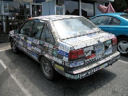
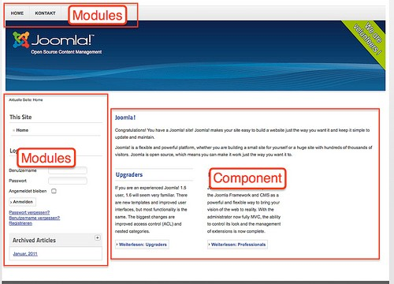
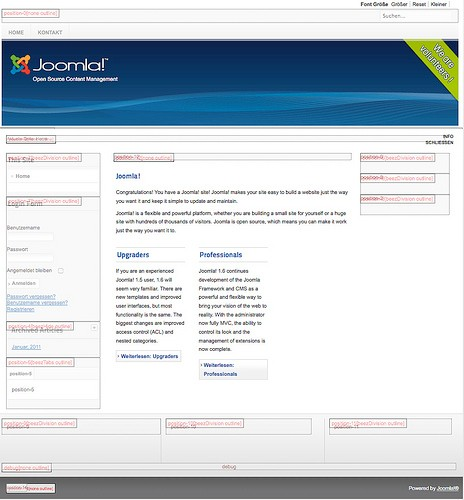
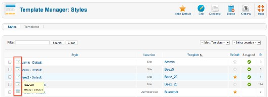
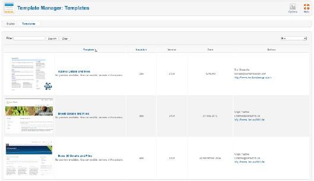
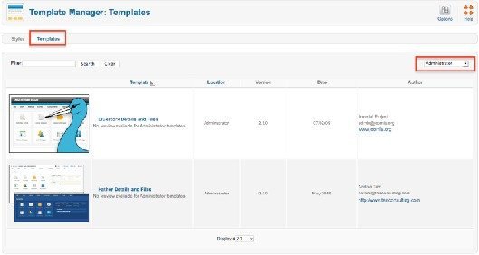
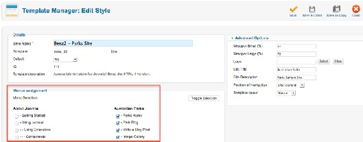

# Joomla! 2.5基础教程系列 - Joomla! 2.5的模板分析

10: 模板

模板是网站最重要的部分之一。它向用户展示了外观和设计。它吸引用户在您的网站驻足探 索。一般访客和用户都乐于逗留在一个设计美观实用的网站。让我们联 想下其他产品。比如汽 车必须有良好的发动机和轮胎，但最重要的购买理由之一通常会是设计。即使它不是最重要的购 买主因，也会引起用户购买的兴趣并使他考虑 到更多实实在在的购买理由。如果设计足够优 美，人们也希望制作精良（图 1， 图 2）!  
 

图 1： 贴纸汽车 (Richardmasoner CC BY-SA 2.030)

图 2： 红色轿车 (FotoSleuth CC BY-SA 2.031)

  
 [30](http://www.flickr.com/photos/bike/201402884) http://www.flickr.com/photos/bike/201402884  
 [31](http://www.flickr.com/photos/51811543%40N08/4978639642) http://www.flickr.com/photos/51811543@N08/4978639642

网页设计是有点像一个工艺品。 它要求你具备各种技能比如HTML、CSS、JavaScript、  
PHP、图像编辑等等。 [Joomla](http://www.Joomla178.com)也不外乎是个工具而已。 好的模板不仅要考虑配色和图像。内容的形状和位置也很重要。网站必须界面友好、运行稳定。 这种挑战让我又想起了那两种轿车。  
网页设计仍然是一个年轻的行业。网页设计师经常要面对低带宽、浏览器不兼容、内容编辑 器不够专业并和在创建良好网站时涉及的人员打交道。创建[Joomla](http://www.Joomla178.com)网站往往是个过程，参与其中 的每个人都能受益良多。良好的网页设计是项艰苦的工作。 ：-）

[Joomla](http://www.Joomla178.com)和模板

[Joomla](http://www.Joomla178.com)以其质量和简洁而闻名。在[Joomla](http://www.Joomla178.com)中，单一页面由组件、模块和模板的HTML输出所 生成。每个页面都可以通过唯一网址来访问。拿首页举例来说。内容组件在中间生成了文章的 HTML输出（图 3）。文章旁的区块就是不同的模块。你可以把某个组件的HTML输出组合上多 个模块。 现有的模块在其它页面还可以重复使用。  
 

图 *3*： *Joomla* 首页

位置

你必须了解，在哪里分配模块。为达此目的，每个模板提供了所谓的位置。 想要查看这些位 置 ，你必须打开预览模块位置 开关（扩展- 模块管理器- 选项）。接下来，你可以用参数tp=1 来 访问网站（http://localhost/index.php?tp=1）。你会看到凸显的模块位置和它们的名称（图  
4）。在扩展- 模块管理器 里面，你可以把它们分配给某个模块。如果你在不同的位置需要模 块，你也可以复制模块。自打[Joomla](http://www.Joomla178.com) 2.5以来，后台增加了个更简便的方法来查看位置。你可以 在（扩展 - 模板 管理器）内点击模板名称旁边的图标来查看（图 5）  
 

图 *4*： 模块位置

核心模板

图 *5*： 预览图标

[Joomla](http://www.Joomla178.com)核心自带三套网站模板和两套管理员模板。在扩展→ 模板管理器→ 模板 标签里面你  
可以看到预览（图 6）。  
 

图 *6*： 网站模板

模板Atomic示例了什么是基本模板。在章节 使用Atomic创建新模板中，我们将使用该模板作  
为基础模板来创建我们自己的模板。模板Beez5 是Beez2 的HTML 5 版本。为便于管理，还提供 了另外一个模板。（图 7）  
 

图 *7*： 管理模板

样式

样式是[Joomla](http://www.Joomla178.com) 1.6以来的新功能。它们使得创建和使用同一模板的不同版本成为可能。一个模  
板至少有一个样式。在这种样式下，可以依据模板来进行配置，比如更换色调或上 传头部logo。 你可以在扩展→ 模板管理器 → 样式内设置默认的网站样式。你可以通过位置筛选来区分网站和 管理样式 。默认模板Beez2提供了两种预定义 样式：default 和 Parks Site 。  
通过复制模板你可以创建附加样式 。每种样式都可以分配到一个菜单项。比如你想让网站在 点击菜单项 A 时搭配绿色背景、在点击菜单项 B 时搭配蓝色背景，那么你就可以分配相应的样 式 （图 8）。

图 *8*： 为菜单项指定样式

有关模板的更多信息请阅读章节使用模板.

---

除特殊标明文章转自第三方网站，文章均由JOOMLASK.COM原创提供  
欢迎友情转载，请务必保留本文出处并引用本文链接： [Joomla! 2.5基础教程系列 - Joomla! 2.5的模板分析](http://www.joomla178.com/joomla-share/joomla-basic/joomla-base-guide-template-guide.html)
