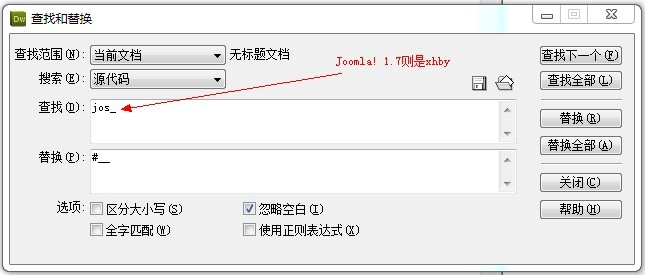

# 创建Joomla! 1.7的Quickstart（示例数据）安装包

前面有谈过创建Joomla! 1.5的QS示例数据安装包：[教你如何创建joomla的quickstart安装包](http://www.Joomla178.com/joomla-share/research-and-development/316-how-to-create-a-quickstart-package-joomla.html)，但这个教程里面会有个隐性问题，也就是当用户选择了设置了非jos\_数据前缀的时候，你制作好的示例数据库就被浮云了。

因为Joomla! 1.7在安装的时候，设置数据前缀的时候是生成的4个随机字母，比Joomla! 1.5的变数更大了，天知道用户下载了你的安装包之后会起什么数据前缀名，那么你制作好的Joomla! 1.7示例数据就毫无用处了。

那么解决上述两个问题，只需要根据[教你如何创建joomla的quickstart安装包](http://www.Joomla178.com/joomla-share/research-and-development/316-how-to-create-a-quickstart-package-joomla.html)教程所说，到第4步之后加一条办法即可，我们用Dreamweaver编辑器打开导出并重命名后的sample\_data.sql文件，假设我们之前安装的数据前缀名就叫jos\_（Joomla! 1.7可能为4个字母的前缀，例如xhby\_）。

然后通过DW编辑器的批量替换功能，CTRL+F，被替换的内容设置为：jos\_（如果是Joomla! 1.7则设置为xhby\_），替换后的内容为：#\_\_（两个英文下划线），然后选择“替换全部”。保存修改后的sample\_data.sql

那么以上是插在**[教你如何创建joomla的quickstart安装包](http://www.Joomla178.com/joomla-share/research-and-development/316-how-to-create-a-quickstart-package-joomla.html)**教程第4步之后，第5步回到前面教程

****原创文章转载请标明出处，请引用本文地址：****[创建Joomla! 1.7的Quickstart（示例数据）安装包](how-to-create-a-quickstart-package-joomla-17.md)

---

除特殊标明文章转自第三方网站，文章均由JOOMLASK.COM原创提供  
欢迎友情转载，请务必保留本文出处并引用本文链接： [创建Joomla! 1.7的Quickstart（示例数据）安装包](http://www.joomla178.com/joomla-share/joomla-templates-tutorials/how-to-create-a-quickstart-package-joomla-17.html)
