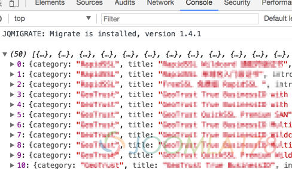

# Joomla+Angular+Bootstrap打造产品筛选器Joomla部分

在前端发展迅猛的今天，显然基于脚本语言PHP的Joomla!模板已经满足不了日新月异的开发需求了，例如Joomla!的文章列表筛选和排序仍然是使用form+post方式，而前端大多已采用前端框架异步表现，使得用户体验更佳，下面我们来详解一下Joomla!配合前端框架Angular、Bootstrap打造产品筛选器。

### 需要什么

开始前，需要掌握一些基本的技能

- 对类MVVM前端框架有一定的了解
- PHP的基本了解
- Joomla!模板开发的基本入门
- Angular 1.6.6+
- Bootstrap 3.6+
- ui-bootstrap-tpls 1.3.3+ （兼容Angular的Bootstrap中间件）

### 实现方式

基本实现的套路仍然是将原有的Joomla模板基于PHP前台脚本式模板转换为前端框架模板，分为下述三个步骤

1. 利用Joomla!的文章作为产品的主要表现形式，使用自定义字段作为产品的要素表现，参考：[Joomla!3.8结合标签、自定义字段打造产品分类](../research-and-development/joomla38-build-product-pages.md)
2. 创建一个文章摘要下所有文章的菜单页面，在模板中将Joomla!文章的数据转换为JSON数据并以JS数组变量表现
3. 使用Angular的filter筛选功能将数据使用ng-repeat在表格中循环

### 创建产品分类及产品

首先，要做的就是创建分类、这个分类下面的文章、以及[结合标签、自定义字段打造产品分类](../research-and-development/joomla38-build-product-pages.md)。

然后创建一个独立的模板，专门用于基于Angular筛选器的页面，关于自定义文章、分类布局可参考[Joomla! 2.5.x 文章布局、分类布局模板释疑](joomla25-article-layout-and-blog-layout.md)（适用于最新版Joomla! 3.8+），由于本文所用是文章摘要式展示内容，此处简单概述创建文章摘要展示模板。

- 1、拷贝/components/com\_content/articles/category/tmpl/ 中blog.xml以及blog\_\*\*.php等文件至/templates/joomla178/html/com\_content/处
- 2、重命名blog.xml以及blog\_\*\*.php为 prices.xml和prices\_\*\*.php
- 3、编辑prices.xml中的<layout title=""为<layout title="Prices"，以便于和其它文章摘要式布局区分
- 4、菜单管理中，创建一个Prices页面，并选择创建好的分类，并在『分类』设置『最大下级分类级别』为『全部』
- 5、在第4步的菜单设置中『多列排版』选项卡下设置『摘要文章数量』为最大，此处假设100
- 6、如果基于性能考虑不希望一次请求所有产品数据，可设置特定数量，并配合分页数据来优化，此种方法不在本次教程之内

### 修改数据输出形式

在传统的Joomla!模板开发中，大多采用下述代码循环输出html标签及数据

```php
<?php foreach ($this->intro_items as $key => &$item) : ?> <?php echo '...'; ?><?php endforeach; ?>
```

而现在我们要将$this->intro\_items转换为JSON数据，并用JS数组变量形式输出，这里要使用到的最常用方法 json\_encode，具体可使用如下方法将数据打印在console.log中：

```php
<script type="text/javascript">console.log(<?php echo json_encode($this->intro_items);</script>
```

在Chrome浏览器中，可见如下数据



显然这些数据当中很多是多余的，我们需要优化一下数据

### 优化数据

---

除特殊标明文章转自第三方网站，文章均由JOOMLASK.COM原创提供  
欢迎友情转载，请务必保留本文出处并引用本文链接： [Joomla+Angular+Bootstrap打造产品筛选器Joomla部分](http://www.joomla178.com/joomla-share/joomla-templates-tutorials/joomla-angular-bootstrap-filter.html)
