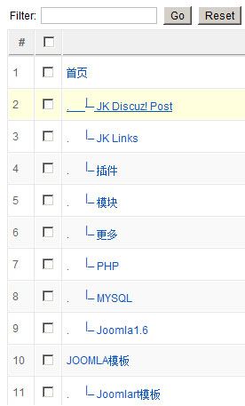
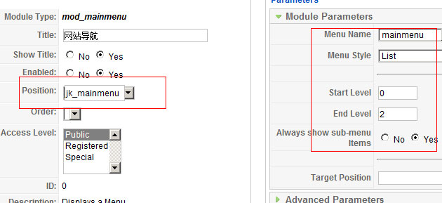
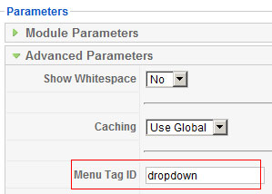
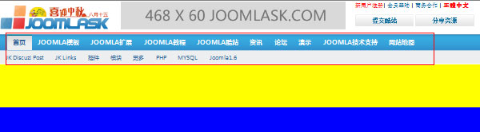
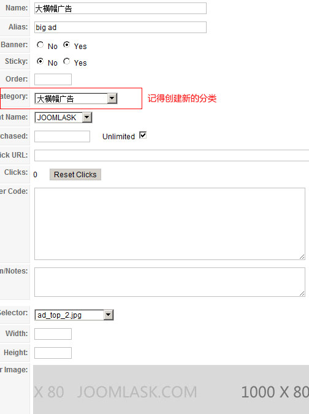
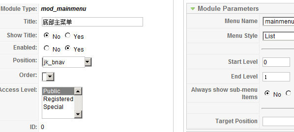
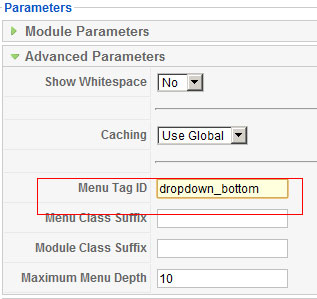
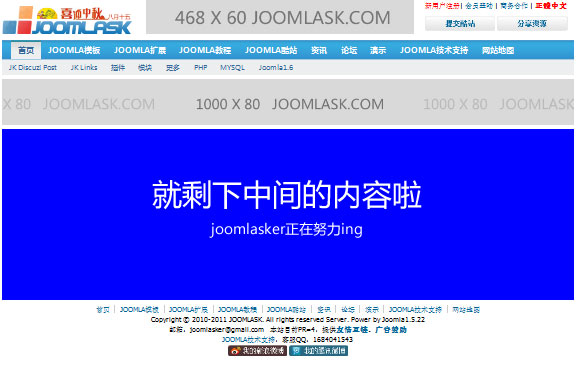

# Joomla模板制作实战教程-美化我们的模板【二】

[上一节](joomla-templates-tutorials-add-css-to-modules.md)（[Joomla模板制作实战教程-美化我们的模板【一】](joomla-templates-tutorials-add-css-to-modules.md)）中我们学了美化模板的最重要知识，即是对模块进行美化，本节我们继续对整站的模块进行完善，说的简单点就是，先把那些预置的模块位置框架设计完全，经过上节的简单DIV+CSS讲解，想必大家也课下了解了一下DIV+CSS的知识，那么我们后面就不对DIV+CSS的一些构建原理做过多阐述。

### 创建主菜单

#### 一） 创建菜单

在**/templates/jk\_Joomla178/index.php**，前一节中我们已经编写如下代码，其中<jdoc:include type="modules" name="jk\_mainmenu" />

```
	<div id="jk_nav">
		<div class="main">			<jdoc:include type="modules" name="jk_mainmenu" /><!--调用菜单模块-->		</div>
	</div>
```

进入后台->菜单->创建新菜单，这时候由于我们菜单暂时还没有指定的内容，所以我们创建菜单的时候注意设置成“自定义链接”，链接设定为当前页“#”，以保证有点击手形，好的，创建如下菜单（文章尾部的Quickstart安装包中的菜单链接示例数据是来自<http://www.Joomla178.com>）



#### 二） 创建菜单模块

进入后台->扩展->模块管理->创建一个新的菜单模块（mod\_mainmenu），如下设置模块位置选择jk\_mainmenu，子菜单终止到2级，始终显示子菜单



\*注意：创建模块的时候我们给该菜单加一个ID区分，比如底部主菜单调的是同一菜单，就是通过ID来区分，打开高级配置，在Menu Tag ID处输入dropdown



### 给菜单加样式

打开文件**/templates/jk\_Joomla178/css/template.css**编写代码：（基于上节的代码，修改#jk\_nav .main部分，并将颜色标识去除，CSS中的调用 图片见安装包）

并且我们新加了一些公用样式，和菜单配套的图片以及菜单、广告的底边距，请注意区分

```

@charset "utf-8";
/*------------------------------------------------------------------------
# Copyright (C) JOOMLA178. All Rights Reserved.
# @license - Copyrighted Commercial Software
# Author: JOOMLA178
# Websites: http://www.Joomla178.com
# This file may not be redistributed in whole or significant part.
-------------------------------------------------------------------------*/
/*--------------*/
body{background:#fff;color:#000;font-family:Tahoma, Geneva, sans-serif;line-height:1.5;font-size:12px;}/*新加了一些公用样式*/body,ul,ol,dl,dd,h1,h2,h3,h4,h5,h6,p,form,fieldset,legend,input,textarea,select,button,th,td{margin:0;padding:0;}ol,ul,li{list-style-type:none;}/*global*/
#jk_wrapper{}/*定义每个框架的宽度、居中对齐*/#jk_wrapper .main{width:1000px; margin:0 auto;}/*定义需要设定固定高度的DIV高度*/#jk_header .main{ height:70px; background:black;}/*菜单详细样式代码*/#jk_nav{ margin-bottom:6px;}#jk_nav .main{ height:63px; background: url(../images/nav_bg.gif) repeat-x left top; }#jk_nav ul#dropdown {display: block;height: 63px;margin: 0; padding: 0 0 0 16px; position: relative;}#jk_nav ul#dropdown li {float: left; font-family: "微软雅黑",Tahoma,Geneva,sans-serif;font-size: 14px;font-weight: bold;height: 35px;}#jk_nav ul#dropdown li a {color: #FFFFFF;display: inline-block; height: 29px; padding: 6px 12px 0;}#jk_nav ul#dropdown li.active a {color: #336699;}#jk_nav ul#dropdown li.hover, ul#dropdown li.active {background: url(../images/nav_hover.gif) repeat-x scroll 50% top transparent;}#jk_nav ul#dropdown li.active ul li.active {background: none repeat scroll 0 0 transparent !important;font-weight: normal;height: 28px !important;}#jk_nav ul#dropdown li.active ul {display: block;font-weight: normal;height: 28px !important;visibility: visible;}#jk_nav ul#dropdown ul {font-weight: normal;height: 28px;left: 0; position: absolute; top: 34px; visibility: hidden; width: 728px;z-index: 9999;}#jk_nav ul#dropdown ul li { background: none repeat scroll 0 0 transparent;color: #000000;float: left; font-weight: normal; height: 28px;}#jk_nav ul#dropdown ul li.hover { background: none repeat scroll 0 0 transparent; font-weight: normal;}#jk_nav ul#dropdown ul li a { background: none repeat scroll 0 0 transparent; color: #006699; display: inline-block !important; font-size: 12px; font-weight: normal; height: 22px !important;#jk_nav ul#dropdown ul li a span { display: inline-block;height: 22px;}/*最新的广告尺寸为1000*80的大小*/#jk_ad_top{ margin-bottom:6px;}#jk_ad_top .main{ height:80px; background:yellow;}#jk_body .main{ height:800px; background:blue;}#jk_bottom .main{ height:170px; background:green;}
```

上述样式是针对主菜单进行的设计，保存之后打开前台测试得下图结果：

那么我们现在测试以上改的结果如下图



菜单就成形了。

### 大横幅广告

上一节中我们有提过，旗帜广告和广告模块的创建，同上节，我们把演示中的黄色部分替换为广告，把准备好的广告上传到/images/banners目录下。

记得在旗帜广告管理中，要创建一个新的分类，因为广告模块要按分类调用。



创建广告模块并设置到我们预设的jk\_adlong模块位置，结果如下图

\*注意上述的样式中，我们也要把原来预设的黄色背景去掉，高度改成现在的80px,并且让广告的下面显的有一些边距

```
#jk_ad_top{ margin-bottom:6px;}#jk_ad_top .main{ height:90px;}
```

### 底部版权信息

#### 一） 底部主菜单（底部友情链接本节不讲）

上面我们创建过了主菜单，也创建了主菜单的模块，这里我们还要创建一个底部的主菜单模块，样式与上面的主菜单也略有不同

进入后台->扩展->模块管理->创建一个新的菜单模块（mod\_mainmenu），模块位置选择jk\_bnav，不显示子菜单，上



在我们也讲到了高级配置中设置的菜单ID来区分，这里的底部菜单我们就填入ID为： dropdown\_bottom



继续给底部菜单添加样式，补充后的样式为（底部的绿色标识背景也去除）：

```

@charset "utf-8";
/*------------------------------------------------------------------------
# Copyright (C) JOOMLA178. All Rights Reserved.
# @license - Copyrighted Commercial Software
# Author: JOOMLA178
# Websites: http://www.Joomla178.com
# This file may not be redistributed in whole or significant part.
-------------------------------------------------------------------------*/
/*--------------*/
body{background:#fff;color:#000;font-family:Tahoma, Geneva, sans-serif;line-height:1.5;font-size:12px;}/*新加了一些公用样式*/body,ul,ol,dl,dd,h1,h2,h3,h4,h5,h6,p,form,fieldset,legend,input,textarea,select,button,th,td{margin:0;padding:0;}ol,ul,li{list-style-type:none;}/*global*/
#jk_wrapper{}/*定义每个框架的宽度、居中对齐*/#jk_wrapper .main{width:1000px; margin:0 auto;}/*定义需要设定固定高度的DIV高度*/#jk_header .main{ height:70px; background:black;}/*菜单详细样式代码*/#jk_nav{ margin-bottom:6px;}#jk_nav .main{ height:63px; background: url(../images/nav_bg.gif) repeat-x left top; }#jk_nav ul#dropdown {display: block;height: 63px;margin: 0; padding: 0 0 0 16px; position: relative;}#jk_nav ul#dropdown li {float: left; font-family: "微软雅黑",Tahoma,Geneva,sans-serif;font-size: 14px;font-weight: bold;height: 35px;}#jk_nav ul#dropdown li a {color: #FFFFFF;display: inline-block; height: 29px; padding: 6px 12px 0;}#jk_nav ul#dropdown li.active a {color: #336699;}#jk_nav ul#dropdown li.hover, ul#dropdown li.active {background: url(../images/nav_hover.gif) repeat-x scroll 50% top transparent;}#jk_nav ul#dropdown li.active ul li.active {background: none repeat scroll 0 0 transparent !important;font-weight: normal;height: 28px !important;}#jk_nav ul#dropdown li.active ul {display: block;font-weight: normal;height: 28px !important;visibility: visible;}#jk_nav ul#dropdown ul {font-weight: normal;height: 28px;left: 0; position: absolute; top: 34px; visibility: hidden; width: 728px;z-index: 9999;}#jk_nav ul#dropdown ul li { background: none repeat scroll 0 0 transparent;color: #000000;float: left; font-weight: normal; height: 28px;}#jk_nav ul#dropdown ul li.hover { background: none repeat scroll 0 0 transparent; font-weight: normal;}#jk_nav ul#dropdown ul li a { background: none repeat scroll 0 0 transparent; color: #006699; display: inline-block !important; font-size: 12px; font-weight: normal; height: 22px !important;#jk_nav ul#dropdown ul li a span { display: inline-block;height: 22px;}/*最新的广告尺寸为1000*80的大小*/#jk_ad_top{ margin-bottom:6px;}#jk_ad_top .main{ height:80px; background:yellow;}/*给中间内容部分一个底外边距*/#jk_body{ margin-bottom:6px;}#jk_body .main{ height:800px; background:blue;}#jk_bottom .main{ height:170px;}/*新加了底部主菜单的样式*/#jk_bottom ul#dropdown_bottom { overflow: hidden;text-align: center; width: 100%;}#jk_bottom ul#dropdown_bottom li { border-left: 1px solid #CCCCCC; display: inline; padding: 0 8px;}#jk_bottom ul#dropdown_bottom li.item1 { border-left: medium none;}
```

#### 二） 版权信息及联系方式等

这个应该算是最简单的了，后台->扩展->模块管理->创建一个定制HTML模块，命名为：底部版权 ，并选择jk\_footer模块位置，编辑器代码模式下插入以下代码：

```
<p style="text-align: center;">Copyright © 2010-2011 JOOMLA178. All rights reserved Server. Power by Joomla1.5.22</p><p style="text-align: center;">邮箱：Joomla178(at)gmail.com 本站目前PR=4，提供<strong><a href="http://www.Joomla178.com/news/cooperation/356-links-info.html" target="_blank">友情互链</a></strong>、<strong><a href="http://www.Joomla178.com/news/cooperation/355-ads.html" target="_blank">广告赞助</a></strong></p><p style="text-align: center;"><a href="http://www.sunsane.com" target="_blank">JOOMLA技术支持</a>，客服QQ：1684041543</p><p style="text-align: center;"><a href="http://weibo.com/2316446582" target="_blank"></a> <a href="http://t.qq.com/Joomla178" target="_blank"></a></p>
```

保存后，观看一下本前的所有内容前台效果：



那么本节教程主要继续对主页、子页公用的模块位置进行了美化，回过头来看，我们所用到的模块都是Joomla自带的一些简单模块，诸如菜单、定制HTML、广告等模块。下一节我们将设计一些符合中国人习惯的模块，可以算做是模块制作教程了。

制作Quickstart教程请参考：[教你如何创建joomla的quickstart安装包](http://www.Joomla178.com/joomla-share/research-and-development/316-how-to-create-a-quickstart-package-joomla.html)。

**原创文章转载请标明出处，请引用本文地址：**[Joomla模板制作实战教程-美化我们的模板【二】](joomla-templates-tutorials-add-css-to-modules-2.md)

---

除特殊标明文章转自第三方网站，文章均由JOOMLASK.COM原创提供  
欢迎友情转载，请务必保留本文出处并引用本文链接： [Joomla模板制作实战教程-美化我们的模板【二】](http://www.joomla178.com/joomla-share/joomla-templates-tutorials/joomla-templates-tutorials-add-css-to-modules-2.html)
