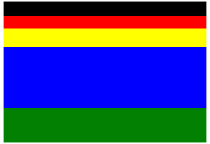
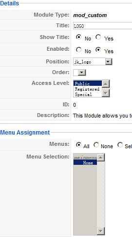
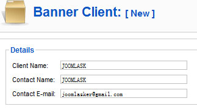
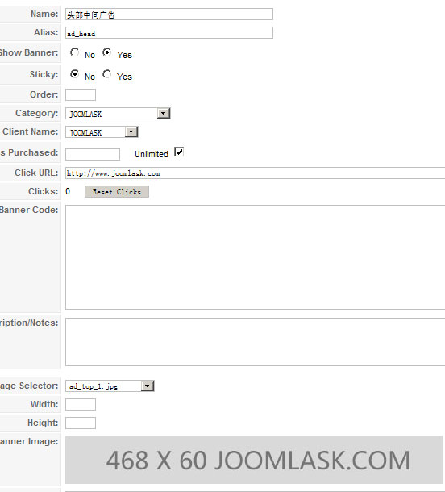
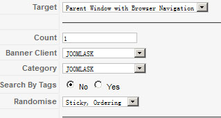
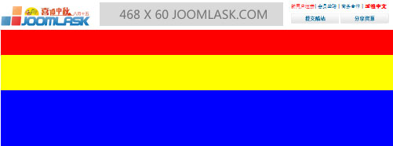

# Joomla模板制作实战教程-美化我们的模板【一】

[上一节](joomla-templates-tutorials-creat-a-modules-position.md)（[Joomla模板制作实战教程-创建各种模块位置](joomla-templates-tutorials-creat-a-modules-position.md)）中我们学了关于在模板中制作各种模块位置，作为模板的骨架，模块位置的外观自然占有很重要的分量。当然制作模板首先最重要的一门知识就是前端制作（HTML＋CSS）

在这里一些HTML+CSS的细节性知识就不多阐述了，首先我们要明确整个站点的前端框架，完了我们再针对模块位置进行制作。

### 首先创建好整站的前端框架及基础样式

根据上一节中提供的设计稿模块规划，我们将前端分为5个部分，分别是：jk\_header(头部）、jk\_nav（菜单）、jk\_ad\_top（设计之初是考虑这里放置多个广告）、jk\_body（内容主体部分）、jk\_bottom（底部），我们将这5个部分制作在index.php中

打开**/templates/jk\_Joomla178/index.php**，编写如下代码：

```
<?php defined( '_JEXEC' ) or die( 'Restricted access' );?><!DOCTYPE html PUBLIC "-//W3C//DTD XHTML 1.0 Transitional//EN"  "http://www.w3.org/TR/xhtml1/DTD/xhtml1-transitional.dtd"><html xmlns="http://www.w3.org/1999/xhtml"    xml:lang="<?php echo $this->language; ?>" lang="<?php echo $this->language; ?>" ><head><jdoc:include type="head" /><link rel="stylesheet" href="/<?php echo $this->baseurl ?>/templates/jk_Joomla178/css/template.css" type="text/css" /></head><body><div id="jk_wrapper">
	<div id="jk_header">		<div class="main">			<jdoc:include type="modules" name="jk_logo" /> 			<jdoc:include type="modules" name="jk_adtop" /> 			<jdoc:include type="modules" name="jk_headinfo" />		</div>	</div>	<div id="jk_nav">
		<div class="main">			<jdoc:include type="modules" name="jk_mainmenu" />		</div>
	</div>
	<div id="jk_ad_top">		<div class="main">			<jdoc:include type="modules" name="jk_adlong" />		</div>
	</div>
	<div id="jk_body">
		<div class="main">			<jdoc:include type="modules" name="jk_left" /> 			<jdoc:include type="modules" name="jk_right" /> 			<jdoc:include type="modules" name="jk_user1" /> 			<jdoc:include type="modules" name="jk_user2" /> 			<jdoc:include type="modules" name="jk_user3" />			<jdoc:include type="modules" name="jk_user4" />			<jdoc:include type="modules" name="jk_user5" /> 			<jdoc:include type="modules" name="jk_user6" /> 			<jdoc:include type="modules" name="jk_user7" /> 			<jdoc:include type="modules" name="jk_user8" /> 			<jdoc:include type="modules" name="jk_admid_1" /> 			<jdoc:include type="modules" name="jk_admid_2" />		</div>
	</div>
	<div id="jk_bottom">
		<div class="main">			<jdoc:include type="modules" name="jk_link" /> 			<jdoc:include type="modules" name="jk_bnav" /> 			<jdoc:include type="modules" name="jk_footer" />		</div>
	</div>
</div></body></html>
```

### 然后我们要给这些前端框架一些外观样式

打开文件**/templates/jk\_Joomla178/css/template.css**编写代码：（以下代码为了方便学习识别，会暂时在框架上加上一些颜色、高度以区分）

```

@charset "utf-8";
/*------------------------------------------------------------------------
# Copyright (C) JOOMLA178. All Rights Reserved.
# @license - Copyrighted Commercial Software
# Author: JOOMLA178
# Websites: http://www.Joomla178.com
# This file may not be redistributed in whole or significant part.
-------------------------------------------------------------------------*/
/*--------------*/
body{background:#fff;color:#000;font-family:Tahoma, Geneva, sans-serif;line-height:1.5;font-size:12px;}/*global*/
#jk_wrapper{}/*定义每个框架的宽度、居中对齐*/#jk_wrapper .main{width:1000px; margin:0 auto;}/*定义需要设定固定高度的DIV高度*/#jk_header .main{ height:70px; background:black;}#jk_nav .main{ height:63px; background:red;}#jk_ad_top .main{ height:90px; background:yellow;}#jk_body .main{ height:800px; background:blue;}#jk_bottom .main{ height:170px; background:green;}
```

上述样式是给大框加进行了大体上的设定，并附加了颜色加以区分，在后面的控制中我们会把这些背景色全部去掉。

那么我们现在测试以上改的结果如下图



那么这样确实蛮难看的！我们现在就开始创建三个头部模块，一个LOGO，一个顶部广告，一个右上角的快捷信息。

进入后台->扩展->模块管理->创建一个定制HTML（mod\_custom）模块，在编辑器中插入一张图片（LOGO），这个模块定名为LOGO，模块标题隐藏，模块位置选择jk\_logo

```
<div><a href="http://www.Joomla178.com" target="_blank"></a></div>
```



然后我们再创建顶部广告（利用Joomla 1.5自带的广告管理），将我们设计好的广告图片上传至/images/banners/ad\_top\_1.jpg

进入后台->旗帜广告->分类管理->创建一个新的广告分类，定名为“JOOMLA178”，再回到旗帜广告->客户管理->创建一个新的客户，定名为“JOOMLA178”



回到旗帜广告->广告管理->创建一个新的广告，名称设置为“头部中间广告”,分类和客户设置为“JOOMLA178”，广告URL设定为http://www.Joomla178.com，广告图片选择我们刚才上传的广告ad\_top\_1.jpg



广告创建结束后，模块中并未显示，所以我们再回到扩展->模块管理->创建一个旗帜广告模块



模块位置选择jk\_adtop，保存创建的广告模块。

下面我们还要创建右上角的相关信息模块，这是一个定制HTML模块，模块管理->创建一个定制HTML模块，在编辑器中输入以下代码：

```
<p><a href="http://www.Joomla178.com/" target="_blank"><span style="color: #ff0000;">新用户注册</span></a>| <a href="http://www.Joomla178.com/" target="_blank">会员登陆 </a>| <a href="http://www.Joomla178.com/news/cooperation.html" target="_blank">商务合作</a> | <strong><a id="translateLink" style="color: red; font-weight: bold;">正體中文</a></strong></p><p><a href="http://www.Joomla178.com/" target="_blank"></a>&nbsp;&nbsp;<a href="http://www.Joomla178.com/forum.php?mod=forumdisplay&amp;fid=6" target="_blank"></a></p>
```

创建定制HTML模块就不多说了，同第一步创建LOGO模块一样

那么这时候jk\_header的这三个模块没有实质样式，再打开**/templates/jk\_Joomla178/css/template.css**修改代码为：

```
@charset "utf-8";
/*------------------------------------------------------------------------
# Copyright (C) JOOMLA178. All Rights Reserved.
# @license - Copyrighted Commercial Software
# Author: JOOMLA178
# Websites: http://www.Joomla178.com
# This file may not be redistributed in whole or significant part.
-------------------------------------------------------------------------*/
/*--------------*/
body{background:#fff;color:#000;font-family:Tahoma, Geneva, sans-serif;line-height:1.5;font-size:12px;}
a{color:#006699;text-decoration:none;}
/*global*/
#jk_wrapper{}
#jk_wrapper .main{width:1000px; margin:0 auto;}
#jk_header .main{ height:70px;}
#jk_header .jk_logo{ float:left; width:252px; padding-top:10px;  height:60px;}
#jk_header .jk_headad{ float:left; width:468px;}
#jk_header .jk_headinfo{ float:right; width:260px; height:60px;}
#jk_header .jk_headinfo p{ margin:0; padding-bottom:10px;}

#jk_nav .main{ height:63px; background:red;}
#jk_ad_top .main{ height:90px; background:yellow;}
#jk_body .main{ height:300px; background:blue;}
#jk_bottom .main{ height:170px; background:green;}
```

我们定义了头部的这些样式，自然也要在前端给它装上，更改头部代码如下

```
<?php defined( '_JEXEC' ) or die( 'Restricted access' );?><!DOCTYPE html PUBLIC "-//W3C//DTD XHTML 1.0 Transitional//EN"  "http://www.w3.org/TR/xhtml1/DTD/xhtml1-transitional.dtd"><html xmlns="http://www.w3.org/1999/xhtml"    xml:lang="<?php echo $this->language; ?>" lang="<?php echo $this->language; ?>" ><head><jdoc:include type="head" /><link rel="stylesheet" href="/<?php echo $this->baseurl ?>/templates/jk_Joomla178/css/template.css" type="text/css" /></head><body><div id="jk_wrapper">
	<div id="jk_header">		<div class="main">			<div class="jk_logo"><jdoc:include type="modules" name="jk_logo" /></div>			<div class="jk_headad"><jdoc:include type="modules" name="jk_adtop" /></div> 			<div class="jk_headinfo"><jdoc:include type="modules" name="jk_headinfo" /></div>		</div>	</div>	<div id="jk_nav">
		<div class="main">			<jdoc:include type="modules" name="jk_mainmenu" />		</div>
	</div>
	<div id="jk_ad_top">		<div class="main">			<jdoc:include type="modules" name="jk_adlong" />		</div>
	</div>
	<div id="jk_body">
		<div class="main">			<jdoc:include type="modules" name="jk_left" /> 			<jdoc:include type="modules" name="jk_right" /> 			<jdoc:include type="modules" name="jk_user1" /> 			<jdoc:include type="modules" name="jk_user2" /> 			<jdoc:include type="modules" name="jk_user3" />			<jdoc:include type="modules" name="jk_user4" />			<jdoc:include type="modules" name="jk_user5" /> 			<jdoc:include type="modules" name="jk_user6" /> 			<jdoc:include type="modules" name="jk_user7" /> 			<jdoc:include type="modules" name="jk_user8" /> 			<jdoc:include type="modules" name="jk_admid_1" /> 			<jdoc:include type="modules" name="jk_admid_2" />		</div>
	</div>
	<div id="jk_bottom">
		<div class="main">			<jdoc:include type="modules" name="jk_link" /> 			<jdoc:include type="modules" name="jk_bnav" /> 			<jdoc:include type="modules" name="jk_footer" />		</div>
	</div>
</div></body></html>
```

这时候我们测试一下效果，看，不是想象中的那么难。



那么本节教程主要是针对外观做了一些简单的操作，后面的关于DIV+CSS将不再做详细讲解，否则本系列教程将要用一本书的内容来讲了。在下一节中，我们将针对模块的个性化定制进行讲解。鉴于本节及以后章节都将涉及数据展示，在此我们将教学涉及到的相关内容做成quickstart安装包供大家学习参考，关于Quickstart安装包，可参考：[教你如何创建joomla的quickstart安装包](http://www.Joomla178.com/joomla-share/research-and-development/316-how-to-create-a-quickstart-package-joomla.html)。

**原创文章转载请标明出处，请引用本文地址：**[Joomla模板制作实战教程-美化我们的模板【一】](joomla-templates-tutorials-add-css-to-modules.md)

---

除特殊标明文章转自第三方网站，文章均由JOOMLASK.COM原创提供  
欢迎友情转载，请务必保留本文出处并引用本文链接： [Joomla模板制作实战教程-美化我们的模板【一】](http://www.joomla178.com/joomla-share/joomla-templates-tutorials/joomla-templates-tutorials-add-css-to-modules.html)
