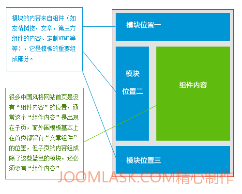
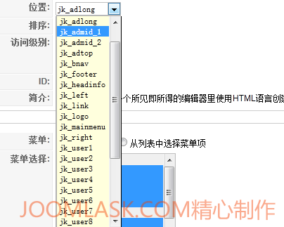
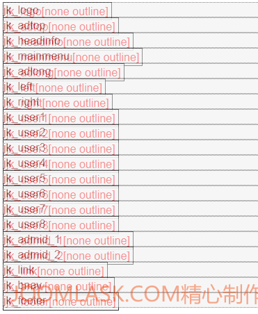
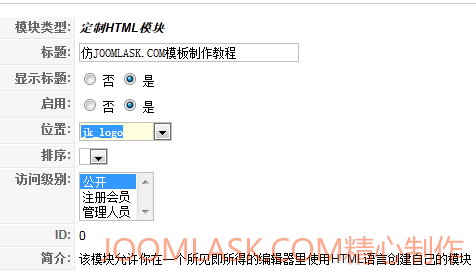
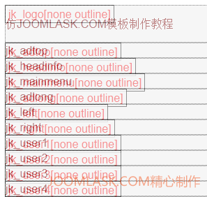

# Joomla模板制作实战教程-创建各种模块位置

在上一节([Joomla模板制作实战教程【一】-创建一个简单的模板](joomla-templates-tutorials-creat-a-simple-template.md) 
)中我们创建了一个非常简单的模板，包含了默认的文章组件、top和bottom两个模块位置。虽然看起来比较不养眼，但是我们掌握了Joomla模板的一个基本结构，这节我们要针对一个设计完整的设计稿进行规划。

#### 首先需要解释一下“模块位置”的概念。

之前做的一些开发分享，总是会碰到一些似乎入门的朋友容易把模板和“模块”当成两回事，所以有必要把它们的概念讲清楚，Joomla的模板其实就相当于一个白纸，你需要在上面画上各种具体对象，它才能成为一真正模板，而我这里说的具体对象，不仅仅包括文章内容，它主要各种模块，诸如你看到的一条一条的新闻列表、排列整齐的图片列表、带输入用户名密码的登陆区域。他们构成了一个真正的模板。

所以当你下载了一个新的纯模板，它安装在Joomla系统之后，是看不到你所看到的模板样子，它需要各种模块去、组件内容（如文章内容）填充这张空白的纸，模块又是组件的另一种表现形式。便于大家理解，请看下图



那么看了上图之后，我们就知道模块的重要性了，它的意义在中式网站上甚至大于组件内容，理论上来说，一个JOOMLA网站可以由N个模块组成，却不需要组件内容，当然这没什么意义。

#### 第一步：我们需要针对一个完整的设计稿做出规划

此次制作模板是以[Joomla178.com](http://www.Joomla178.com)为例，所以把很中式的Joomla178设计稿拿出来，针对设计稿，我们把Joomla178的设计稿划分为以下模块位置


> jk\_logo 设计为LOGO位置  
> jk\_adtop 设计为网站最顶部广告位置  
> jk\_headinfo 设计为顶部右上角信息位置  
> jk\_mainmenu 设计为主菜单位置  
> jk\_adlong 设计为整条横幅广告位置  
> jk\_left 设计为左边模块位置  
> jk\_right 设计为右边模块位置（仅子页显示）  
> jk\_user1, jk\_user2, jk\_user3, jk\_user4, jk\_user5, jk\_user6, jk\_user7, jk\_user8 设计为图中分别指定位置，可以放一些通用的内容  
> jk\_admid\_1,jk\_admid\_2设计为网站中部的两个广告位  
> jk\_link 设计为底部友情链接位置  
> jk\_bnav 设计为底部菜单  
> jk\_footer 设计为底部综合信息  
> compontent 就是组件内容的位置（本演示设计为仅子页显示）

#### 第二步：根据规划的模块位置将其编写到模板中

打开文件**templates/jk\_Joomla178/templateDetails.xml**填写代码

```
<?xml version="1.0" encoding="utf-8"?> <!DOCTYPE install PUBLIC "-//Joomla! 1.5//DTD template 1.0//EN" "http://www.joomla.org/xml/dtd/1.5/template-install.dtd"> <!--扩展的类型是模板, 适用的版本是Joomla 1.5--> <install version="1.5" type="template"> <!--模板的名称，即后台模板的显示名称--> <name>JK JOOMLA178</name>  <!--模板的创建日期--> <creationDate>2011-09-05</creationDate>  <!--模板的创建作者--> <author>Joomla178</author>  <!--作者联系邮箱--> <authorEmail>Joomla178(at)gmail.com</authorEmail>  <!--作者网站--> <authorUrl>http://www.Joomla178.com</authorUrl> <copyright>JOOMLA178 2011</copyright> <license>GNU/GPL</license> <version>1.0.0</version>  <!--模板的简介--> <description>JOOMLA178</description>  <!--模板的相关文件--> <files> <!--单个文件是filename表达式--> <filename>index.php</filename> <filename>templateDetails.xml</filename> </files>  <!--模板的模块位置选项，即新建模块时的位置选择，预设以下位置--> <positions> <position>jk_logo</position> <position>jk_adtop</position> <position>jk_headinfo</position> <position>jk_mainmenu</position> <position>jk_adlong</position> <position>jk_left</position> <position>jk_right</position> <position>jk_user1</position> <position>jk_user2</position> <position>jk_user3</position> <position>jk_user4</position> <position>jk_user5</position> <position>jk_user6</position> <position>jk_user7</position> <position>jk_user8</position> <position>jk_admid_1</position> <position>jk_admid_2</position> <position>jk_link</position> <position>jk_bnav</position> <position>jk_footer</position> </positions> </install>
```

这时候神奇的事情发生了，我们回到后台，扩展->模块->创建一个新模块（以mod\_custom）为示例，在选择模块位置的时候我们就看到了刚才规划的这些模块位置了



#### 第三步：在模块文件index.php中调用安装模块位置

当然完成第二步之后，有的同学肯定迫不及待的测试?tp=1了，第二步仅是让其在后台可显示，现在我们开始安装这些预设的模块位置：

打开**/templates/jk\_Joomla178/index.php**，编写如下代码：

```
<?php defined( '_JEXEC' ) or die( 'Restricted access' );?><!DOCTYPE html PUBLIC "-//W3C//DTD XHTML 1.0 Transitional//EN"  "http://www.w3.org/TR/xhtml1/DTD/xhtml1-transitional.dtd"><html xmlns="http://www.w3.org/1999/xhtml"    xml:lang="<?php echo $this->language; ?>" lang="<?php echo $this->language; ?>" ><head><jdoc:include type="head" /><link rel="stylesheet" href="<?php echo $this->baseurl ?>/templates/mynewtemplate/css/template.css" type="text/css" /></head><body><jdoc:include type="modules" name="jk_logo" /> <jdoc:include type="modules" name="jk_adtop" /> <jdoc:include type="modules" name="jk_headinfo" /> <jdoc:include type="modules" name="jk_mainmenu" /> <jdoc:include type="modules" name="jk_adlong" /> <jdoc:include type="modules" name="jk_left" /> <jdoc:include type="modules" name="jk_right" /> <jdoc:include type="modules" name="jk_user1" /> <jdoc:include type="modules" name="jk_user2" /> <jdoc:include type="modules" name="jk_user3" /> <jdoc:include type="modules" name="jk_user4" /> <jdoc:include type="modules" name="jk_user5" /> <jdoc:include type="modules" name="jk_user6" /> <jdoc:include type="modules" name="jk_user7" /> <jdoc:include type="modules" name="jk_user8" /> <jdoc:include type="modules" name="jk_admid_1" /> <jdoc:include type="modules" name="jk_admid_2" /> <jdoc:include type="modules" name="jk_link" /> <jdoc:include type="modules" name="jk_bnav" /> <jdoc:include type="modules" name="jk_footer" /></body></html>
```

好了，请前往你的网站前台测试吧，在URL最后面，如：http://www.Joomla178.com/?tp=1，需要注意的是，第一节我们安装了组件内容位置、TOP和BOTTOM模块位置，这一节我们先将其删除。



到这里我们创建了很多胀眼的模块位置，有的同学可能会问了，怎么又是没内容，这简单，我们就来填充一个模块内容，就以mod\_custom模块为例，后台->扩展->模块->创建一个定制html模块 （mod\_custom），在定制HTML模块中我们输入任意内容，模块位置就选择第一个jk\_logo，保存好创建的模块。



保存之后我们前台刷新如下：



那么到此，我们学习了模块的规划和安装，关于外观，还请耐心等到下一节：**Joomla模板制作实战教程-美化我们的模板**【一】

**原创文章转载请标明出处，请引用本文地址：**[Joomla模板制作实战教程-创建各种模块位置](joomla-templates-tutorials-creat-a-modules-position.md)

---

除特殊标明文章转自第三方网站，文章均由JOOMLASK.COM原创提供  
欢迎友情转载，请务必保留本文出处并引用本文链接： [Joomla模板制作实战教程-创建各种模块位置](http://www.joomla178.com/joomla-share/joomla-templates-tutorials/joomla-templates-tutorials-creat-a-modules-position.html)
