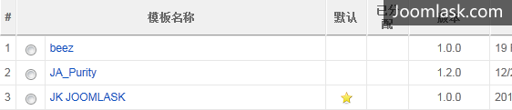
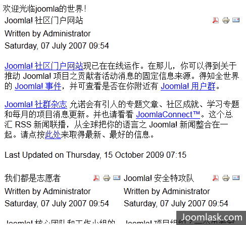

# Joomla模板制作实战教程【一】-创建一个简单的模板

Joomla绝对是一款优秀的CMS，相较一些国产CMS她始终不能占据优势地位，很多人说Joomla做模板难、Joomla不支持静态生成、Joomla执行效率低等等，但其实Joomla团队为这些东西做了很多的功夫，细细研究不难发现，Joomla模板只需要会Html+CSS就行了，Joomla的静态生成其实就是[System-cache](../research-and-development/system-cache-make-joomla-site-runningnn-fast.md)(缓存插件)，当做足了优化之后，Joomla的执行效率是相当可观的，如本站[www.Joomla178.com](http://www.Joomla178.com)（优化的方法会在后面的教程中提及）

话说Joomla模板难做，这是很多入门的学习者遇上的足以让他放弃Joomla的门槛，那么我要说的是Joomla模板一点不难，它的难点根本不在于“是否会PHP”，而是在于不敢钻研的心，那么为了砍掉这个所谓的“门槛”，我将为大家带来这个系列的模板实战教程。

**做之前我们必须要准备这几样东西！**

1. 1、持之以恒的心
2. 2、必要的HTML+CSS基础知识
3. 3、熟悉了Joomla的使用方法、工作原理
4. 4、一丝不苟的工作态度。
5. 5、认认真真的看好教程，不要急着复制粘贴。

开始我们的模板制作（以Joomla 1.5.x为例，完结之后会推出Joomla 1.7.x相关教程）   
 安装好Joomla 1.5.x，在templates/目录下建立一个我们要制作的模板文件夹，命名为jk\_Joomla178，这时候在后台我们尚且看不到有jk\_Joomla178的这个模板选项。

**\*Joomla网站系统是基于utf-8编码编写的，所以以下所有操作的文件都务必保存为utf-8编码。**

**第一步我们需要让其在Joomla后台中显示这个模板选项，创建文件templateDetails.xml，不要担心会不会xml，很简单，根据官方文档给出的说明，照着写便是：**

```
<?xml version="1.0" encoding="utf-8"?> <!DOCTYPE install PUBLIC "-//Joomla! 1.5//DTD template 1.0//EN" "http://www.joomla.org/xml/dtd/1.5/template-install.dtd"><!--扩展的类型是模板, 适用的版本是Joomla 1.5--> <install version="1.5" type="template"><!--模板的名称，即后台模板的显示名称--> <name>JK JOOMLA178</name>  <!--模板的创建日期--> <creationDate>2011-09-05</creationDate>  <!--模板的创建作者--> <author>Joomla178</author>  <!--作者联系邮箱--> <authorEmail>Joomla178(at)gmail.com</authorEmail>  <!--作者网站--> <authorUrl>http://www.Joomla178.com</authorUrl> <copyright>JOOMLA178 2011</copyright> <license>GNU/GPL</license> <version>1.0.0</version>  <!--模板的简介--> <description>JOOMLA178</description>  <!--模板的相关文件--> <files> <!--单个文件是filename表达式--> <filename>index.php</filename> <filename>templateDetails.xml</filename> </files>  <!--模板的模块位置选项，即新建模块时的位置选择，预设以下位置--> <positions> <position>top</position> <position>bottom</position> </positions> </install>
```

请细心看看上述文档，即是官方文档的标准设置   
 这时候我们进入后台，可以看到JK JOOMLA178的模板已经出现了（如下图：）



这时候可以将JK JOOMLA178设为默认，但保存后前台会显示一片空白。

**第二步，我们要让这个模板在前台能显示内容**

```
<!--照着抄--> <?php defined( '_JEXEC' ) or die( 'Restricted access' );?> <!DOCTYPE html PUBLIC "-//W3C//DTD XHTML 1.0 Transitional//EN" "http://www.w3.org/TR/xhtml1/DTD/xhtml1-transitional.dtd"> <html xmlns="http://www.w3.org/1999/xhtml" xml:lang="<?php echo $this->language; ?>" lang="<?php echo $this->language; ?>" ><head><!--导入joomla库的<head>相关内容--> <jdoc:include type="head" /> <!--link模板的主样式表--> <link rel="stylesheet" href="/<?php echo $this->baseurl ?>/templates/jk_Joomla178/css/template.css" type="text/css" /> </head> <body> <!--创建模块位置 top--> <jdoc:include type="modules" name="top" /> <!--创建文章内容组件--> <jdoc:include type="component" /><!--创建模块位置 bottom--> <jdoc:include type="modules" name="bottom" /> </body></html>
```

普及一下PHP的简单知识，<?php echo "打印内容" ?>，就是我们所熟知的程序基本打印功能，示例即是打印出隐号部分内容，那么上述index.php中的

```
<?php echo $this->baseurl ?>
```

便是打印当前网站的绝对路径，

```
<?php echo $this->language; ?>
```

的意思便是当前网站的语言设置，如果我们在后台设置的网站前台语言为中文，那么通过浏览器查看源码得到的就是<html xmlns="http://www.w3.org/1999/xhtml" xml:lang="zh-cn" lang="zh-cn" >。

回到正题，index.php中，我们创建了top和bottom的两个模块位置，格式：<jdoc:include type="modules" name="top" />，这里的top和bottom就是我们在templateDetails.xml预设的位置配置，另外还创建了一个非常重要的组件，那就是Joomla的基本组件：文章格式如：<jdoc:include type="component" />，大部分新手忽略了这个从而测试的时候发现不了文章内容。

保存好文件之后，刷新前台，即可看到被设定位frontpage的文章了！如下图，虽然难看了点：



**第三步，可别忘了给这个超简单的模板制作成为安装包，其中包含文件：index.php和templateDetails.xml**

到此我们就创建了一个名为JK JOOMLA178的简单模板，希望大家通过此节的教程能够建立起实足的信心，模板的好看与否在我们的后面教程中会慢慢给大家细化，嗨，看！Joomla模板制作如此简单。

请看下集：Joomla模板制作实战教程-模块位置模板

**原创文章转载请标明出处，请引用本文地址：**[Joomla模板制作实战教程-创建一个简单的模板](http://www.Joomla178.com/index.php?option=com_content&view=article&id=387:joomla-templates-tutorials-creat-a-simple-template&catid=36&Itemid=76)

---

除特殊标明文章转自第三方网站，文章均由JOOMLASK.COM原创提供  
欢迎友情转载，请务必保留本文出处并引用本文链接： [Joomla模板制作实战教程【一】-创建一个简单的模板](http://www.joomla178.com/joomla-share/joomla-templates-tutorials/joomla-templates-tutorials-creat-a-simple-template.html)
