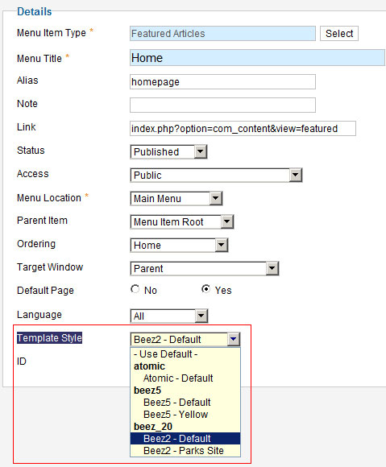
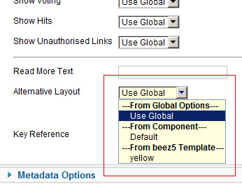
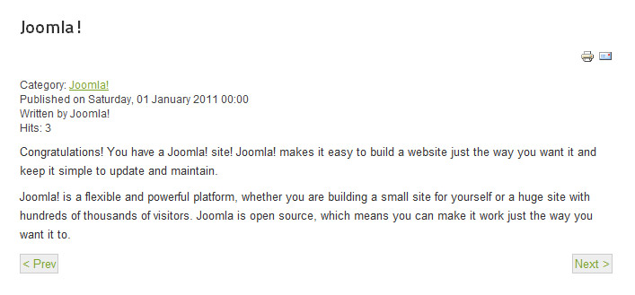
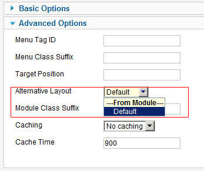
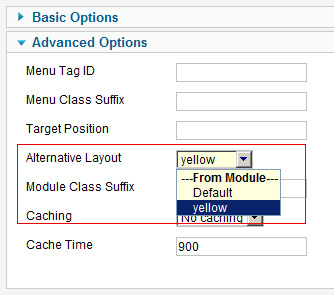
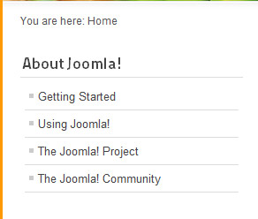

# Joomla! 1.7模板多样化进阶

前面一节[Joomla! 1.7模板初识](joomla17-template-info.md)中我们对模板的用途有了一个初识，了解了它不仅是代表一个外观的模板，它可以代表n个样式的模板，这给我们的建站带来了极大的便利，那么本节我们继续深入了解模板的多样化之处。

### 让菜单选择想要的模板样式

多样化的第一步就是让菜单选择不同的模板样式，Joomla! 的网站经脉就是“菜单”，你得靠它来连接各种页面！进入菜单管理（Menus-Main menu），由于本教程是以最新版为蓝本讲解，而汉化团队跟进稍慢，以中文版讲解的话可能会出现一些未汉化的一大串字体，所以面的教程讲解还是以英文版后台为准。

随意选择一个现有的菜单，或者创建一个新的菜单，这里我们以改默认内容为主，打开“Home”，我们可以看到下图中有一个名为“模板样式（ Template Style ）”的选项

可以看出，我们在[第一节](joomla17-template-info.md)中复制的一个“Beez5 - Yellow”出现在下拉选单中，那么菜单出的“模板样式（ Template Style ）”选择功能就是的一个新功能，如果我们此时的“Home”选择了“Beez5 - Yellow”而不是默认的“Beez2 - Default”，那么“Home”就会变成预设的金黄色 Beez5模板样式。

确认选择“Beez5 - Yellow”之后，保存刷新前台就可生效了

按照这个理论，我们在制作模板的时候，在template.css就可以写很少的公用样式了，比如一些框架类的样式，而非决定外观的样式，那么这些外观样式，就全部设定在 default.css、yellow.css中，也就是理论上的同模板+n个样式。

### 组件、模块的多样化选择

在Joomla! 1.5时代，我们在模板文件夹下会看到**templates/beez5/html/**的文件夹，这个文件夹就是管组件、模块的个性化设定，但它被局限了只能用一个个性化设定，就解决了一个模板的的组件、模块多样化功能。

**1、组件多样化设定**

进入**templates/beez5/html/com\_content** 文件中，我们看到这里有5个文件夹，这就是Joomla! 默认的内容组件模板文件夹，以“文章（article）”为例，打开**templates/beez5/html/com\_content/article/**文件夹后，有个“default.php”的默认文件，它也就是管文章的默认样式布局，比如标题先显示、内容后显示、是否显示打印图标、日期等等等等。

我们直接将“default.php”复制一份，并更名为“yellow.php”，PHP中的代码暂时不做更改，那么见证效果的时候到了。

进入文章管理（Content->Article Manager），选择一篇名为Joomla!的文章作为示例，点开右侧的**Article Options**选项，往下拉可以看到有个名为“（布局样式）Alternative Layout”的选项，点开后我们能看到刚才创建的yellow文章模板选项。

我们可以将这篇名为Joomla!文章的布局样式设定为yellow。

因为yellow.php是直接复制default.php得到的，所以我们要体现出不同效果话，必须要对yellow.php做一点小手术。

那么这篇名为Joomla!文章的布局样式默认如下图：

打开文件**templates/beez5/html/com\_content/article/yellow.php**，为了更显著的效果，我们直接把yellow.php中的代码全部删除，然后保存。这时候再刷新前台，你会发现这篇名为Joomla!文章内容全然不见了，也就证明了，这个布局样式设定是有效的。那具体要怎么DIY，大家随意发挥了，比如要把标题放正文下面之类的。

要说文章的设定倒是简单，直接可以生效，那么分类博客样式的多样化就比较复杂了，关于分类博客样式的多样化，我们在下一节中再细述。

**2、模块多样化设定**

模块也像组件一样，支持多种布局样式，我们以菜单模块（mod\_menu）模块为例，进入模块管理（Extensions->Module Manager），以About Joomla!菜单模块为例，打开之后可看到下图右侧高级选项中也有“（布局样式）Alternative Layout”的选项

在DIY之前，我们需要先将模块文件复制到模板文件夹下。

首先进入**templates/beez5/html/**创建一个新的名为**mod\_menu**的文件夹。

然后进入**modules/mod\_menu/tmpl**文件夹中，将4个php文件复制至上面创建的**templates/beez5/html/mod\_menu**文件夹中。

最后，我们以**templates/beez5/html/mod\_menu/default.php**为蓝本，复制一个名为**templates/beez5/html/mod\_menu/yellow.php**的模板文件，这时候我们再刷新后台About Joomla!这个模块，不难发现，已有下图yellow模板选项了。

我们设定About Joomla!菜单模块调用的模板样式就是yellow。然后保存，为了检测效果，我们看一下默认的菜单模板样式：

同组件的测试原理，我们也将**templates/beez5/html/mod\_menu/yellow.php**中的代码清空，保存PHP文件，再刷新前台，不难发现About Joomla!这个菜单模块不见了，这里模块的DIY也是一样，具体要怎么与众不同，大家自由发挥了。

所以本节就简单讲一下可以直接生效的多样化效果，下一节着重对内容的主体部分（文章博客布局）进行阐述。

**原创文章转载请标明出处，请引用本文地址：**[Joomla! 1.7模板多样化进阶](joomla17-template-info-2.md)

---

除特殊标明文章转自第三方网站，文章均由JOOMLASK.COM原创提供  
欢迎友情转载，请务必保留本文出处并引用本文链接： [Joomla! 1.7模板多样化进阶](http://www.joomla178.com/joomla-share/joomla-templates-tutorials/joomla17-template-info-2.html)
