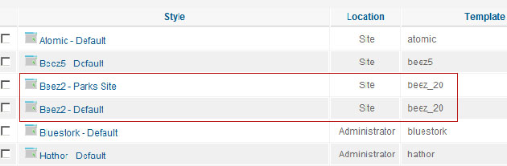
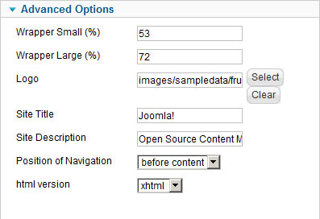
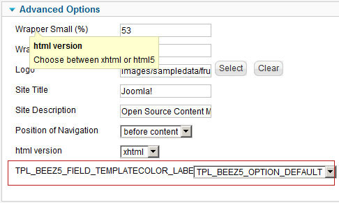
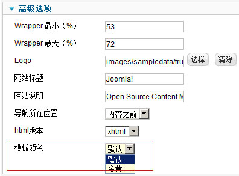
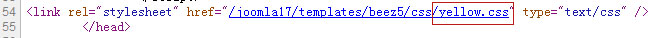
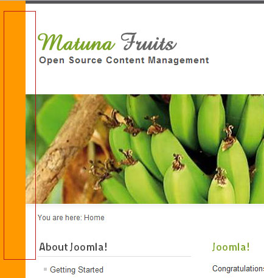
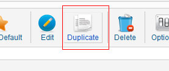
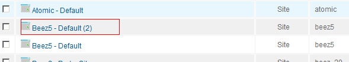
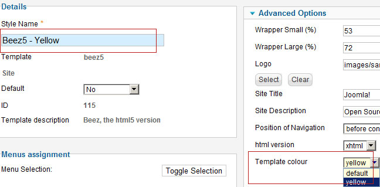

# Joomla! 1.7模板初识

就像每件新事物的发明一样，Joomla! 1.7的许多优秀的地方还未被人们所授受，可能有很多同学觉得Joomla! 1.7 偏复杂，还存在很多问题，大多选择了继续使用Joomla! 1.5，那么我们就开始了解Joomla! 1.7的强大之处，本文着重对Joomla! 1.7的定制自由度做讲解。

大家都知道，在Joomla! 1.5时代，文章的形式比较死板，分类也令人纠结，比如我们前面讲的 [JOOMLA模板开发](README.md)教程中，就会在文章布局中要花费大量的时间精力去做不同页的不同样式，这对一些做各类复杂的产品展示网站就比较麻烦，再就是一套模板的外观样式被限制的死死的，碰上一些需求复杂的客户，就略显捉襟见肘了。那么Joomla! 1.7就彻底解决了这个问题，当然Joomla! 1.7的优势也不仅在此，诸如权限控制等就更显得其优秀之处了。

言归正转，我们将目前的Joomla! 1.7最新版，安装好之后，进入模板管理（Extensions->Template Manager）



可以看到上图中，官方的默认模板beez\_20有两个列表出现，可能习惯Joomla! 1.5的同学就迷惑了，那么我们要接触一个新名字：style，而不简单是Template，那么这个style相当于什么呢，如果有同学用过那些专业模板厂商制作的模板的话，应该就有所了解，在Joomla! 1.5中的多style模板是通过设置模板调用不同的样式表（css）来实现多样式的，但它仍旧局限于全站一起变样式，而Joomla! 1.7就把换样式的自由度做的高，Joomla! 1.7把style拆成同模板的多样式是为了能够让不同的页面，也能调用不同的style。

### 再看看是如何做到的

我们以官方默认模板 beez5为例，例如我们现在再设定一个与beez5默认样式不同的模板，打开beez5之后，可以看到下列模板参数：



我们要在这些参数的基础上再做一个参数，为了做到同一模板不同样式，我们还是需要调用不同的样式表（css）来实现，beez5的模板样式是一个绿色的种植园样式，那么我们就做一个金黄色的种植园样式，设定样式表为 yellow.css

打开文件：**templates\beez5\templateDetails.xml**

找到参数代码：

```
<field name="html5" type="list" default="0"			label="TPL_BEEZ5_FIELD_HTML5_LABEL"			description="TPL_BEEZ5_FIELD_HTML5_DESC"			filter="int"			>			<option value="0">TPL_BEEZ5_OPTION_XHTML</option>			<option value="1">TPL_BEEZ5_OPTION_HTML5</option></field>
```

在其下方添加代码，改为：

```
<field name="html5" type="list" default="0"			label="TPL_BEEZ5_FIELD_HTML5_LABEL"			description="TPL_BEEZ5_FIELD_HTML5_DESC"			filter="int"			>			<option value="0">TPL_BEEZ5_OPTION_XHTML</option>			<option value="1">TPL_BEEZ5_OPTION_HTML5</option></field>

<field name="templatecolor" type="list" default="default"
			label="TPL_BEEZ5_FIELD_TEMPLATECOLOR_LABEL"			description="TPL_BEEZ5_FIELD_TEMPLATECOLOR_DESC"			filter="word"			>			<option value="default">TPL_BEEZ5_OPTION_DEFAULT</option>			<option value="yellow">TPL_BEEZ5_OPTION_YELLOW</option></field>
```

解释一下，上述添加的代码：

设定了一个可以用的变量templatecolor，默认值为default（即会调用css目录下的default.css），两个选项，一个是default，一个是yellow，这时候保存一下此文件，我们可以在后台看到下图的参数。



出现上图，一大串字母比较难看，这是因为我们还没为此参数语言化（就好比我们做汉化的意思）。

### 语言化我们设定的新参数：

找到模板beez5的英文语言文件 **language\en-GB\en-GB.tpl\_beez5.ini**

在最底部添加以下英文化的代码：

```
TPL_BEEZ5_FIELD_TEMPLATECOLOR_DESC="Colour of the template"TPL_BEEZ5_FIELD_TEMPLATECOLOR_LABEL="Template colour"TPL_BEEZ5_OPTION_DEFAULT="default"TPL_BEEZ5_OPTION_YELLOW="yellow"
```

再找到模板beez5的中文语言文件 **language\zh-CN\zh-CN.tpl\_beez5.ini**

在最底部添加以下中文化的代码：

```
TPL_BEEZ5_FIELD_TEMPLATECOLOR_DESC="模板样式选择"TPL_BEEZ5_FIELD_TEMPLATECOLOR_LABEL="模板颜色"TPL_BEEZ5_OPTION_DEFAULT="默认"TPL_BEEZ5_OPTION_YELLOW="金黄"
```

方便大家学习，后面的讲解就以中文后台出现了，语言化之后，再回到后台我们就可以看到下图正常的文字识别了



这个时候我们的后台模板配置的用户体验就搞定了，但是还没有功能的哦，不要尝试刷新前台。

### 让模板颜色选择器工作起来吧

上面我们配置好了颜色选择参数，所以这时候我们要把这些参数放在模板文件中，让其工作起来，打开文件**templates\beez5\index.php**

找到代码：

```
$color			= $this->params->get('templatecolor');
```

找到这串代码就是强调一下，此模板设计之初应该是等同beez\_20，也有选择颜色的功能，只是未添加而已，当然有了这串代码，我们就不需要额外添加了，如果有同学想自制模板，原理也是如此，只要在defined('\_JEXEC') or die;下面加上上述代码即可，意思就是调到后台配置的参数。

```
defined('_JEXEC') or die;$color			= $this->params->get('templatecolor');
```

调用到这个templatecolor参数之后，要link到对应的颜色样式表，在模板index.php的</head>上方加入代码：

```
<link rel="stylesheet" href="<?php echo $this->baseurl ?>/templates/beez5/css/<?php echo $color ?>.css" type="text/css" />
```

本串代码关键是$color是取到的名称，然后后面.css，就组成了 name.css，如果我们后台选的是yellow，那么$color取到的就是yellow，组合之后就是yellow.css，保存好index.php之后，我们不防到后台设置一下模板颜色为yellow，确认之后，在前台刷新，然后查看前台的源代码：



可以看到，此时的前端代码中已经成功生成link好的yellow.css，这个时候我们就可以创建一个名为**yellow.css**的文件放在**\templates\beez5\css\**目录下了。

方便查看效果，我们在yellow.css中设置背景为黄色

```
@charset "utf-8";/* CSS Document */body{ background:#F90;}
```

保存之后我们再看看前台，不难发现，这时候前台的背景是很黄很黄的颜色



至于其它要换成黄色的地方，大家自己发挥了！这个样式yellow.css旨在抛砖引玉。

### 神奇的功能出现了

其实我们上面说的那么多在Joomla! 1.5也可以做，那么这时候Joomla! 1.7的神奇功能就体现出来了，我们再进入模板管理（Extensions->Template Manager）

在模板列表的勾选框中，选中beez5这个模板，再点击右上侧的
**Duplicate** 按钮



这个被汉化团队译成“复制”的按钮确实是有复制的功能，他给我们直接复制了一个和beez5一样的模板： **Beez5 - Default (2)**



那么为了表现出他们的不同之处，Beez5 - Default 的模板颜色就设为default，进入Beez5 - Default (2)，将其名称改为Beez5 - Yellow，模板颜色设定为yellow。



保存之后，这就是我们新建的一个基于beez5模板的金黄色模板样式，那么本节我们就暂时说到这，下一节再细说这样做多模板的用处，和它真正神奇的地方。

**原创文章转载请标明出处，请引用本文地址：**[Joomla! 1.7模板初识](joomla17-template-info.md)

---

除特殊标明文章转自第三方网站，文章均由JOOMLASK.COM原创提供  
欢迎友情转载，请务必保留本文出处并引用本文链接： [Joomla! 1.7模板初识](http://www.joomla178.com/joomla-share/joomla-templates-tutorials/joomla17-template-info.html)
