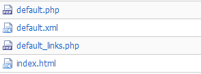
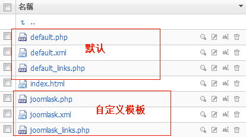
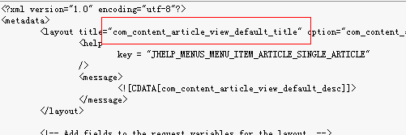
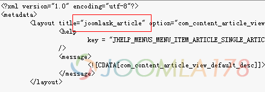
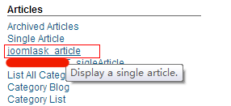

# Joomla! 2.5.x 文章布局、分类布局模板释疑

2012年9月底，Joomla官方发布了**[Joomla! 3.0的正式版](http://www.Joomla178.com/news/10-joomla-news/459-joomla-300-released.html)**，也就意味着Joomla! 3.5将成为继Joomla! 2.5的下一个长期版本，Joomla! 2.5将支持到2014年，Joomla! 2.5到Joomla! 3.5升级将不再是难事，Joomla! 2.5作为长期版本，模板构建还是值得说一说的。

Joomla! 2.5的模板构建等同于Joomla! 1.7，所以我们之前讲的Joomla! 1.7系列的教程都适用于Joomla! 2.5，本次教程我们主要针对单篇文章布局、文章博客式布局 的自定义模板进行释疑。

**一、单篇文章布局：**

1、上一篇教程[Joomla! 1.7模板多样化进阶](joomla17-template-info-2.md)我们有提过“组件多样化”内容，这次我们将**/components/com\_content/views/article/tmpl**下的文件复制至我们创建的模板文件夹**/templates/jk\_Joomla178/html/com\_content/article/**中，那么我们看看些文件的结构：

2、文件结构我们看得出，default.php为默认文章模板，default\_links.php是这个默认文章模板的关于“其它文章链接”的一块模板，另外有个default.xml配置文件。我们复制一套文件在此目录下，分别命名如下（以Joomla178为示例）：

这里需要强调的是，如果没有Joomla178.xml，那么Joomla178.php只能在分类博客布局中生效，后面我们详细解释。

这个时候，们不应该在创建文章的时候选择新模板，因为现在在创建文章时候，在文章模板Alternative Layout处是看不到有Joomla178选项，只有默认的default选项，这是正常现象，当时我卡在这里折腾了很久。

3、打开编辑Joomla178.xml文件，看到下图中com\_content\_article\_view\_default\_title改为Joomla178\_article，意思是在下面我们创建一个单篇文章菜单时候可选择的两个项是：单篇文章、Joomla178\_aritlce。

  

3、回到我们的后台，创建一个新的菜单，选择文章块，我们会发现多了一个“Joomla178\_article”的选项，这就是我们自定制的单篇文章模板，不过要注意的是，刚才建立的单篇文章模板只对设定的文章菜单有效，这个时候，比如您要对“关于我们”之类的文章天马行空都可以了，怎么写代码还需要朋友们多研究研究啊。

**二、分类布局模板**

和创建文章模板文件夹一样，我们需要将**/components/com\_content/views/category/tmpl**下的文件复制至我们创建的模板文件夹**/templates/jk\_Joomla178/html/com\_content/category/**中。再创建一套新的分类模板结构：Joomla178.xml, Joomla178.php, Joomla178\_item.php, Joomla178\_links.php, Joomla178\_children.php, Joomla178\_articlelinks.php，再针对Joomla178.xml做修改，把默认的改为Joomla178\_category。

创建一个新的分类博客式菜单，选择Joomla178\_category，而不是再选择默认的“分类模客式布局”。

这个时候我们就要联系到上面的文章布局了，上面但凡带有.xml的文章自定义模板，在创建文章的时候都是看不到文章模板Alternative Layout中新创建的文章模板，那么如果我们通过分类布局的文章链接点进去，他们是没有单独菜单，他们只能继承分类布局的模板，所以这个时候针对分类布局的文章要自定义的话，又要回到上面，再进入**/components/com\_content/views/category/tmpl** 创建一个新的文件如**：Joomla178\_blogarticle.php,** 这时候，再进入后台，创建指定分类下的文章时，进入**Alternative Layout**选择**Joomla178\_blogarticle.php**

**这里要注意的是：如果针对这个自定义分类布局下的某篇文章创建了一个新的菜单，而且这个新的菜单是我们创建好的自定义菜单Joomla178\_article，那么这时，这篇分类布局下的文章自定义布局将失效。**

到这我们关于文章、分类模板的自定义创建就结束了，这里只要掌握一句就好：**有菜单的文章，吃不了分类下的文章模板，**关于怎么去实战美化模板，短期内可能无法进行教程编写，后面的教程仍然以抛砖引玉的方式讲解，关于文章转载，还是希望同行转载时保留本站出处。

---

除特殊标明文章转自第三方网站，文章均由JOOMLASK.COM原创提供  
欢迎友情转载，请务必保留本文出处并引用本文链接： [Joomla! 2.5.x 文章布局、分类布局模板释疑](http://www.joomla178.com/joomla-share/joomla-templates-tutorials/joomla25-article-layout-and-blog-layout.html)
