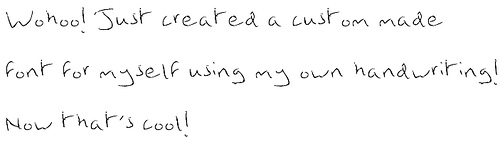
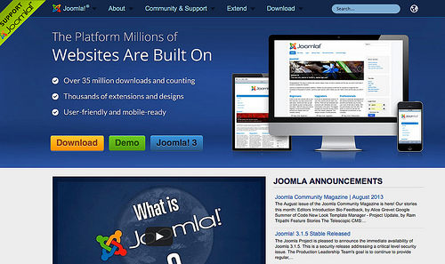
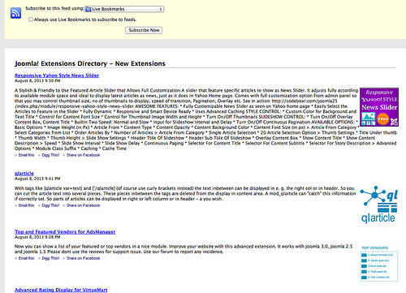
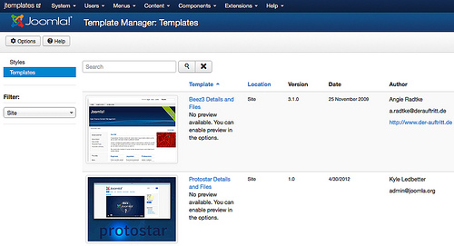
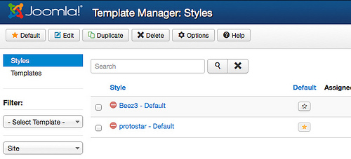

# Joomla! 3 从零开始学设计模板 - 什么是模板

当你第一次在纸上用铅笔涂鸦似地写字的时候，你同时就开始了你的书法之旅。你的书法是你所写的内容和呈现该内容的效果的综合体。通过你所使用的笔的类型、纸张的类型、字迹的颜色、字体的类型、书写的速度以及其它种种因素，你的书法才是吸引人（或者……是不吸引人）的。

当我们聪明绝顶的先祖发明印刷术之后，经过过去几个世纪不断的探索，我们现在已经有了一套完美的印刷理论和方法。

而尽管互联网里的网站总数已超过了6亿个，实际上互联网还是很年轻的。对于“完美网站”设计的有关理论和方法的探索还刚刚开始。

在开始我们的Joomla模板探索之旅前，请让我们一起来看看现状。

## 不同之处

手写文稿、印刷书籍和网页之间最大的差别在于可复制的数量和拷贝所花费的时间：

- 手写文稿都是独一无二的。如果想得到一个副本，你必须重写一遍（除非之前写的时候用了复写纸）。可复制的数量取决于作者的书写能力，或者老师的严厉程度（重抄作业的时候）。也就是说作者和抄写者决定了一切。
- 印刷书籍只需写一次，然后交给印刷厂使用机器来复制。复制的数量取决于机器的能力和纸张的采购量。作者和印刷厂老板决定了一切。
- 网站是储存在服务器里的。当你要浏览一个网站的时候，服务器就为你创建一个副本并将它发送到你的浏览器里。副本的数量是无限的。仅有的限制是服务器的能力和电力。作者和服务器的提供方决定了一切。已经没印刷厂什么事了。

### 机器 vs. 人类

网站和书籍相比的另一个不同点在于它被机器读取的能力。手写文稿和书籍可以扫描识别但对于扫描仪来说识别内容是件复杂的工作。而一个像Joomla!一样规范的网页是很容易被机器读取的。一篇手写文稿或一本书常常是送达给一个人。一个网站则是送达给一个人和一台机器（web服务），人常常是被网站的某种设计吸引过去的，而机器则更钟意良好的结构和纯粹的内容。

### 作者会被替代吗？

送达给机器和（或）人的内容必须先准备好。以前作者就是人，但今天，我们越来越多地使用程序创建内容。最常见的例子是自动回复的emails，但实际上还有很多的例子以及越来越多的可能性（In the US, algorithms are already reporting the news - Guardian, 2010）。  
因此我们仍然需要作者，但也可以由程序来替代作者。就创建内容而言，程序已经成为一种营销工具！

### 未来如何？

网站与其它网络服务如社会化网络的关系越来越密切。为了照顾不同的上网设备，用于展示网站的模板也需要越来越强的适应性，例如屏幕尺寸、设备速度或者带宽。

## 内容的呈现

无论怎样产生的，内容最终都必须呈现给它的目标群体。过去十年里，内容管理系统前三甲们（Joomla, WordPress, Drupal）发展出了几乎如出一辙的内容呈现的技术系统：整个网站的内容储存在一个数据库以及多媒体文件里。通过使用模板文件和不同的web框架，它的内容可以以无限的方式送达到无限的目标群体。

我们刚才谈到了“机器 vs. 人类”。这两个群体又由很多的子群体所组成。例如，机器可以分为网络爬虫、新闻阅读器、xml阅读器、“代理”，等等。网站需要为每个群体提供一个特定的呈现，才能使之“理解”网站内容。

我之所以能够将机器分类，是因为这很容易。但说到人，分类就困难很多了。人可以被分成很多群组，但并不容易预期他们到底是哪些群组。因此设计模板就是一件充满挑战、乐趣和回报的工作。

## Joomla.org

我们通常所说的Joomla模板是为了吸引人而设计出来的。例如http://joomla.org（图1）。需要呈现给机器的部分相对比较简单。例如“Joomla!功能扩展库”之新扩展 http://feeds.joomla.org/JoomlaExtensions...（图2）。

图1：joomla.org

图2：新扩展的RSS种子

## Joomla模板和风格

Joomla本身是包含有几个前台模板和后台模板的。在你的本地电脑下载并安装Joomla 3.x后，登录后台，然后点击扩展 --> 模板管理。在这你就可管理网站模板了。（图3）。

图3：Joomla 3 网站模板

你可以在“模板”和“风格”之间切换。“风格”的作用是提供定制和使用一个模板的某种风格类型。一个模板至少有一种风格。这个风格里通常会有配置功能，比如改换颜色或者上传网站的logo。你可以通过扩展 -->模板管理 --> 风格为你的网站设置一个默认的风格（图4）。你甚至可以通过复制来创建新的风格。你还可以将每种风格分配到指定的菜单项上。例如，当你想让来访者访问菜单A时网站的背景色为绿色，访问菜单B时网站的背景色为蓝色。你可以将相关的风格分配到这两个菜单项上。

图4：Joomla 3网站模板风格

Joomla自身默认的模板是Protostar（和游戏“星空战机”同名是巧合）。它是基于大名鼎鼎的Twitter的Bootstrap前端框架和Joomla用户界面库（JUI）。

## 额……到底什么是Joomla模板？

根据刚才的介绍，这事还蛮复杂的。:)

与Joomla自身默认的模板“Protostar”（“星空战机”）相关的所有文件都在文件夹[joomlaroot]/templates/protostar里。它的基础Twitter的Bootstrap前端框架和Joomla用户界面库都在文件夹[joomlaroot]/media/jui/。该模板的设置开关都在其风格之中，而设置结果都保存在数据库。

## 我们将从零开始构建一个与之相似的模板？

额……是的。 :)

在过去几年里，我不断地收到email来信问我“如何从零开始创建一个Joomla模板”，这是我为什么写作本书的原因。这项工作对我而言也很困难，因为我也不是一个模板设计师！

我最大的目标是让你理解Joomla模板的基本结构，从而使你能够依靠你自己的技能和需求，从零开始完成你需要的Joomla模板。

本书将不涉及Adobe Photoshop的使用，也不涉及Joomla内容的创建，更不涉及让人头疼的PHP或JS脚本。

我们仅仅是通过效果图来创建一个模板！

我们下一章就动手！

---

除特殊标明文章转自第三方网站，文章均由JOOMLASK.COM原创提供  
欢迎友情转载，请务必保留本文出处并引用本文链接： [Joomla! 3 从零开始学设计模板 - 什么是模板](http://www.joomla178.com/joomla-share/joomla-templates-tutorials/joomla3-design-template-1st-what-is-template.html)
