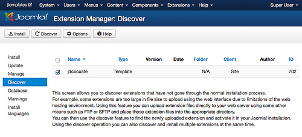
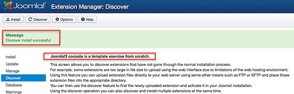
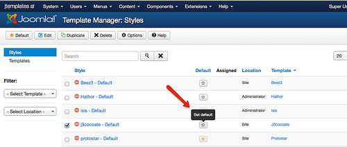
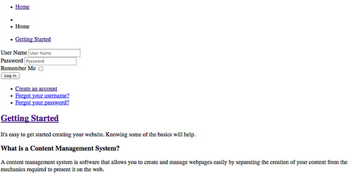

# Joomla! 3 从零开始学设计模板 - 文件和目录

本章开始，我们即开始了解与一个Joomla 3 前台模板相关的技术基础：我们会创建它规定好的文件和目录结构。通常我们有三种方式来创建一个新模板。我们可以通过效果图来创建我们自己的模板的目录和所有必需的文件；我们可以通过安装一个简单的基础模板然后来丰富它；或者我们可以拷贝一个已存在的模板然后修改它。本书的选择是第一种方式，并且尽可能让事情变得简单。

本章的目标是让你理解Joomla的模板结构。

## 模板名称

首先所有的Joomla网站模板都需要个名称。它由一个技术名称以及一个对应的说明组成。这个技术名称将会应用到XML文件、目录名称、数据库、服务器文件系统和几个缓存文件里。尽管理论上可以，但实际上我们还是建议技术名称里避免使用特殊字符和空格。我将把我的模板命名为*j3cocoate*。说明里的名称可以一点，譬如：*"Joomla! 3 - cocoate Template"*.

## 文件和目录

每个模板都有它自己的目录来储存所有必需的文件。所以我们首先要做的就是创建目录*[root]/templates/j3cocoate*（别眨眼就忘了它必须和模板的名称一致）。如果你看一下Joomla里的目录*[root]/templates/protostar*，你会发现里面还有一些目录，如*css*、*js*、*html*，等等。先别急，我们下一章会详细介绍目录的作用和内容。为了简单起见，我们现在只在我们的模板*j3cocoate*里创建一个必不可少的目录：*[root]/templates/j3cocoate/css*

在模板根目录下我们需要三个文件。其中文件*index.php*包含的是模板的HTML结构以及其它一些我们以后的章节会详细介绍的举足轻重的东西。文件*template.css*则包含了CSS命令。这个文件可以根据你的需要命名，比如你可以命名为*style.css*。第三个文件是*templateDetails.xml*，它是模板的主文件，包含了模板的元数据（meta data）和整个结构。

删繁就简，我们只需要以下结构：

### 目录

- *[root]/templates/j3cocoate*
- *[root]/template/j3cocoate/css*

### 文件

- *[root]/templates/j3cocoate/index.php*
- *[root]/templates/j3cocoate/templateDetails.xml*
- *[root]/templates/j3cocoate/css/template.css*

## 文件的内容

文件*index.php*和*templateDetails.xml*是必须有一些内容的。至于文件*template.css*，我们先让它空着。

### index.php

这个文件由一些HTML标记组成。建议使用HTML5，因为它将是HTML的新标准。这之前的HTML版本是HTML 4.01是1999制订。但自那之后互联网已经发生了翻天覆地的变化。HTML5还在完善和发展中，但主流的浏览器已经能支持许多HTML5的元素和API。如果你对HTML 5还不熟悉，花90秒钟看看这个视频。（已转存至Youku）

倘若你突然觉得HTML5不错想了解更多，请访问：[W3C HTML5 指南](http://www.w3schools.com/html/html5_intro.asp).

在本身的示例中，我们需要混合使用HTML和Joomla指定的命令。这也就是说我要完成一点代码。

```
<?php defined( '_JEXEC' ) or die;?>
```

这一行的作用是为Joomla提供安全保护。它实际上是防止有人直接访问本文件的一个PHP命令。它会检查是否设置了变量\_JEXEC。如果没有，文件的执行就会马上停止（die）。保证仅仅只有Joomla系统本身能够访问该文件。

```
<!DOCTYPE HTML>
<html>
<head>
</head>
<body>
</body>
</html>
```

这是一个HTML5网页的基本结构，也是Joomla模板里必不可少的部分。接下来我们会额外加一点信息，像“这个网站是什么语言？”、“这个网站的内容是由左往右读，还是由右往左读？”。Joomla将替你回答这些问题。而这些信息是浏览器感兴趣的。

```
<!DOCTYPE html>
<html xmlns="http://www.w3.org/1999/xhtml" 
      xml:lang="<?php echo $this->language; ?>" 
      lang="<?php echo $this->language; ?>" 
      dir="<?php echo $this->direction; ?>">
```

这个HTML标签的属性其实是PHP命令。当web服务器将这一行代码送达到一个浏览器后，这一行输出的结果是：

```
<html xmlns="http://www.w3.org/1999/xhtml" xml:lang="en-gb" lang="en-gb" dir="ltr">
```

Joomla会自动为你创建header区域。你所要写的代码是：

```
<head>
   <jdoc:include type="head" />
</head>
```

浏览器输出的页面的源代码将是：

```
<head>
  <base href="http://localhost/j3/" />
  <meta http-equiv="content-type" content="text/html; charset=utf-8" />
  <meta name="author" content="Super User" />
  <meta name="generator" content="Joomla! - Open Source Content Management" />
  <title>Home</title>
  <link href="http://localhost/j3/" rel="canonical" />
  <script src="/j3/media/system/js/mootools-core.js" type="text/javascript"></script>
  <script src="/j3/media/system/js/core.js" type="text/javascript"></script>
  <script src="/j3/media/system/js/caption.js" type="text/javascript"></script>
  <script src="/j3/media/jui/js/jquery.min.js" type="text/javascript"></script>
  <script src="/j3/media/jui/js/jquery-noconflict.js" type="text/javascript"></script>
  <script src="/j3/media/jui/js/bootstrap.min.js" type="text/javascript"></script>
  ...
</head>
```

“body”是网站输出内容的部分，它需要一些位置（position）设置方面的信息，以便Joomla能在那些位置输出指定的内容。在Joomla的核心模板*Protostar*里，大多数位置（position）采用了连续的数字标记。它是从*position-1*到*position-14*来命名位置。只有一个例外的位置叫*footer*。如你在安装Joomla时安装了示范数据，那么主菜单是位于*position-1*，面包屑（即导航）是位于*position-2*。一些模块位于*position-7*。我们采用*jdoc*命令，在我们的模板里也使用同样的位置命名规则：

```
<jdoc:include type="modules" name="position-1" style="none" />   
<jdoc:include type="modules" name="position-2" style="none" />
<jdoc:include type="modules" name="position-7" style="none" />
<jdoc:include type="component" />
<jdoc:include type="modules" name="footer" style="none" />   
```

位置的名称完全由你自己决定。只要将它们在文件 *templateDetails.xml*里定义好就行了。现在我们所需要的*index.php*文件的全部内容如下：（*表1*）。

```
<?php defined( '_JEXEC' ) or die;?>
<!DOCTYPE html>
<html xmlns="http://www.w3.org/1999/xhtml" 
      xml:lang="<?php echo $this->language; ?>" 
      lang="<?php echo $this->language; ?>" 
      dir="<?php echo $this->direction; ?>">
   <jdoc:include type="head" />
</head>
<body>
  <jdoc:include type="modules" name="position-1" style="none" />    
  <jdoc:include type="modules" name="position-2" style="none" />
  <jdoc:include type="modules" name="position-7" style="none" />
  <jdoc:include type="component" />
  <jdoc:include type="modules" name="footer" style="none" />    
</body>
</html>
```

*表1：index.php*

### templateDetails.xml

这是模板里最重要的文件。它是一个清单或者压缩包里的文件的列表，详细记录了这个模板所包含的所有文件和目录。它同时也包含了作者和版权信息。如果缺乏这个文件，Joomla就无法找到你的模板和我们刚才在所谈到的index.php文件里使用的那些位置。顺便提一下：你想使用多少位置都行，位置的名称也是随心所欲。Joomla对此没有特别的规定。

```
<?xml version="1.0" encoding="utf-8"?>
<!DOCTYPE install PUBLIC "-//Joomla! 2.5//DTD template 1.0//EN"
   "http://www.joomla.org/xml/dtd/2.5/template-install.dtd">
<extension version="3.1" type="template" client="site">
    <name>j3cocoate</name>
    <version>1.0</version>
    <creationDate>08/18/2013</creationDate>
    <author>Hagen Graf</author>
    <authorEmail>该 Email 地址已受到反垃圾邮件插件保护。要显示它需要在浏览器中启用 JavaScript。<;/authorEmail>
    <copyright>Copyright (C) 2006 - 2013 cocoate.com. All rights reserved.</copyright>
    <description><![CDATA[
    <p>Joomla!3 cocoate is a template exercise from scratch.<p>
    ]]></description>
    <files>
        <filename>index.php</filename>
        <filename>templateDetails.xml</filename>
        <folder>css</folder>
    </files>
    <positions>
        <position>position-1</position>
        <position>position-2</position>
        <position>position-3</position>
        <position>position-4</position>
        <position>position-5</position>
        <position>position-6</position>
        <position>position-7</position>
        <position>footer</position>
    </positions>
</extension>
```

*Listing 2: templateDetails.xml*

### template.css

这个文件现在还不急用，但我们很快就需要它。所以先创建一个空白文件，并把它放到目录*[root]/templates/j3cocoate/css*里。

## 检测和安装你的模板

创建好两个目录和三个文件之后，我们还得检测和安装我们的模板。从Joomla 1.6开始，模板就必须“注册”到数据库的数据表\_extensions里。请登录后台，然后点击*扩展 -> 扩展管理 -> 检测*。再点击顶部的“检测”按钮。你马上就会看到你的刚新鲜出炉的模板（*图1*）。勾选该模板，并点击顶部的“安装”按钮（*图2*）。



*图1：检测出你的模板*



*图2安装你的模板*

在安装过程中，Joomla会自动给你的模板创建一个风格。找到这个风格（*扩展 -> 模板管理*），将这个风格选为默认的模板风格。（*图3*）。



*图3：默认的模板风格*

现在访问你的网站，效果虽然实在不怎么的，但从技术上说，你已经白手起家在构建你的模板了！



*图4：我们的处女作 :)*

---

下一章将是有关模板界面的介绍，值得期待！

## 原文嵌入媒体

- [媒体链接](http://player.youku.com/player.php/sid/XNjMzOTQ5MzQ4/v.swf)

---

除特殊标明文章转自第三方网站，文章均由JOOMLASK.COM原创提供  
欢迎友情转载，请务必保留本文出处并引用本文链接： [Joomla! 3 从零开始学设计模板 - 文件和目录](http://www.joomla178.com/joomla-share/joomla-templates-tutorials/joomla3-design-template-2nd-files-directory.html)
