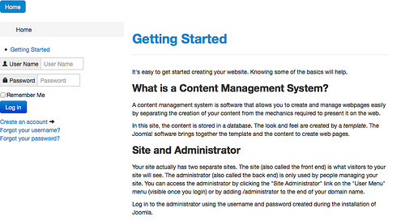

# Joomla! 3 从零开始学设计模板 - 布局

当我们说到网站设计的布局的时候，我们通常指的是网页的布局。网页布局的基础是平面设计，是一个页面的内容和风格的总体安排。Joomla这样的内容管理系统构建的网站可以有成千上万个页面，为了保证所以页面在任何类型的屏幕上都可读，妥善安排好内容元素就非常重要了。

使用铅笔或者绘图软件很容易就能绘制一个页面的布局。

困难的是将准备好的页面转换成为HTML及CSS，并与Joomla结合到一起。

Joomla出道后，很长一段时间都在使用基于HTML表格（table）的布局。这种布局容易掌握，在80%的情况下也能达到要求，但从语义上来说页面布局使用HTML表格是不对的。HTML表格仅仅只适用于给一个栅格（比如一个电子表格）提交数据的情况。一个使用HTML表格的很好的例子是[元素周期表](http://zh.wikipedia.org/wiki/%E5%85%83%E7%B4%A0%E5%91%A8%E6%9C%9F%E8%A1%A8)。

几年前曾经发生过一次有关“Table vs. CSS布局"的大讨论（[Tables: The Next Evolution in CSS Layout](http://blog.teamtreehouse.com/tables-the-next-evolution-in-css-layout)）。

总的来说界面的处理比较难，因为它需要设计功底。

与HTML表格相比，层叠样式表（CSS，简称样式表）较难掌握，因为在安排你的内容时，样式表提供了太多的可能。要想全面了解样式表，请仔细阅读[学习CSS布局](http://zh.learnlayout.com/)。

## 框架

如果一项工作太难，常常就会有人设计一个框架来简化你的工作。同样地，为不同的内容管理系统设计模板的公司需要框架使他们的设计工作轻松点。Joomla领域内常用的模板框架有（[Gantry](http://www.gantry-framework.org/)、[T3](http://t3-framework.org/)、[Warp](http://www.yootheme.com/themes/warp-framework)、[Phoca](http://www.phoca.cz/phoca-template-framework)），等等，但这些框架常常都绑定在这些公司的产品里。这里是两个与公司无关、与Joomla绑定的框架（[Construct](http://joomlaengineering.com/), [Morph](https://github.com/MorphTemplateFramework)）。

撇开内容管理系统不说，框架的需求还是非常地大。因此也出现了几个杰出的框架。简单举几个例子：[Foundation](http://foundation.zurb.com/)、[Bootstrap](http://getbootstrap.com/)以及[Skeleton](http://www.getskeleton.com/)。

## Joomla 3里的Bootstrap

Joomla! 3已经将Bootstrap框架集成到Joomla核心里（[Bootstrap 版本2.3.2](http://getbootstrap.com/2.3.2/)）。Bootstrap是[Twitter](http://en.wikipedia.org/wiki/Twitter_Bootstrap)研发的前端框架——现在它不仅是框架，它还包含基于HTML和CSS的文字排版、表单、按钮、图表、导航和其它界面元素等等的模板，以及可选的JavaScript插件。Bootstrap框架集成到Joomla核心之后，上面所提到的那些Joomla模板框架也纷纷将Bootstrap应用到他们自己的框架中，并增加了一些特色功能。

有时候在Joomla 3里使用另外的框架是有帮助的。但我们要做的第一步还是使用已集成的Bootstrap框架。

## 用Bootstrap设计布局很容易！

通常网站的结构是顶部一个主菜单，中间分成2～3底部是一个版权说明页脚。大家都在用这种布局，所以我们现在也将设计这样的布局。

### 栅格系统

Bootstrap框架的一个核心是将一个栅格均分为12列（[详细文档](http://getbootstrap.com/2.3.2/scaffolding.html#gridSystem)）。

一个页面两列的布局：

```
<div>
  <div>navigation</div>
</div>
<div>
  <div>first column</div>
  <div>second column</div>
</div>
<div>
  <div>footer</div>
</div>
```

这是三列的布局：

```
<div>
  <div>navigation</div>
</div>
<div>
  <div>first column</div>
  <div>second column</div>
  <div>third column</div>
</div>
<div>
  <div>footer</div>
</div>
```

每列都通过一个叫“span”的类来控制。“span4”表示该元素占用12列里的4列，“span6”则占用12列里的6列。依次类推。每一列都必须包含于一“排”。

### index.php里的两列布局

趁这个机会，我想介绍下JFactory/getDocument。整个Joomla页面是一个所谓的对象或者实例。这个对象由方法和属性组成。比如我们之前已经使用过的jdoc:include就是一个方法。一个属性则是一个变量的值。如language（语言）的属性是“en-GB”，如果该页面是中文版本，那么其language属性就是“zh-CN”。为确保你的模板里使用的变量的值均准确无误，必须在你的index.php文件里写入这三行：

$doc = JFactory::getDocument();  
$this->language = $doc->language;  
$this->direction = $doc->direction;

当我们将上一章的index.php文件和刚刚讨论的bootstrap布局结合的时候，我们得到这样的代码（列表1）。

<?php defined( '\_JEXEC' ) or die;  
$doc = JFactory::getDocument();  
$this->language = $doc->language;  
$this->direction = $doc->direction;  
?>  
<!DOCTYPE html>  
<html xmlns="http://www.w3.org/1999/xhtml"  
      xml:lang="<?php echo $this->language; ?>"  
      lang="<?php echo $this->language; ?>"  
      dir="<?php echo $this->direction; ?>"><head>  
   <jdoc:include type="head" />  
   <!-- Stylesheets -->  
   <link rel="stylesheet" href="/<?php echo $this->baseurl ?>/media/jui/css/bootstrap.css" type="text/css" />  
</head>  
<body>

<div>  
  <!-- navigation -->  
  <div>  
    <jdoc:include type="modules" name="position-1" style="none" />  
  </div>  
</div>

<div>  
  <!-- first column -->  
  <div>  
    <jdoc:include type="modules" name="position-2" style="none" />  
    <jdoc:include type="modules" name="position-7" style="none" />  
  </div>  
  <!-- second column -->  
  <div>  
  <jdoc:include type="component" />  
  </div>  
</div>

<!-- second column -->  
<div>  
  <div>  
  <jdoc:include type="modules" name="footer" style="none" />      
  </div>  
</div>

</body>  
</html>

表1：两列布局的index.php文件

我们只要在HTML的head标签里调用bootstrap.css文件，即可完全整合bootstrap。

```
<link rel="stylesheet" href="/<?php echo $this->baseurl ?>/media/jui/css/bootstrap.css" type="text/css" />
```

PHP变量$this->baseurl代表的是你所安装的Joomla的路径。

保存后，我们的网站就开始起变化了。借助于bootstrap框架我们已经创建了一个布局。（图1）



图1：使用bootstrap的两列布局

## 小结

正如你所见，使用bootstrap是很容易创建一个布局的！你可通过列和排来熟悉这个框架，你也可以把模块设置到不同的位置来看看会发生什么。

---

下一章我们将一起来设计一个下拉菜单。

---

除特殊标明文章转自第三方网站，文章均由JOOMLASK.COM原创提供  
欢迎友情转载，请务必保留本文出处并引用本文链接： [Joomla! 3 从零开始学设计模板 - 布局](http://www.joomla178.com/joomla-share/joomla-templates-tutorials/joomla3-design-template-3rd-layout.html)
