# Joomla! 3 十步建站第五步：关于用户、权限、模块和文章

### 5. 关于用户、权限、模块和文章

本系列教学转自 [Cocoate免费书库](http://cocoate.com/j3/what-is-joomla) ，英文原著由[Hagen Graf](http://cocoate.com/user/hagen-graf)编写，中文翻译由[Derek Joe](http://cocoate.com/zh-hans/derek-joe)完成

我知道我们的网站还是没有内容，但在我们创建内容前先来看看这个新网站的用户帐号。  
在安装Joomla的时候，您就已经创建了一个超级管理员的帐号。该用户可做一切操作：这个帐号用起来很爽但同时也很危险。您大概会在您的网站设立多个用户帐号，如可以编撰文章的采编等。接下来就让我们一起来构建一个可以让采编不必登录管理后台就可以编撰文章、上传图片的网站吧。本章内容将使您了解到Joomla的很多道道！ :）

### 关于用户、角色和权限

在我们开始前，了解到这些是很重要的：

- 根据他们的角色权限，用户通常也可登录网站前台，及（或）管理后台。
- 一个用户必须是某个用户组里的成员。我们通常是把权限分配给一个用户组，而不是每个用户。用户则是被分配到一个或多个用户组里来获取相应的权限。想象一个您的网站有分配在四个不同的用户组的1万个用户。管理员很容易改变每个用户组的权限。而如果没有用户组，那您就不得不手工改变每个用户的权限。相反，通过使用用户组，您仅仅需要一次性调整几组权限。

Joomla本身带有预定义好的几个用户组：如采编和总编，它们很容易被理解。采编可以提交（在线编辑）内容，而总编拥有发布内容的特权。

- 预定义好的前台用户组为：访客、注册用户、采编、主编、总编
- 预定义好的后台用户组为：初级管理员、高级管理员、超级管理员

### 示范：一个可以让采编编撰文章的网站

这是一个非常简单的工作流程，但它涵括了存在于Joomla里的一系列可能性。我们假设您安装的是有一个超级管理员帐号但没有示范数据的裸奔的囧啦。

### 理想的方案

1. 后台管理帐号：  
   - 当有人创建一个新用户帐号时，能够激活网站给管理发送一份通知  
   - 为注册用户创建一个用户菜单，其链接指向一个可以编撰文章的页面
2. 网站访客：  
   可注册为新用户
3. 后台管理帐号：  
   接收通知，将用户分配到“采编”用户组
4. 网站的采编：  
   可创建文章但不允许发布文章
5. 后台管理帐号：  
   - 当有新内容提交时接收到相关通知  
   - 发布文章到网站前台

### 1. 超级管理员电子邮件通知和用户菜单

在管理后台点击*用户* → *用户管理* → *选项*，然后开启“给管理员发送邮件通知” （*图1*）.

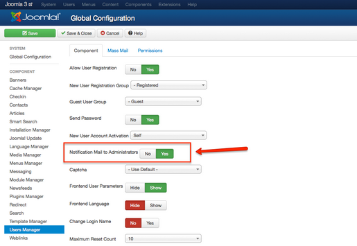

*图1: 给管理员发送邮件通知*

点击*菜单* → *菜单管理*，添加一个新菜单群：

- 标题：用户菜单
- 菜单类型：用户
- 描述：一个为用户提供有用的链接的菜单

保存并关闭，你就创建了一个菜单群或者是菜单容器。现在还缺少的是菜单群里的链接，以及在模板的指定位置显示出来的一个带菜单链接的模块。  
为创建和链接该模块，请点击“链接到该菜单的模块”下的链接 （*图2*）

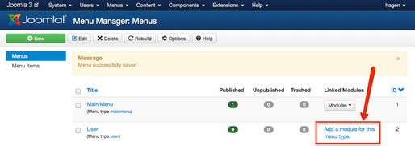

*图2: 添加一个模块*

在该模块表单，您必须添加一个标题（即“用户菜单”），选择位置（注意是模板*Protostar*里的位置），访问权限（*注册用户*）。最后别忘了保存并关闭它。（*图3*）.

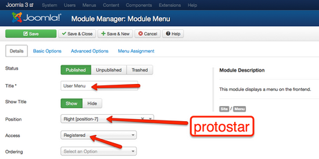

*图3: 创建用户菜单模块*

现在我们需要的是菜单中能够显示给采编的“创建文章”链接，请点击菜单 → 用户菜单 → 添加新的菜单项（*图4*）

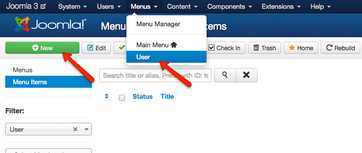

*图4: 在用户菜单群里创建一个链接*

在接下来的表单里，您必须填写该链接的名称（菜单项的标题 ），选择一个菜单项类型（*图5*）并且限制为“注册用户”才能访问。每个Joomla组件都可以提供“菜单项类型”。我们需要的类型（*创建文章*）是Joomla核心组件之一的内容组件所提供的。

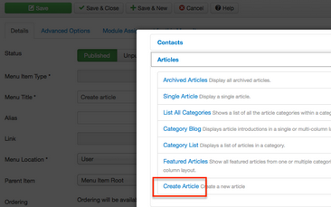  
  
*图5: 选择菜单项类型*

在您保存并关闭后，列表中就会显示一个新的菜单项。（*图6*）

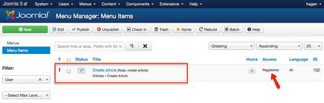

*图6: 用户菜单中的新菜单项*

测试下您的工作吧！用您的超级管理员帐号登录网站前台，我们会看到新创建的用户菜单群及其链接（*图7*）。

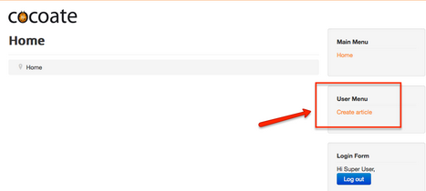

*图7: 登录后显示的用户菜单*

测试后请退出登录。

### 2. 注册为新用户

现在我们创建一个新的用户帐号。请像其他访客一样访问网站，点击“创建帐户”，填写好表单后点击“注册”按钮（*图8*）。

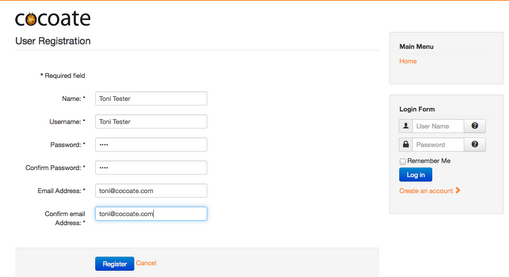

*图8: 注册表单*

- 如果您的服务器栈允许发送邮件，此时将有一封通知邮件发送给超级管理员帐号里填写的Email地址。
- Joomla提供验证码功能来阻止垃圾信息制造者。要使用该功能，请激活验证码插件。操作：*扩展* →*插件管理*，激活验证码插件（CAPTCHA）；然后回到用户管理，点击“选项”，在配置的“验证码”一项中选择刚才激活的插件。

### 3. 将用户分配到用户组

用您的超级管理员帐号登录管理后台，然后点击*用户* → *用户管理*，点击新注册的这个用户的名字（Toni Tester）。在“分配用户组”标签下勾选用户组“采编”（图9）。

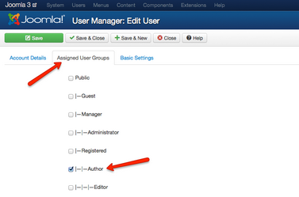

*图9: 将用户分配到一个用户组*

### 4. 我们的新采编将编撰一篇文章

以您新注册的用户帐号登录网站前台，点击用户菜单中的“编撰文章”，填写标题和内容，然后点击保存（*图10*）。

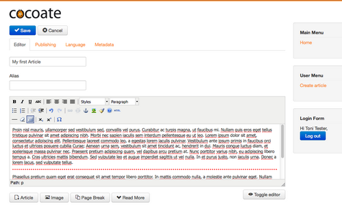

*图10: 编撰一篇文章*

文章已经保存并发送，但采编本人看不到它，因为文章并未发布出来。我有意设置成这样，是因为在一些情况下，我们希望由另外一个人来编辑、审核这样的文章，并决定是否发布或（和）何时发布。

当然，我们也可以简化工作流程，将这个用户分派到“总编”用户组，这样他就在完成文章的编撰后立刻将文章发布出来。

### 5. 管理员在前台发布文章

Joomla有一个站内信息系统，当一个用户提交新文章后，系统就会发出一条信息。信息的发布形式依据于您的设置（*组件 → 站内信息 → 选项*），可以通过email发给管理员，也可以存储在管理后台。  
收到信息的管理员须登录管理后台（以后您会知道也不是什么情况下都必须登录管理后台），访问*内容 → 文章管理*，才能发布这篇文章。如果想让这篇文章同时发表到网站首页，请在“头版”选项处选择“是”（*图11, 图12*）。

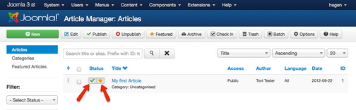

*图11: 发布一篇文章*

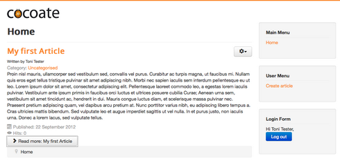

*图12: 头版文章*

### 修改流程

看完这个示范，我们已经注意到操作中涉及到了很多Joomla的基本原理，且相关的配置可以根据您的需求很容易就设置好。但其实Joomla还存在大量的权限、选项等等设置工作，我将在第8章提供一些这方面的示范。

---

除特殊标明文章转自第三方网站，文章均由JOOMLASK.COM原创提供  
欢迎友情转载，请务必保留本文出处并引用本文链接： [Joomla! 3 十步建站第五步：关于用户、权限、模块和文章](http://www.joomla178.com/joomla-share/joomla3-in-10-easy-steps/joomla3-in-10-easy-steps-5th-about-users.html)
