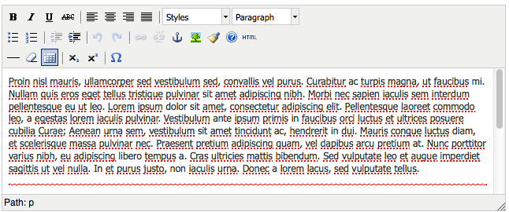
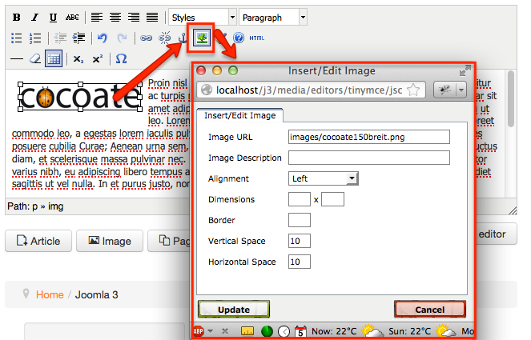
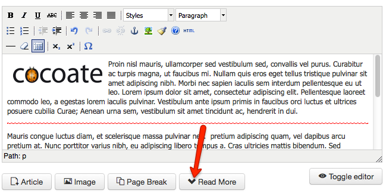
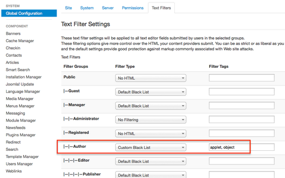
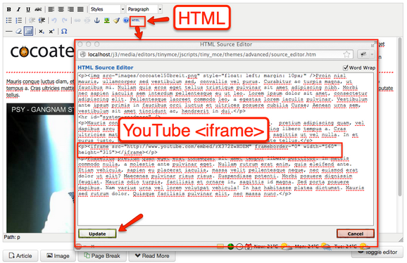
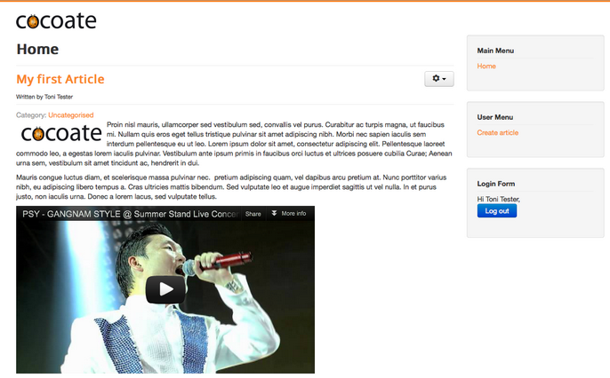
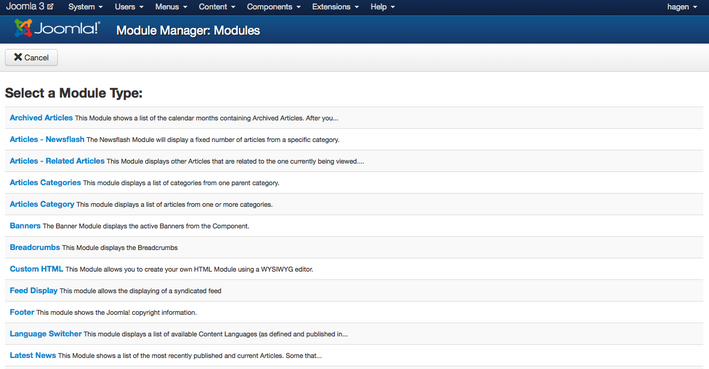
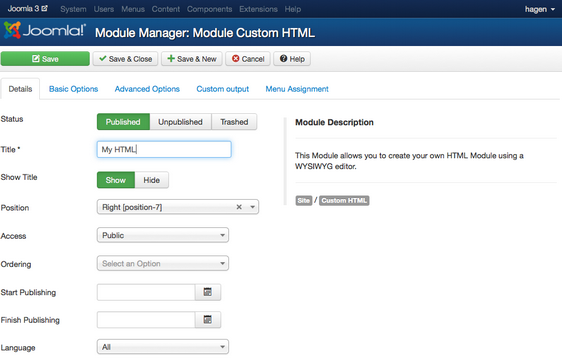
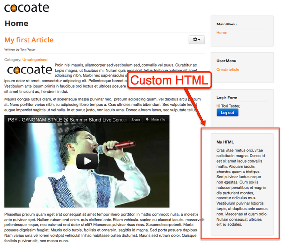
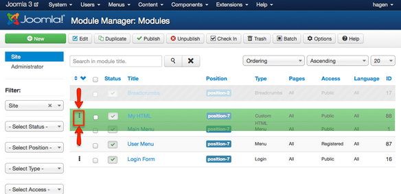

# Joomla! 3 十步建站第六步：创建内容

### 6. 创建内容

本系列教学转自 [Cocoate免费书库](http://cocoate.com/j3/what-is-joomla) ，英文原著由[Hagen Graf](http://cocoate.com/user/hagen-graf)编写，中文翻译由[Derek Joe](http://cocoate.com/zh-hans/derek-joe)完成

创建内容是很不容易的！每篇内容都是一则故事。故事可以很精彩或者很平淡，由此吸引来访者或者让他们觉得枯燥无味。关于写作的书不计其数，有良好的写作才能的人这年代也不少。  
我只有一个涵括技术部分的相对轻松的任务。 :）

### 什么是Joomla网站的文章？

以专业术语来说，一篇文章的组成如下：

- 一个标题和一个别名（网址里）
- 正文（文字、图片和其它媒体的混合体）
- 分门别类保存文章的分类
- 一个作者及其别名
- 访问权限
- 文章使用的语言
- 供搜索引擎和其它机器人搜索的元数据

当然还有很多关于如何、哪里、谁、什么时候让文章才能显示出来的选项。  
上一章您已经编写过一篇文章，也明白事情并不那么复杂：只有标题是必须的，其它字段都有一个默认值或者一个默认选项。  
让我们一起来解决上面列表中的项目 :）

### 标题

这是很小但很重要的工作。

- 它要够味够短到能够吸引到读者，而且对于您来说还有够便利，因为在网站前台或管理后台的文章列表中显示的就是文章标题。
- 一般文章标题显示在读者的浏览器窗口的顶部（专业点说：文章标题同时也是浏览网页时的页面标题），页面标题里除了文章标题外还可以包含网站名称——您可以通过这样的配置达到这一效果：*系统 → 全局配置 → 网站 → SEO设置 → 添加网站名称到网页标题*。
- 可以让它成为页面网址的一部分（I），这取决于您如何设置网址的格式：  
  *系统 → 全局配置 → 网站 → SEO设置*

### 正文

Joomla文章里的文本部分可包含某些排版中会显示的部分和其余并不马上显示的部分。文章的其余部分又能分页，因此一篇很长的文章甚至可以被分为10页，并以一个小目录来导读。 :）  
Joomla能提供二个编辑器来帮您创建文章。其中默认使用的是一个富文本编辑器（[TinyMCE](http://www.tinymce.com/)）。所谓富文本编辑器是可内嵌于浏览器，让您所见即所得的文本编辑器。这也就是说，您不需要懂得那些HTML标签（代码）即可编撰文章。这个编辑器无论是看起来还是用起来都很像您的PC电脑里的文本处理器Word和LibreOffice，上面的功能图标（按钮）既直观又方便。（*图1*）。



*图1: 所见即所得的文本编辑器*

当您的鼠标移到一个按钮的上方，会马上显示出一个与这个按钮的功能有关的说明。

*备注：*

*您可以安装其它编辑器，如大名鼎鼎的[JCE Editor](http://www.joomlacontenteditor.net/)，你也可以什么编辑器都不用。Joomla本身带有两个编辑器，你可以自行指定默认的编辑器：系统 → 全局配置 → 网站 → 默认编辑器。*

*Joomla的默认设置允许用户通过编辑他们的用户帐号来自行决定将何种编辑器作为自己的默认编辑器。但您也可以关闭这个功能：用户 → 用户管理 → 选项 → 前台用户参数。*

#### 从Word粘帖内容

编辑时常发生的比较糟糕的事情是，当我们从Microsoft Word等电脑软件中拷贝文章内容的时候，粘帖到基于HTML的Joomla编辑器里后，得到的排版和像Microsoft Word这样的基于二进制或者复杂的XML的文本处理器的排版还是有点不同（虽然这几年越来越接近）。TinyMCE等编辑器提供了“清理无用代码”的按钮，但通常还是无法完全得到与原来的文章一致的排版。当您在给您的团队或客户讲解Joomla的编辑器时请记得提醒他们。:）

#### 插入图片

在编辑器窗口的下方，您能找到一个叫“图片”的按钮。它的功能是使用能够从Joomla的图片库中选择一张插入到内容中，或者让你通过上传将您电脑中的图片添加到Joomla图片库中。

- 您可以通过这里管理您的Joomla网站的图片库*内容 → 媒体管理*
- 您可以通过启用Flash上传方式一次上传多张图片 （*内容 → 媒体管理 → 选项 → 启用Flash批量上传器*）
- Joomla并不能真正改变您的图片大小，因此请特别留意大图片！最佳方案：您的图片的大小和您想网站里显示的图片大小完全一致。Joomla扩展库里有几个专门调整图片大小的功能扩展。Joomla 3里使用的Twitter Bootstrap framework（框架）也有助于快速显示图片。

从图片库将图片插入到内容里后，点击编辑器上方的“图片”按钮，您还可以设置它的属性（*图2*）

  
  
*图2: 使用富文本编辑器*

#### 参考文章

编辑器窗口下方的“文章”按钮您从当前文本里链接其它有用的文章。

#### 阅读更多

Joomla文章可以以列表的形式展示，也可以整版显示一篇文章的所有详情。当以列表形式展示时，为使版面内容简洁明了，显示的文本必须简明扼要（只显示引言）。编辑器窗口下方的*阅读更多*按钮即可以帮助你控制引言的长短。鼠标移至您想截断文本地地方，点击”阅读更多“按钮即可（*图3*）。



*图3: 阅读更多链接*

### 添加一个YouTube视频

当然不仅仅只能插入YouTube视频，这只是一个Joomla和编辑器使用文本过滤器的典型范例。倘若您想通过以下代码添加一个YouTube 视频

```
<iframe width="560"   height="315"   src="http://www.youtube.com/embed/rX372ZwXOEM"   frameborder="0" allowfullscreen></iframe>
```

您会发现代码被编辑器和Joomla过滤得无影无踪了。这不是bug！这是一个正常的功能。 :）  
为安全起见：

- Joomla使用所谓的文本过滤器（*系统 → 全局配置 →*文本过滤）过滤这些标签：*<applet>、<body>、<bgsound>、<base>、<basefont>、<embed>、<frame>、<frameset>、<head>、<html>、<id>、<iframe>、<ilayer>、<layer>、<link>、<meta>、<name>、<object>、<script>、<style>、<title>以及<xml>*。
- TinyMCE也会过滤以下标签：*<applet>、<object>*及*<iframe>*。

不幸的是，我们常常需要通过以上示范的插入<iframe>标签的方式添加YouTube 视频。  
**那如何可以解决这一矛盾？**  
一个方法是完全信任您的采编，并为用户组“采编”创建一个黑名单（*系统 → 全局配置 → 文本过滤*）（*图4*），然后告诉TinyMCE标签*<iframe>*不是邪恶的东西（*扩展 → 插件管理 → 编辑器-TinyMCE → 编辑 → 基本选项 → 禁用的元素*）：删除禁用的元素里的*iframe*。



*图4: 为用户组“采编”定制一个黑名单*

在您改变这些过滤规则后，您就可以通过拷贝粘帖的方式在您的文章中插入代码。请记住您必须点击HTML按钮切换编辑器到HTML视图：会在一个弹出窗口里显示文章的HTML代码。现在粘帖代码到您希望播放视频的地方。（*图5*）。



*图5: 在文章中插入iframe代码*

点击“更新”按钮后，您就能在编辑器窗口里看到您插入的视频。文章保存后视频就会出现在您的网站（图6）。



*图6: 在文章中插入iframe代码*

同样方法，您能够插入数个平台（Twitter、Facebook及Flickr）提供的嵌入代码。

### 在文本中使用宏指令

是的，可以在文本中使用宏指令！宏指令是可以将您键入的代码转换为另一段代码的表达式或命令（如添加YouTube视频）。  
理论上，我们我们可以在我们的文章文本中（不是在HTML视图中）插入这样的代码：

*[youtube = http://www.youtube.com/watch?v=rX372ZwXOEM]*

像变魔术一样，它会转变为正确的添加视频的代码：

*<iframe width="560" height="315" src="http://www.youtube.com/embed/rX372ZwXOEM" frameborder="0" allowfullscreen></iframe>*

唯一的问题是Joomla本身并不提供这样的转换功能。如您要使用宏指令，您必须额外安装功能扩展——非常大的可能是所谓的插件。

### 模块里的内容？

当我们创建一篇文章的时候，我们使用的是Joomla的内容组件。其实我们使用模块也可以创建内容。  
这也就是说模块可以是布置在您的网站的指定位置的内容元素。譬如一个菜单就需要模块来显示。登录框实际上也是一个模块。您可以创建预定义了功能的许多模块，并把它们安排到模板的预设区域。Joomla预安装了24个模块。您可查阅到它们的说明：*扩展 → 模板管理 → 新建* （*图7*）。



*图7: 可供选择的模块*

我们还可以创建像文章一样包含HTML文本的模块（自定义HTML 模块）。我们甚至可以为每个模块上传一个背景图片，并依据设定的时间发布模块。  
但通常采编是无权创建自定义HTML模块的。在模块中创建内容是“初级管理员”或“高级管理员”的工作。

自己动手试试自定义HTML模块：创建一个，添加内容并选择一个位置（*图8*）。



*图8: 后台管理里的自定义HTML 模块*

您可以使用富文本编辑器提供的所有功能来编撰、格式化和强化文章文本。您甚至可以配置模块在哪些页面显示（标签“菜单分配”）以及何时显示（*发布时间*）。  
保存后您的自定义HTML 模块就将显示于您的网站（*图9*）。



*图9: 瓮中的自定义HTML模块*

如果在同一个位置同时分配了多个模块，那么我们必须让它们按自己需要的顺序进行排列：在“模块管理”里将模块拖到您安排好的地方即可（*图10*）。



*图10: 模块排序*

---

除特殊标明文章转自第三方网站，文章均由JOOMLASK.COM原创提供  
欢迎友情转载，请务必保留本文出处并引用本文链接： [Joomla! 3 十步建站第六步：创建内容](http://www.joomla178.com/joomla-share/joomla3-in-10-easy-steps/joomla3-in-10-easy-steps-6th-creat-a-content.html)
