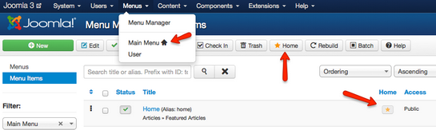
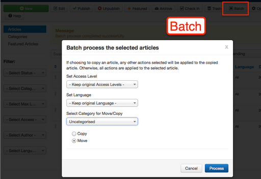
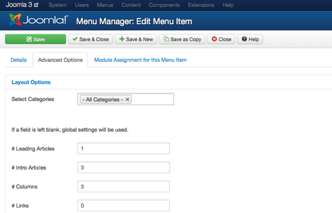
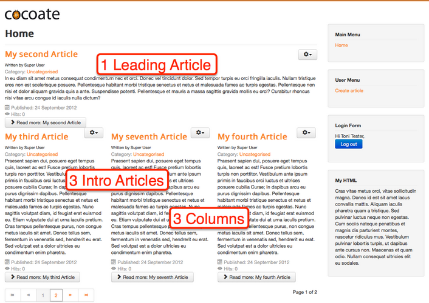
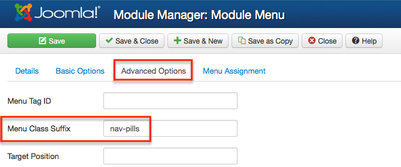
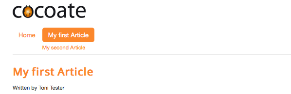

# Joomla! 3 十步建站第七步：内容排版

### 7. 内容排版

本系列教学转自 [Cocoate免费书库](http://cocoate.com/j3/what-is-joomla) ，英文原著由[Hagen Graf](http://cocoate.com/user/hagen-graf)编写，中文翻译由[Derek Joe](http://cocoate.com/zh-hans/derek-joe)完成

在您学会创建内容后，您需要考虑的自然就是怎么显示内容。这听起来容易但非常重要。

在上一章我们创建了一篇文章，并把它发布到了首页。  
访客只有访问首页时能阅读到这篇文章（只限于我们的示范）。

### 首页

标准的首页的菜单类型为“头版文章”。当您通过*菜单* → *菜单管理*访问主菜单时，您可能会留意到那个小小的“主页”标记。它的意思是这个菜单群里包含了首页链接（*图1*）。

*图1: 包含首页链接的主菜单*

编辑首页链接时，您有多种配置选项。“头版文章”菜单类型提供了头版头条、引言导读、多版块显示和链接导读等丰富的排版方式。要理解“头版文章”这种排版，我们需要几篇文章。为简明扼要起见，干脆拷贝您的第一篇文章。拷贝的方法是“另存为副本”，或者通过批量拷贝：即选择要拷贝的目标文章然后点击下面的批处理按钮（*图2*）。

*图2: 批量拷贝文章*

如果您有四五篇甚至更多的文章（别忘了要都设为“头版文章”），您就可以尝试不同风格的排版了。依次点击*菜单 → 主菜单 →*首页，找到“高级选项”标签，你可以看到默认是设置是：1篇头条文章、3篇引言分3列显示、页面中不带其它文章的标题链接（*图3*）。

*图3: 首页的排版*

现在您的首页效果看起来如*图4*。

*图4: 默认的首页*

### 分类和菜单

Joomla提供两种结果来组织网站内容：分类和菜单。每篇文章都属于一个分类。分类可以无限极。菜单可以指向某篇文章或者分类或者一系列文章，比如刚才示范的首页就对应于所有头版文章。这种既简单又容易拓展的方式为内容的表现提供了极佳的解决方案。

如您所知，Joomla的模板预设了一些位置。位置的作用是让您可以为网站内容和导航等元素安排合理的排版。

Joomla内容展示机制是通过模板的各个预设位置显示出模块即组件里的某些内容而实现的。Joomla网站的每个页面是由一个组件和数量没有限制的模块构成。

- 分类的创建和管理：*内容 → 分类管理*
- 菜单的创建和管理：*菜单 → 菜单管理*（创建菜单的更多内容请回顾：[*第5章： 关于用户、权限、模块和文章*](http://cocoate.com/node/10912)）

### 顶部导航

Joomla空白页面在默认模板的position-7这个位置有一个“主菜单”。我们使用模板Protostar时，*position-7*就在侧栏，但我们想要使主菜单显示在页面顶部。要达到这一排版目标，请点击*扩展 → 模块管理 → 主菜单，*并把这个模块重分配到*position-1*。在“高级选项”标签里将*菜单样式类的后缀*改为*“ nav-pills”*（前面有一个空格！） （*图5*）。

*图5: 菜单样式类的后缀*

这将影响到 输出的HTML代码中菜单样式类的后缀，如果操作正确，您的导航效果看起来将如*图6*。

*图6: 主菜单导航*

多个分类里的文章可以像首页那样进行“博客式排版”，也可以以列表式排版。两种方式都有丰富的排版设置。您只要找几个菜单项的类型试试，对此就会马上有体会。

使用Joomla内设的屈指可数的几种机制，您就可以获得令人惊讶的排版效果。

---

除特殊标明文章转自第三方网站，文章均由JOOMLASK.COM原创提供  
欢迎友情转载，请务必保留本文出处并引用本文链接： [Joomla! 3 十步建站第七步：内容排版](http://www.joomla178.com/joomla-share/joomla3-in-10-easy-steps/joomla3-in-10-easy-steps-7th-content.html)
