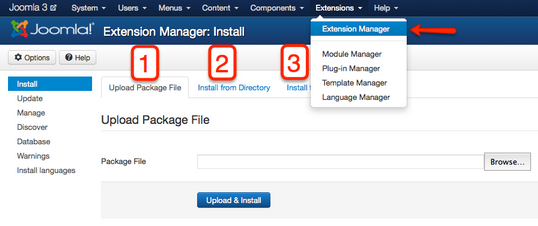

# Joomla! 3 十步建站第八步：功能扩展

### 8. 功能扩展

本系列教学转自 [Cocoate免费书库](http://cocoate.com/j3/what-is-joomla) ，英文原著由[Hagen Graf](http://cocoate.com/user/hagen-graf)编写，中文翻译由[Derek Joe](http://cocoate.com/zh-hans/derek-joe)完成

我们已经在“扩展管理”看到，Joomla 3本身带有一些核心扩展。并且我们已经和其中几个打过交道。作为网站用户您可能并不关心网站里有哪些功能扩展，而只要网站能按您的要求工作就行。不过作为一个超级管理员，您其实还是必须知道网站里到底有哪些东西在工作。回顾一下我们已接触的功能扩展：让我们能够编撰和管理文章并按不同的展示方式在网站发布的内容扩展、与用户管理相关的用户扩展、文章分类管理扩展，等等。

在“组件”菜单里，有旗帜广告、联系我们、Joomla升级、站内信息、新闻联播、重定向、站内搜索、智能搜索和友情链接。下面我们一起来简单了解一下这些组件及其相关的模块和插件。由于它们的使用方法和在Joomla 2.5里完全一样，我只是简要介绍下，并提供我们网站的Joomla 2.5教材里的详细介绍的链接。

### 旗帜广告

旗帜广告组件提供一个在您的网站展示广告的手段。一个旗帜广告由图片和自定义的HTML代码组成。每次您的网站被访问时，它就能在您旗帜广告库里调用并显示一个旗帜广告。如果用户点击旗帜广告，他就会被带到您的客户的网站。旗帜广告组件提供客户、分类、广告管理，以及详细的广告分析。  
有关*旗帜广告*组件更详细的介绍请访问我们的网站：[Joomla! 2.5基础教程系列 - Joomla! 2.5自带的扩展](../joomla-basic/joomla-base-guide-joomla25-default-extensions.md)（Joomla 2.5）

### 联系我们

每个网站都需要联系信息表单。根据实际需要，有时候您可能只需要一个联系信息表单，有时候则需要多个。比如企业网站有时候要展示多个部门的联系信息。甚至可能您要为每个员工或每个用户提供给一个联系信息表单。  
联系我们组件可以完成以上所有需求。

有关*联系我们*组件更详细的介绍请访问我们的网站：[Joomla! 2.5基础教程系列 - Joomla! 2.5自带的扩展](../joomla-basic/joomla-base-guide-joomla25-default-extensions.md)（Joomla 2.5）  
这是如果构建一个联系我们表单的介绍：[Joomla! 2.5基础教程系列 - Joomla! 2.5自带的扩展](../joomla-basic/joomla-base-guide-joomla25-default-extensions.md)

### Joomla升级

它让您可以选择Joomla自动升级的某个分支来保证你获得相关信息并让您的网站能够持续更新，即您可以选择跟随长期支持版本、标准支持版本、测试版本或完全自定义。

### 站内信息

站内信息是Joomla的核心组件，它负责给后台管理员传递私信，或者说它让后台管理员相互之间收发私信。它的使用很简单，但大家常常忘记自己可以配置该组件：*组件 → 站内信息 → 我的设置*。您可以设置为当网站有新信息时给你发邮件通知，或者在超过指定时间后删除信息，甚至你还可以关闭您的收件箱。

### 新闻联播

新闻源是一个方便大家订阅到各类新闻和信息的便利工具。不幸的是因为某些让人费解的原因，直至今天大家还是不常使用它。30年前我们购买报纸获得新闻；15年前我们通过浏览器访问一个个网站来获得新闻。今天，我们仍然可以使用这两种方式，但同时我们也可以使用一个新闻聚合器。[Google's reader](http://www.google.com/reader)和您的浏览器（如Firefox）的动态标签工具条都是很流行的工具。Joomla新闻联播组件也是一个聚合工具。虽然不及Google's reader复杂，但相当实用。

新闻联播组件让您可以获取其它网站的新闻源，并将相关新闻发布到自己的网站。

在今天这个网络社会化的时代，每个人基本都有一打帐号。最常见的如分享视频的youtube.com帐号，分享图片的flickr.com（中国人多么可怜）。而在一家公司，情况可能更加复杂。想象一下对于像Joomla这样的项目或您的公司，会有多少信息可以通过联播新闻源分享。

有关*新闻联播*组件更详细的介绍请访问我们的网站：[Joomla! 2.5基础教程系列 - Joomla! 2.5自带的扩展](../joomla-basic/joomla-base-guide-joomla25-default-extensions.md)（Joomla 2.5）

### 重定向

重定向管理是个了不起的功能。它在有人访问一个已经不存在的页面时将他/她转至一个有效页面。有个页面以前存在，并且被搜索引擎所收录，或者被其他人将其链接收录到他的网站里。当一个网站改版的时候这些情况是常会发生的。  
重定向组件通过一个看似简单的机制提供了便利。如果某人试图访问一个已经没有的路径，Joomla将显示一个404 - 未发现页面，并同时在重定向组件里创建一个新的纪录。这使得网站管理员不必因为要检查不工作的页面而疲于奔命。  
有关*重定向*组件更详细的介绍请访问我们的网站：[Joomla! 2.5基础教程系列 - Joomla! 2.5自带的扩展](../joomla-basic/joomla-base-guide-joomla25-default-extensions.md)（Joomla 2.5）

### 站内搜索

谁都希望能搜索您网站的内容。  
Joomla!默认提供全文搜索。全文搜索意味着Joomla!在您在搜索框里输入关键词后直接从数据库进行搜索。

多数人似乎应该能够理解这一点，但其实不然。很多搜索引擎都是先创建一个包含常用的搜索用词的搜索索引，在实际搜索时，它是在索引中寻找匹配的词条，并通过相应的词条链接到实际内容。这也就是说：搜索结果是基于索引和其中的链接。

基于索引的搜索通常比全文搜索更快，但索引需要在网站发生变化时进行更新，否则就无法搜索到新内容。为了弥补搜索速度不及基于索引的搜索功能的缺点，Joomla!是高度可配置的。有关*站内搜索*组件更详细的介绍请访问我们的网站：[Joomla! 2.5基础教程系列 - Joomla! 2.5自带的扩展](../joomla-basic/joomla-base-guide-joomla25-default-extensions.md)（Joomla 2.5）

### 智能搜索

智能搜索是Joomla 2.5开始有的新功能，并在Joomla 3里得到了提升。  
它给Joomla!核心提供了更灵活、更快速同时还是自动完成并且还给用户“您的意思是否是”这种类型的推荐意见（词干花）的“智能化”的搜索引擎。

> ***Stemming（词干花）？**  
> 在英文中，词干分析器要能够识别字串“cats”（以及“catlike”、“catty”等等），因为它是基于词根“cat”。这正如“stemmer”、“stemming”、“stemmed”都是基于“stem”。词干算法能够确定单词fishing、fished、fish及fisher的词根是fish。（[Wikipedia](http://en.wikipedia.org/wiki/Stemming)）。*

Joomla核心智能搜索包含一个英语词干分析器和一个所谓的Snowball Stemmer（扩展→ 智能搜索 → 选项）。英语词干分析器好呆了。Snowball词干分析器则需要PHP的Stem扩展提供14种语言的支持。这14种语言是丹麦语、德语、英语、西班牙语、芬兰语、法语、匈牙利语、意大利语、挪威语、荷兰语、葡萄牙语、罗马尼亚语、俄语和土耳其语（……知道为什么没有中文吗）。

智能搜索的灵活性和快速性需要数据先被索引。

有关*智能搜索*组件更详细的介绍请访问我们的网站：[Joomla! 2.5基础教程系列 - Joomla! 2.5自带的扩展](../joomla-basic/joomla-base-guide-joomla25-default-extensions.md)（Joomla 2.5）

### 友情链接

有了友情链接组件，您就可以创建一个链接列表或者为您的网站建立一个下载单元。为了很好地服务于这种需求，Joomla!提供了无限分类系统和链接点击数统计功能。该组件有助于编制链接目录：添加无限制的友情链接分类，在每个分类里创建您需要的所有链接，然后添加一个菜单链接，选择一种排版并通过选项做好相关的设置。  
有关*友情链接*组件更详细的介绍请访问我们的网站：[Joomla! 2.5基础教程系列 - Joomla! 2.5自带的扩展](../joomla-basic/joomla-base-guide-joomla25-default-extensions.md)（Joomla 2.5）

### 第三方功能扩展

在Joomla扩展库（<http://extensions.joomla.org/>）您能够在10,000多个具有不同功能的扩展（至2012年11月已经有*613个兼容Joomla 3）*中找到能够为您的网站锦上添花的扩展。

通过扩展管理器（*扩展 → 扩展管理*）您能够在后台管理直接安装、升级、搜寻和管理扩展。

### 管理扩展

三步即可让您安装扩展（*表1*）：

1. **上传一个压缩包文件**  
   如果您已经将一个Joomla!扩展的zip文件下载到您的本地电脑，您可以采用该方式上传并安装该扩展。
2. **通过本地目录安装**  
   如果您已经将一个Joomla!扩展的zip文件下载到您的服务器的某个目录，您可以采用该方式解压并安装该扩展。
3. **通过网址安装**  
   如果您已知一个Joomla!扩展的zip文件所在的网址，您可以采用该方式下载、解压并安装该扩展。

*表1: 安装扩展*

扩展管理器还可以升级、管理（启用、禁用）以及安装语言。

探索对话框允许你检查哪些扩展没有通过常规安装流程。使用该功能您可以通过如FTP或SFTP等方式将扩展文件上传到您的web服务器的适当的目录，并进行安装。

---

除特殊标明文章转自第三方网站，文章均由JOOMLASK.COM原创提供  
欢迎友情转载，请务必保留本文出处并引用本文链接： [Joomla! 3 十步建站第八步：功能扩展](http://www.joomla178.com/joomla-share/joomla3-in-10-easy-steps/joomla3-in-10-easy-steps-8th-extensions.html)
