# Joomla! 3 十步建站第四步：设计、界面、颜色

### 4. 设计、界面、颜色

本系列教学转自 [Cocoate免费书库](http://cocoate.com/j3/what-is-joomla) ，英文原著由[Hagen Graf](http://cocoate.com/user/hagen-graf)编写，中文翻译由[Derek Joe](http://cocoate.com/zh-hans/derek-joe)完成

模板是一个网站最重要的部分。它为网站提供外观设计，并吸引新访客在您的网站逗留和浏览。普通访客和用户都会因漂亮且实用的设计而心情愉悦。比如我们想想其它产品：一辆汽车需要一个强劲的引擎和耐用的轮胎，但促使人们购买的最重要的因素还是设计。即使设计不是主要原因，它常常也是勾起购买冲动，或者引发消费者考虑更实在的理由的的一个导火索。如果设计做得很好，人们很自然地就会期待其它方面也很好（*图1, 图2*）！

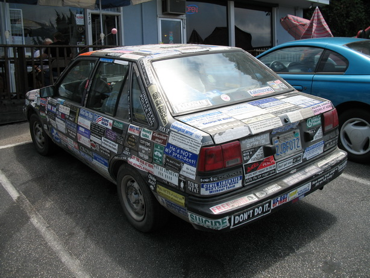

*图1：满身贴纸的轿车 （[Richardmasoner](http://www.flickr.com/photos/bike/)） -<http://www.flickr.com/photos/bike/201402884>*

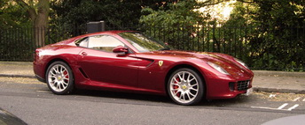

*图2：红色轿车 （[FotoSleuth](http://www.flickr.com/photos/51811543@N08/)） - <http://www.flickr.com/photos/51811543@N08/4978639642>*

这两辆车针对的是不同的目标人们。它们也是为达到它们的目标而采用迥然不同的设计的范例。

### 几个概念

我将仅仅介绍几个概念来启发你。

### 什么叫设计？

- 设计作为名词，指的是通过一个计划或者绘画显示某事物的功能和前景，并在一定的环境达到某个特定的目标，并满足一系列的需求。
- 设计作为动词，指的是在一个设计环境下创造一个设计。

因此设计一词可以用于

- 艺术（“纯直觉的”、“内在的”、“自然的”、“我们感觉合适的”）
- 机械工程（一款新车的产品设计）
- 生产制造（计划和执行）
- 流程（业务流程建模）

### 什么是页面布局？

页面布局是“图片”设计的一部分工作，它主要解决一个页面的风格元素（如内容）以及这些元素的页面安排。以Joomla的专业术语来说，页面布局就是在预定的模板位置安排Joomla的模块和组件。

### 什么是颜色？

颜色是人类的视觉财产，是我们称之为红色、绿色、蓝色等等视觉感觉的总称。常有些特定的颜色与文化如国旗的颜色相关。颜色的应用具有多样性，它们与文化的联系甚至与同一种文化不同年代的联系也是多元化的。  
[HTML颜色](http://www.w3schools.com/html/html_colors.asp)和[CSS颜色](http://www.w3schools.com/cssref/css_colors.asp)有1600万种不同的颜色值。它们由红色、绿色、蓝色混合而成，每种颜色的最小值是 0，最大值是 255。这些值最终组合成超过1600万种不同的颜色（256 x 256 x 256）。  
举例：**黑色** = 16进制颜色中的#000000 = RGB颜色中的 rgb（0,0,0）  
有几个工具（如[color scheme designer](http://colorschemedesigner.com/)）可以帮助你为你的网站找到正确的颜色（*图3*）。

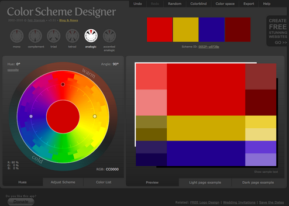

*图3：Color Scheme Designer（配色方案设计师）*

### 模板

一个模板包含访问网站的人可以看到的重复性的元素。使用一个模板编排这些元素，往往可以减少对图片设计技巧的要求，并且把背景元素的修改和其它常用前景内容元素的修改（或交替）的工作量降低最低。

### 网页设计

网页设计有点像利用手工和很多种技能来制作和维护网站。  
网页设计必须要能具备HTML、CSS、JavaScript、PHP、图片编辑以及其它一些技能。  
Joomla!只是网页设计师的工具箱中的一个工具。  
  
一个优秀的模板并不仅仅与颜色和图片相关。内容表现的形态和位置排列也很重要。网站必须是用户友好的和可靠的——这让我再次联想到了上面的两辆靓车。  
网页设计是个年轻的职业。现在的网页设计师常常要应对低带宽、浏览器不兼容、青涩的内容编辑器以及一起协作于“漂亮”网站的其他人。在构建一个Joomla!网站时，参与工程的每个人常常都会学到一些新知识。在使用Joomla 3设计网站时，其中的模板“Protostar”会让你了解Joomla用户界面库（JUI）。  
优秀的网站设计源自辛苦的工作！：-）  
用自己需要的语种安装好网站后，即使还没有内容，多数人就已经开始为颜色而苦恼，并且急于上传一些东西，比如一个新Logo。好在Joomla为用户预备了几个模板以及所谓的模板风格。一个模板风格就是为模板准备的一系列与颜色、logo、界面相关的选项。风格的变化能力完全取决于模板。一些模板具有海量的设置，而另外一些模板的设置则非常少。  
因此您可以随心所欲设计很多种风格并把它们分配到您网站的不同页面。

### 结构

Joomla以其高质量和简单而著称。Joomla网站的一个页面可以是由一个组件、几个模块和一个模板输出的HTML代码而生成的。每个页面都能通过一个唯一的网址而访问到。以首页为例，内容组件通过输出HTML代码在中间区域显示文章。这张截图是使用Joomla模板“Beez”（*图4*）时截取的。文章周围的方形区域是几个不同的模块。你可以把组件的HTML输出和任意数量的模块的HTML输出相组合。模块还可以在其它页面重复使用。

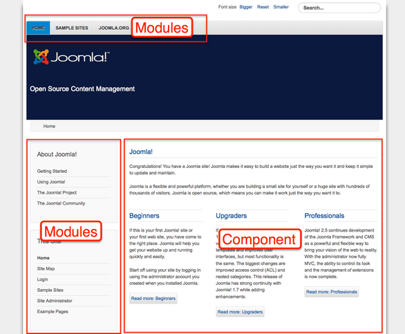

*图4：Joomla!首页*

### 位置

当然，您必须知道您能把模块分配到页面的哪些地方。为达到这一点，每个模板都提供了所谓的“位置”。为了了解这些位置的分布，您必须开启“模块位置预览”开关（*扩展 → 模板管理 → 选项*）。随后您即可通过在网址后面加*tp=1*访问您的网站（*<http://your_domain.tld/index.php?tp=1>*）或者点击*扩展 → 模板扩展*→ 模板（*图5*），再在任何一个模板边点击“预览”链接。

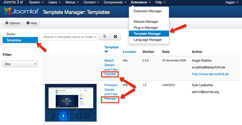

*图5：模板管理 - 网站模板*

您将看到高亮显示的模块位置及其名称（*图6*）。

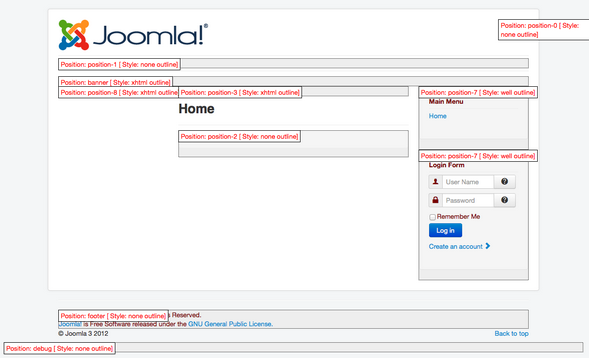

*图6：模块位置 - 模板Protostar*

点击*扩展 → 模块管理*，您就能将某个模块分配到某个位置。如果您希望一个模块同时在几个不同的位置显示，您可以复制它。

### 核心模板

Joomla!安装包本身带来2个网站模板和2个后台管理模板。您可点击*扩展 → 模板管理 → “模板”标签*。您还可以通过在下拉框“选择位置”里选择不同的选项，来筛选出前台模板和后台模板。（*图6*及*图7*）.

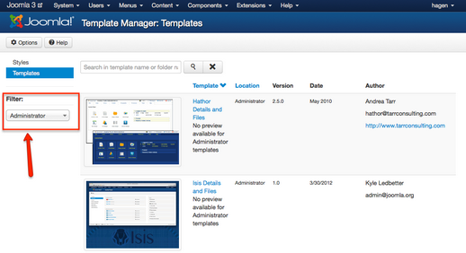

*图7：模板管理 - 后台管理模板*

### 风格

风格能够让您创造和使用同一个模板的不同“版本”。一个模板至少有一种风格。您通过更改模板的配置即可产生不同的风格，比如改变颜色或上传头部需要的logo。您可通过*扩展 → 模板管理 → 风格*来为您的网站设置不同的风格。

### 示例：一个个性化的风格

让我们一起来为我们的网站创建一个个性化的风格：

- Name：cocoate
- Template Colour：#f88638
- Fluid Layout

您可以拷贝这些信息并应用到您正在创建中的额外的风格。如我即已用到模板Protostar里了（*图8*）。

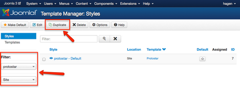

*图8 - 一种复杂的风格*

填写风格的名称，并设置它为所有语言的默认模板。如果您的是多语言Joomla网站，您可以为不同的语言设置不同的风格。（*图9*）

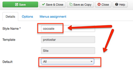

*图9 - 设置模板的一个风格*

通过“选项”标签，您可以选择一个模板和一个背景颜色，上传一个logo，并将模板设置为固定或动态宽度（*图10, 图11*）。

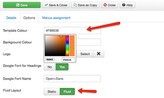

*图10 - 风格的“选项”标签*

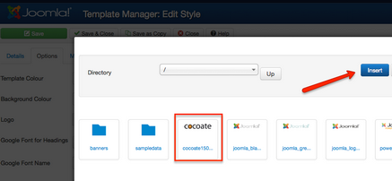

*图11 - 上传logo*

每种风格都可（必须）被分配给一个菜单项。比如，如果您想访客点击菜单项A时，网站的背景色为绿色。访客点击菜单项B时，网站的背景色为蓝色，你可以为它们分配相应的风格。在我的示范中，我只有一个菜单项，因为到现在为止，我的网站还没有内容。我将新的风格分配到菜单项“主页”（*图12*）。

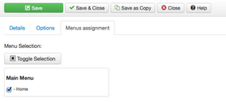

*图12 - 菜单分配*

保存风格后，网站看上去就不同了（*图13*）， 并且因为模板Protostar良好的兼容性，网站在移动设备上能够完美展示（*图14*） 。

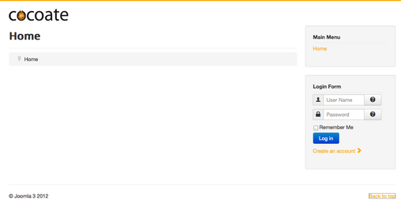

*图13 - 台式PC机里的网站*

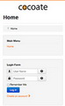

*图14 - 移动设备中的网站*

### 在线编辑模板文件

如果您明白页头标题的缩略词，您实际上可以直接设置模板。模板是Joomla的基础，它由几个文件组成。而我们完全可以在线改变某个模板的核心元素。  
如果您想编辑模板“Protostar”，您须访问*扩展 → 模板管理 → 模板 → Protostar*获取细节和文件：点击指向文件的链接即可。

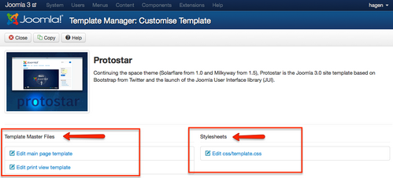

*图15：在线编辑模板文件*

我们当然也可以用外部编辑器来编辑这些文件。  
Joomla网站的模板文件位于文件夹/templates。每个模板都有它对应的文件夹。在文件夹/templates/systems里您还能找到编辑网站关闭和页面报错的模板对应的文件。  
后台管理的模板位于文件夹*/administrator/templates。*

---

除特殊标明文章转自第三方网站，文章均由JOOMLASK.COM原创提供  
欢迎友情转载，请务必保留本文出处并引用本文链接： [Joomla! 3 十步建站第四步：设计、界面、颜色](http://www.joomla178.com/joomla-share/joomla3-in-10-easy-steps/joomla3-in-10-easy-steps-design.html)
